# v5：真实—仿真一致性指标与逐变量成像实验

日期：2026-11-23。先读指标结论，再看每个变量的实际图片。用户提供的 v4 总结作为知识来源，历史文档中的流程说明没有被当作本次新增执行指令。

本次完成 **67 组 Isaac 原生参数扫描 + 120 组离线模型实验，共 187 组**；每组 2～3 档，每档 5 帧。原生扫描 995 帧，模型输出 1780 帧，另有六路相机各 5 帧、97 帧 240 Hz 运动状态辐射图及 5 帧独立静态辐射输入。模型输出不是额外的 Isaac 相机采集。

**检索找到了更适合的候选指标：SEDD（非配对风格差）、IPD（实例性能差）和 CPD（上下文条件下的性能分布差）。没有证据表明其中任何一个分数能单独认证完整相机一致性。** 本次已使用作者预训练权重跑通 SEDD；物理成像与业务任务验收仍需新的实拍靶/真值数据。

[可搜索图片浏览器](index.html) · [论文、指标选择与公式](docs/01_论文与一致性指标.md) · [实验协议与模型边界](docs/02_实验协议.md) · [v4 逐项覆盖表](docs/03_v4参数覆盖与边界.md) · [全部数值 CSV](analysis/parameter_metrics.csv) · [验证记录](analysis/validation_summary.json)

## 1. 实验场景与证据范围

场景实际引用本地 Isaac Sim 6.2 Simple Room，使用其原有桌子，摆放来自 `v3/meshes` 的香蕉、甜椒、瓶子、黄瓜、砧板、鸡蛋、葡萄、刀、壶和盘子。另加入中性/颜色块、斜边、高频条纹、不同深度靶和运动目标。GLB 经 Omni asset converter 转成 USD，源文件未修改；摆放位置、尺寸、灯光和演示相机曝光是实验假设。

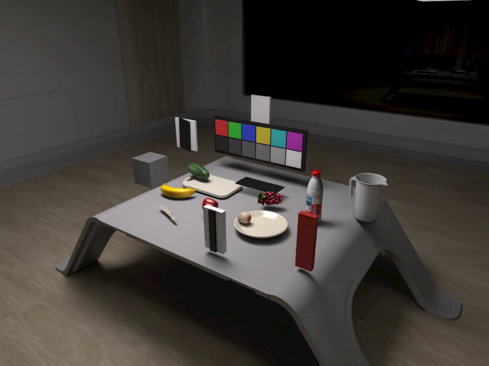

场景入口：[simple_room_lab.usda](scene/simple_room_lab.usda)。Isaac 原始 RGB8 与固定 sRGB OETF 预览分开保存；HdrColor 作为 renderer linear RGB 输入，不称为 sensor RAW。初始化时观察到的曝光/编码差异、运行时投影和全部参数记录均保留。

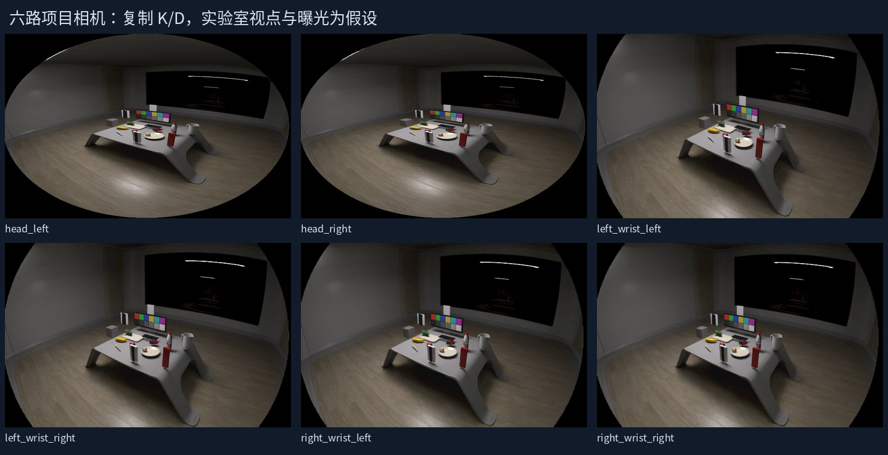

六路来源为 head / left_wrist / right_wrist 的左右目，逐路保留 K、D 与原始安装合同，半分辨率输出。本场景给它们安排了实验室观察位置，未声称恢复真实机器人同步姿态；头部历史标签冲突仍未实拍确认。见 [六路配置](configs/project_camera_profiles.json)。

## 2. 指标检索与实际 SEDD 试算

SEDD 使用浅层 Gram 风格表示和学习得到的 64 维 embedding。此处比较真实实验室与 Simple Room 的非配对图片，且预训练模型来自道路数据；因此数值是**外观诊断，不是相机合格证**。[论文 v3](https://arxiv.org/abs/2510.10203v3)、[作者实现](https://github.com/Dingyi-Yao/SEDD)。

| 相机 | 真实/仿真帧数 | SEDD1 | SEDD2（作者代码 γ=10）| SEDD2（论文 σ=10）| 真实—真实分半 SEDD1 |
|---|---|---|---|---|---|
| head_left | 10 / 5 | 0.26122 | 0.988907 | 0.000682 | 0.00203 |
| head_right | 10 / 5 | 0.25764 | 0.969883 | 0.000664 | 0.00404 |
| left_wrist_left | 10 / 5 | 0.12897 | 0.306335 | 0.000166 | 0.00394 |
| left_wrist_right | 10 / 5 | 0.15709 | 0.437169 | 0.000247 | 0.00420 |
| right_wrist_left | 10 / 5 | 0.14161 | 0.363225 | 0.000200 | 0.00241 |
| right_wrist_right | 10 / 5 | 0.19570 | 0.636109 | 0.000383 | 0.00386 |

论文和公开实现的核带宽约定不同，故两套 SEDD2 都报告；本次推理使用固定多 crop，与作者随机 crop/flip 协议也不同，不能对照论文表格验收。来源和权重 SHA256 见 [试算完整记录](analysis/sedd_pilot.json)。图像邻近、场景数少，使真实—真实分半差偏小，不能据此设通用阈值。

建议验收同时保留几何、响应/颜色、光学/噪声、时间和任务差向量。需要任务行为一致时采用 [IPD](https://arxiv.org/html/2411.07375v1)；缺精确配对时考察 [CPD 与上下文覆盖](https://arxiv.org/html/2208.01022v1)。当前未补造 IPD/CPD、色卡 ΔE、真实 MTF 或真实噪声测量。

## 2.1 汇总曲线与几个可直接核对的发现

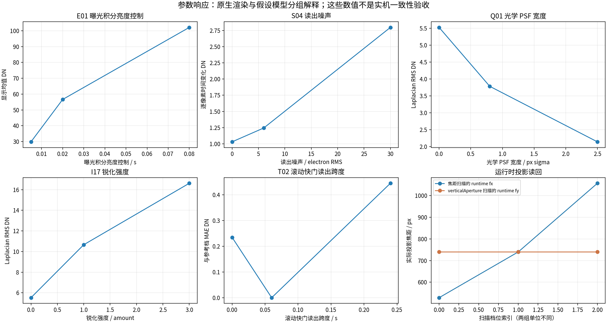

- G01 焦距 25 / 35 / 50 mm 对应运行时 fx 约 528.57 / 740.00 / 1057.14 px，视场变化可见。
- G03 三档 verticalAperture 的运行时 fy 都约 740 px，说明本路径不能仅靠这个声明值独立调整 fy；D02 使用另一镜头参数接口单独扫描。
- E05 的曝光补偿档位没有呈现预期倍率；保留当前版本原生响应，不用离线效果替代。
- S04 读出噪声、Q01 PSF、I17 锐化和 T02 行间时间模型都有各自的曲线和图片；模型曲线只验证实现与设定的关系。
- 相同静态亮度可能来自不同曝光/增益分配，T12 的时间标签也可以变化而像素不变。不能看到图一样就推断全部参数相同。

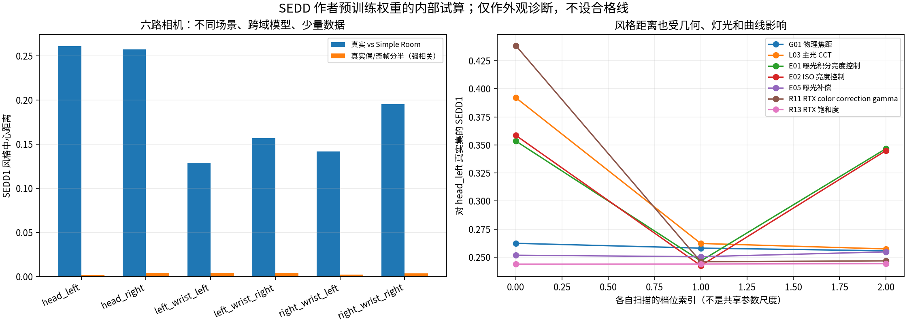

SEDD 会同时响应焦距、CCT、曝光、gamma 和饱和度，这正说明一个风格距离不能唯一定位相机参数。六路的配置证据逐项表在 [alignment_audit.csv](configs/alignment_audit.csv)，全部真实物理验收状态仍保留 NOT_EVALUATED。

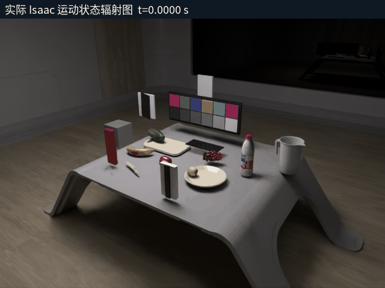

上图为实际渲染状态序列的慢放预览，不是实机视频。滚动读出高档采用 240 ms，以放大可见形变，属于演示设置，不代表 AVS 工作模式。

## 3. 怎样看下面每张图

每组只改变一个逻辑参数，其余条件固定；`固定上下文` 对该组所有档位一致。第一排是每档第 5 帧，第二排为同一 ROI 的均图放大，第三排为相对参考档的显示 RGB 绝对差 ×4。重复帧联系表可以打开查看全部 5 次。展示中的统一缩略尺寸只用于排版，分析保留原始图像尺寸。

时间模型中的确定性组复用同一段渲染运动序列，五次输出可能完全相同；它们不是五次独立动态采集，也不用于估计真实时间噪声。

“重复帧逐像素波动”是本次管线输出随重复采集的变化，包含渲染器历史/Monte Carlo 波动和模型噪声，**不等于实机 sensor temporal noise**。均值/边缘能量/高低码值比例用于解释响应，不用它们直接给异内容真实/仿真图片评合格。

## 4. 全部参数的图片对比

### 几何

#### G01　物理焦距

类型：Isaac 原生渲染。扫描值：`[25, 35, 50]`；单位：mm。固定上下文：`{}`。

其他设置采用本组基准，完整配置随每帧保存。

显示 RGB 均值范围 56.86～63.76 DN；相对参考档最大均图差 36.401 DN，平均重复帧逐像素波动 0.253 DN。

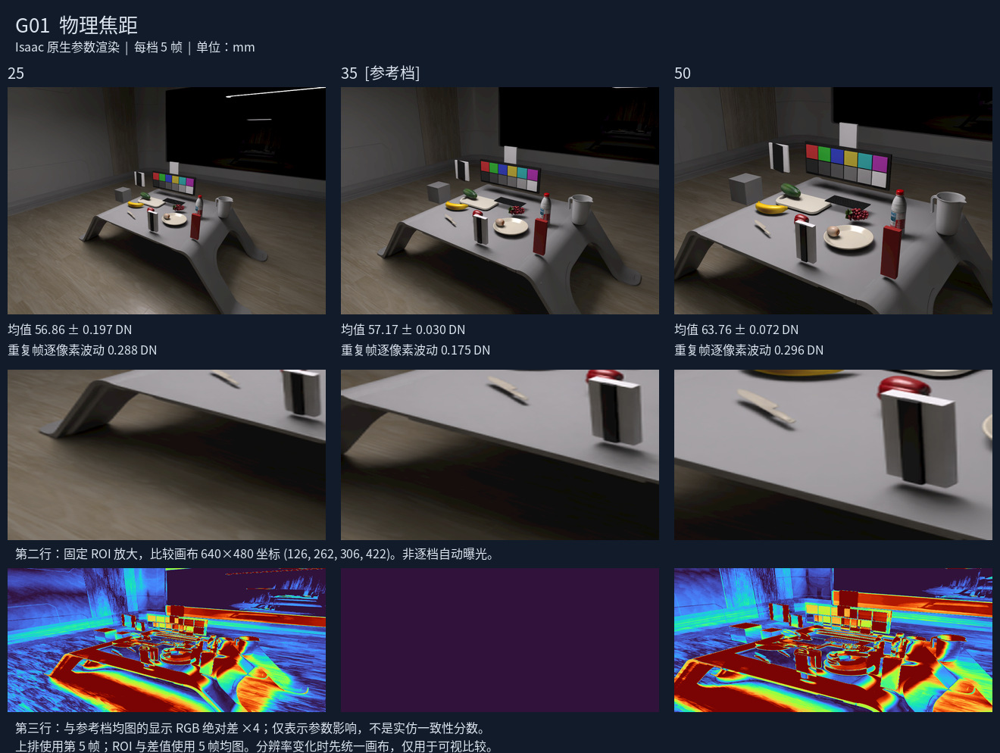

[全部重复帧](comparisons/G01_repeats.jpg) · [原始逐帧记录](analysis/native_frames.jsonl)

#### G02　水平 filmback aperture

类型：Isaac 原生渲染。扫描值：`[0.3, 0.4540540540540541, 0.65]`；单位：USD 光学单位。固定上下文：`{}`。

其他设置采用本组基准，完整配置随每帧保存。

显示 RGB 均值范围 56.88～66.93 DN；相对参考档最大均图差 40.097 DN，平均重复帧逐像素波动 0.248 DN。

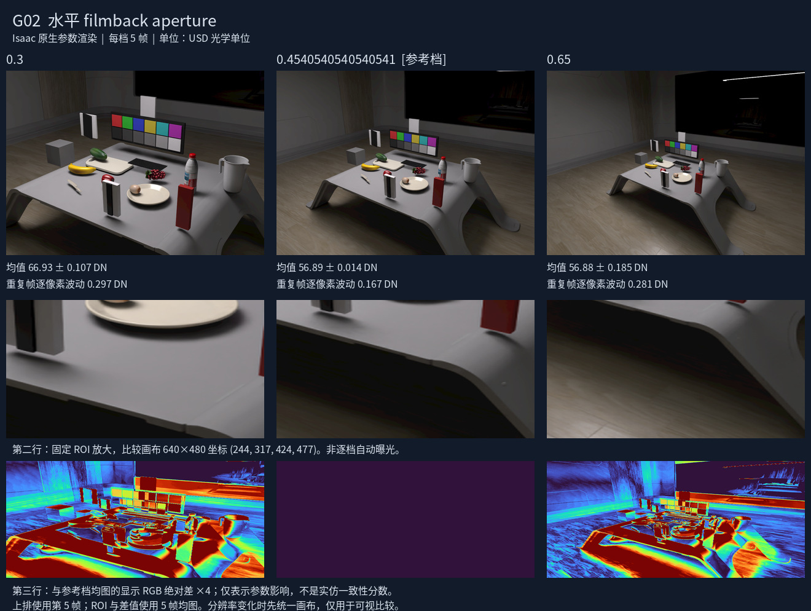

[全部重复帧](comparisons/G02_repeats.jpg) · [原始逐帧记录](analysis/native_frames.jsonl)

#### G03　垂直 filmback aperture

类型：Isaac 原生渲染。扫描值：`[0.22, 0.3405405405405405, 0.48]`；单位：USD 光学单位。固定上下文：`{}`。

本机可能强制方形像素；观察不到变化也是需要保留的结论。

显示 RGB 均值范围 55.72～55.81 DN；相对参考档最大均图差 0.235 DN，平均重复帧逐像素波动 0.163 DN。

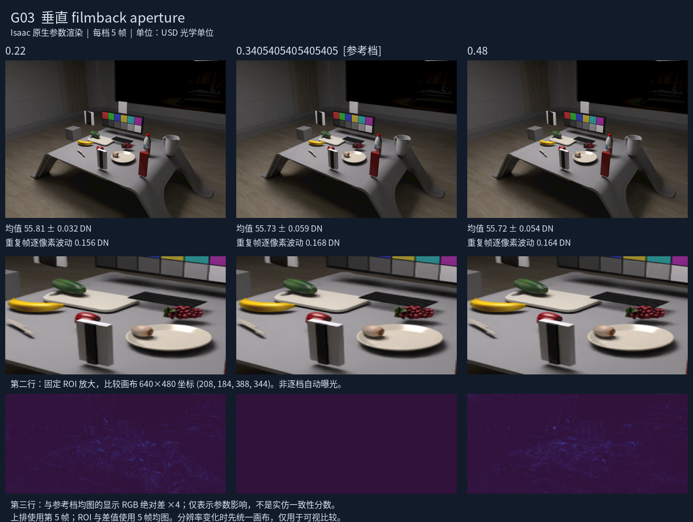

[全部重复帧](comparisons/G03_repeats.jpg) · [原始逐帧记录](analysis/native_frames.jsonl)

#### G04　主点 cx

类型：Isaac 原生渲染。扫描值：`[400, 479.5, 560]`；单位：px。固定上下文：`{}`。

其他设置采用本组基准，完整配置随每帧保存。

显示 RGB 均值范围 51.82～59.28 DN；相对参考档最大均图差 23.087 DN，平均重复帧逐像素波动 0.180 DN。

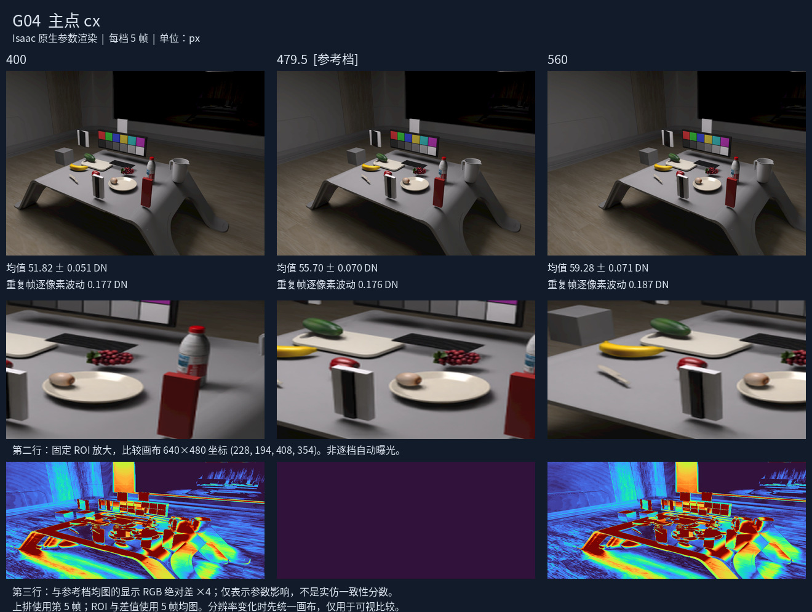

[全部重复帧](comparisons/G04_repeats.jpg) · [原始逐帧记录](analysis/native_frames.jsonl)

#### G05　主点 cy

类型：Isaac 原生渲染。扫描值：`[280, 359.5, 440]`；单位：px。固定上下文：`{}`。

其他设置采用本组基准，完整配置随每帧保存。

显示 RGB 均值范围 50.66～61.96 DN；相对参考档最大均图差 29.297 DN，平均重复帧逐像素波动 0.176 DN。

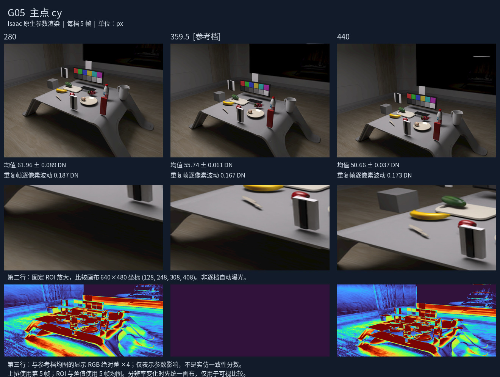

[全部重复帧](comparisons/G05_repeats.jpg) · [原始逐帧记录](analysis/native_frames.jsonl)

#### G06　位置 X

类型：Isaac 原生渲染。扫描值：`[1.3, 1.5, 1.7]`；单位：m。固定上下文：`{}`。

仅平移，保持原方向，不重新 look-at。

显示 RGB 均值范围 54.61～57.43 DN；相对参考档最大均图差 14.946 DN，平均重复帧逐像素波动 0.181 DN。

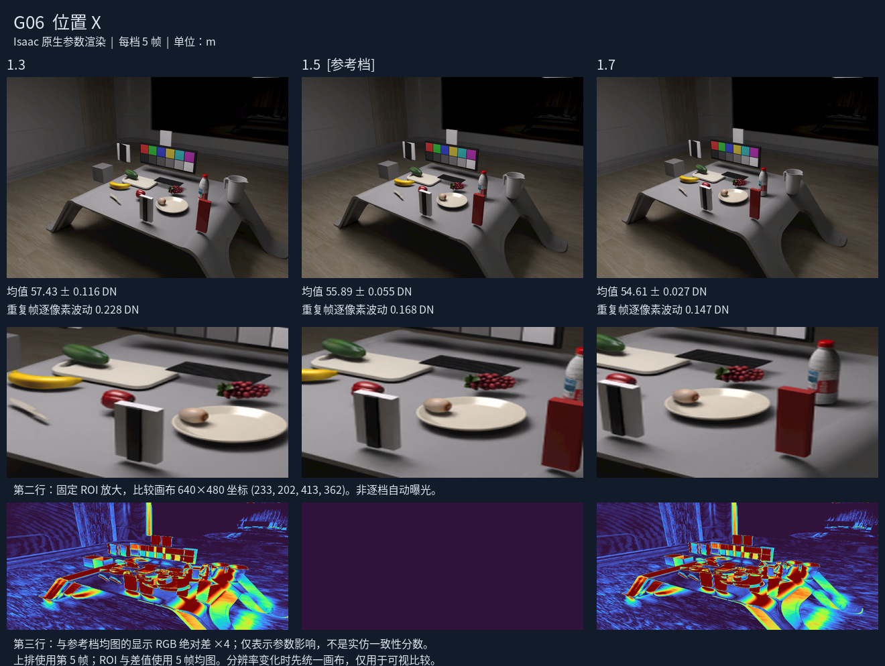

[全部重复帧](comparisons/G06_repeats.jpg) · [原始逐帧记录](analysis/native_frames.jsonl)

#### G07　位置 Y

类型：Isaac 原生渲染。扫描值：`[-2.4, -2.2, -2.0]`；单位：m。固定上下文：`{}`。

仅平移，保持原方向，不重新 look-at。

显示 RGB 均值范围 55.46～56.19 DN；相对参考档最大均图差 18.386 DN，平均重复帧逐像素波动 0.187 DN。

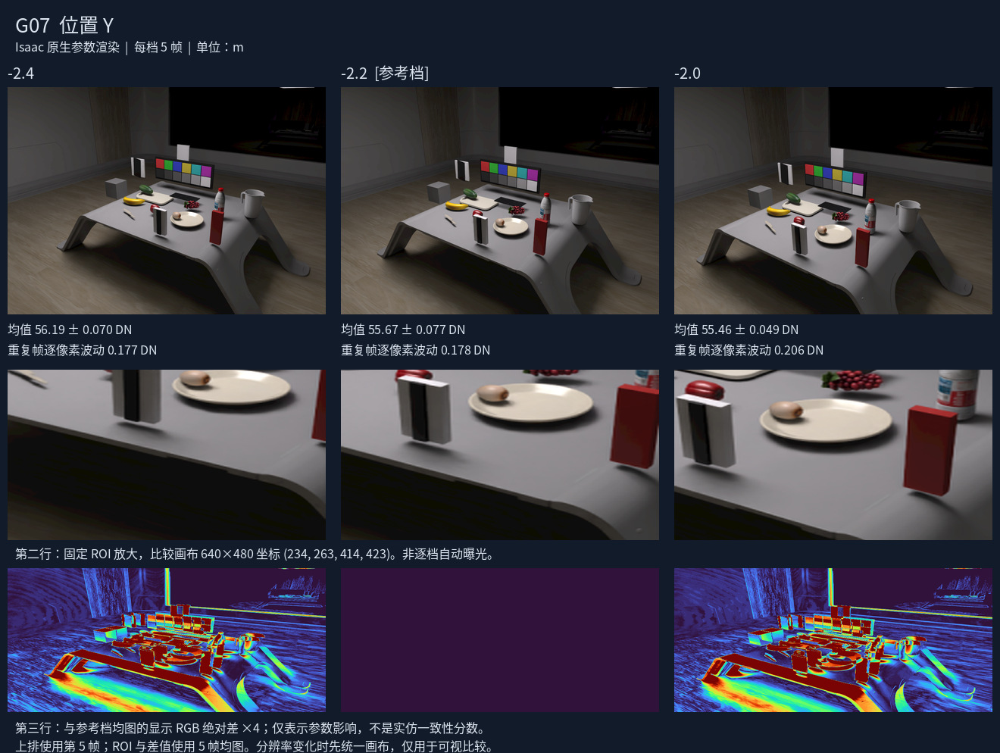

[全部重复帧](comparisons/G07_repeats.jpg) · [原始逐帧记录](analysis/native_frames.jsonl)

#### G08　位置 Z

类型：Isaac 原生渲染。扫描值：`[1.8, 2.1, 2.4]`；单位：m。固定上下文：`{}`。

仅平移，保持原方向，不重新 look-at。

显示 RGB 均值范围 54.98～56.80 DN；相对参考档最大均图差 25.021 DN，平均重复帧逐像素波动 0.167 DN。

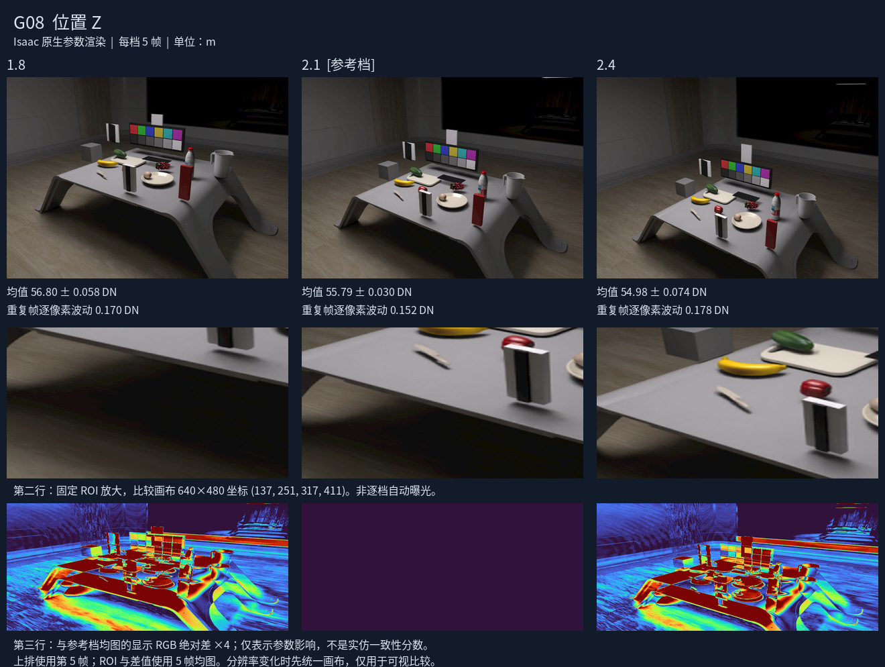

[全部重复帧](comparisons/G08_repeats.jpg) · [原始逐帧记录](analysis/native_frames.jsonl)

#### G09　局部 Y 轴转角

类型：Isaac 原生渲染。扫描值：`[-10, 0, 10]`；单位：degree。固定上下文：`{}`。

其他设置采用本组基准，完整配置随每帧保存。

显示 RGB 均值范围 49.02～62.36 DN；相对参考档最大均图差 30.613 DN，平均重复帧逐像素波动 0.168 DN。

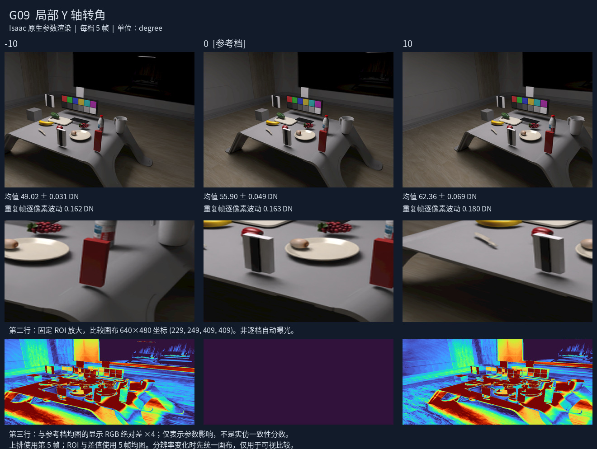

[全部重复帧](comparisons/G09_repeats.jpg) · [原始逐帧记录](analysis/native_frames.jsonl)

#### G10　局部 X 轴转角

类型：Isaac 原生渲染。扫描值：`[-10, 0, 10]`；单位：degree。固定上下文：`{}`。

其他设置采用本组基准，完整配置随每帧保存。

显示 RGB 均值范围 51.53～68.72 DN；相对参考档最大均图差 39.674 DN，平均重复帧逐像素波动 0.217 DN。

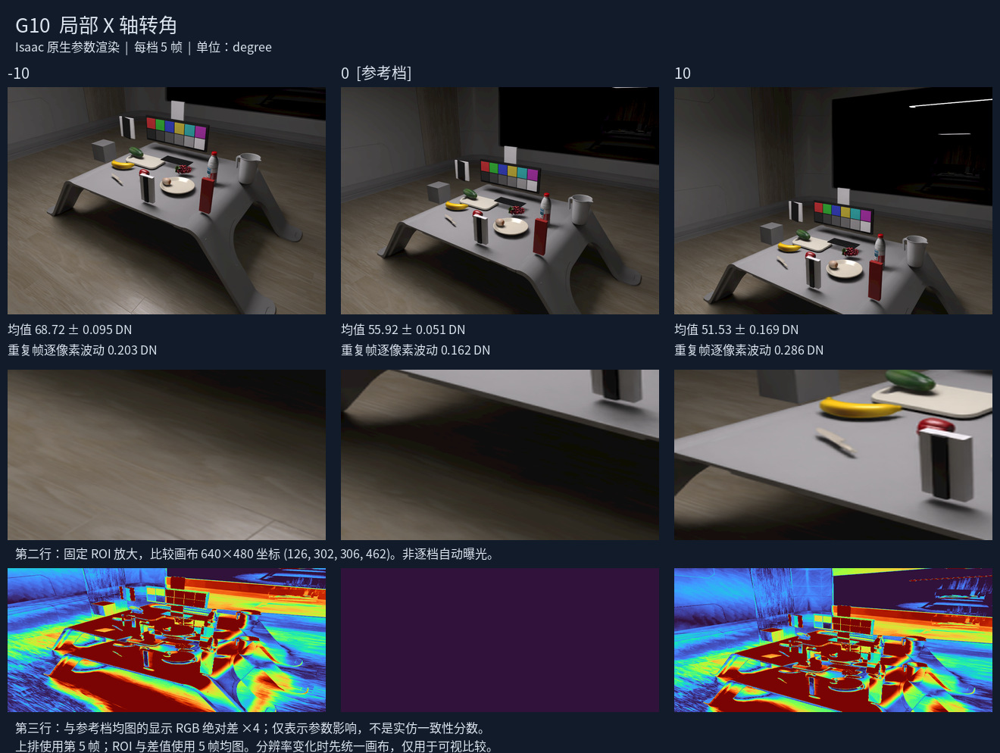

[全部重复帧](comparisons/G10_repeats.jpg) · [原始逐帧记录](analysis/native_frames.jsonl)

#### G11　局部 Z 轴转角

类型：Isaac 原生渲染。扫描值：`[-10, 0, 10]`；单位：degree。固定上下文：`{}`。

其他设置采用本组基准，完整配置随每帧保存。

显示 RGB 均值范围 54.92～57.02 DN；相对参考档最大均图差 18.898 DN，平均重复帧逐像素波动 0.176 DN。

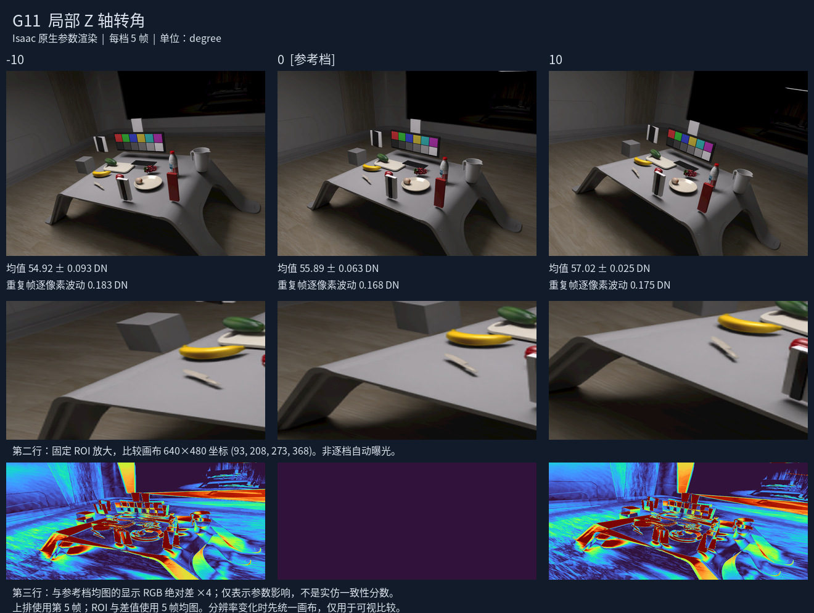

[全部重复帧](comparisons/G11_repeats.jpg) · [原始逐帧记录](analysis/native_frames.jsonl)

#### G12　near clipping

类型：Isaac 原生渲染。扫描值：`[0.01, 2.7, 3.2]`；单位：m。固定上下文：`{}`。

其他设置采用本组基准，完整配置随每帧保存。

显示 RGB 均值范围 33.50～55.18 DN；相对参考档最大均图差 24.316 DN，平均重复帧逐像素波动 0.142 DN。

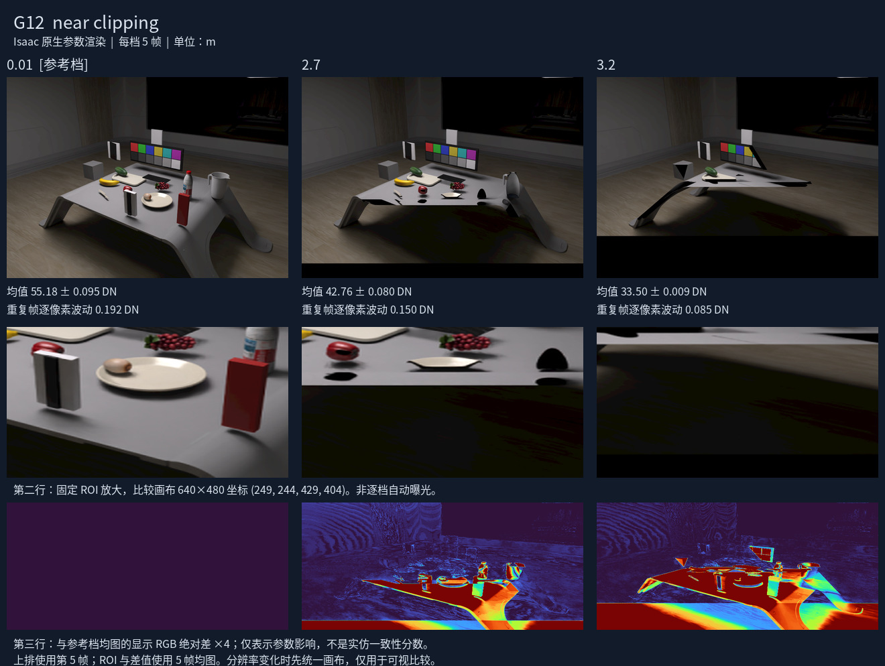

[全部重复帧](comparisons/G12_repeats.jpg) · [原始逐帧记录](analysis/native_frames.jsonl)

#### G13　far clipping

类型：Isaac 原生渲染。扫描值：`[2.7, 3.3, 100]`；单位：m。固定上下文：`{}`。

其他设置采用本组基准，完整配置随每帧保存。

显示 RGB 均值范围 14.55～54.38 DN；相对参考档最大均图差 39.841 DN，平均重复帧逐像素波动 0.172 DN。

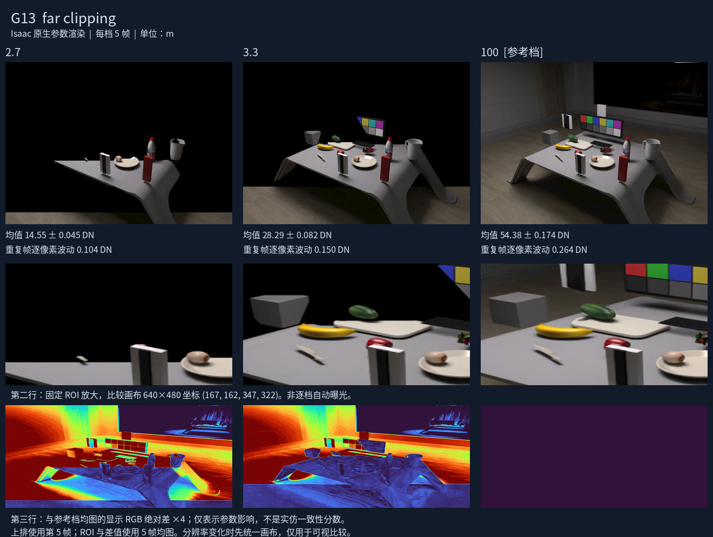

[全部重复帧](comparisons/G13_repeats.jpg) · [原始逐帧记录](analysis/native_frames.jsonl)

### 光学

#### O01　对焦距离

类型：Isaac 原生渲染。扫描值：`[0.8, 2.7, 8]`；单位：m。固定上下文：`{"fstop": 1.0}`。

其他设置采用本组基准，完整配置随每帧保存。

显示 RGB 均值范围 55.75～57.41 DN；相对参考档最大均图差 4.918 DN，平均重复帧逐像素波动 0.140 DN。

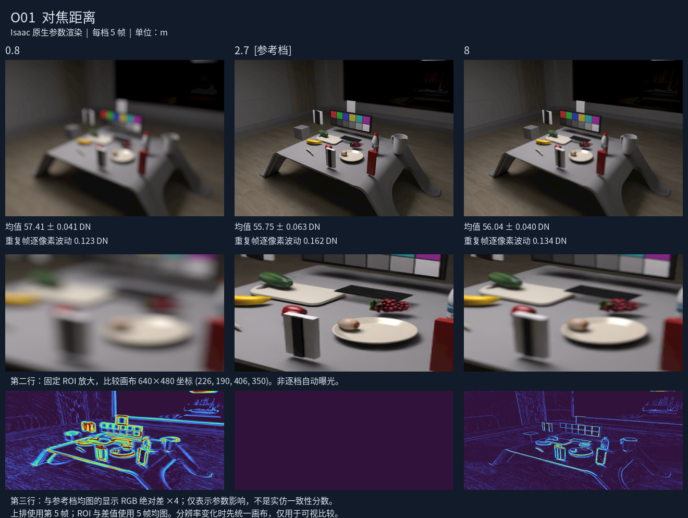

[全部重复帧](comparisons/O01_repeats.jpg) · [原始逐帧记录](analysis/native_frames.jsonl)

#### O02　景深光圈 fStop

类型：Isaac 原生渲染。扫描值：`[0.5, 2, 16]`；单位：f-number。固定上下文：`{"focus": 2.2}`。

曝光光圈保持 5；本实验只验证独立的景深控制。

显示 RGB 均值范围 55.72～56.20 DN；相对参考档最大均图差 1.723 DN，平均重复帧逐像素波动 0.159 DN。

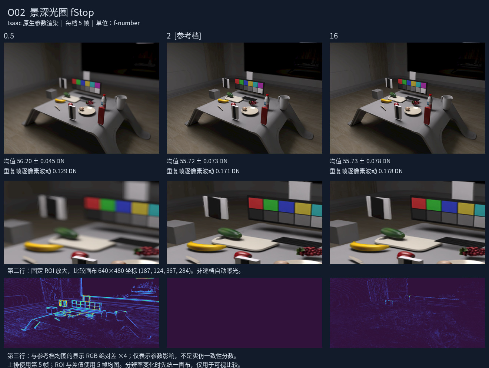

[全部重复帧](comparisons/O02_repeats.jpg) · [原始逐帧记录](analysis/native_frames.jsonl)

### 场景光照

#### L01　主光强度

类型：Isaac 原生渲染。扫描值：`[250, 1000, 4000]`；单位：USD intensity。固定上下文：`{}`。

其他设置采用本组基准，完整配置随每帧保存。

显示 RGB 均值范围 36.51～94.67 DN；相对参考档最大均图差 39.144 DN，平均重复帧逐像素波动 0.237 DN。

[全部重复帧](comparisons/L01_repeats.jpg) · [原始逐帧记录](analysis/native_frames.jsonl)

#### L02　灯光 exposure

类型：Isaac 原生渲染。扫描值：`[-2, 0, 2]`；单位：stop。固定上下文：`{}`。

其他设置采用本组基准，完整配置随每帧保存。

显示 RGB 均值范围 38.16～95.33 DN；相对参考档最大均图差 37.077 DN，平均重复帧逐像素波动 0.290 DN。

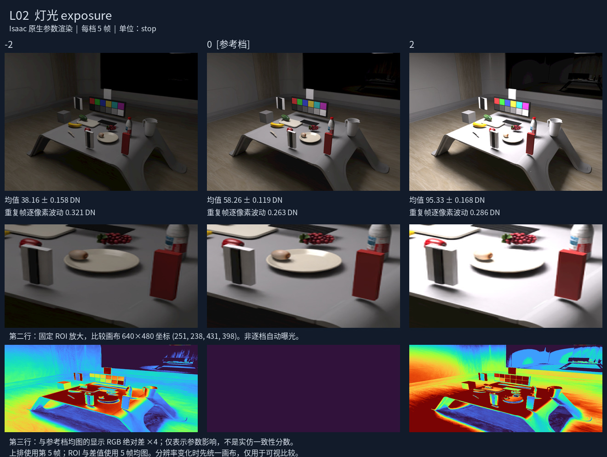

[全部重复帧](comparisons/L02_repeats.jpg) · [原始逐帧记录](analysis/native_frames.jsonl)

#### L03　主光 CCT

类型：Isaac 原生渲染。扫描值：`[3000, 6500, 10000]`；单位：K。固定上下文：`{}`。

RTX RGB 黑体近似，不是完整 SPD 光谱仿真。

显示 RGB 均值范围 52.40～56.72 DN；相对参考档最大均图差 12.100 DN，平均重复帧逐像素波动 0.202 DN。

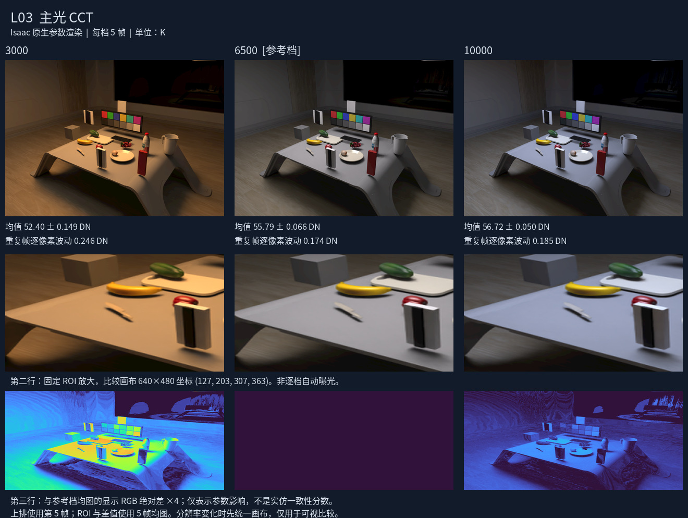

[全部重复帧](comparisons/L03_repeats.jpg) · [原始逐帧记录](analysis/native_frames.jsonl)

#### L04　主光 X 位置

类型：Isaac 原生渲染。扫描值：`[-1.3, -0.4, 1.3]`；单位：m。固定上下文：`{}`。

其他设置采用本组基准，完整配置随每帧保存。

显示 RGB 均值范围 53.42～55.82 DN；相对参考档最大均图差 18.082 DN，平均重复帧逐像素波动 0.186 DN。

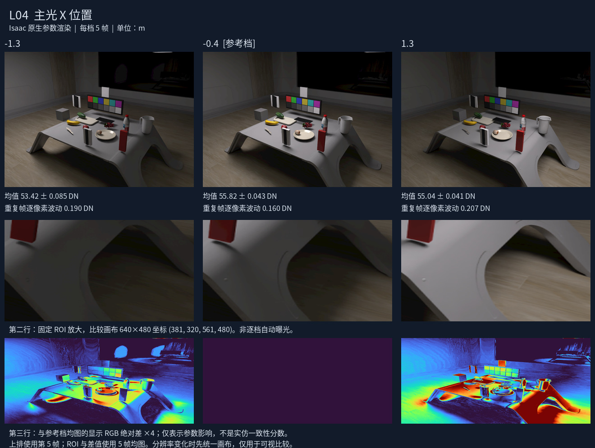

[全部重复帧](comparisons/L04_repeats.jpg) · [原始逐帧记录](analysis/native_frames.jsonl)

#### L05　主光 Z 位置

类型：Isaac 原生渲染。扫描值：`[1.4, 2.6, 4.0]`；单位：m。固定上下文：`{}`。

其他设置采用本组基准，完整配置随每帧保存。

显示 RGB 均值范围 50.38～56.09 DN；相对参考档最大均图差 17.619 DN，平均重复帧逐像素波动 0.189 DN。

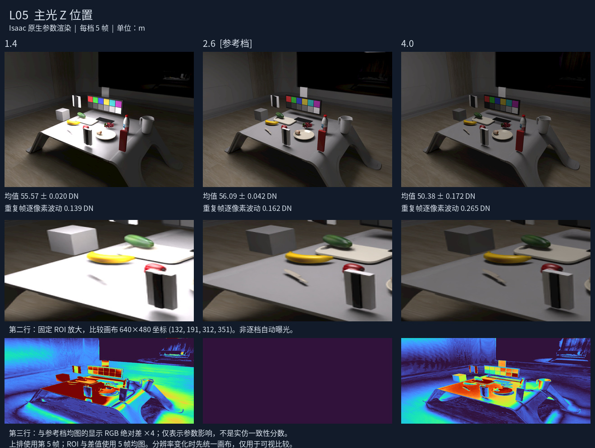

[全部重复帧](comparisons/L05_repeats.jpg) · [原始逐帧记录](analysis/native_frames.jsonl)

#### L06　发光面宽度

类型：Isaac 原生渲染。扫描值：`[0.1, 1.2, 2.4]`；单位：m。固定上下文：`{}`。

保持 USD intensity 不变；面积变化可同时改变总通量，不能解释成仅阴影软硬。

显示 RGB 均值范围 30.06～73.64 DN；相对参考档最大均图差 24.487 DN，平均重复帧逐像素波动 0.215 DN。

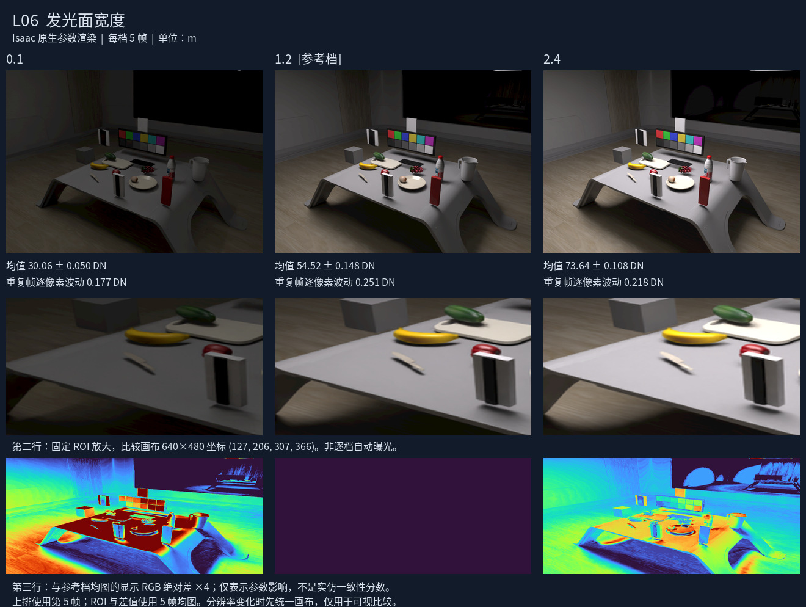

[全部重复帧](comparisons/L06_repeats.jpg) · [原始逐帧记录](analysis/native_frames.jsonl)

#### L07　发光面高度

类型：Isaac 原生渲染。扫描值：`[0.1, 0.8, 2.0]`；单位：m。固定上下文：`{}`。

其他设置采用本组基准，完整配置随每帧保存。

显示 RGB 均值范围 33.09～80.12 DN；相对参考档最大均图差 25.600 DN，平均重复帧逐像素波动 0.237 DN。

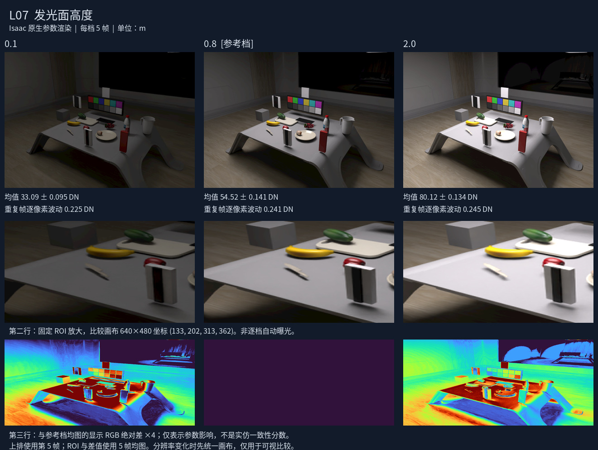

[全部重复帧](comparisons/L07_repeats.jpg) · [原始逐帧记录](analysis/native_frames.jsonl)

#### L08　主光倾角

类型：Isaac 原生渲染。扫描值：`[-25, 0, 25]`；单位：degree。固定上下文：`{}`。

其他设置采用本组基准，完整配置随每帧保存。

显示 RGB 均值范围 52.94～57.76 DN；相对参考档最大均图差 5.655 DN，平均重复帧逐像素波动 0.173 DN。

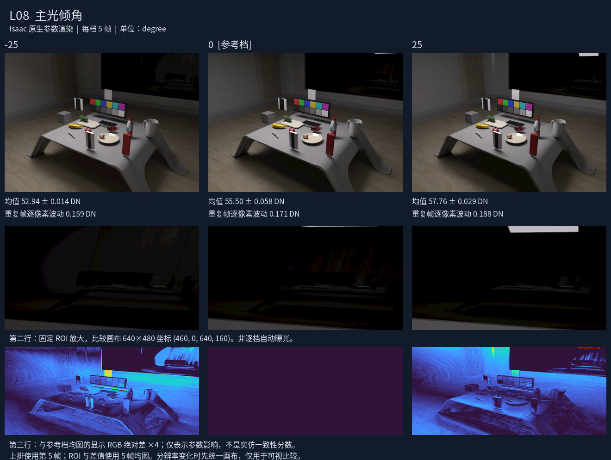

[全部重复帧](comparisons/L08_repeats.jpg) · [原始逐帧记录](analysis/native_frames.jsonl)

#### L09　环境补光

类型：Isaac 原生渲染。扫描值：`[0, 120, 480]`；单位：USD intensity。固定上下文：`{}`。

其他设置采用本组基准，完整配置随每帧保存。

显示 RGB 均值范围 55.52～55.78 DN；相对参考档最大均图差 0.344 DN，平均重复帧逐像素波动 0.165 DN。

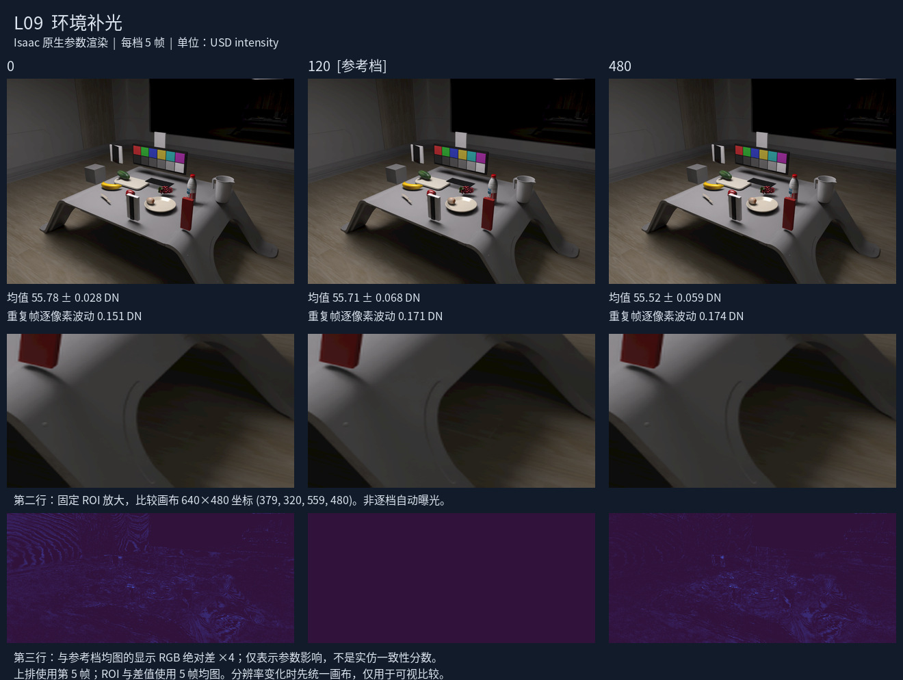

[全部重复帧](comparisons/L09_repeats.jpg) · [原始逐帧记录](analysis/native_frames.jsonl)

### 材质

#### M01　中性物体漫反射率

类型：Isaac 原生渲染。扫描值：`[0.05, 0.18, 0.7]`；单位：linear RGB。固定上下文：`{}`。

其他设置采用本组基准，完整配置随每帧保存。

显示 RGB 均值范围 52.47～55.19 DN；相对参考档最大均图差 2.746 DN，平均重复帧逐像素波动 0.349 DN。

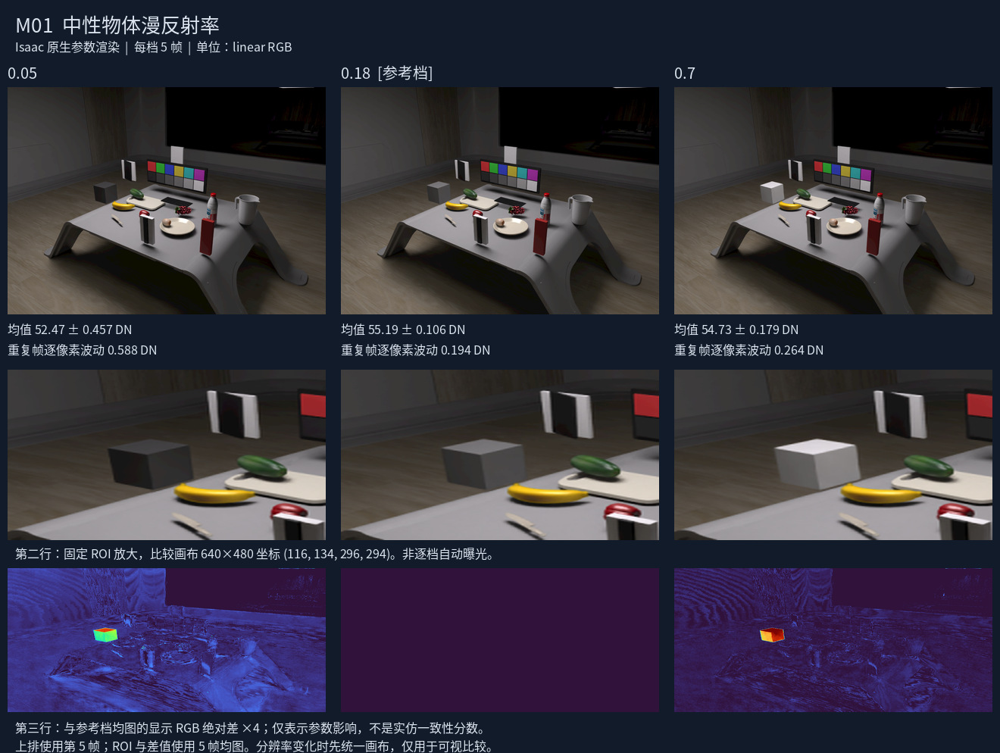

[全部重复帧](comparisons/M01_repeats.jpg) · [原始逐帧记录](analysis/native_frames.jsonl)

#### M02　表面粗糙度

类型：Isaac 原生渲染。扫描值：`[0.02, 0.35, 1.0]`；单位：1。固定上下文：`{}`。

其他设置采用本组基准，完整配置随每帧保存。

显示 RGB 均值范围 55.58～55.96 DN；相对参考档最大均图差 0.514 DN，平均重复帧逐像素波动 0.148 DN。

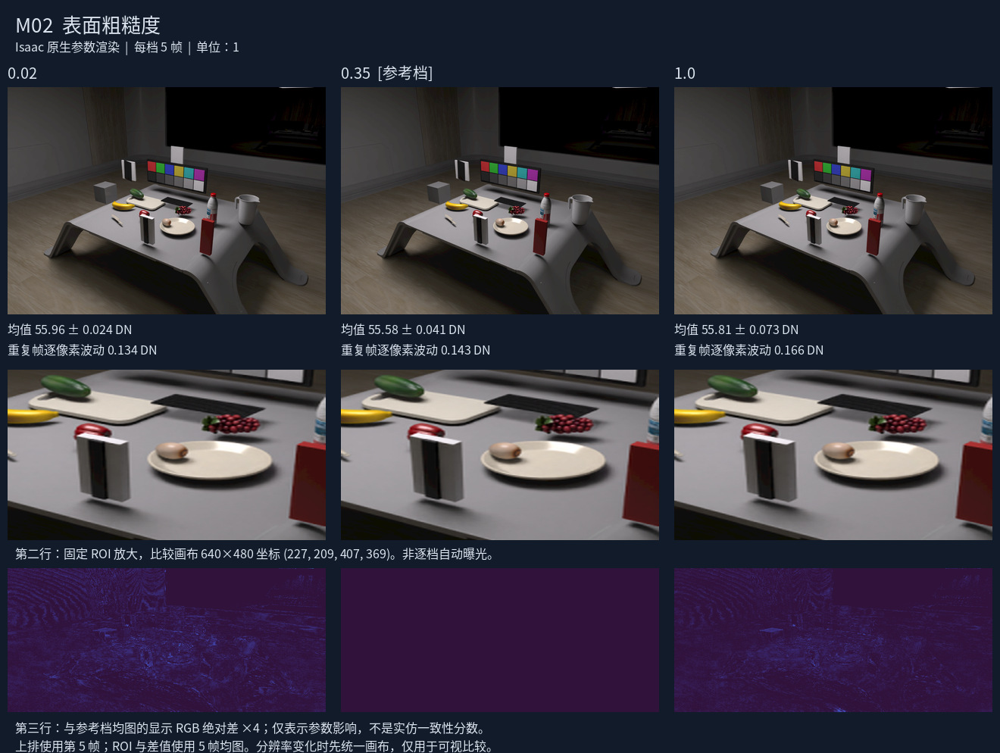

[全部重复帧](comparisons/M02_repeats.jpg) · [原始逐帧记录](analysis/native_frames.jsonl)

#### M03　金属度

类型：Isaac 原生渲染。扫描值：`[0, 0.5, 1.0]`；单位：1。固定上下文：`{}`。

其他设置采用本组基准，完整配置随每帧保存。

显示 RGB 均值范围 56.09～56.25 DN；相对参考档最大均图差 0.467 DN，平均重复帧逐像素波动 0.141 DN。

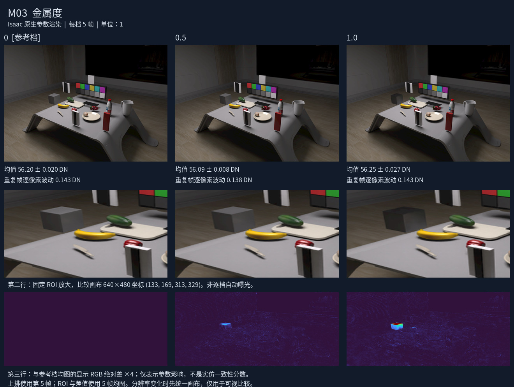

[全部重复帧](comparisons/M03_repeats.jpg) · [原始逐帧记录](analysis/native_frames.jsonl)

#### M04　折射率输入 IOR

类型：Isaac 原生渲染。扫描值：`[1.1, 1.5, 2.4]`；单位：1。固定上下文：`{}`。

只验证当前 UsdPreviewSurface 的响应，不代表完整玻璃光谱。

显示 RGB 均值范围 56.55～56.61 DN；相对参考档最大均图差 0.367 DN，平均重复帧逐像素波动 0.137 DN。

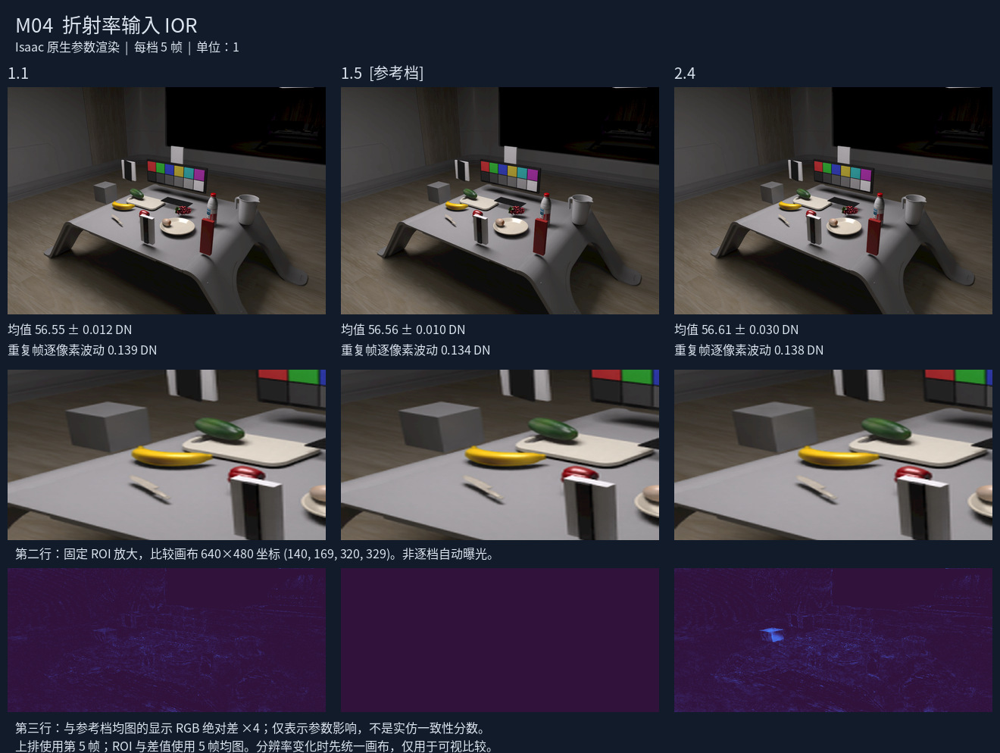

[全部重复帧](comparisons/M04_repeats.jpg) · [原始逐帧记录](analysis/native_frames.jsonl)

#### M05　透明度 opacity

类型：Isaac 原生渲染。扫描值：`[0.2, 0.6, 1.0]`；单位：1。固定上下文：`{}`。

其他设置采用本组基准，完整配置随每帧保存。

显示 RGB 均值范围 56.37～56.61 DN；相对参考档最大均图差 0.528 DN，平均重复帧逐像素波动 0.136 DN。

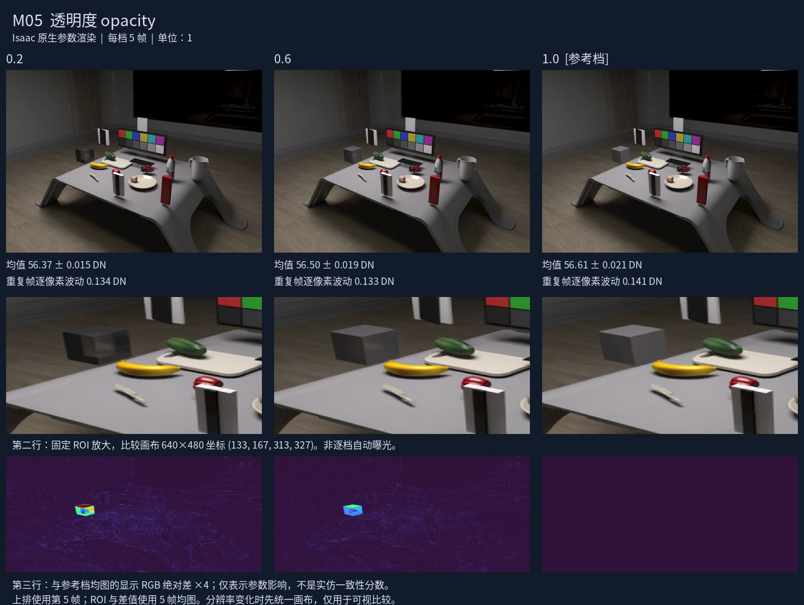

[全部重复帧](comparisons/M05_repeats.jpg) · [原始逐帧记录](analysis/native_frames.jsonl)

### 曝光

#### E01　曝光积分亮度控制

类型：Isaac 原生渲染。扫描值：`[0.005, 0.02, 0.08]`；单位：s。固定上下文：`{}`。

原生 exposure:time 只在此验证静态辐射缩放；物理运动积分另见时间实验。

显示 RGB 均值范围 29.85～102.10 DN；相对参考档最大均图差 45.499 DN，平均重复帧逐像素波动 0.881 DN。

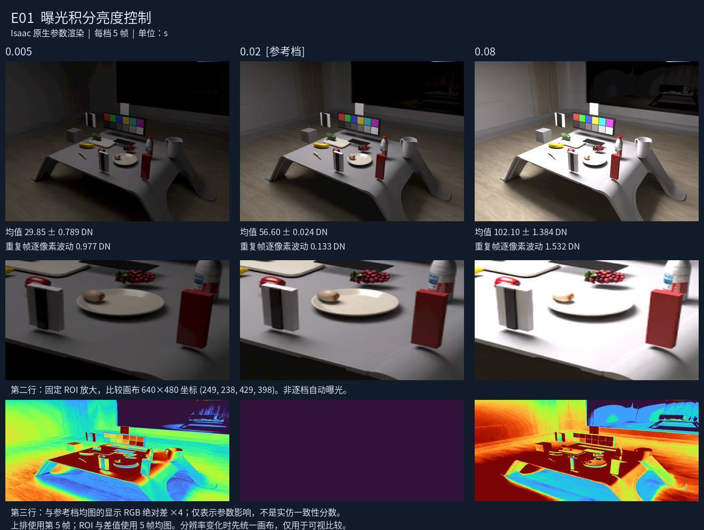

[全部重复帧](comparisons/E01_repeats.jpg) · [原始逐帧记录](analysis/native_frames.jsonl)

#### E02　ISO 亮度控制

类型：Isaac 原生渲染。扫描值：`[25, 100, 400]`；单位：ISO。固定上下文：`{}`。

RTX ISO 未建模实机增益相关读噪。

显示 RGB 均值范围 30.09～99.42 DN；相对参考档最大均图差 37.435 DN，平均重复帧逐像素波动 0.689 DN。

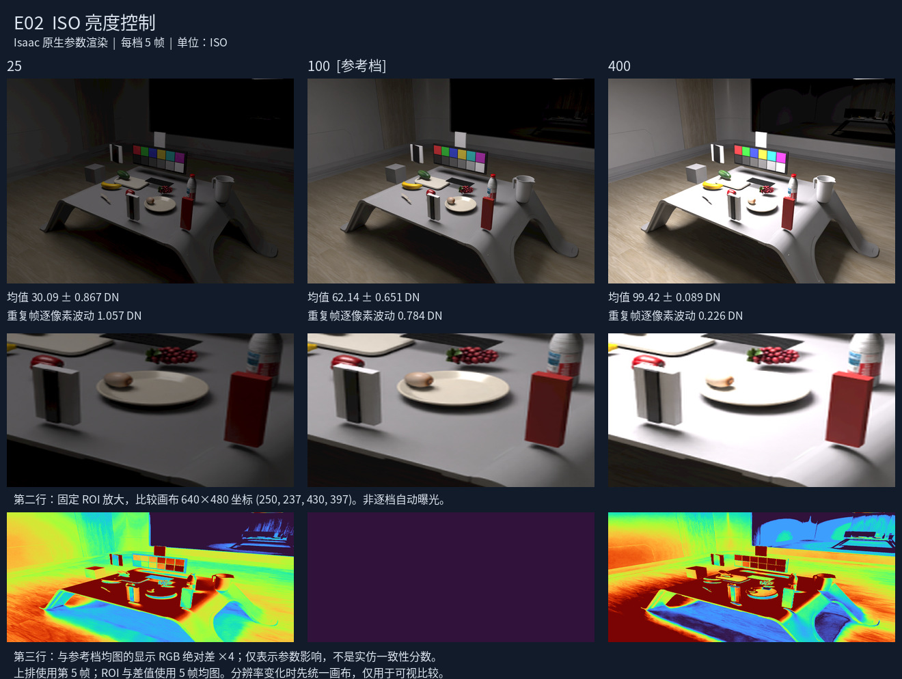

[全部重复帧](comparisons/E02_repeats.jpg) · [原始逐帧记录](analysis/native_frames.jsonl)

#### E03　曝光专用 f-number

类型：Isaac 原生渲染。扫描值：`[2.5, 5, 10]`；单位：f-number。固定上下文：`{}`。

保持几何 fStop=0；与景深光圈分开验证。

显示 RGB 均值范围 30.28～100.99 DN；相对参考档最大均图差 39.247 DN，平均重复帧逐像素波动 0.916 DN。

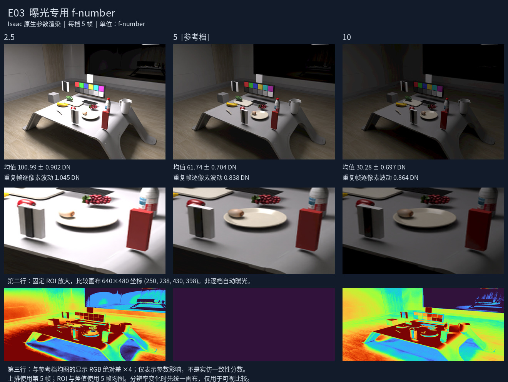

[全部重复帧](comparisons/E03_repeats.jpg) · [原始逐帧记录](analysis/native_frames.jsonl)

#### E04　responsivity

类型：Isaac 原生渲染。扫描值：`[4, 16, 64]`；单位：1。固定上下文：`{}`。

其他设置采用本组基准，完整配置随每帧保存。

显示 RGB 均值范围 30.44～102.03 DN；相对参考档最大均图差 48.843 DN，平均重复帧逐像素波动 0.839 DN。

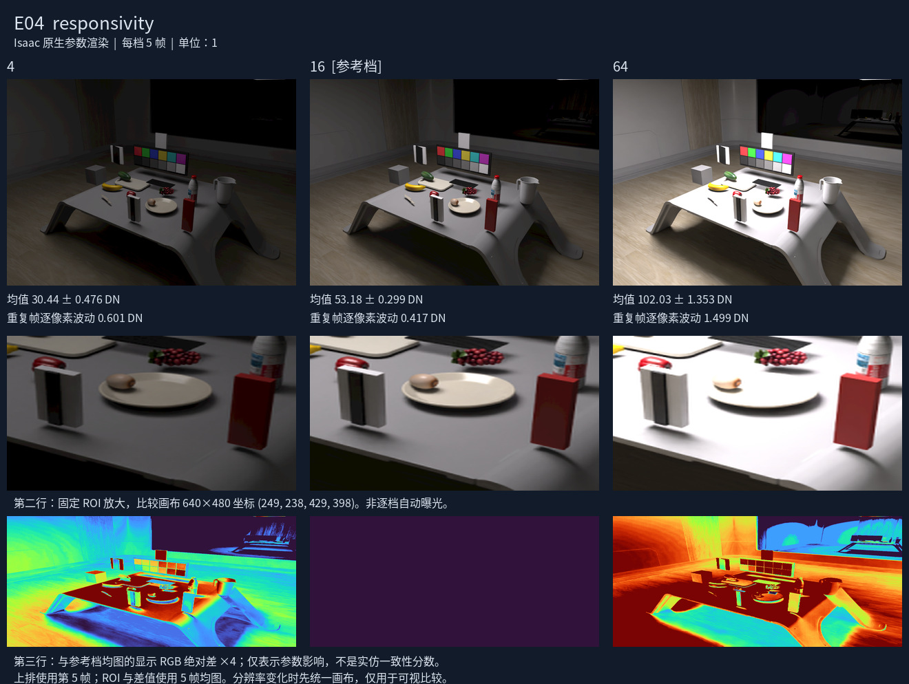

[全部重复帧](comparisons/E04_repeats.jpg) · [原始逐帧记录](analysis/native_frames.jsonl)

#### E05　曝光补偿

类型：Isaac 原生渲染。扫描值：`[1, 3, 5]`；单位：stop。固定上下文：`{}`。

其他设置采用本组基准，完整配置随每帧保存。

显示 RGB 均值范围 54.50～55.63 DN；相对参考档最大均图差 1.201 DN，平均重复帧逐像素波动 0.178 DN。

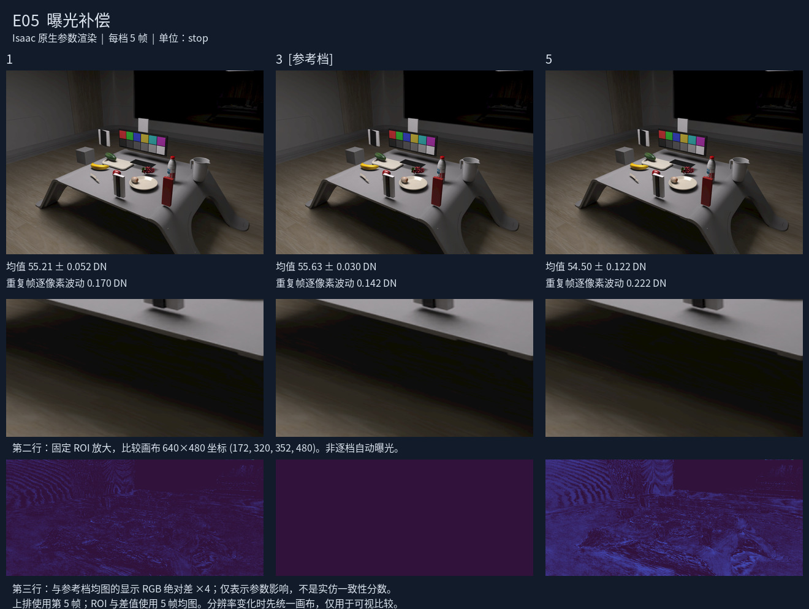

[全部重复帧](comparisons/E05_repeats.jpg) · [原始逐帧记录](analysis/native_frames.jsonl)

#### E06　静态场景 shutter:close

类型：Isaac 原生渲染。扫描值：`[0, 0.5, 1.0]`；单位：timeCode。固定上下文：`{}`。

静态输入下预期不改变物体位置；不能据此确认运动模糊实现。

显示 RGB 均值范围 55.82～56.14 DN；相对参考档最大均图差 0.449 DN，平均重复帧逐像素波动 0.140 DN。

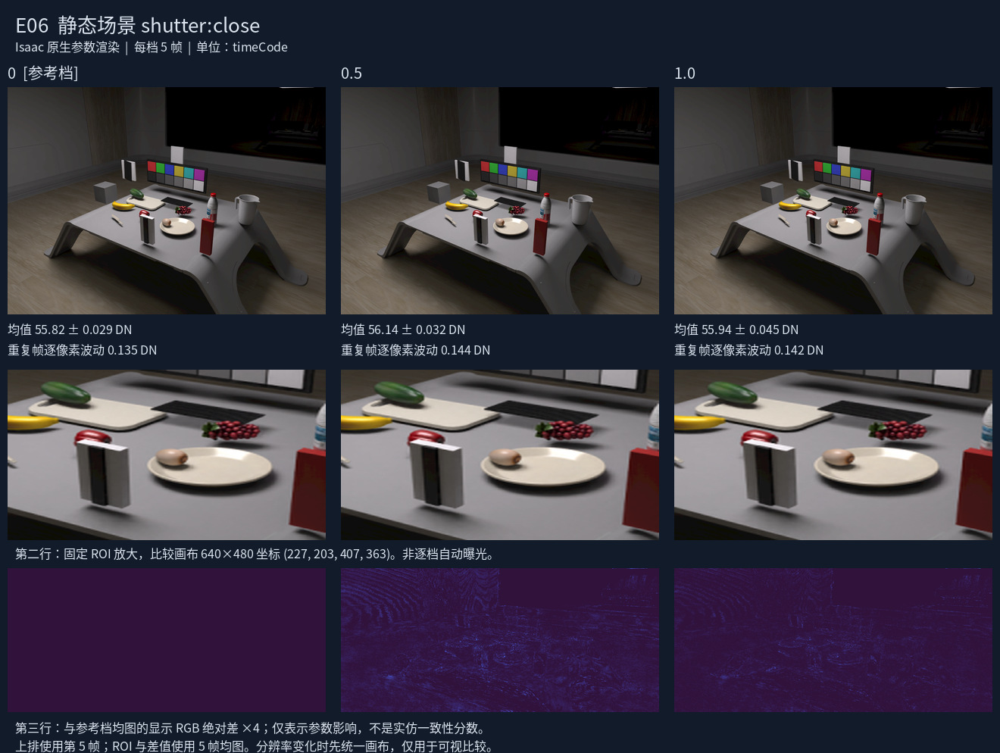

[全部重复帧](comparisons/E06_repeats.jpg) · [原始逐帧记录](analysis/native_frames.jsonl)

### 畸变

#### D01　OpenCV 针孔 fx

类型：Isaac 原生渲染。扫描值：`[600, 740, 900]`；单位：px。固定上下文：`{"lens": "opencvPinhole"}`。

其他设置采用本组基准，完整配置随每帧保存。

显示 RGB 均值范围 55.03～55.93 DN；相对参考档最大均图差 14.083 DN，平均重复帧逐像素波动 0.214 DN。

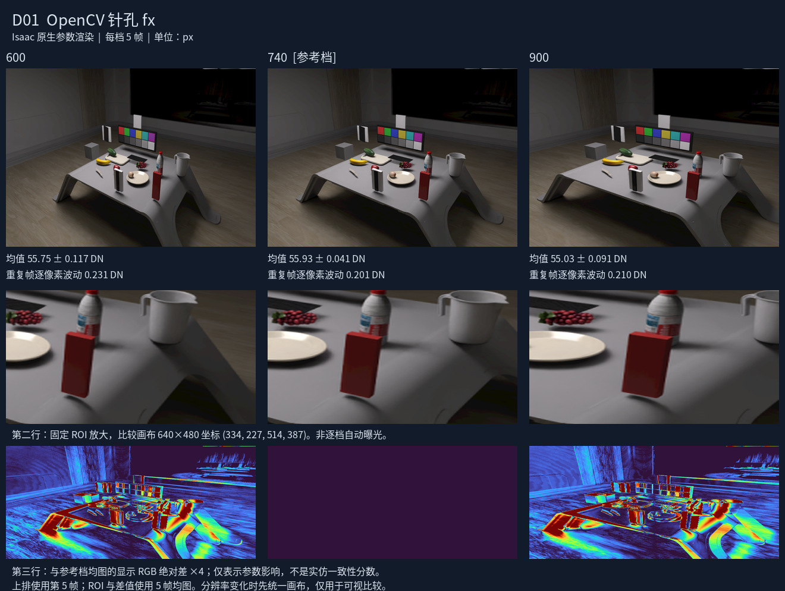

[全部重复帧](comparisons/D01_repeats.jpg) · [原始逐帧记录](analysis/native_frames.jsonl)

#### D02　OpenCV 针孔 fy

类型：Isaac 原生渲染。扫描值：`[600, 740, 900]`；单位：px。固定上下文：`{"lens": "opencvPinhole"}`。

其他设置采用本组基准，完整配置随每帧保存。

显示 RGB 均值范围 54.35～58.39 DN；相对参考档最大均图差 13.771 DN，平均重复帧逐像素波动 0.199 DN。

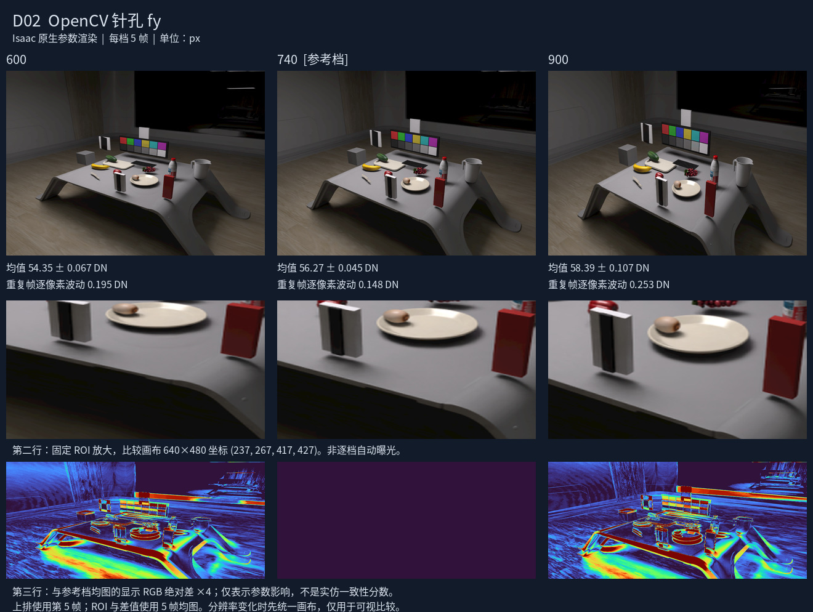

[全部重复帧](comparisons/D02_repeats.jpg) · [原始逐帧记录](analysis/native_frames.jsonl)

#### D03　Brown/rational k1

类型：Isaac 原生渲染。扫描值：`[-0.15, 0, 0.15]`；单位：1。固定上下文：`{"lens": "opencvPinhole"}`。

其他设置采用本组基准，完整配置随每帧保存。

显示 RGB 均值范围 55.35～56.00 DN；相对参考档最大均图差 3.538 DN，平均重复帧逐像素波动 0.199 DN。

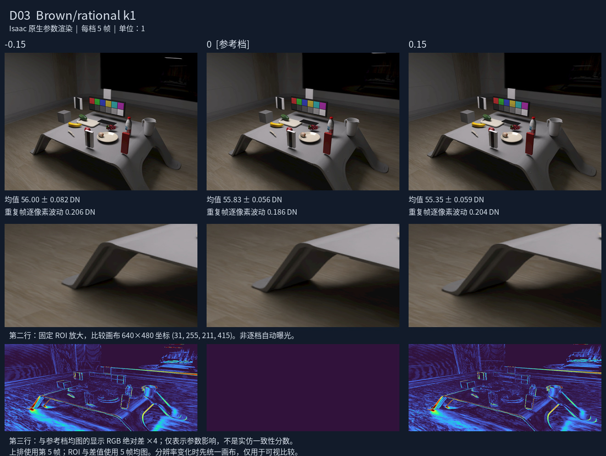

[全部重复帧](comparisons/D03_repeats.jpg) · [原始逐帧记录](analysis/native_frames.jsonl)

#### D04　Brown/rational k2

类型：Isaac 原生渲染。扫描值：`[-0.15, 0, 0.15]`；单位：1。固定上下文：`{"lens": "opencvPinhole"}`。

其他设置采用本组基准，完整配置随每帧保存。

显示 RGB 均值范围 55.88～56.09 DN；相对参考档最大均图差 1.631 DN，平均重复帧逐像素波动 0.183 DN。

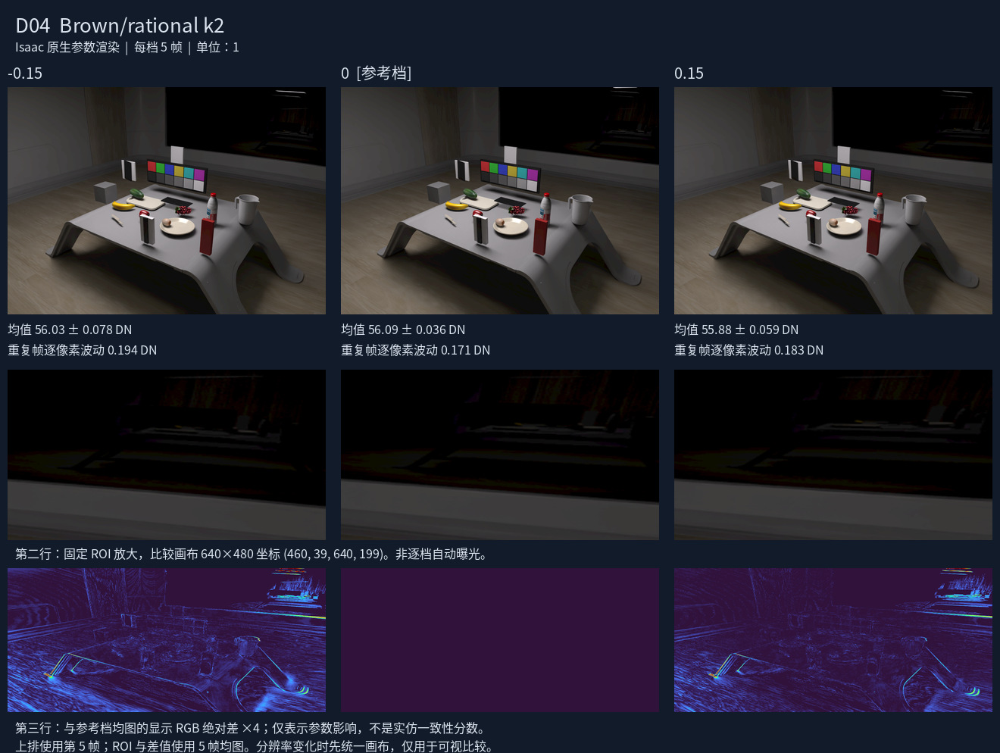

[全部重复帧](comparisons/D04_repeats.jpg) · [原始逐帧记录](analysis/native_frames.jsonl)

#### D05　Brown/rational k3

类型：Isaac 原生渲染。扫描值：`[-0.15, 0, 0.15]`；单位：1。固定上下文：`{"lens": "opencvPinhole"}`。

其他设置采用本组基准，完整配置随每帧保存。

显示 RGB 均值范围 56.22～56.33 DN；相对参考档最大均图差 0.675 DN，平均重复帧逐像素波动 0.153 DN。

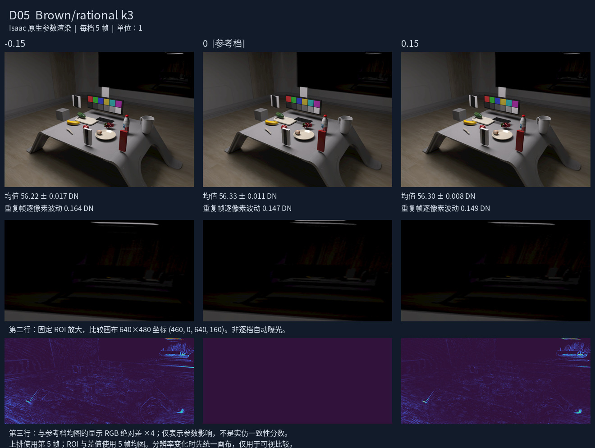

[全部重复帧](comparisons/D05_repeats.jpg) · [原始逐帧记录](analysis/native_frames.jsonl)

#### D06　Brown/rational k4

类型：Isaac 原生渲染。扫描值：`[-0.15, 0, 0.15]`；单位：1。固定上下文：`{"lens": "opencvPinhole"}`。

k4 为 rational 分母项；与 fisheye 的 k4 定义不同。

显示 RGB 均值范围 55.45～56.03 DN；相对参考档最大均图差 3.418 DN，平均重复帧逐像素波动 0.192 DN。

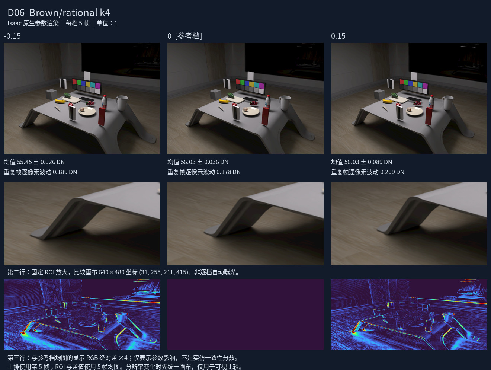

[全部重复帧](comparisons/D06_repeats.jpg) · [原始逐帧记录](analysis/native_frames.jsonl)

#### D07　切向畸变 p1

类型：Isaac 原生渲染。扫描值：`[-0.04, 0, 0.04]`；单位：1。固定上下文：`{"lens": "opencvPinhole"}`。

其他设置采用本组基准，完整配置随每帧保存。

显示 RGB 均值范围 55.21～56.87 DN；相对参考档最大均图差 4.520 DN，平均重复帧逐像素波动 0.199 DN。

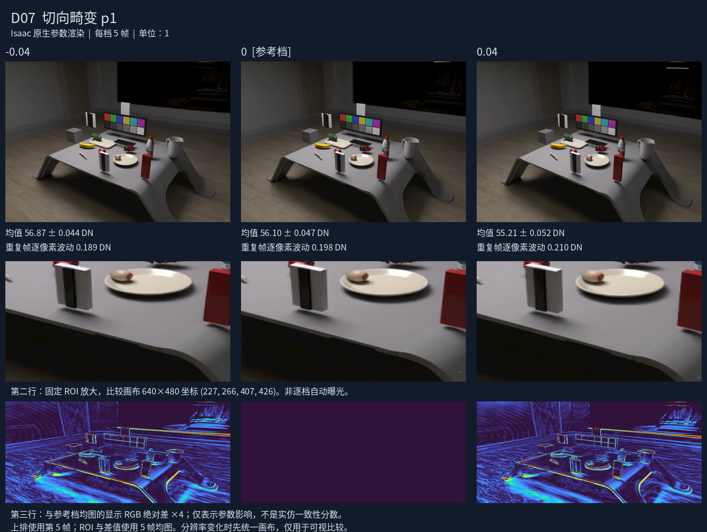

[全部重复帧](comparisons/D07_repeats.jpg) · [原始逐帧记录](analysis/native_frames.jsonl)

#### D08　切向畸变 p2

类型：Isaac 原生渲染。扫描值：`[-0.04, 0, 0.04]`；单位：1。固定上下文：`{"lens": "opencvPinhole"}`。

其他设置采用本组基准，完整配置随每帧保存。

显示 RGB 均值范围 55.18～56.38 DN；相对参考档最大均图差 4.750 DN，平均重复帧逐像素波动 0.202 DN。

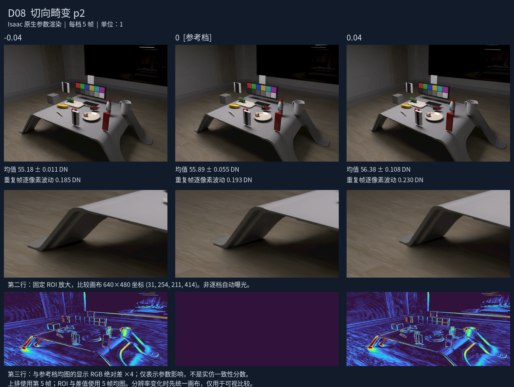

[全部重复帧](comparisons/D08_repeats.jpg) · [原始逐帧记录](analysis/native_frames.jsonl)

#### F01　OpenCV fisheye k1

类型：Isaac 原生渲染。扫描值：`[-0.1, 0, 0.1]`；单位：1。固定上下文：`{"lens": "opencvFisheye"}`。

固定 fx=fy=740，与 Brown 模型不共享系数含义。

显示 RGB 均值范围 50.10～50.23 DN；相对参考档最大均图差 2.579 DN，平均重复帧逐像素波动 0.193 DN。

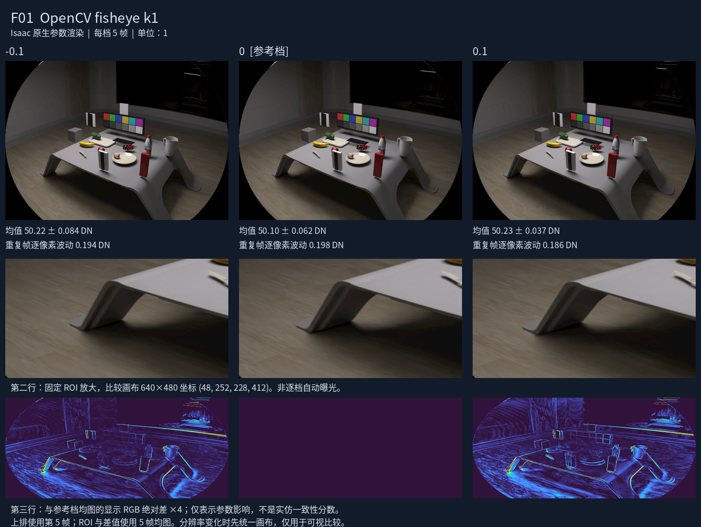

[全部重复帧](comparisons/F01_repeats.jpg) · [原始逐帧记录](analysis/native_frames.jsonl)

#### F02　OpenCV fisheye k2

类型：Isaac 原生渲染。扫描值：`[-0.1, 0, 0.1]`；单位：1。固定上下文：`{"lens": "opencvFisheye"}`。

固定 fx=fy=740，与 Brown 模型不共享系数含义。

显示 RGB 均值范围 50.32～50.63 DN；相对参考档最大均图差 0.901 DN，平均重复帧逐像素波动 0.166 DN。

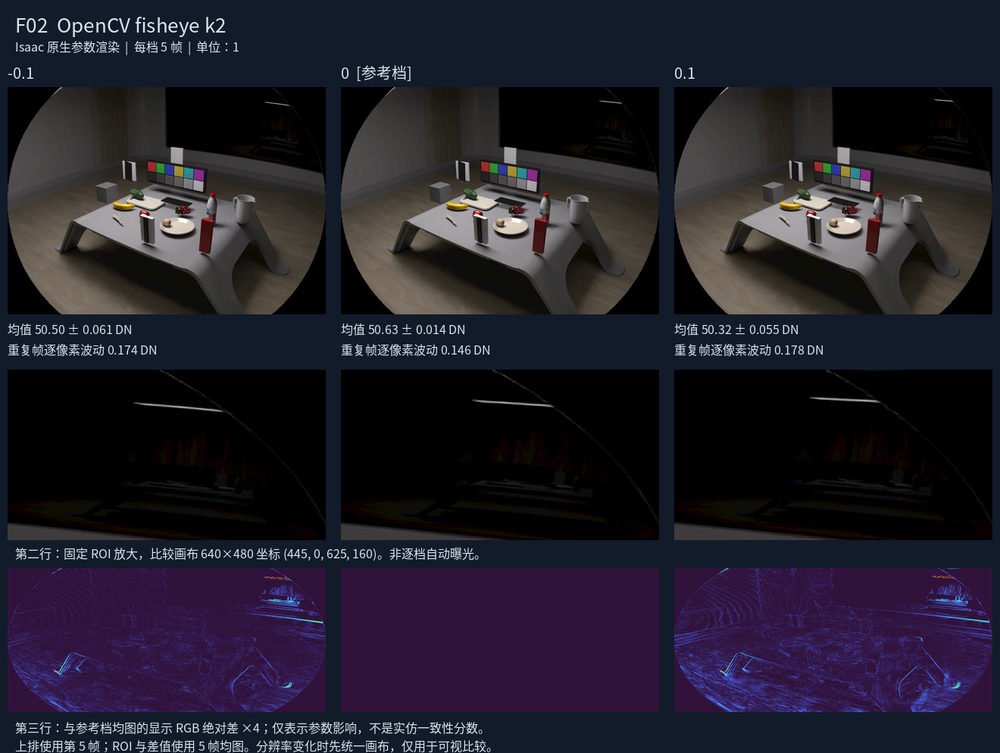

[全部重复帧](comparisons/F02_repeats.jpg) · [原始逐帧记录](analysis/native_frames.jsonl)

#### F03　OpenCV fisheye k3

类型：Isaac 原生渲染。扫描值：`[-0.1, 0, 0.1]`；单位：1。固定上下文：`{"lens": "opencvFisheye"}`。

固定 fx=fy=740，与 Brown 模型不共享系数含义。

显示 RGB 均值范围 50.73～50.87 DN；相对参考档最大均图差 0.416 DN，平均重复帧逐像素波动 0.139 DN。

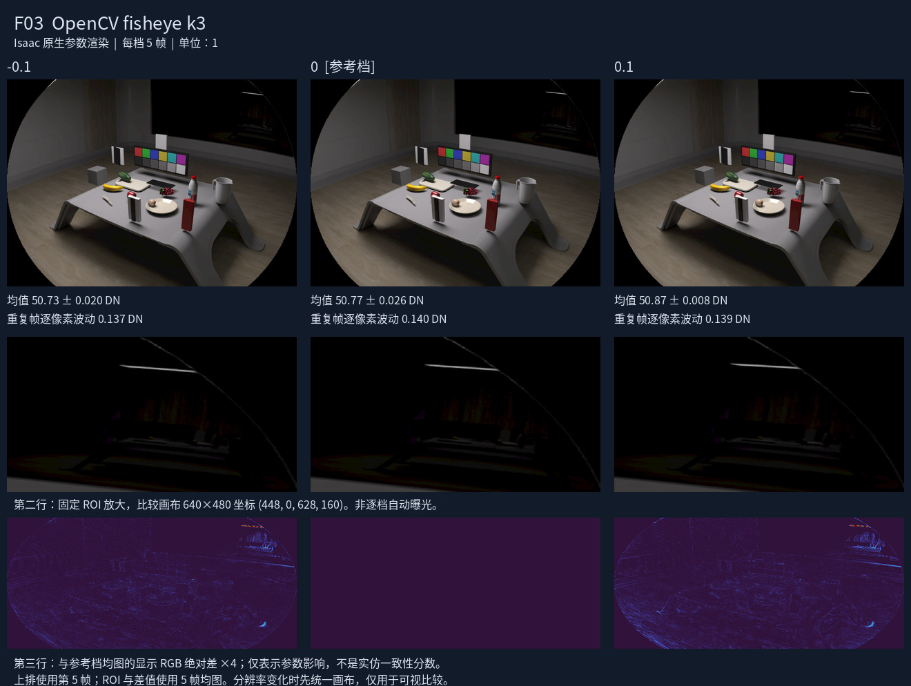

[全部重复帧](comparisons/F03_repeats.jpg) · [原始逐帧记录](analysis/native_frames.jsonl)

#### F04　OpenCV fisheye k4

类型：Isaac 原生渲染。扫描值：`[-0.1, 0, 0.1]`；单位：1。固定上下文：`{"lens": "opencvFisheye"}`。

固定 fx=fy=740，与 Brown 模型不共享系数含义。

显示 RGB 均值范围 50.83～50.87 DN；相对参考档最大均图差 0.372 DN，平均重复帧逐像素波动 0.130 DN。

[全部重复帧](comparisons/F04_repeats.jpg) · [原始逐帧记录](analysis/native_frames.jsonl)

### 渲染

#### R01　RTX tone operator

类型：Isaac 原生渲染。扫描值：`["none", "reinhard", "acesApproximation"]`；单位：模式。固定上下文：`{}`。

其他设置采用本组基准，完整配置随每帧保存。

显示 RGB 均值范围 53.16～56.05 DN；相对参考档最大均图差 9.816 DN，平均重复帧逐像素波动 0.156 DN。

[全部重复帧](comparisons/R01_repeats.jpg) · [原始逐帧记录](analysis/native_frames.jsonl)

#### R02　抗锯齿 / 重建模式

类型：Isaac 原生渲染。扫描值：`["none", "taa", "dlss"]`；单位：模式。固定上下文：`{}`。

DLSS 的实际驱动回退保留在日志；不认定是实机 ISP。

显示 RGB 均值范围 56.36～56.44 DN；相对参考档最大均图差 0.250 DN，平均重复帧逐像素波动 0.136 DN。

[全部重复帧](comparisons/R02_repeats.jpg) · [原始逐帧记录](analysis/native_frames.jsonl)

#### R03　Path tracing samples

类型：Isaac 原生渲染。扫描值：`[1, 8, 32]`；单位：samples。固定上下文：`{"renderer": "PathTracing"}`。

改变最大累积样本数；渲染颗粒不是传感器噪声。

显示 RGB 均值范围 67.31～67.46 DN；相对参考档最大均图差 4.010 DN，平均重复帧逐像素波动 0.000 DN。

[全部重复帧](comparisons/R03_repeats.jpg) · [原始逐帧记录](analysis/native_frames.jsonl)

#### R04　Path tracing 最大反弹

类型：Isaac 原生渲染。扫描值：`[1, 3, 8]`；单位：bounce。固定上下文：`{"renderer": "PathTracing"}`。

其他设置采用本组基准，完整配置随每帧保存。

显示 RGB 均值范围 0.00～69.15 DN；相对参考档最大均图差 59.934 DN，平均重复帧逐像素波动 0.000 DN。

[全部重复帧](comparisons/R04_repeats.jpg) · [原始逐帧记录](analysis/native_frames.jsonl)

#### R05　Path tracing 去噪开关

类型：Isaac 原生渲染。扫描值：`[false, true]`；单位：bool。固定上下文：`{"renderer": "PathTracing"}`。

其他设置采用本组基准，完整配置随每帧保存。

显示 RGB 均值范围 62.33～67.31 DN；相对参考档最大均图差 10.785 DN，平均重复帧逐像素波动 0.000 DN。

[全部重复帧](comparisons/R05_repeats.jpg) · [原始逐帧记录](analysis/native_frames.jsonl)

#### R06　参数更新后 warm-up

类型：Isaac 原生渲染。扫描值：`[0, 4, 20]`；单位：updates。固定上下文：`{}`。

含历史状态影响；是瞬态实验，不将重复帧当独立光子采样。

显示 RGB 均值范围 55.88～56.31 DN；相对参考档最大均图差 0.597 DN，平均重复帧逐像素波动 0.212 DN。

[全部重复帧](comparisons/R06_repeats.jpg) · [原始逐帧记录](analysis/native_frames.jsonl)

#### R07　每次采集 render subframes

类型：Isaac 原生渲染。扫描值：`[1, 4, 12]`；单位：subframes。固定上下文：`{}`。

其他设置采用本组基准，完整配置随每帧保存。

显示 RGB 均值范围 56.45～56.50 DN；相对参考档最大均图差 0.472 DN，平均重复帧逐像素波动 0.147 DN。

[全部重复帧](comparisons/R07_repeats.jpg) · [原始逐帧记录](analysis/native_frames.jsonl)

#### R08　RenderProduct 分辨率

类型：Isaac 原生渲染。扫描值：`[[480, 360], [960, 720], [1440, 1080]]`；单位：pixel。固定上下文：`{}`。

光学视场固定，K 随分辨率缩放；比较板统一缩略显示。

显示 RGB 均值范围 55.77～57.02 DN；相对参考档最大均图差 1.688 DN，平均重复帧逐像素波动 0.187 DN。

[全部重复帧](comparisons/R08_repeats.jpg) · [原始逐帧记录](analysis/native_frames.jsonl)

#### R09　渲染器

类型：Isaac 原生渲染。扫描值：`["RayTracedLighting", "PathTracing"]`；单位：模式。固定上下文：`{}`。

其他设置采用本组基准，完整配置随每帧保存。

显示 RGB 均值范围 56.86～67.28 DN；相对参考档最大均图差 10.501 DN，平均重复帧逐像素波动 0.069 DN。

[全部重复帧](comparisons/R09_repeats.jpg) · [原始逐帧记录](analysis/native_frames.jsonl)

#### R10　实时模式漫反射反弹

类型：Isaac 原生渲染。扫描值：`[0, 1, 3]`；单位：bounce。固定上下文：`{}`。

其他设置采用本组基准，完整配置随每帧保存。

显示 RGB 均值范围 56.58～57.00 DN；相对参考档最大均图差 0.409 DN，平均重复帧逐像素波动 0.147 DN。

[全部重复帧](comparisons/R10_repeats.jpg) · [原始逐帧记录](analysis/native_frames.jsonl)

### 渲染 ISP

#### R11　RTX color correction gamma

类型：Isaac 原生渲染。扫描值：`[0.6, 1.0, 1.8]`；单位：1。固定上下文：`{}`。

其他设置采用本组基准，完整配置随每帧保存。

显示 RGB 均值范围 21.85～119.13 DN；相对参考档最大均图差 61.961 DN，平均重复帧逐像素波动 0.130 DN。

[全部重复帧](comparisons/R11_repeats.jpg) · [原始逐帧记录](analysis/native_frames.jsonl)

#### R12　RTX color correction gain

类型：Isaac 原生渲染。扫描值：`[0.5, 1.0, 2.0]`；单位：1。固定上下文：`{}`。

其他设置采用本组基准，完整配置随每帧保存。

显示 RGB 均值范围 0.61～225.92 DN；相对参考档最大均图差 168.779 DN，平均重复帧逐像素波动 0.104 DN。

[全部重复帧](comparisons/R12_repeats.jpg) · [原始逐帧记录](analysis/native_frames.jsonl)

#### R13　RTX 饱和度

类型：Isaac 原生渲染。扫描值：`[0.0, 1.0, 2.0]`；单位：1。固定上下文：`{}`。

其他设置采用本组基准，完整配置随每帧保存。

显示 RGB 均值范围 57.26～57.33 DN；相对参考档最大均图差 0.301 DN，平均重复帧逐像素波动 0.131 DN。

[全部重复帧](comparisons/R13_repeats.jpg) · [原始逐帧记录](analysis/native_frames.jsonl)

#### R14　RTX 对比度

类型：Isaac 原生渲染。扫描值：`[0.6, 1.0, 1.6]`；单位：1。固定上下文：`{}`。

其他设置采用本组基准，完整配置随每帧保存。

显示 RGB 均值范围 35.67～101.22 DN；相对参考档最大均图差 44.967 DN，平均重复帧逐像素波动 0.142 DN。

[全部重复帧](comparisons/R14_repeats.jpg) · [原始逐帧记录](analysis/native_frames.jsonl)

#### R15　RTX offset

类型：Isaac 原生渲染。扫描值：`[-0.03, 0.0, 0.05]`；单位：linear value。固定上下文：`{}`。

其他设置采用本组基准，完整配置随每帧保存。

显示 RGB 均值范围 47.45～77.70 DN；相对参考档最大均图差 20.364 DN，平均重复帧逐像素波动 0.136 DN。

[全部重复帧](comparisons/R15_repeats.jpg) · [原始逐帧记录](analysis/native_frames.jsonl)

#### R16　RTX R 通道 gain

类型：Isaac 原生渲染。扫描值：`[0.8, 1.0, 1.2]`；单位：1。固定上下文：`{}`。

其他设置采用本组基准，完整配置随每帧保存。

显示 RGB 均值范围 38.18～74.92 DN；相对参考档最大均图差 36.388 DN，平均重复帧逐像素波动 0.119 DN。

[全部重复帧](comparisons/R16_repeats.jpg) · [原始逐帧记录](analysis/native_frames.jsonl)

### 几何

#### G14　双目基线（右相机沿局部 X）

类型：Isaac 原生渲染。扫描值：`[0, 0.065, 0.13]`；单位：m。固定上下文：`{}`。

左相机光心固定为实验基准；本组仅移动右相机，不是机器人实测基线。

显示 RGB 均值范围 54.91～56.13 DN；相对参考档最大均图差 14.729 DN，平均重复帧逐像素波动 0.166 DN。

[全部重复帧](comparisons/G14_repeats.jpg) · [原始逐帧记录](analysis/native_frames.jsonl)

#### G15　metersPerUnit 单位声明

类型：Isaac 原生渲染。扫描值：`[0.01, 0.1, 1.0]`；单位：m/scene unit。固定上下文：`{}`。

只改单一元数据，数值几何不变；这是单位合同错配诊断，不是保持物理场景不变的单位换算。

显示 RGB 均值范围 55.91～56.28 DN；相对参考档最大均图差 0.540 DN，平均重复帧逐像素波动 0.148 DN。

[全部重复帧](comparisons/G15_repeats.jpg) · [原始逐帧记录](analysis/native_frames.jsonl)

### 材质

#### M06　镜面反射系数

类型：Isaac 原生渲染。扫描值：`[0.02, 0.08, 0.3]`；单位：linear RGB。固定上下文：`{"specular_workflow": 1}`。

其他设置采用本组基准，完整配置随每帧保存。

显示 RGB 均值范围 56.49～56.56 DN；相对参考档最大均图差 0.286 DN，平均重复帧逐像素波动 0.137 DN。

[全部重复帧](comparisons/M06_repeats.jpg) · [原始逐帧记录](analysis/native_frames.jsonl)

#### M07　表面法线扰动

类型：Isaac 原生渲染。扫描值：`[0, 20, 40]`；单位：degree。固定上下文：`{}`。

UsdPreviewSurface normal 常量方向扰动；不是已校准的微表面法线贴图。

显示 RGB 均值范围 56.56～56.74 DN；相对参考档最大均图差 0.391 DN，平均重复帧逐像素波动 0.140 DN。

[全部重复帧](comparisons/M07_repeats.jpg) · [原始逐帧记录](analysis/native_frames.jsonl)

### 传感器模型

#### S01　量子效率 QE

类型：离线假设模型。扫描值：`[0.2, 0.5, 0.9]`；单位：electron/photon。固定上下文：`{}`。

固定光子/电子/ADC 模型；不是 RGB 上直接加颗粒。

显示 RGB 均值范围 34.53～75.25 DN；相对参考档最大均图差 21.724 DN，平均重复帧逐像素波动 1.106 DN。

[全部重复帧](comparisons/S01_repeats.jpg) · [原始逐帧记录](analysis/model_frames.jsonl)

#### S02　入射光子数量标尺

类型：离线假设模型。扫描值：`[2000, 16000, 128000]`；单位：photon / unit radiance。固定上下文：`{}`。

固定光子/电子/ADC 模型；不是 RGB 上直接加颗粒。

显示 RGB 均值范围 16.99～138.26 DN；相对参考档最大均图差 82.019 DN，平均重复帧逐像素波动 1.071 DN。

[全部重复帧](comparisons/S02_repeats.jpg) · [原始逐帧记录](analysis/model_frames.jsonl)

#### S03　满阱容量

类型：离线假设模型。扫描值：`[1000, 8000, 32000]`；单位：electron。固定上下文：`{}`。

固定光子/电子/ADC 模型；不是 RGB 上直接加颗粒。

显示 RGB 均值范围 50.57～56.25 DN；相对参考档最大均图差 5.674 DN，平均重复帧逐像素波动 1.057 DN。

[全部重复帧](comparisons/S03_repeats.jpg) · [原始逐帧记录](analysis/model_frames.jsonl)

#### S04　读出噪声

类型：离线假设模型。扫描值：`[0, 6, 30]`；单位：electron RMS。固定上下文：`{}`。

固定光子/电子/ADC 模型；不是 RGB 上直接加颗粒。

显示 RGB 均值范围 56.25～56.43 DN；相对参考档最大均图差 0.863 DN，平均重复帧逐像素波动 1.691 DN。

[全部重复帧](comparisons/S04_repeats.jpg) · [原始逐帧记录](analysis/model_frames.jsonl)

#### S05　暗电流

类型：离线假设模型。扫描值：`[0, 100, 1000]`；单位：electron/s。固定上下文：`{}`。

固定光子/电子/ADC 模型；不是 RGB 上直接加颗粒。

显示 RGB 均值范围 56.24～59.25 DN；相对参考档最大均图差 2.729 DN，平均重复帧逐像素波动 1.124 DN。

[全部重复帧](comparisons/S05_repeats.jpg) · [原始逐帧记录](analysis/model_frames.jsonl)

#### S06　温度

类型：离线假设模型。扫描值：`[273, 298, 323]`；单位：K。固定上下文：`{"dark_current": 50.0}`。

温度模型假设每升高 8 K 暗电流翻倍，非实机实测。

显示 RGB 均值范围 56.26～57.59 DN；相对参考档最大均图差 1.310 DN，平均重复帧逐像素波动 1.119 DN。

[全部重复帧](comparisons/S06_repeats.jpg) · [原始逐帧记录](analysis/model_frames.jsonl)

#### S07　模拟增益

类型：离线假设模型。扫描值：`[1, 4, 16]`；单位：1。固定上下文：`{}`。

固定光子/电子/ADC 模型；不是 RGB 上直接加颗粒。

显示 RGB 均值范围 56.25～171.46 DN；相对参考档最大均图差 115.216 DN，平均重复帧逐像素波动 2.080 DN。

[全部重复帧](comparisons/S07_repeats.jpg) · [原始逐帧记录](analysis/model_frames.jsonl)

#### S08　数字增益

类型：离线假设模型。扫描值：`[1, 4, 16]`；单位：1。固定上下文：`{}`。

固定光子/电子/ADC 模型；不是 RGB 上直接加颗粒。

显示 RGB 均值范围 56.25～172.42 DN；相对参考档最大均图差 116.172 DN，平均重复帧逐像素波动 2.088 DN。

[全部重复帧](comparisons/S08_repeats.jpg) · [原始逐帧记录](analysis/model_frames.jsonl)

#### S09　ADC 位深

类型：离线假设模型。扫描值：`[4, 8, 12]`；单位：bit。固定上下文：`{}`。

固定光子/电子/ADC 模型；不是 RGB 上直接加颗粒。

显示 RGB 均值范围 56.03～56.28 DN；相对参考档最大均图差 9.714 DN，平均重复帧逐像素波动 1.256 DN。

[全部重复帧](comparisons/S09_repeats.jpg) · [原始逐帧记录](analysis/model_frames.jsonl)

#### S10　传感器黑位偏置

类型：离线假设模型。扫描值：`[0, 64, 256]`；单位：12-bit DN。固定上下文：`{}`。

固定光子/电子/ADC 模型；不是 RGB 上直接加颗粒。

显示 RGB 均值范围 43.91～88.27 DN；相对参考档最大均图差 32.028 DN，平均重复帧逐像素波动 0.944 DN。

[全部重复帧](comparisons/S10_repeats.jpg) · [原始逐帧记录](analysis/model_frames.jsonl)

#### S11　BLC 扣除量

类型：离线假设模型。扫描值：`[0, 64, 256]`；单位：12-bit DN。固定上下文：`{}`。

固定光子/电子/ADC 模型；不是 RGB 上直接加颗粒。

显示 RGB 均值范围 26.08～70.51 DN；相对参考档最大均图差 30.165 DN，平均重复帧逐像素波动 0.874 DN。

[全部重复帧](comparisons/S11_repeats.jpg) · [原始逐帧记录](analysis/model_frames.jsonl)

#### S12　白电平归一化参考

类型：离线假设模型。扫描值：`[4000, 8000, 16000]`；单位：electron。固定上下文：`{}`。

固定光子/电子/ADC 模型；不是 RGB 上直接加颗粒。

显示 RGB 均值范围 39.05～79.13 DN；相对参考档最大均图差 22.881 DN，平均重复帧逐像素波动 1.142 DN。

[全部重复帧](comparisons/S12_repeats.jpg) · [原始逐帧记录](analysis/model_frames.jsonl)

#### S13　PRNU 幅度

类型：离线假设模型。扫描值：`[0, 0.03, 0.12]`；单位：relative RMS。固定上下文：`{}`。

固定光子/电子/ADC 模型；不是 RGB 上直接加颗粒。

显示 RGB 均值范围 56.19～56.24 DN；相对参考档最大均图差 1.556 DN，平均重复帧逐像素波动 1.103 DN。

[全部重复帧](comparisons/S13_repeats.jpg) · [原始逐帧记录](analysis/model_frames.jsonl)

#### S14　DSNU 幅度

类型：离线假设模型。扫描值：`[0, 10, 50]`；单位：electron/s RMS。固定上下文：`{}`。

固定光子/电子/ADC 模型；不是 RGB 上直接加颗粒。

显示 RGB 均值范围 56.25～56.30 DN；相对参考档最大均图差 0.582 DN，平均重复帧逐像素波动 1.104 DN。

[全部重复帧](comparisons/S14_repeats.jpg) · [原始逐帧记录](analysis/model_frames.jsonl)

#### S15　行相关读噪

类型：离线假设模型。扫描值：`[0, 4, 20]`；单位：electron RMS。固定上下文：`{}`。

固定光子/电子/ADC 模型；不是 RGB 上直接加颗粒。

显示 RGB 均值范围 56.25～56.42 DN；相对参考档最大均图差 0.809 DN，平均重复帧逐像素波动 1.574 DN。

[全部重复帧](comparisons/S15_repeats.jpg) · [原始逐帧记录](analysis/model_frames.jsonl)

#### S16　列相关读噪

类型：离线假设模型。扫描值：`[0, 4, 20]`；单位：electron RMS。固定上下文：`{}`。

固定光子/电子/ADC 模型；不是 RGB 上直接加颗粒。

显示 RGB 均值范围 56.24～56.30 DN；相对参考档最大均图差 0.836 DN，平均重复帧逐像素波动 1.569 DN。

[全部重复帧](comparisons/S16_repeats.jpg) · [原始逐帧记录](analysis/model_frames.jsonl)

#### S17　热像素比例

类型：离线假设模型。扫描值：`[0, 0.001, 0.01]`；单位：fraction。固定上下文：`{}`。

固定光子/电子/ADC 模型；不是 RGB 上直接加颗粒。

显示 RGB 均值范围 56.25～59.22 DN；相对参考档最大均图差 2.971 DN，平均重复帧逐像素波动 1.095 DN。

[全部重复帧](comparisons/S17_repeats.jpg) · [原始逐帧记录](analysis/model_frames.jsonl)

#### S18　死像素比例

类型：离线假设模型。扫描值：`[0, 0.001, 0.01]`；单位：fraction。固定上下文：`{}`。

固定光子/电子/ADC 模型；不是 RGB 上直接加颗粒。

显示 RGB 均值范围 55.87～56.25 DN；相对参考档最大均图差 0.374 DN，平均重复帧逐像素波动 1.102 DN。

[全部重复帧](comparisons/S18_repeats.jpg) · [原始逐帧记录](analysis/model_frames.jsonl)

#### S19　Poisson 散粒噪声

类型：离线假设模型。扫描值：`[false, true]`；单位：bool。固定上下文：`{}`。

固定光子/电子/ADC 模型；不是 RGB 上直接加颗粒。

显示 RGB 均值范围 56.25～56.25 DN；相对参考档最大均图差 0.443 DN，平均重复帧逐像素波动 0.766 DN。

[全部重复帧](comparisons/S19_repeats.jpg) · [原始逐帧记录](analysis/model_frames.jsonl)

#### S20　电子域曝光时间

类型：离线假设模型。扫描值：`[0.005, 0.02, 0.08]`；单位：s。固定上下文：`{}`。

固定光子/电子/ADC 模型；不是 RGB 上直接加颗粒。

显示 RGB 均值范围 26.33～107.26 DN；相对参考档最大均图差 51.015 DN，平均重复帧逐像素波动 1.089 DN。

[全部重复帧](comparisons/S20_repeats.jpg) · [原始逐帧记录](analysis/model_frames.jsonl)

#### S21　镜头透过率

类型：离线假设模型。扫描值：`[0.3, 0.7, 1.0]`；单位：1。固定上下文：`{}`。

固定光子/电子/ADC 模型；不是 RGB 上直接加颗粒。

显示 RGB 均值范围 29.32～56.25 DN；相对参考档最大均图差 26.936 DN，平均重复帧逐像素波动 1.121 DN。

[全部重复帧](comparisons/S21_repeats.jpg) · [原始逐帧记录](analysis/model_frames.jsonl)

### 光学近似

#### Q01　光学 PSF 宽度

类型：离线假设模型。扫描值：`[0, 0.8, 2.5]`；单位：px sigma。固定上下文：`{}`。

基于 RGB 辐射图的空间近似；不能验证真实镜片、光谱响应或真正采样前 OLPF。

显示 RGB 均值范围 56.25～57.15 DN；相对参考档最大均图差 2.801 DN，平均重复帧逐像素波动 1.098 DN。

[全部重复帧](comparisons/Q01_repeats.jpg) · [原始逐帧记录](analysis/model_frames.jsonl)

#### Q02　暗角强度

类型：离线假设模型。扫描值：`[0, 0.4, 0.8]`；单位：corner attenuation。固定上下文：`{}`。

基于 RGB 辐射图的空间近似；不能验证真实镜片、光谱响应或真正采样前 OLPF。

显示 RGB 均值范围 48.29～56.25 DN；相对参考档最大均图差 7.990 DN，平均重复帧逐像素波动 1.107 DN。

[全部重复帧](comparisons/Q02_repeats.jpg) · [原始逐帧记录](analysis/model_frames.jsonl)

#### Q03　红通道颜色阴影

类型：离线假设模型。扫描值：`[0, 0.4, 0.8]`；单位：corner R attenuation。固定上下文：`{}`。

基于 RGB 辐射图的空间近似；不能验证真实镜片、光谱响应或真正采样前 OLPF。

显示 RGB 均值范围 53.39～56.25 DN；相对参考档最大均图差 3.231 DN，平均重复帧逐像素波动 1.105 DN。

[全部重复帧](comparisons/Q03_repeats.jpg) · [原始逐帧记录](analysis/model_frames.jsonl)

#### Q04　红通道径向色差

类型：离线假设模型。扫描值：`[0, 1.5, 4.0]`；单位：px at edge。固定上下文：`{}`。

基于 RGB 辐射图的空间近似；不能验证真实镜片、光谱响应或真正采样前 OLPF。

显示 RGB 均值范围 56.25～56.28 DN；相对参考档最大均图差 0.764 DN，平均重复帧逐像素波动 1.103 DN。

[全部重复帧](comparisons/Q04_repeats.jpg) · [原始逐帧记录](analysis/model_frames.jsonl)

#### Q05　衍射 f-number

类型：离线假设模型。扫描值：`[2, 8, 22]`；单位：f-number。固定上下文：`{}`。

假设 λ=550nm、pixel pitch=4µm，Airy 宽度用高斯近似；非真实镜头 PSF。

显示 RGB 均值范围 56.25～56.76 DN；相对参考档最大均图差 1.524 DN，平均重复帧逐像素波动 1.098 DN。

[全部重复帧](comparisons/Q05_repeats.jpg) · [原始逐帧记录](analysis/model_frames.jsonl)

#### Q06　PSF 横向像散近似

类型：离线假设模型。扫描值：`[0, 1, 3]`；单位：px sigma。固定上下文：`{}`。

基于 RGB 辐射图的空间近似；不能验证真实镜片、光谱响应或真正采样前 OLPF。

显示 RGB 均值范围 56.25～56.76 DN；相对参考档最大均图差 1.868 DN，平均重复帧逐像素波动 1.099 DN。

[全部重复帧](comparisons/Q06_repeats.jpg) · [原始逐帧记录](analysis/model_frames.jsonl)

#### Q07　杂散光雾幕

类型：离线假设模型。扫描值：`[0, 0.05, 0.2]`；单位：linear veil。固定上下文：`{}`。

基于 RGB 辐射图的空间近似；不能验证真实镜片、光谱响应或真正采样前 OLPF。

显示 RGB 均值范围 56.25～139.03 DN；相对参考档最大均图差 82.783 DN，平均重复帧逐像素波动 1.013 DN。

[全部重复帧](comparisons/Q07_repeats.jpg) · [原始逐帧记录](analysis/model_frames.jsonl)

#### Q08　鬼影强度

类型：离线假设模型。扫描值：`[0, 0.1, 0.4]`；单位：relative。固定上下文：`{}`。

基于 RGB 辐射图的空间近似；不能验证真实镜片、光谱响应或真正采样前 OLPF。

显示 RGB 均值范围 56.25～66.36 DN；相对参考档最大均图差 10.481 DN，平均重复帧逐像素波动 1.112 DN。

[全部重复帧](comparisons/Q08_repeats.jpg) · [原始逐帧记录](analysis/model_frames.jsonl)

#### Q09　数字 bloom 强度

类型：离线假设模型。扫描值：`[0, 0.5, 2.0]`；单位：relative。固定上下文：`{}`。

基于 RGB 辐射图的空间近似；不能验证真实镜片、光谱响应或真正采样前 OLPF。

显示 RGB 均值范围 56.25～60.71 DN；相对参考档最大均图差 4.901 DN，平均重复帧逐像素波动 1.099 DN。

[全部重复帧](comparisons/Q09_repeats.jpg) · [原始逐帧记录](analysis/model_frames.jsonl)

#### Q10　降采样前低通

类型：离线假设模型。扫描值：`[0, 0.8, 1.6]`；单位：px sigma。固定上下文：`{}`。

基于 RGB 辐射图的空间近似；不能验证真实镜片、光谱响应或真正采样前 OLPF。

显示 RGB 均值范围 56.25～56.77 DN；相对参考档最大均图差 1.860 DN，平均重复帧逐像素波动 1.099 DN。

[全部重复帧](comparisons/Q10_repeats.jpg) · [原始逐帧记录](analysis/model_frames.jsonl)

### ISP 模型

#### I01　WB 红增益

类型：离线假设模型。扫描值：`[0.7, 1, 1.6]`；单位：1。固定上下文：`{}`。

完整参数和执行域见 sensor_pipeline.py；不代表 AVS 内部顺序。

显示 RGB 均值范围 52.89～61.49 DN；相对参考档最大均图差 5.241 DN，平均重复帧逐像素波动 1.115 DN。

[全部重复帧](comparisons/I01_repeats.jpg) · [原始逐帧记录](analysis/model_frames.jsonl)

#### I02　WB 绿增益

类型：离线假设模型。扫描值：`[0.7, 1, 1.6]`；单位：1。固定上下文：`{}`。

完整参数和执行域见 sensor_pipeline.py；不代表 AVS 内部顺序。

显示 RGB 均值范围 53.09～61.21 DN；相对参考档最大均图差 4.961 DN，平均重复帧逐像素波动 1.112 DN。

[全部重复帧](comparisons/I02_repeats.jpg) · [原始逐帧记录](analysis/model_frames.jsonl)

#### I03　WB 蓝增益

类型：离线假设模型。扫描值：`[0.7, 1, 1.6]`；单位：1。固定上下文：`{}`。

完整参数和执行域见 sensor_pipeline.py；不代表 AVS 内部顺序。

显示 RGB 均值范围 53.28～60.92 DN；相对参考档最大均图差 4.671 DN，平均重复帧逐像素波动 1.117 DN。

[全部重复帧](comparisons/I03_repeats.jpg) · [原始逐帧记录](analysis/model_frames.jsonl)

#### I04　CCM 非对角混色

类型：离线假设模型。扫描值：`[-0.25, 0, 0.25]`；单位：1。固定上下文：`{}`。

完整参数和执行域见 sensor_pipeline.py；不代表 AVS 内部顺序。

显示 RGB 均值范围 55.99～56.49 DN；相对参考档最大均图差 0.396 DN，平均重复帧逐像素波动 1.114 DN。

[全部重复帧](comparisons/I04_repeats.jpg) · [原始逐帧记录](analysis/model_frames.jsonl)

#### I05　CCM 红通道系数

类型：离线假设模型。扫描值：`[0.7, 1, 1.4]`；单位：1。固定上下文：`{}`。

完整参数和执行域见 sensor_pipeline.py；不代表 AVS 内部顺序。

显示 RGB 均值范围 52.89～59.91 DN；相对参考档最大均图差 3.663 DN，平均重复帧逐像素波动 1.105 DN。

[全部重复帧](comparisons/I05_repeats.jpg) · [原始逐帧记录](analysis/model_frames.jsonl)

#### I06　饱和度

类型：离线假设模型。扫描值：`[0, 1, 2]`；单位：1。固定上下文：`{}`。

完整参数和执行域见 sensor_pipeline.py；不代表 AVS 内部顺序。

显示 RGB 均值范围 54.98～56.99 DN；相对参考档最大均图差 3.843 DN，平均重复帧逐像素波动 1.262 DN。

[全部重复帧](comparisons/I06_repeats.jpg) · [原始逐帧记录](analysis/model_frames.jsonl)

#### I07　色相

类型：离线假设模型。扫描值：`[-30, 0, 30]`；单位：degree。固定上下文：`{}`。

完整参数和执行域见 sensor_pipeline.py；不代表 AVS 内部顺序。

显示 RGB 均值范围 55.23～57.08 DN；相对参考档最大均图差 1.693 DN，平均重复帧逐像素波动 1.208 DN。

[全部重复帧](comparisons/I07_repeats.jpg) · [原始逐帧记录](analysis/model_frames.jsonl)

#### I08　对比度

类型：离线假设模型。扫描值：`[0.6, 1, 1.8]`；单位：1。固定上下文：`{}`。

完整参数和执行域见 sensor_pipeline.py；不代表 AVS 内部顺序。

显示 RGB 均值范围 24.68～91.40 DN；相对参考档最大均图差 37.425 DN，平均重复帧逐像素波动 0.664 DN。

[全部重复帧](comparisons/I08_repeats.jpg) · [原始逐帧记录](analysis/model_frames.jsonl)

#### I09　亮度偏移

类型：离线假设模型。扫描值：`[-0.1, 0, 0.1]`；单位：linear。固定上下文：`{}`。

完整参数和执行域见 sensor_pipeline.py；不代表 AVS 内部顺序。

显示 RGB 均值范围 16.13～109.71 DN；相对参考档最大均图差 53.467 DN，平均重复帧逐像素波动 0.654 DN。

[全部重复帧](comparisons/I09_repeats.jpg) · [原始逐帧记录](analysis/model_frames.jsonl)

#### I10　gamma 指数

类型：离线假设模型。扫描值：`[0.7, 1, 1.6]`；单位：inverse exponent。固定上下文：`{}`。

完整参数和执行域见 sensor_pipeline.py；不代表 AVS 内部顺序。

显示 RGB 均值范围 31.47～96.16 DN；相对参考档最大均图差 39.916 DN，平均重复帧逐像素波动 1.205 DN。

[全部重复帧](comparisons/I10_repeats.jpg) · [原始逐帧记录](analysis/model_frames.jsonl)

#### I11　全局 tone map

类型：离线假设模型。扫描值：`["linear", "reinhard", "aces"]`；单位：模式。固定上下文：`{}`。

完整参数和执行域见 sensor_pipeline.py；不代表 AVS 内部顺序。

显示 RGB 均值范围 53.26～56.25 DN；相对参考档最大均图差 9.796 DN，平均重复帧逐像素波动 1.105 DN。

[全部重复帧](comparisons/I11_repeats.jpg) · [原始逐帧记录](analysis/model_frames.jsonl)

#### I12　高光 shoulder

类型：离线假设模型。扫描值：`[0.3, 1, 4]`；单位：linear knee。固定上下文：`{}`。

完整参数和执行域见 sensor_pipeline.py；不代表 AVS 内部顺序。

显示 RGB 均值范围 48.51～55.41 DN；相对参考档最大均图差 4.746 DN，平均重复帧逐像素波动 1.011 DN。

[全部重复帧](comparisons/I12_repeats.jpg) · [原始逐帧记录](analysis/model_frames.jsonl)

#### I13　局部对比度

类型：离线假设模型。扫描值：`[0, 0.5, 1.5]`；单位：amount。固定上下文：`{}`。

完整参数和执行域见 sensor_pipeline.py；不代表 AVS 内部顺序。

显示 RGB 均值范围 52.69～56.25 DN；相对参考档最大均图差 10.129 DN，平均重复帧逐像素波动 1.634 DN。

[全部重复帧](comparisons/I13_repeats.jpg) · [原始逐帧记录](analysis/model_frames.jsonl)

#### I14　空域降噪

类型：离线假设模型。扫描值：`[0, 0.7, 2.0]`；单位：px sigma。固定上下文：`{"read_noise": 30.0, "photons": 2000.0}`。

完整参数和执行域见 sensor_pipeline.py；不代表 AVS 内部顺序。

显示 RGB 均值范围 17.35～17.46 DN；相对参考档最大均图差 2.083 DN，平均重复帧逐像素波动 3.502 DN。

[全部重复帧](comparisons/I14_repeats.jpg) · [原始逐帧记录](analysis/model_frames.jsonl)

#### I15　色度降噪

类型：离线假设模型。扫描值：`[0, 1, 3]`；单位：px sigma。固定上下文：`{"read_noise": 30.0, "photons": 2000.0}`。

完整参数和执行域见 sensor_pipeline.py；不代表 AVS 内部顺序。

显示 RGB 均值范围 17.30～17.46 DN；相对参考档最大均图差 1.662 DN，平均重复帧逐像素波动 3.961 DN。

[全部重复帧](comparisons/I15_repeats.jpg) · [原始逐帧记录](analysis/model_frames.jsonl)

#### I16　RAW 域平滑

类型：离线假设模型。扫描值：`[0, 0.7, 2.0]`；单位：px sigma。固定上下文：`{"read_noise": 30.0, "photons": 2000.0}`。

完整参数和执行域见 sensor_pipeline.py；不代表 AVS 内部顺序。

显示 RGB 均值范围 17.33～17.52 DN；相对参考档最大均图差 2.952 DN，平均重复帧逐像素波动 2.814 DN。

[全部重复帧](comparisons/I16_repeats.jpg) · [原始逐帧记录](analysis/model_frames.jsonl)

#### I17　锐化强度

类型：离线假设模型。扫描值：`[0, 1, 3]`；单位：amount。固定上下文：`{}`。

完整参数和执行域见 sensor_pipeline.py；不代表 AVS 内部顺序。

显示 RGB 均值范围 55.10～56.25 DN；相对参考档最大均图差 3.828 DN，平均重复帧逐像素波动 1.971 DN。

[全部重复帧](comparisons/I17_repeats.jpg) · [原始逐帧记录](analysis/model_frames.jsonl)

#### I18　锐化半径

类型：离线假设模型。扫描值：`[0.5, 1.5, 4.0]`；单位：px sigma。固定上下文：`{"sharpen": 2.0}`。

完整参数和执行域见 sensor_pipeline.py；不代表 AVS 内部顺序。

显示 RGB 均值范围 54.42～56.05 DN；相对参考档最大均图差 3.678 DN，平均重复帧逐像素波动 2.197 DN。

[全部重复帧](comparisons/I18_repeats.jpg) · [原始逐帧记录](analysis/model_frames.jsonl)

#### I19　坏点修复阈值

类型：离线假设模型。扫描值：`[0, 0.1, 0.5]`；单位：normalized residual。固定上下文：`{"hot_fraction": 0.005}`。

完整参数和执行域见 sensor_pipeline.py；不代表 AVS 内部顺序。

显示 RGB 均值范围 56.22～56.25 DN；相对参考档最大均图差 0.808 DN，平均重复帧逐像素波动 0.965 DN。

[全部重复帧](comparisons/I19_repeats.jpg) · [原始逐帧记录](analysis/model_frames.jsonl)

#### I20　镜头阴影补偿

类型：离线假设模型。扫描值：`[0, 0.5, 1]`；单位：fraction。固定上下文：`{"vignette": 0.7}`。

完整参数和执行域见 sensor_pipeline.py；不代表 AVS 内部顺序。

显示 RGB 均值范围 49.44～56.26 DN；相对参考档最大均图差 6.818 DN，平均重复帧逐像素波动 1.194 DN。

[全部重复帧](comparisons/I20_repeats.jpg) · [原始逐帧记录](analysis/model_frames.jsonl)

#### I21　去马赛克算法

类型：离线假设模型。扫描值：`["nearest", "bilinear", "edge_aware"]`；单位：模式。固定上下文：`{}`。

完整参数和执行域见 sensor_pipeline.py；不代表 AVS 内部顺序。

显示 RGB 均值范围 56.09～56.25 DN；相对参考档最大均图差 1.345 DN，平均重复帧逐像素波动 1.280 DN。

[全部重复帧](comparisons/I21_repeats.jpg) · [原始逐帧记录](analysis/model_frames.jsonl)

#### I22　CFA 相位

类型：离线假设模型。扫描值：`["RGGB", "BGGR", "GRBG"]`；单位：模式。固定上下文：`{}`。

完整参数和执行域见 sensor_pipeline.py；不代表 AVS 内部顺序。

显示 RGB 均值范围 56.23～56.25 DN；相对参考档最大均图差 1.158 DN，平均重复帧逐像素波动 1.104 DN。

[全部重复帧](comparisons/I22_repeats.jpg) · [原始逐帧记录](analysis/model_frames.jsonl)

#### I23　错误 CFA 解释

类型：离线假设模型。扫描值：`[false, true]`；单位：bool。固定上下文：`{}`。

完整参数和执行域见 sensor_pipeline.py；不代表 AVS 内部顺序。

显示 RGB 均值范围 56.25～56.25 DN；相对参考档最大均图差 6.294 DN，平均重复帧逐像素波动 1.103 DN。

[全部重复帧](comparisons/I23_repeats.jpg) · [原始逐帧记录](analysis/model_frames.jsonl)

#### I24　HDR 长短曝光比例

类型：离线假设模型。扫描值：`[1, 4, 16]`；单位：ratio。固定上下文：`{}`。

完整参数和执行域见 sensor_pipeline.py；不代表 AVS 内部顺序。

显示 RGB 均值范围 56.24～56.25 DN；相对参考档最大均图差 0.470 DN，平均重复帧逐像素波动 1.144 DN。

[全部重复帧](comparisons/I24_repeats.jpg) · [原始逐帧记录](analysis/model_frames.jsonl)

#### I25　HDR 融合帧错时

类型：离线假设模型。扫描值：`[0, 0.0125, 0.05]`；单位：s。固定上下文：`{}`。

完整参数和执行域见 sensor_pipeline.py；不代表 AVS 内部顺序。

显示 RGB 均值范围 56.58～56.92 DN；相对参考档最大均图差 0.826 DN，平均重复帧逐像素波动 1.075 DN。

[全部重复帧](comparisons/I25_repeats.jpg) · [原始逐帧记录](analysis/model_frames.jsonl)

#### I26　去摩尔纹低通

类型：离线假设模型。扫描值：`[0, 0.7, 1.5]`；单位：px sigma。固定上下文：`{}`。

完整参数和执行域见 sensor_pipeline.py；不代表 AVS 内部顺序。

显示 RGB 均值范围 56.25～56.75 DN；相对参考档最大均图差 1.535 DN，平均重复帧逐像素波动 0.846 DN。

[全部重复帧](comparisons/I26_repeats.jpg) · [原始逐帧记录](analysis/model_frames.jsonl)

#### I27　处理顺序

类型：离线假设模型。扫描值：`["wb_then_tone", "tone_then_wb", "clip_then_wb"]`；单位：模式。固定上下文：`{"wb_r": 1.6, "wb_b": 0.7}`。

完整参数和执行域见 sensor_pipeline.py；不代表 AVS 内部顺序。

显示 RGB 均值范围 54.99～81.82 DN；相对参考档最大均图差 26.827 DN，平均重复帧逐像素波动 1.221 DN。

[全部重复帧](comparisons/I27_repeats.jpg) · [原始逐帧记录](analysis/model_frames.jsonl)

#### I28　时域降噪历史权重

类型：离线假设模型。扫描值：`[0, 0.5, 0.9]`；单位：history weight。固定上下文：`{}`。

完整参数和执行域见 sensor_pipeline.py；不代表 AVS 内部顺序。

显示 RGB 均值范围 56.92～57.03 DN；相对参考档最大均图差 1.217 DN，平均重复帧逐像素波动 1.074 DN。

[全部重复帧](comparisons/I28_repeats.jpg) · [原始逐帧记录](analysis/model_frames.jsonl)

### 自动控制模型

#### A01　AE 目标均值

类型：离线假设模型。扫描值：`[0.08, 0.18, 0.35]`；单位：linear。固定上下文：`{}`。

可复现的演示控制器，输出含阶跃响应 filmstrip；不能冒充 AVS AE/AWB 固件。

显示 RGB 均值范围 56.56～109.73 DN；相对参考档最大均图差 26.750 DN，平均重复帧逐像素波动 0.244 DN。

[全部重复帧](comparisons/A01_repeats.jpg) · [原始逐帧记录](analysis/model_frames.jsonl)

#### A02　AE 响应系数

类型：离线假设模型。扫描值：`[0.05, 0.25, 1.0]`；单位：per frame。固定上下文：`{}`。

可复现的演示控制器，输出含阶跃响应 filmstrip；不能冒充 AVS AE/AWB 固件。

显示 RGB 均值范围 59.76～91.29 DN；相对参考档最大均图差 23.225 DN，平均重复帧逐像素波动 0.238 DN。

[全部重复帧](comparisons/A02_repeats.jpg) · [原始逐帧记录](analysis/model_frames.jsonl)

#### A03　AE 测光区域

类型：离线假设模型。扫描值：`["full", "center", "left"]`；单位：模式。固定上下文：`{}`。

可复现的演示控制器，输出含阶跃响应 filmstrip；不能冒充 AVS AE/AWB 固件。

显示 RGB 均值范围 51.72～82.98 DN；相对参考档最大均图差 31.267 DN，平均重复帧逐像素波动 0.222 DN。

[全部重复帧](comparisons/A03_repeats.jpg) · [原始逐帧记录](analysis/model_frames.jsonl)

#### A04　AE 最大曝光

类型：离线假设模型。扫描值：`[0.01, 0.04, 0.16]`；单位：s。固定上下文：`{}`。

可复现的演示控制器，输出含阶跃响应 filmstrip；不能冒充 AVS AE/AWB 固件。

显示 RGB 均值范围 74.01～82.98 DN；相对参考档最大均图差 8.968 DN，平均重复帧逐像素波动 0.247 DN。

[全部重复帧](comparisons/A04_repeats.jpg) · [原始逐帧记录](analysis/model_frames.jsonl)

#### A05　AGC 最大增益

类型：离线假设模型。扫描值：`[1, 4, 16]`；单位：1。固定上下文：`{}`。

可复现的演示控制器，输出含阶跃响应 filmstrip；不能冒充 AVS AE/AWB 固件。

显示 RGB 均值范围 74.01～82.98 DN；相对参考档最大均图差 8.968 DN，平均重复帧逐像素波动 0.247 DN。

[全部重复帧](comparisons/A05_repeats.jpg) · [原始逐帧记录](analysis/model_frames.jsonl)

#### A06　AWB 响应系数

类型：离线假设模型。扫描值：`[0.05, 0.25, 1.0]`；单位：per frame。固定上下文：`{}`。

可复现的演示控制器，输出含阶跃响应 filmstrip；不能冒充 AVS AE/AWB 固件。

显示 RGB 均值范围 55.71～56.25 DN；相对参考档最大均图差 3.819 DN，平均重复帧逐像素波动 0.198 DN。

[全部重复帧](comparisons/A06_repeats.jpg) · [原始逐帧记录](analysis/model_frames.jsonl)

#### A07　AWB 测光区域

类型：离线假设模型。扫描值：`["full", "center", "neutral"]`；单位：模式。固定上下文：`{}`。

可复现的演示控制器，输出含阶跃响应 filmstrip；不能冒充 AVS AE/AWB 固件。

显示 RGB 均值范围 55.54～60.48 DN；相对参考档最大均图差 4.947 DN，平均重复帧逐像素波动 0.200 DN。

[全部重复帧](comparisons/A07_repeats.jpg) · [原始逐帧记录](analysis/model_frames.jsonl)

#### A08　灯光闪烁频率

类型：离线假设模型。扫描值：`[50, 60, 120]`；单位：Hz。固定上下文：`{}`。

可复现的演示控制器，输出含阶跃响应 filmstrip；不能冒充 AVS AE/AWB 固件。

显示 RGB 均值范围 49.01～55.10 DN；相对参考档最大均图差 12.281 DN，平均重复帧逐像素波动 0.215 DN。

[全部重复帧](comparisons/A08_repeats.jpg) · [原始逐帧记录](analysis/model_frames.jsonl)

#### A09　抗闪烁曝光选择

类型：离线假设模型。扫描值：`[0.008333333333333333, 0.01, 0.02]`；单位：s。固定上下文：`{}`。

可复现的演示控制器，输出含阶跃响应 filmstrip；不能冒充 AVS AE/AWB 固件。

显示 RGB 均值范围 56.05～56.15 DN；相对参考档最大均图差 2.754 DN，平均重复帧逐像素波动 0.223 DN。

[全部重复帧](comparisons/A09_repeats.jpg) · [原始逐帧记录](analysis/model_frames.jsonl)

### 时间采样模型

#### T01　运动曝光积分

类型：离线假设模型。扫描值：`[0.001, 0.016666666666666666, 0.06666666666666667]`；单位：s。固定上下文：`{}`。

输入是实际 Isaac 移动物体辐射序列；时序/积分在离线模型中实现。时间戳标签单独变化时像素应相同；链路损坏是故障注入。

显示 RGB 均值范围 56.74～56.86 DN；相对参考档最大均图差 0.320 DN，平均重复帧逐像素波动 0.000 DN。

[全部重复帧](comparisons/T01_repeats.jpg) · [原始逐帧记录](analysis/model_frames.jsonl)

#### T02　滚动快门读出跨度

类型：离线假设模型。扫描值：`[0, 0.06, 0.24]`；单位：s。固定上下文：`{}`。

输入是实际 Isaac 移动物体辐射序列；时序/积分在离线模型中实现。时间戳标签单独变化时像素应相同；链路损坏是故障注入。

显示 RGB 均值范围 56.74～56.84 DN；相对参考档最大均图差 0.445 DN，平均重复帧逐像素波动 0.000 DN。

[全部重复帧](comparisons/T02_repeats.jpg) · [原始逐帧记录](analysis/model_frames.jsonl)

#### T03　滚动扫描方向

类型：离线假设模型。扫描值：`["top_down", "bottom_up"]`；单位：模式。固定上下文：`{}`。

输入是实际 Isaac 移动物体辐射序列；时序/积分在离线模型中实现。时间戳标签单独变化时像素应相同；链路损坏是故障注入。

显示 RGB 均值范围 56.69～56.84 DN；相对参考档最大均图差 0.851 DN，平均重复帧逐像素波动 0.000 DN。

[全部重复帧](comparisons/T03_repeats.jpg) · [原始逐帧记录](analysis/model_frames.jsonl)

#### T04　触发相位

类型：离线假设模型。扫描值：`[-0.02, 0, 0.02]`；单位：s。固定上下文：`{}`。

输入是实际 Isaac 移动物体辐射序列；时序/积分在离线模型中实现。时间戳标签单独变化时像素应相同；链路损坏是故障注入。

显示 RGB 均值范围 56.67～56.88 DN；相对参考档最大均图差 0.627 DN，平均重复帧逐像素波动 0.000 DN。

[全部重复帧](comparisons/T04_repeats.jpg) · [原始逐帧记录](analysis/model_frames.jsonl)

#### T05　双目曝光相位差

类型：离线假设模型。扫描值：`[0, 0.01, 0.04]`；单位：s。固定上下文：`{}`。

输入是实际 Isaac 移动物体辐射序列；时序/积分在离线模型中实现。时间戳标签单独变化时像素应相同；链路损坏是故障注入。

显示 RGB 均值范围 56.74～57.10 DN；相对参考档最大均图差 0.808 DN，平均重复帧逐像素波动 0.000 DN。

[全部重复帧](comparisons/T05_repeats.jpg) · [原始逐帧记录](analysis/model_frames.jsonl)

#### T06　采样帧率

类型：离线假设模型。扫描值：`[10, 30, 60]`；单位：Hz。固定上下文：`{}`。

输入是实际 Isaac 移动物体辐射序列；时序/积分在离线模型中实现。时间戳标签单独变化时像素应相同；链路损坏是故障注入。

显示 RGB 均值范围 56.66～56.85 DN；相对参考档最大均图差 0.909 DN，平均重复帧逐像素波动 0.000 DN。

[全部重复帧](comparisons/T06_repeats.jpg) · [原始逐帧记录](analysis/model_frames.jsonl)

#### T07　固定使用时刻的帧延迟

类型：离线假设模型。扫描值：`[0, 0.03333333333333333, 0.1]`；单位：s。固定上下文：`{}`。

输入是实际 Isaac 移动物体辐射序列；时序/积分在离线模型中实现。时间戳标签单独变化时像素应相同；链路损坏是故障注入。

显示 RGB 均值范围 56.67～56.74 DN；相对参考档最大均图差 1.253 DN，平均重复帧逐像素波动 0.000 DN。

[全部重复帧](comparisons/T07_repeats.jpg) · [原始逐帧记录](analysis/model_frames.jsonl)

#### T08　采样时间 jitter

类型：离线假设模型。扫描值：`[0, 0.003, 0.015]`；单位：s RMS。固定上下文：`{}`。

输入是实际 Isaac 移动物体辐射序列；时序/积分在离线模型中实现。时间戳标签单独变化时像素应相同；链路损坏是故障注入。

显示 RGB 均值范围 56.73～56.74 DN；相对参考档最大均图差 0.273 DN，平均重复帧逐像素波动 0.204 DN。

[全部重复帧](comparisons/T08_repeats.jpg) · [原始逐帧记录](analysis/model_frames.jsonl)

#### T09　丢帧概率

类型：离线假设模型。扫描值：`[0, 0.2, 0.6]`；单位：probability。固定上下文：`{}`。

输入是实际 Isaac 移动物体辐射序列；时序/积分在离线模型中实现。时间戳标签单独变化时像素应相同；链路损坏是故障注入。

显示 RGB 均值范围 56.63～56.66 DN；相对参考档最大均图差 0.242 DN，平均重复帧逐像素波动 0.230 DN。

[全部重复帧](comparisons/T09_repeats.jpg) · [原始逐帧记录](analysis/model_frames.jsonl)

#### T10　重帧概率

类型：离线假设模型。扫描值：`[0, 0.2, 0.6]`；单位：probability。固定上下文：`{}`。

输入是实际 Isaac 移动物体辐射序列；时序/积分在离线模型中实现。时间戳标签单独变化时像素应相同；链路损坏是故障注入。

显示 RGB 均值范围 56.63～56.66 DN；相对参考档最大均图差 0.242 DN，平均重复帧逐像素波动 0.230 DN。

[全部重复帧](comparisons/T10_repeats.jpg) · [原始逐帧记录](analysis/model_frames.jsonl)

#### T11　世界状态采样步长

类型：离线假设模型。扫描值：`[0.03333333333333333, 0.008333333333333333, 0.004166666666666667]`；单位：s。固定上下文：`{}`。

输入是实际 Isaac 移动物体辐射序列；时序/积分在离线模型中实现。时间戳标签单独变化时像素应相同；链路损坏是故障注入。

显示 RGB 均值范围 56.70～56.73 DN；相对参考档最大均图差 0.330 DN，平均重复帧逐像素波动 0.000 DN。

[全部重复帧](comparisons/T11_repeats.jpg) · [原始逐帧记录](analysis/model_frames.jsonl)

#### T12　时间戳标签语义

类型：离线假设模型。扫描值：`["start", "center", "end"]`；单位：模式。固定上下文：`{}`。

输入是实际 Isaac 移动物体辐射序列；时序/积分在离线模型中实现。时间戳标签单独变化时像素应相同；链路损坏是故障注入。

显示 RGB 均值范围 56.74～56.74 DN；相对参考档最大均图差 0.000 DN，平均重复帧逐像素波动 0.000 DN。

[全部重复帧](comparisons/T12_repeats.jpg) · [原始逐帧记录](analysis/model_frames.jsonl)

#### T13　传输块损坏概率

类型：离线假设模型。扫描值：`[0, 0.001, 0.01]`；单位：probability。固定上下文：`{}`。

输入是实际 Isaac 移动物体辐射序列；时序/积分在离线模型中实现。时间戳标签单独变化时像素应相同；链路损坏是故障注入。

显示 RGB 均值范围 56.74～57.84 DN；相对参考档最大均图差 1.025 DN，平均重复帧逐像素波动 0.914 DN。

[全部重复帧](comparisons/T13_repeats.jpg) · [原始逐帧记录](analysis/model_frames.jsonl)

### 输出处理

#### P01　输出 resize

类型：离线假设模型。扫描值：`[0.5, 0.75, 1.0]`；单位：scale。固定上下文：`{}`。

这是明确的输出处理实验；resize/crop 的 K 和有效 mask 需随变换更新，编码格式不等于相机物理响应。

显示 RGB 均值范围 56.25～56.25 DN；相对参考档最大均图差 1.176 DN，平均重复帧逐像素波动 1.018 DN。

[全部重复帧](comparisons/P01_repeats.jpg) · [原始逐帧记录](analysis/model_frames.jsonl)

#### P02　裁剪起点 X

类型：离线假设模型。扫描值：`[0, 80, 160]`；单位：px。固定上下文：`{}`。

这是明确的输出处理实验；resize/crop 的 K 和有效 mask 需随变换更新，编码格式不等于相机物理响应。

显示 RGB 均值范围 50.74～62.82 DN；相对参考档最大均图差 32.330 DN，平均重复帧逐像素波动 1.113 DN。

[全部重复帧](comparisons/P02_repeats.jpg) · [原始逐帧记录](analysis/model_frames.jsonl)

#### P03　裁剪起点 Y

类型：离线假设模型。扫描值：`[0, 60, 120]`；单位：px。固定上下文：`{}`。

这是明确的输出处理实验；resize/crop 的 K 和有效 mask 需随变换更新，编码格式不等于相机物理响应。

显示 RGB 均值范围 56.02～66.55 DN；相对参考档最大均图差 36.781 DN，平均重复帧逐像素波动 1.099 DN。

[全部重复帧](comparisons/P03_repeats.jpg) · [原始逐帧记录](analysis/model_frames.jsonl)

#### P04　binning 因子

类型：离线假设模型。扫描值：`[1, 2, 4]`；单位：pixels。固定上下文：`{}`。

这是明确的输出处理实验；resize/crop 的 K 和有效 mask 需随变换更新，编码格式不等于相机物理响应。

显示 RGB 均值范围 56.25～56.25 DN；相对参考档最大均图差 2.258 DN，平均重复帧逐像素波动 0.907 DN。

[全部重复帧](comparisons/P04_repeats.jpg) · [原始逐帧记录](analysis/model_frames.jsonl)

#### P05　binning / subsampling 模式

类型：离线假设模型。扫描值：`["average", "sum", "subsample"]`；单位：模式。固定上下文：`{}`。

这是明确的输出处理实验；resize/crop 的 K 和有效 mask 需随变换更新，编码格式不等于相机物理响应。

显示 RGB 均值范围 56.24～172.89 DN；相对参考档最大均图差 116.641 DN，平均重复帧逐像素波动 1.596 DN。

[全部重复帧](comparisons/P05_repeats.jpg) · [原始逐帧记录](analysis/model_frames.jsonl)

#### P06　插值方式

类型：离线假设模型。扫描值：`["nearest", "linear", "cubic"]`；单位：模式。固定上下文：`{}`。

这是明确的输出处理实验；resize/crop 的 K 和有效 mask 需随变换更新，编码格式不等于相机物理响应。

显示 RGB 均值范围 56.24～56.26 DN；相对参考档最大均图差 2.372 DN，平均重复帧逐像素波动 1.107 DN。

[全部重复帧](comparisons/P06_repeats.jpg) · [原始逐帧记录](analysis/model_frames.jsonl)

#### P07　去畸变新 K 视场尺度

类型：离线假设模型。扫描值：`[0.75, 1, 1.25]`；单位：fx multiplier。固定上下文：`{}`。

这是明确的输出处理实验；resize/crop 的 K 和有效 mask 需随变换更新，编码格式不等于相机物理响应。

显示 RGB 均值范围 31.64～59.52 DN；相对参考档最大均图差 38.934 DN，平均重复帧逐像素波动 0.898 DN。

[全部重复帧](comparisons/P07_repeats.jpg) · [原始逐帧记录](analysis/model_frames.jsonl)

#### P08　crop / resize 顺序

类型：离线假设模型。扫描值：`["crop_then_resize", "resize_then_crop"]`；单位：模式。固定上下文：`{}`。

这是明确的输出处理实验；resize/crop 的 K 和有效 mask 需随变换更新，编码格式不等于相机物理响应。

显示 RGB 均值范围 61.26～61.27 DN；相对参考档最大均图差 0.661 DN，平均重复帧逐像素波动 1.001 DN。

[全部重复帧](comparisons/P08_repeats.jpg) · [原始逐帧记录](analysis/model_frames.jsonl)

#### P09　翻转

类型：离线假设模型。扫描值：`["none", "horizontal", "vertical"]`；单位：模式。固定上下文：`{}`。

这是明确的输出处理实验；resize/crop 的 K 和有效 mask 需随变换更新，编码格式不等于相机物理响应。

显示 RGB 均值范围 56.25～56.25 DN；相对参考档最大均图差 41.442 DN，平均重复帧逐像素波动 1.103 DN。

[全部重复帧](comparisons/P09_repeats.jpg) · [原始逐帧记录](analysis/model_frames.jsonl)

#### P10　旋转

类型：离线假设模型。扫描值：`[0, 90, 180]`；单位：degree。固定上下文：`{}`。

这是明确的输出处理实验；resize/crop 的 K 和有效 mask 需随变换更新，编码格式不等于相机物理响应。

显示 RGB 均值范围 56.25～56.25 DN；相对参考档最大均图差 45.629 DN，平均重复帧逐像素波动 1.103 DN。

[全部重复帧](comparisons/P10_repeats.jpg) · [原始逐帧记录](analysis/model_frames.jsonl)

#### P11　RGB 通道解释

类型：离线假设模型。扫描值：`["RGB", "BGR", "GRB"]`；单位：模式。固定上下文：`{}`。

这是明确的输出处理实验；resize/crop 的 K 和有效 mask 需随变换更新，编码格式不等于相机物理响应。

显示 RGB 均值范围 56.25～56.25 DN；相对参考档最大均图差 6.294 DN，平均重复帧逐像素波动 1.103 DN。

[全部重复帧](comparisons/P11_repeats.jpg) · [原始逐帧记录](analysis/model_frames.jsonl)

#### P12　YUV 量化范围与解码

类型：离线假设模型。扫描值：`["full", "limited_correct", "limited_as_full"]`；单位：模式。固定上下文：`{}`。

这是明确的输出处理实验；resize/crop 的 K 和有效 mask 需随变换更新，编码格式不等于相机物理响应。

显示 RGB 均值范围 56.25～64.30 DN；相对参考档最大均图差 9.077 DN，平均重复帧逐像素波动 1.059 DN。

[全部重复帧](comparisons/P12_repeats.jpg) · [原始逐帧记录](analysis/model_frames.jsonl)

#### P13　YUV 编码矩阵

类型：离线假设模型。扫描值：`["BT601", "BT709", "BT2020"]`；单位：模式。固定上下文：`{}`。

这是明确的输出处理实验；resize/crop 的 K 和有效 mask 需随变换更新，编码格式不等于相机物理响应。

显示 RGB 均值范围 56.25～56.25 DN；相对参考档最大均图差 0.000 DN，平均重复帧逐像素波动 1.103 DN。

[全部重复帧](comparisons/P13_repeats.jpg) · [原始逐帧记录](analysis/model_frames.jsonl)

#### P14　YUV 错用矩阵

类型：离线假设模型。扫描值：`["correct", "601_as_709", "709_as_601"]`；单位：模式。固定上下文：`{}`。

这是明确的输出处理实验；resize/crop 的 K 和有效 mask 需随变换更新，编码格式不等于相机物理响应。

显示 RGB 均值范围 56.13～56.38 DN；相对参考档最大均图差 0.372 DN，平均重复帧逐像素波动 1.108 DN。

[全部重复帧](comparisons/P14_repeats.jpg) · [原始逐帧记录](analysis/model_frames.jsonl)

#### P15　色度子采样

类型：离线假设模型。扫描值：`["444", "422", "420"]`；单位：模式。固定上下文：`{}`。

这是明确的输出处理实验；resize/crop 的 K 和有效 mask 需随变换更新，编码格式不等于相机物理响应。

显示 RGB 均值范围 56.25～56.25 DN；相对参考档最大均图差 0.575 DN，平均重复帧逐像素波动 0.987 DN。

[全部重复帧](comparisons/P15_repeats.jpg) · [原始逐帧记录](analysis/model_frames.jsonl)

#### P16　最终量化位深

类型：离线假设模型。扫描值：`[4, 8, 12]`；单位：bit。固定上下文：`{}`。

这是明确的输出处理实验；resize/crop 的 K 和有效 mask 需随变换更新，编码格式不等于相机物理响应。

显示 RGB 均值范围 55.73～56.25 DN；相对参考档最大均图差 3.457 DN，平均重复帧逐像素波动 1.173 DN。

[全部重复帧](comparisons/P16_repeats.jpg) · [原始逐帧记录](analysis/model_frames.jsonl)

#### P17　JPEG 质量

类型：离线假设模型。扫描值：`[15, 50, 95]`；单位：quality。固定上下文：`{}`。

这是明确的输出处理实验；resize/crop 的 K 和有效 mask 需随变换更新，编码格式不等于相机物理响应。

显示 RGB 均值范围 56.17～56.29 DN；相对参考档最大均图差 2.994 DN，平均重复帧逐像素波动 0.889 DN。

[全部重复帧](comparisons/P17_repeats.jpg) · [原始逐帧记录](analysis/model_frames.jsonl)

#### P18　编码器

类型：离线假设模型。扫描值：`["PNG", "JPEG", "WEBP"]`；单位：quality=40。固定上下文：`{}`。

这是明确的输出处理实验；resize/crop 的 K 和有效 mask 需随变换更新，编码格式不等于相机物理响应。

显示 RGB 均值范围 56.25～56.41 DN；相对参考档最大均图差 1.743 DN，平均重复帧逐像素波动 1.082 DN。

[全部重复帧](comparisons/P18_repeats.jpg) · [原始逐帧记录](analysis/model_frames.jsonl)

#### P19　K 的 skew

类型：离线假设模型。扫描值：`[-80, 0, 80]`；单位：px。固定上下文：`{}`。

明确的射线/编码变换演示；参考白使用 RGB 通道近似，不冒充 CIE 光谱色度标定。

显示 RGB 均值范围 54.27～56.25 DN；相对参考档最大均图差 12.252 DN，平均重复帧逐像素波动 1.048 DN。

[全部重复帧](comparisons/P19_repeats.jpg) · [原始逐帧记录](analysis/model_frames.jsonl)

#### P20　rectification 旋转 R

类型：离线假设模型。扫描值：`[-5, 0, 5]`；单位：degree。固定上下文：`{}`。

明确的射线/编码变换演示；参考白使用 RGB 通道近似，不冒充 CIE 光谱色度标定。

显示 RGB 均值范围 49.23～56.25 DN；相对参考档最大均图差 29.285 DN，平均重复帧逐像素波动 0.972 DN。

[全部重复帧](comparisons/P20_repeats.jpg) · [原始逐帧记录](analysis/model_frames.jsonl)

#### P21　像素中心约定偏移

类型：离线假设模型。扫描值：`[-0.5, 0, 0.5]`；单位：px。固定上下文：`{}`。

明确的射线/编码变换演示；参考白使用 RGB 通道近似，不冒充 CIE 光谱色度标定。

显示 RGB 均值范围 56.15～56.25 DN；相对参考档最大均图差 1.193 DN，平均重复帧逐像素波动 1.002 DN。

[全部重复帧](comparisons/P21_repeats.jpg) · [原始逐帧记录](analysis/model_frames.jsonl)

#### P22　overscan 输入覆盖

类型：离线假设模型。扫描值：`[0, 40, 80]`；单位：px margin。固定上下文：`{}`。

明确的射线/编码变换演示；参考白使用 RGB 通道近似，不冒充 CIE 光谱色度标定。

显示 RGB 均值范围 33.75～56.25 DN；相对参考档最大均图差 36.204 DN，平均重复帧逐像素波动 0.868 DN。

[全部重复帧](comparisons/P22_repeats.jpg) · [原始逐帧记录](analysis/model_frames.jsonl)

#### P23　显示编码 transfer

类型：离线假设模型。扫描值：`["linear", "sRGB", "gamma22"]`；单位：模式。固定上下文：`{}`。

明确的射线/编码变换演示；参考白使用 RGB 通道近似，不冒充 CIE 光谱色度标定。

显示 RGB 均值范围 16.76～59.55 DN；相对参考档最大均图差 39.483 DN，平均重复帧逐像素波动 0.903 DN。

[全部重复帧](comparisons/P23_repeats.jpg) · [原始逐帧记录](analysis/model_frames.jsonl)

#### P24　输出参考白变换近似

类型：离线假设模型。扫描值：`["D65", "warm", "cool"]`；单位：RGB adaptation。固定上下文：`{}`。

明确的射线/编码变换演示；参考白使用 RGB 通道近似，不冒充 CIE 光谱色度标定。

显示 RGB 均值范围 55.84～56.65 DN；相对参考档最大均图差 5.627 DN，平均重复帧逐像素波动 1.103 DN。

[全部重复帧](comparisons/P24_repeats.jpg) · [原始逐帧记录](analysis/model_frames.jsonl)

### ISP 模型

#### I29　CCM[0,0] 单独系数

类型：离线假设模型。扫描值：`[0.7, 1.0, 1.3]`；单位：1。固定上下文：`{}`。

固定其余八个矩阵系数，不进行逐行再归一化；因此也可能改变中性块响应。

显示 RGB 均值范围 52.89～59.06 DN；相对参考档最大均图差 3.357 DN，平均重复帧逐像素波动 1.100 DN。

![I29 CCM[0,0] 单独系数 各档对比](comparisons/I29.jpg)

[全部重复帧](comparisons/I29_repeats.jpg) · [原始逐帧记录](analysis/model_frames.jsonl)

#### I30　CCM[0,1] 单独系数

类型：离线假设模型。扫描值：`[-0.15, 0, 0.15]`；单位：1。固定上下文：`{}`。

固定其余八个矩阵系数，不进行逐行再归一化；因此也可能改变中性块响应。

显示 RGB 均值范围 54.83～57.54 DN；相对参考档最大均图差 1.413 DN，平均重复帧逐像素波动 1.106 DN。

![I30 CCM[0,1] 单独系数 各档对比](comparisons/I30.jpg)

[全部重复帧](comparisons/I30_repeats.jpg) · [原始逐帧记录](analysis/model_frames.jsonl)

#### I31　CCM[0,2] 单独系数

类型：离线假设模型。扫描值：`[-0.15, 0, 0.15]`；单位：1。固定上下文：`{}`。

固定其余八个矩阵系数，不进行逐行再归一化；因此也可能改变中性块响应。

显示 RGB 均值范围 54.99～57.40 DN；相对参考档最大均图差 1.252 DN，平均重复帧逐像素波动 1.106 DN。

![I31 CCM[0,2] 单独系数 各档对比](comparisons/I31.jpg)

[全部重复帧](comparisons/I31_repeats.jpg) · [原始逐帧记录](analysis/model_frames.jsonl)

#### I32　CCM[1,0] 单独系数

类型：离线假设模型。扫描值：`[-0.15, 0, 0.15]`；单位：1。固定上下文：`{}`。

固定其余八个矩阵系数，不进行逐行再归一化；因此也可能改变中性块响应。

显示 RGB 均值范围 54.45～57.86 DN；相对参考档最大均图差 1.800 DN，平均重复帧逐像素波动 1.108 DN。

![I32 CCM[1,0] 单独系数 各档对比](comparisons/I32.jpg)

[全部重复帧](comparisons/I32_repeats.jpg) · [原始逐帧记录](analysis/model_frames.jsonl)

#### I33　CCM[1,1] 单独系数

类型：离线假设模型。扫描值：`[0.7, 1.0, 1.3]`；单位：1。固定上下文：`{}`。

固定其余八个矩阵系数，不进行逐行再归一化；因此也可能改变中性块响应。

显示 RGB 均值范围 53.09～58.90 DN；相对参考档最大均图差 3.159 DN，平均重复帧逐像素波动 1.100 DN。

![I33 CCM[1,1] 单独系数 各档对比](comparisons/I33.jpg)

[全部重复帧](comparisons/I33_repeats.jpg) · [原始逐帧记录](analysis/model_frames.jsonl)

#### I34　CCM[1,2] 单独系数

类型：离线假设模型。扫描值：`[-0.15, 0, 0.15]`；单位：1。固定上下文：`{}`。

固定其余八个矩阵系数，不进行逐行再归一化；因此也可能改变中性块响应。

显示 RGB 均值范围 54.91～57.47 DN；相对参考档最大均图差 1.340 DN，平均重复帧逐像素波动 1.107 DN。

![I34 CCM[1,2] 单独系数 各档对比](comparisons/I34.jpg)

[全部重复帧](comparisons/I34_repeats.jpg) · [原始逐帧记录](analysis/model_frames.jsonl)

#### I35　CCM[2,0] 单独系数

类型：离线假设模型。扫描值：`[-0.15, 0, 0.15]`；单位：1。固定上下文：`{}`。

固定其余八个矩阵系数，不进行逐行再归一化；因此也可能改变中性块响应。

显示 RGB 均值范围 54.25～58.02 DN；相对参考档最大均图差 1.993 DN，平均重复帧逐像素波动 1.110 DN。

![I35 CCM[2,0] 单独系数 各档对比](comparisons/I35.jpg)

[全部重复帧](comparisons/I35_repeats.jpg) · [原始逐帧记录](analysis/model_frames.jsonl)

#### I36　CCM[2,1] 单独系数

类型：离线假设模型。扫描值：`[-0.15, 0, 0.15]`；单位：1。固定上下文：`{}`。

固定其余八个矩阵系数，不进行逐行再归一化；因此也可能改变中性块响应。

显示 RGB 均值范围 54.56～57.77 DN；相对参考档最大均图差 1.683 DN，平均重复帧逐像素波动 1.107 DN。

![I36 CCM[2,1] 单独系数 各档对比](comparisons/I36.jpg)

[全部重复帧](comparisons/I36_repeats.jpg) · [原始逐帧记录](analysis/model_frames.jsonl)

#### I37　CCM[2,2] 单独系数

类型：离线假设模型。扫描值：`[0.7, 1.0, 1.3]`；单位：1。固定上下文：`{}`。

固定其余八个矩阵系数，不进行逐行再归一化；因此也可能改变中性块响应。

显示 RGB 均值范围 53.28～58.74 DN；相对参考档最大均图差 2.962 DN，平均重复帧逐像素波动 1.100 DN。

![I37 CCM[2,2] 单独系数 各档对比](comparisons/I37.jpg)

[全部重复帧](comparisons/I37_repeats.jpg) · [原始逐帧记录](analysis/model_frames.jsonl)

### 自动控制模型

#### A10　AE 最小曝光

类型：离线假设模型。扫描值：`[0.0001, 0.01, 0.04]`；单位：s。固定上下文：`{}`。

演示控制器的曝光下限。

显示 RGB 均值范围 82.98～83.63 DN；相对参考档最大均图差 0.652 DN，平均重复帧逐像素波动 0.252 DN。

[全部重复帧](comparisons/A10_repeats.jpg) · [原始逐帧记录](analysis/model_frames.jsonl)

#### A11　AGC 最小增益

类型：离线假设模型。扫描值：`[1, 2, 4]`；单位：1。固定上下文：`{}`。

演示控制器的增益下限。

显示 RGB 均值范围 82.98～145.94 DN；相对参考档最大均图差 33.267 DN，平均重复帧逐像素波动 0.300 DN。

[全部重复帧](comparisons/A11_repeats.jpg) · [原始逐帧记录](analysis/model_frames.jsonl)

#### A12　AE 测光统计量

类型：离线假设模型。扫描值：`["mean", "median", "percentile80"]`；单位：模式。固定上下文：`{}`。

只改变测光汇总方式，目标与响应速度固定。

显示 RGB 均值范围 74.17～111.03 DN；相对参考档最大均图差 36.858 DN，平均重复帧逐像素波动 0.265 DN。

[全部重复帧](comparisons/A12_repeats.jpg) · [原始逐帧记录](analysis/model_frames.jsonl)

### ISP 模型

#### I38　锐化门限

类型：离线假设模型。扫描值：`[0, 0.02, 0.1]`；单位：linear residual。固定上下文：`{"sharpen": 2.0}`。

仅增强超过阈值的高频残差，控制噪声也被增强的程度。

显示 RGB 均值范围 55.27～56.22 DN；相对参考档最大均图差 2.725 DN，平均重复帧逐像素波动 1.566 DN。

[全部重复帧](comparisons/I38_repeats.jpg) · [原始逐帧记录](analysis/model_frames.jsonl)

#### I39　Companding / decompanding μ

类型：离线假设模型。扫描值：`[0, 15, 255]`；单位：mu。固定上下文：`{"compand_enabled": true}`。

ADC 后、BLC/CFA 重建前，μ-law 压缩到 8bit 再解压；固定传输位深，比较暗部精度。不是 AVS WDR 的实测编码。

显示 RGB 均值范围 56.01～56.26 DN；相对参考档最大均图差 0.595 DN，平均重复帧逐像素波动 1.170 DN。

[全部重复帧](comparisons/I39_repeats.jpg) · [原始逐帧记录](analysis/model_frames.jsonl)

### 自动控制模型

#### A13　曝光 / 增益分配优先级

类型：离线假设模型。扫描值：`["time_first", "gain_first", "balanced"]`；单位：模式。固定上下文：`{}`。

相同曝光乘增益可有相同静态亮度；本控制器只展示分配轨迹，不模拟固件噪声。

显示 RGB 均值范围 82.98～82.98 DN；相对参考档最大均图差 0.000 DN，平均重复帧逐像素波动 0.251 DN。

[全部重复帧](comparisons/A13_repeats.jpg) · [原始逐帧记录](analysis/model_frames.jsonl)

## 5. 尚不能从本次实验得出的结论

本次覆盖的是 v4 中可参数化的主要成像控制类别及独立分量，并提供 324 条原文术语/配置项的映射。它不是 Isaac 所有内部属性的穷举。完整 SPD、波长依赖 QE/镜头透射、IR-cut、同色异谱、真实镜片杂散光路径和 AVS 专有固件仍未验证；RGB 渲染无法恢复这些光谱信息。HDRI 方向纹理、真实机器人关节/手眼、实机噪声和真实控制器也没有因外观演示而变成已测。

**软件与模型核验**：有常量颜色/CFA、Poisson 统计、正确 limited-range 往返、IPD 手算、同图 SSIM/PSNR、global shutter 扫描方向不变性等检验。[核验记录](analysis/model_verification.json)。这些只检查实现，不是实机一致性 PASS。

**控制变量边界**：渲染器的隐藏历史不能仅靠 USD 属性表保证清零。实际采集中有档位洗出、固定设置和重复帧；发生过输出资源描述符耗尽，已保存日志并改为复用 RenderProduct 后续采。早期已完成组与续采组的批次时间不同，跨组不能当作完全相同渲染历史下的精密计量；逐组比较保留原始序列与波动。

**结果落地**：使用图集辨认“改变谁会产生哪种现象”，再在真实端锁定 AE/AWB、记录曝光/增益/处理路径，采集同一几何靶、灰/色卡、斜边、暗/平场和运动靶。随后用独立留出条件检验参数和任务，而不是只对当前几张自然图调出好看的分数。

## 6. 复现入口

[reproduce.py](scripts/reproduce.py) 串行管理专用 Isaac 进程、转换/建场景/采集、离线模型、SEDD 和报告。命令与依赖见 [README](README.md)。源场景依赖本机 Isaac 安装；所有实验产物均位于 v5。
