# v5：近景 1K 光线追踪相机参数图解

本次按镜头、传感器、ISP、时间和输出链重新整理；每个参数均解释“是什么、改变后影响什么、应看图中哪里”。旧远景批次保存在 `archive/wide_before_close_1k/`。

[打开分类图片浏览器](index.html) · [快速参数解释表](docs/04_参数解释与看图指南.md) · [论文与指标](docs/01_论文与一致性指标.md) · [实验协议](docs/02_实验协议.md) · [v4 覆盖表](docs/03_v4参数覆盖与边界.md)

## 1. 近景、1K 与光线追踪设置

基准机位 `[0.75, -1.35, 1.85]` m，朝向桌面观察点。光心到观察点约 **1.78 m**，旧版约 2.9 m。实际 RenderProduct 和模型静态/运动辐射输入均为 **1024×1024**，未把旧小图放大冒充新采集。

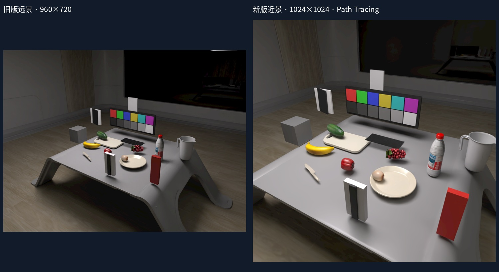

上图是整体取景修订前后，机位、幅面和渲染预算均已更新，不把这张图当作单变量因果实验。下方各实验仍在同组内只改一个逻辑参数。

主批次使用 **Isaac RTX Path Tracing**，默认 32SPP、6 次反弹并开启渲染去噪；基准图与离线模型的辐射输入使用 64SPP。显式的渲染器、AA 和实时漫反射反弹对照可使用 RayTracedLighting，它也是 RTX 光线追踪。参数写入值与运行时设置随原图保存。

本机的 35 帧实时对照请求 `RayTracedLighting`，正式采集时实际读回 `RealTimePathTracing`，即 **RTX Real-Time 2.0**。这些图片按实际后端解释；不认定为旧版 Real-Time 的等价结果。R10 的旧漫反射反弹设置在该后端是否真正生效未获证明。

**尺寸例外只发生在正在研究尺寸的实验中**：R08 真正采集 512/1024/1536 方图；resize、crop、binning、旋转/overscan 等输出处理按各自定义改变尺寸。对比板是拼图，不等于原始单图分辨率；每组提供各档单图链接。

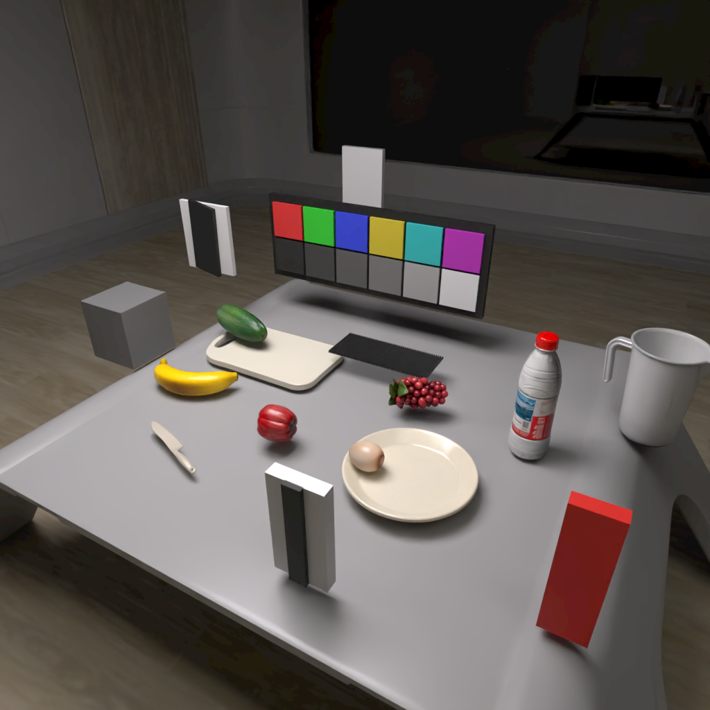

共 **187 组、555 档**，每档保留 5 帧/次模型输出。包括 67 组实际 Isaac 参数扫描和 120 组离线传感器/ISP/时间模型。离线模型和确定性时间重复不冒充额外的原生采集或实机测量。

## 2. 按成像环节阅读

| 环节 | 组数 | 主要回答什么 |
|---|---:|---|
| [场景与照明](#section_scene) | 16 | 先决定物体送给镜头什么光。灯光、材质与相机响应应分开理解；调曝光不能替代正确的照明和反射。 |
| [镜头：投影、畸变与安装](#section_lens_geometry) | 27 | 这一组主要决定东西出现在什么位置、多大、是否弯曲，以及哪些射线被覆盖。几何位置改变不等于清晰度改变。 |
| [镜头：清晰度与光学外观](#section_lens_optics) | 13 | 这一组决定细节如何被摊开、边缘是否分色、四角是否变暗，以及强光是否产生雾幕或光斑。 |
| [传感器：曝光与电子响应](#section_sensor_signal) | 15 | 这一组描述光子变成电子和数字码值的过程。更多光、模拟放大、数字放大和曲线提亮可能看起来相似，但物理含义不同。 |
| [传感器：噪声、温度与缺陷](#section_sensor_noise) | 10 | 随机颗粒、固定斑点和行列条带应分开观察。这里使用明确的电子模型，参数仍是教学假设。 |
| [ISP：校正、颜色与细节](#section_isp) | 46 | ISP 将传感器输入校正并重建成颜色图，再调整明暗、纹理与颗粒。每组都写明当前实现方向，避免只记滑块名称。 |
| [ISP：自动曝光与白平衡](#section_auto) | 13 | AE/AWB 会根据前面帧的统计调整后续帧。必须按 filmstrip 的时间顺序看，同时检查逐步曝光、增益和 WB 轨迹。 |
| [时间：快门、采样与同步](#section_time) | 14 | 静态截图无法验证时间行为。以下模型使用实际渲染的 240Hz 运动状态序列，分别控制积分、行间时间和采样/使用时刻。 |
| [输出：重采样、颜色编码与压缩](#section_output) | 24 | 这些步骤改变算法最终收到的像素和格式，必须同时更新 K、有效区域与颜色/时间合同。处理后尺寸可以与 1K 源图不同。 |
| [光线追踪：采样与后处理](#section_renderer) | 9 | 主批次使用 RTX Path Tracing，默认 32SPP、6 次反弹、去噪开启；基准/模型辐射输入为 64SPP。实时 RTX 对照也使用光线追踪。 |

每组图的第一排是第 5 次输出，第二排为同一个 1K 坐标 ROI 的均图放大，第三排为相对参考档均图的绝对差 ×4。对比板保持图像长宽比；最终判断细节请打开各档原尺寸 PNG。数字统计仍是输出响应描述，不是物理一致性合格分数。

真实硬件中的一个参数常同时影响多个环节。下表解释为何同一物理量在图集中有多组分解实验；这些分解控制不意味着真实设备存在彼此独立的旋钮。

| 同一物理量 | 相互关联的作用 | 分解实验 |
|---|---|---|
| 曝光时间 | 光子/亮度、噪声与运动积分 | E01 静态亮度，S20 电子累积，T01 拖影 |
| 镜头光圈 | 通光、景深与衍射 | E03 曝光光圈，O02 景深，Q05 衍射近似 |
| 放大/灵敏度 | ISO标尺、ADC前增益、ADC后数字增益 | E02、S07、S08；真实设备对应关系需读回 |
| 输出尺寸与视场 | 光学采样、像素K、裁剪/缩放范围 | R08、D01/D02、P01～P08 |

## 3. 各参数的解释与图片

### 场景与照明

先决定物体送给镜头什么光。灯光、材质与相机响应应分开理解；调曝光不能替代正确的照明和反射。

#### L01　主光强度

**它是什么：**主光源的强度参数，控制输入场景的光。

**主要影响与变化方向：**增大通常使受照表面更亮、高光更易饱和；阴影变化取决于补光与反射。

**看图提示：**看白盘、灰块、高光和阴影，不能只看水果颜色。

**实验设置：**Isaac 原生参数扫描；扫描值 `[250, 1000, 4000]` USD intensity；固定上下文 `{}`。

**实现边界：**其余条件固定；本实验不是 AVS 实测参数。

显示 RGB 均值范围 62.90～131.76 DN；相对参考档最大均图差 44.467 DN，平均重复帧逐像素波动 0.000 DN。

**各档原尺寸图：** [250 · 1024×1024](renders/native/L01/level_0/frame_04.png) · [1000 · 1024×1024](renders/native/L01/level_1/frame_04.png) · [4000 · 1024×1024](renders/native/L01/level_2/frame_04.png)

[查看全部 5 次重复](comparisons/L01_repeats.jpg)

#### L02　灯光 exposure

**它是什么：**用 stop 表达的灯光强度倍率。

**主要影响与变化方向：**每增加 1 stop，灯的发光标尺乘 2；显示 RGB 经曲线和截断后不一定也翻倍。

**看图提示：**比较灰阶块和白盘的亮度，检查高端灰块是否合并。

**实验设置：**Isaac 原生参数扫描；扫描值 `[-2, 0, 2]` stop；固定上下文 `{}`。

**实现边界：**其余条件固定；本实验不是 AVS 实测参数。

显示 RGB 均值范围 65.70～132.35 DN；相对参考档最大均图差 43.299 DN，平均重复帧逐像素波动 0.000 DN。

**各档原尺寸图：** [-2 · 1024×1024](renders/native/L02/level_0/frame_04.png) · [0 · 1024×1024](renders/native/L02/level_1/frame_04.png) · [2 · 1024×1024](renders/native/L02/level_2/frame_04.png)

[查看全部 5 次重复](comparisons/L02_repeats.jpg)

#### L03　主光 CCT

**它是什么：**光源相关色温；改变照射场景的光色。

**主要影响与变化方向：**在 WB 固定时，低色温通常偏暖、高色温偏冷；相同 CCT 仍不代表完整光谱相同。

**看图提示：**先看中性灰块和白盘，再看香蕉、甜椒的颜色变化。

**实验设置：**Isaac 原生参数扫描；扫描值 `[3000, 6500, 10000]` K；固定上下文 `{}`。

**实现边界：**RTX RGB 黑体近似，不是完整 SPD 光谱仿真。

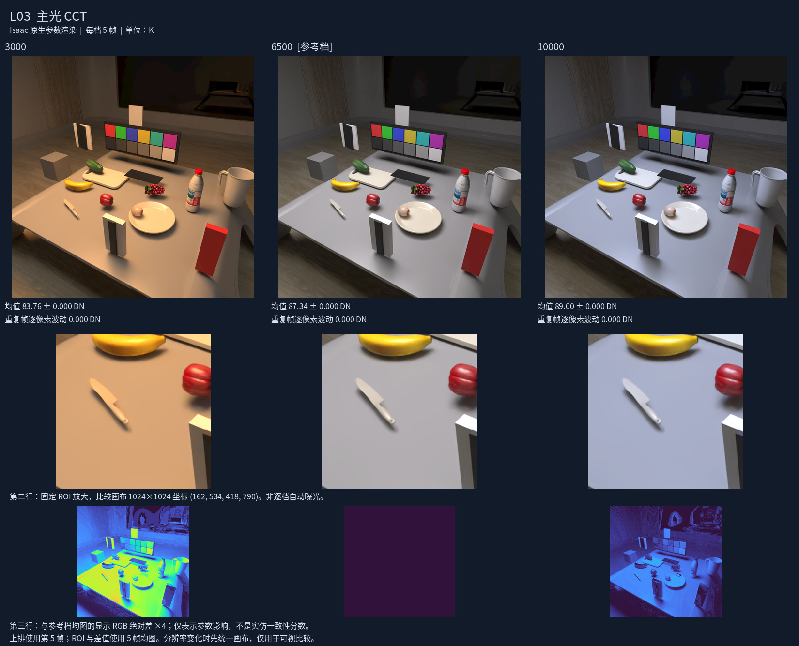

显示 RGB 均值范围 83.76～89.00 DN；相对参考档最大均图差 14.478 DN，平均重复帧逐像素波动 0.000 DN。

**各档原尺寸图：** [3000 · 1024×1024](renders/native/L03/level_0/frame_04.png) · [6500 · 1024×1024](renders/native/L03/level_1/frame_04.png) · [10000 · 1024×1024](renders/native/L03/level_2/frame_04.png)

[查看全部 5 次重复](comparisons/L03_repeats.jpg)

#### L04　主光 X 位置

**它是什么：**主光源在世界 X 方向的位置。

**主要影响与变化方向：**光源横向移动会改变受光面、高光位置和阴影方向，即使曝光没变也会有明暗变化。

**看图提示：**看灰立方体的亮面和投影、瓶子上的高光。

**实验设置：**Isaac 原生参数扫描；扫描值 `[-1.3, -0.4, 1.3]` m；固定上下文 `{}`。

**实现边界：**其余条件固定；本实验不是 AVS 实测参数。

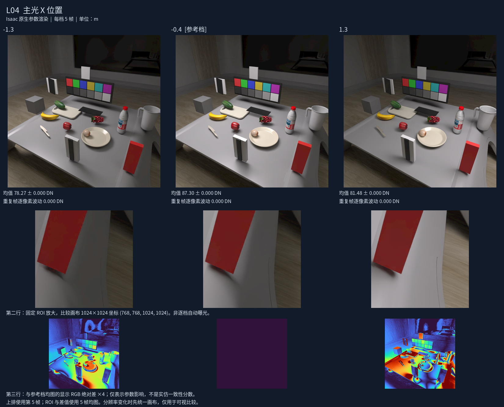

显示 RGB 均值范围 78.27～87.30 DN；相对参考档最大均图差 18.229 DN，平均重复帧逐像素波动 0.000 DN。

**各档原尺寸图：** [-1.3 · 1024×1024](renders/native/L04/level_0/frame_04.png) · [-0.4 · 1024×1024](renders/native/L04/level_1/frame_04.png) · [1.3 · 1024×1024](renders/native/L04/level_2/frame_04.png)

[查看全部 5 次重复](comparisons/L04_repeats.jpg)

#### L05　主光 Z 位置

**它是什么：**主光源的高度。

**主要影响与变化方向：**改变高度会改变光线入射角、距离衰减与光源角尺寸，因此亮度和阴影软硬都可能变化。

**看图提示：**比较灰块阴影长度、盘底阴影和高光面积。

**实验设置：**Isaac 原生参数扫描；扫描值 `[1.4, 2.6, 4.0]` m；固定上下文 `{}`。

**实现边界：**其余条件固定；本实验不是 AVS 实测参数。

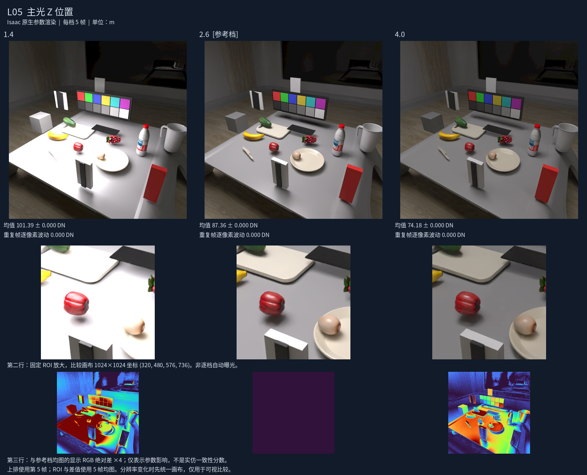

显示 RGB 均值范围 74.18～101.39 DN；相对参考档最大均图差 25.069 DN，平均重复帧逐像素波动 0.000 DN。

**各档原尺寸图：** [1.4 · 1024×1024](renders/native/L05/level_0/frame_04.png) · [2.6 · 1024×1024](renders/native/L05/level_1/frame_04.png) · [4.0 · 1024×1024](renders/native/L05/level_2/frame_04.png)

[查看全部 5 次重复](comparisons/L05_repeats.jpg)

#### L06　发光面宽度

**它是什么：**矩形发光面的宽度。

**主要影响与变化方向：**变宽通常使横向阴影过渡更软；本组固定 intensity 而非总通量，整体亮度也可能变化。

**看图提示：**看灰块、壶和瓶子投影的边缘，不把所有变化归因于柔光。

**实验设置：**Isaac 原生参数扫描；扫描值 `[0.1, 1.2, 2.4]` m；固定上下文 `{}`。

**实现边界：**保持 USD intensity 不变；面积变化可同时改变总通量，不能解释成仅阴影软硬。

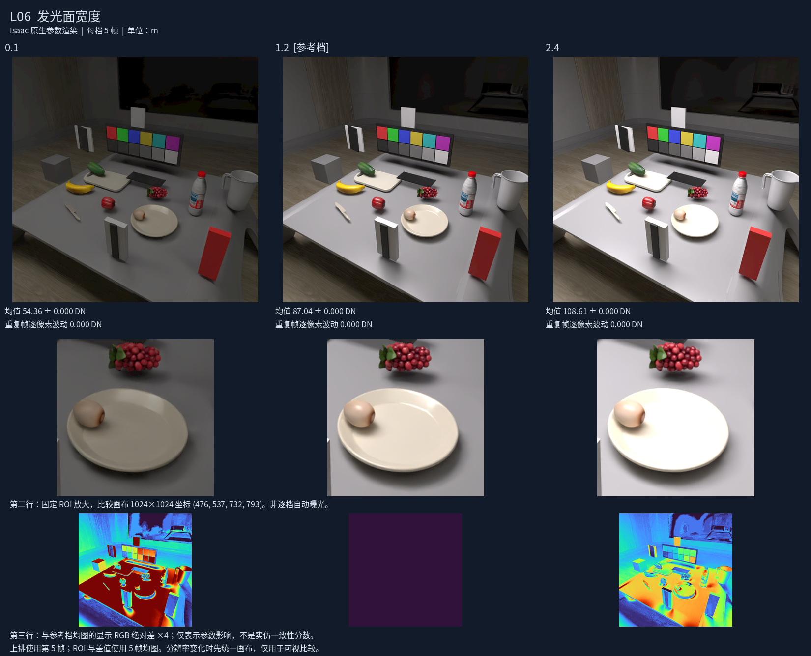

显示 RGB 均值范围 54.36～108.61 DN；相对参考档最大均图差 32.696 DN，平均重复帧逐像素波动 0.000 DN。

**各档原尺寸图：** [0.1 · 1024×1024](renders/native/L06/level_0/frame_04.png) · [1.2 · 1024×1024](renders/native/L06/level_1/frame_04.png) · [2.4 · 1024×1024](renders/native/L06/level_2/frame_04.png)

[查看全部 5 次重复](comparisons/L06_repeats.jpg)

#### L07　发光面高度

**它是什么：**矩形发光面的高度。

**主要影响与变化方向：**变高通常改变另一方向的光源角尺寸与半影，也可能增加总输出。

**看图提示：**比较物体阴影的过渡宽度和盘面高光形状。

**实验设置：**Isaac 原生参数扫描；扫描值 `[0.1, 0.8, 2.0]` m；固定上下文 `{}`。

**实现边界：**其余条件固定；本实验不是 AVS 实测参数。

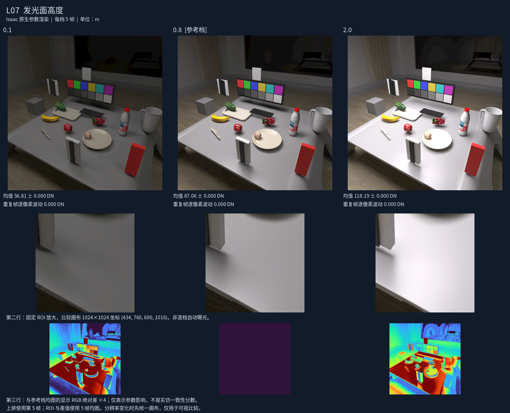

显示 RGB 均值范围 56.81～118.19 DN；相对参考档最大均图差 31.130 DN，平均重复帧逐像素波动 0.000 DN。

**各档原尺寸图：** [0.1 · 1024×1024](renders/native/L07/level_0/frame_04.png) · [0.8 · 1024×1024](renders/native/L07/level_1/frame_04.png) · [2.0 · 1024×1024](renders/native/L07/level_2/frame_04.png)

[查看全部 5 次重复](comparisons/L07_repeats.jpg)

#### L08　主光倾角

**它是什么：**主光源绕固定轴的倾斜角。

**主要影响与变化方向：**改变照射方向和有效投影面积，会同时改变受光面、阴影和高光。

**看图提示：**看瓶子、壶侧面亮暗如何转换及投影偏向。

**实验设置：**Isaac 原生参数扫描；扫描值 `[-25, 0, 25]` degree；固定上下文 `{}`。

**实现边界：**其余条件固定；本实验不是 AVS 实测参数。

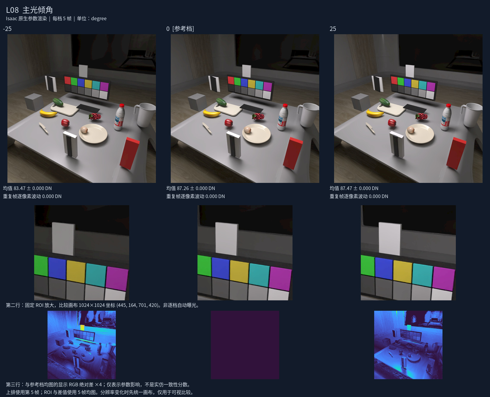

显示 RGB 均值范围 83.47～87.47 DN；相对参考档最大均图差 5.722 DN，平均重复帧逐像素波动 0.000 DN。

**各档原尺寸图：** [-25 · 1024×1024](renders/native/L08/level_0/frame_04.png) · [0 · 1024×1024](renders/native/L08/level_1/frame_04.png) · [25 · 1024×1024](renders/native/L08/level_2/frame_04.png)

[查看全部 5 次重复](comparisons/L08_repeats.jpg)

#### L09　环境补光

**它是什么：**环境 Dome 补光的强度。

**主要影响与变化方向：**若环境光能到达物体，增大可抬高阴影、降低反差；封闭房间里可能被遮挡而影响很弱。

**看图提示：**优先看盘底和物体背光面，微小差异不能当作普遍无效。

**实验设置：**Isaac 原生参数扫描；扫描值 `[0, 120, 480]` USD intensity；固定上下文 `{}`。

**实现边界：**其余条件固定；本实验不是 AVS 实测参数。

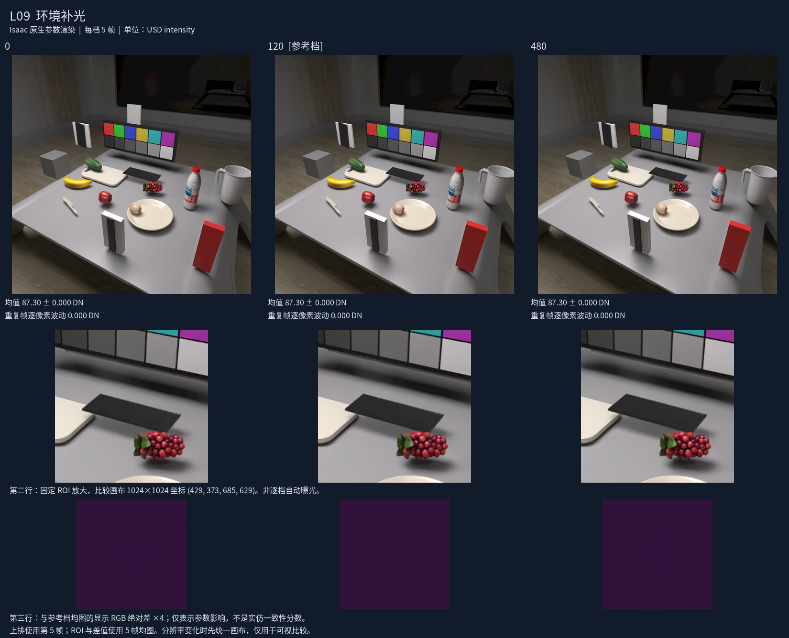

显示 RGB 均值范围 87.30～87.30 DN；相对参考档最大均图差 0.013 DN，平均重复帧逐像素波动 0.000 DN。

**各档原尺寸图：** [0 · 1024×1024](renders/native/L09/level_0/frame_04.png) · [120 · 1024×1024](renders/native/L09/level_1/frame_04.png) · [480 · 1024×1024](renders/native/L09/level_2/frame_04.png)

[查看全部 5 次重复](comparisons/L09_repeats.jpg)

#### M01　中性物体漫反射率

**它是什么：**物体漫反射的中性反射参数。

**主要影响与变化方向：**固定照明时，数值增大通常使灰探针更亮；不会让所有物体同时变亮。

**看图提示：**只比较左侧灰立方体及其反射影响，别把它当相机曝光。

**实验设置：**Isaac 原生参数扫描；扫描值 `[0.05, 0.18, 0.7]` linear RGB；固定上下文 `{}`。

**实现边界：**其余条件固定；本实验不是 AVS 实测参数。

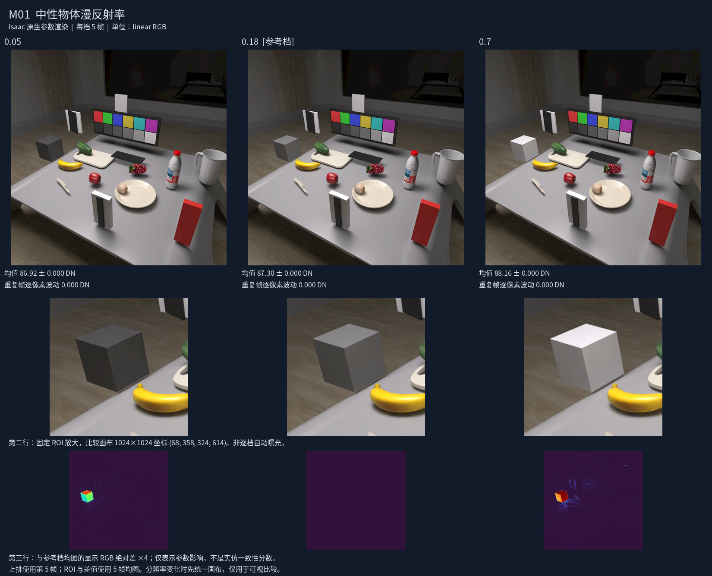

显示 RGB 均值范围 86.92～88.16 DN；相对参考档最大均图差 0.880 DN，平均重复帧逐像素波动 0.000 DN。

**各档原尺寸图：** [0.05 · 1024×1024](renders/native/M01/level_0/frame_04.png) · [0.18 · 1024×1024](renders/native/M01/level_1/frame_04.png) · [0.7 · 1024×1024](renders/native/M01/level_2/frame_04.png)

[查看全部 5 次重复](comparisons/M01_repeats.jpg)

#### M02　表面粗糙度

**它是什么：**表面微结构的粗糙程度。

**主要影响与变化方向：**小值通常产生较窄、较集中的高光或反射；大值让高光更宽、更模糊。

**看图提示：**看灰立方体反光的形状与边界，而非只看平均亮度。

**实验设置：**Isaac 原生参数扫描；扫描值 `[0.02, 0.35, 1.0]` 1；固定上下文 `{}`。

**实现边界：**其余条件固定；本实验不是 AVS 实测参数。

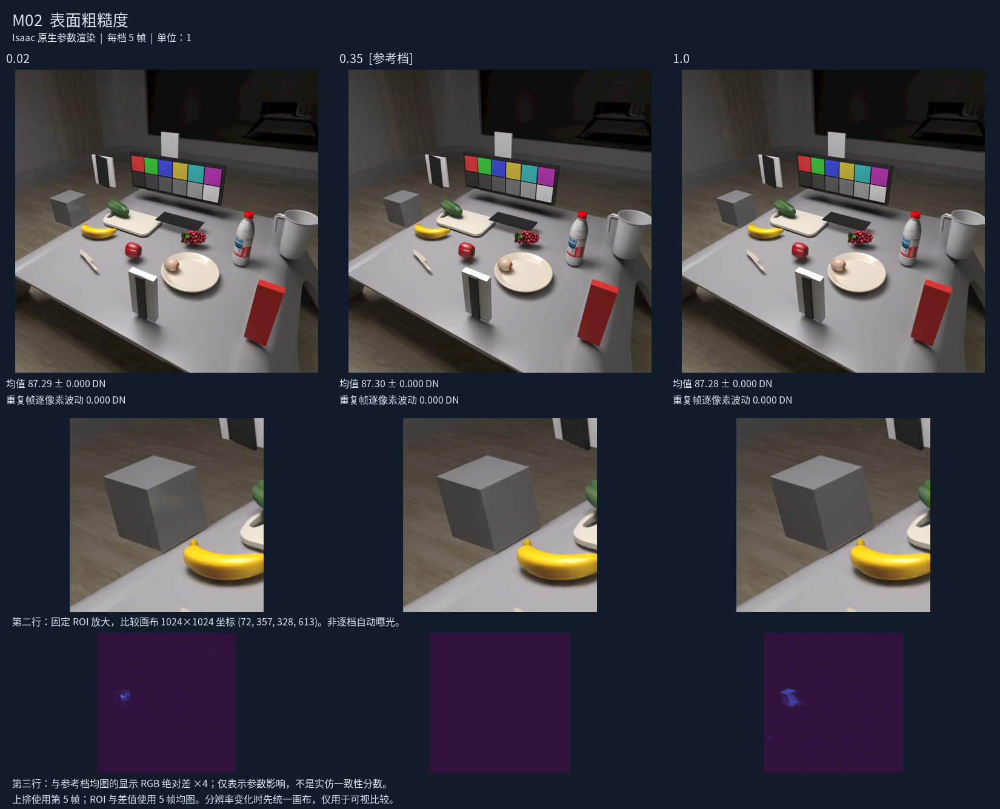

显示 RGB 均值范围 87.28～87.30 DN；相对参考档最大均图差 0.058 DN，平均重复帧逐像素波动 0.000 DN。

**各档原尺寸图：** [0.02 · 1024×1024](renders/native/M02/level_0/frame_04.png) · [0.35 · 1024×1024](renders/native/M02/level_1/frame_04.png) · [1.0 · 1024×1024](renders/native/M02/level_2/frame_04.png)

[查看全部 5 次重复](comparisons/M02_repeats.jpg)

#### M03　金属度

**它是什么：**PBR 中金属与非金属反射行为的混合系数。

**主要影响与变化方向：**增大使表面更偏金属反射、漫反射减少，环境和光源反射更重要；不是统一增亮开关。

**看图提示：**看灰探针是否更像反光金属，注意颜色和明暗分布。

**实验设置：**Isaac 原生参数扫描；扫描值 `[0, 0.5, 1.0]` 1；固定上下文 `{}`。

**实现边界：**其余条件固定；本实验不是 AVS 实测参数。

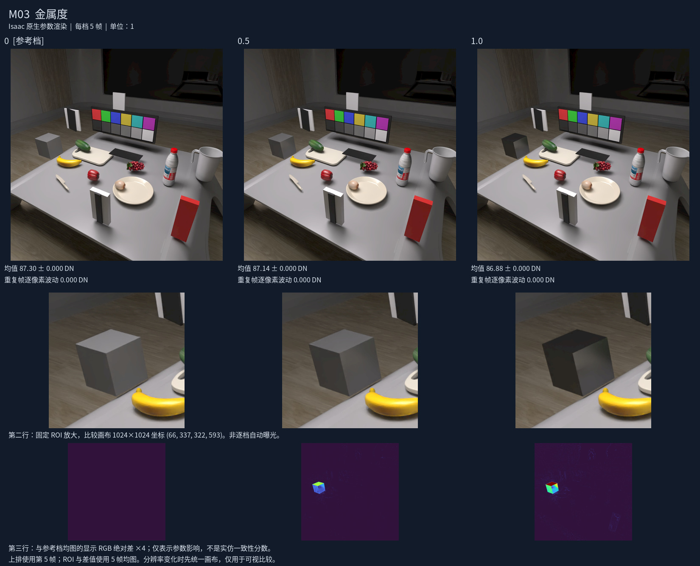

显示 RGB 均值范围 86.88～87.30 DN；相对参考档最大均图差 0.536 DN，平均重复帧逐像素波动 0.000 DN。

**各档原尺寸图：** [0 · 1024×1024](renders/native/M03/level_0/frame_04.png) · [0.5 · 1024×1024](renders/native/M03/level_1/frame_04.png) · [1.0 · 1024×1024](renders/native/M03/level_2/frame_04.png)

[查看全部 5 次重复](comparisons/M03_repeats.jpg)

#### M04　折射率输入 IOR

**它是什么：**材质的折射率输入，影响界面反射/折射关系。

**主要影响与变化方向：**在当前材质工作流支持时会改变菲涅耳反射；不透明、无透射路径时不保证出现明显玻璃形变。

**看图提示：**只看探针的边缘反射，不能把不明显的结果当成完整玻璃验证。

**实验设置：**Isaac 原生参数扫描；扫描值 `[1.1, 1.5, 2.4]` 1；固定上下文 `{}`。

**实现边界：**只验证当前 UsdPreviewSurface 的响应，不代表完整玻璃光谱。

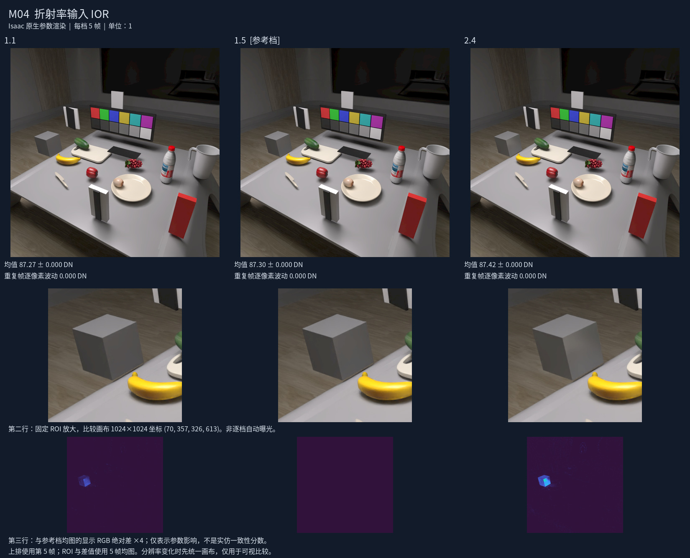

显示 RGB 均值范围 87.27～87.42 DN；相对参考档最大均图差 0.153 DN，平均重复帧逐像素波动 0.000 DN。

**各档原尺寸图：** [1.1 · 1024×1024](renders/native/M04/level_0/frame_04.png) · [1.5 · 1024×1024](renders/native/M04/level_1/frame_04.png) · [2.4 · 1024×1024](renders/native/M04/level_2/frame_04.png)

[查看全部 5 次重复](comparisons/M04_repeats.jpg)

#### M05　透明度 opacity

**它是什么：**表面的不透明程度，1 表示不透明。

**主要影响与变化方向：**减小会让后面的内容透出或减少遮挡；这是当前材质透明模型，不是相机曝光。

**看图提示：**看灰探针背后的桌面能否透出，比较其投影与轮廓。

**实验设置：**Isaac 原生参数扫描；扫描值 `[0.2, 0.6, 1.0]` 1；固定上下文 `{}`。

**实现边界：**其余条件固定；本实验不是 AVS 实测参数。

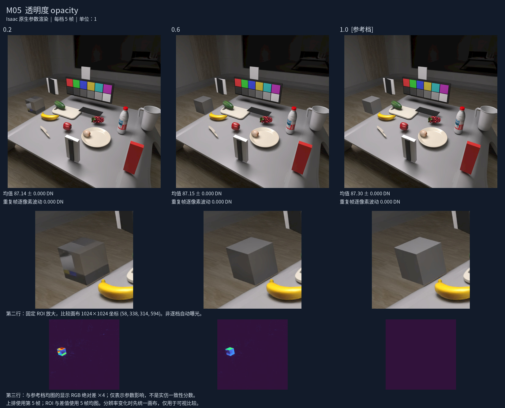

显示 RGB 均值范围 87.14～87.30 DN；相对参考档最大均图差 0.319 DN，平均重复帧逐像素波动 0.000 DN。

**各档原尺寸图：** [0.2 · 1024×1024](renders/native/M05/level_0/frame_04.png) · [0.6 · 1024×1024](renders/native/M05/level_1/frame_04.png) · [1.0 · 1024×1024](renders/native/M05/level_2/frame_04.png)

[查看全部 5 次重复](comparisons/M05_repeats.jpg)

#### M06　镜面反射系数

**它是什么：**非金属 specular workflow 的镜面反射颜色系数。

**主要影响与变化方向：**增大通常增强表面高光和环境反射；漫反射与总亮度的变化依材质实现而定。

**看图提示：**在灰探针上找高光与反射，不只看水果。

**实验设置：**Isaac 原生参数扫描；扫描值 `[0.02, 0.08, 0.3]` linear RGB；固定上下文 `{"specular_workflow": 1}`。

**实现边界：**其余条件固定；本实验不是 AVS 实测参数。

显示 RGB 均值范围 87.28～87.45 DN；相对参考档最大均图差 0.193 DN，平均重复帧逐像素波动 0.000 DN。

**各档原尺寸图：** [0.02 · 1024×1024](renders/native/M06/level_0/frame_04.png) · [0.08 · 1024×1024](renders/native/M06/level_1/frame_04.png) · [0.3 · 1024×1024](renders/native/M06/level_2/frame_04.png)

[查看全部 5 次重复](comparisons/M06_repeats.jpg)

#### M07　表面法线扰动

**它是什么：**表面用于着色的法线方向扰动。

**主要影响与变化方向：**改变法线会改变受光、高光和反射方向；几何轮廓本身应基本不变。

**看图提示：**看灰探针亮面变化，同时确认外轮廓没有像真实几何那样移动。

**实验设置：**Isaac 原生参数扫描；扫描值 `[0, 20, 40]` degree；固定上下文 `{}`。

**实现边界：**UsdPreviewSurface normal 常量方向扰动；不是已校准的微表面法线贴图。

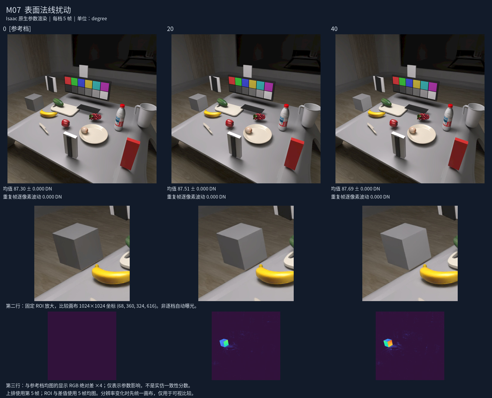

显示 RGB 均值范围 87.30～87.69 DN；相对参考档最大均图差 0.415 DN，平均重复帧逐像素波动 0.000 DN。

**各档原尺寸图：** [0 · 1024×1024](renders/native/M07/level_0/frame_04.png) · [20 · 1024×1024](renders/native/M07/level_1/frame_04.png) · [40 · 1024×1024](renders/native/M07/level_2/frame_04.png)

[查看全部 5 次重复](comparisons/M07_repeats.jpg)

### 镜头：投影、畸变与安装

这一组主要决定东西出现在什么位置、多大、是否弯曲，以及哪些射线被覆盖。几何位置改变不等于清晰度改变。

#### D01　OpenCV 针孔 fx

**它是什么：**OpenCV 镜头模型的水平焦距，单位像素。

**主要影响与变化方向：**增大通常放大水平方向投影、缩小水平视场；当 fx 与 fy 不同，物体像素形状可能改变。

**看图提示：**看盘子的横向直径和左右场景覆盖。

**实验设置：**Isaac 原生参数扫描；扫描值 `[600, 800, 1000]` px；固定上下文 `{"lens": "opencvPinhole"}`。

**实现边界：**其余条件固定；本实验不是 AVS 实测参数。

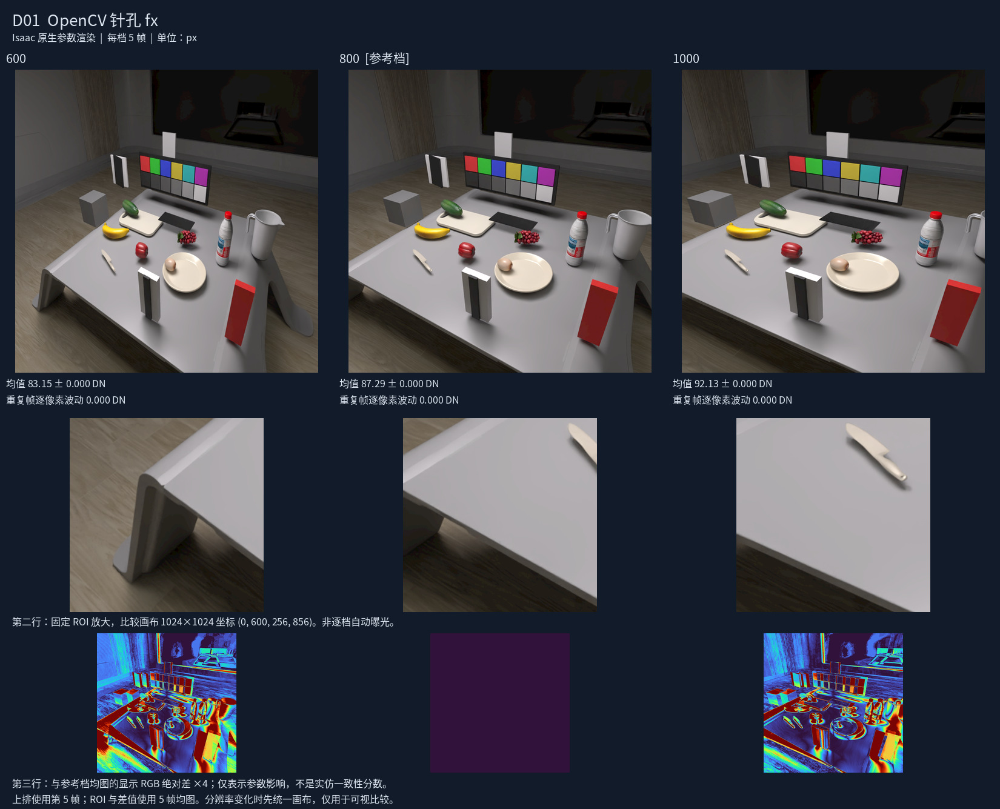

显示 RGB 均值范围 83.15～92.13 DN；相对参考档最大均图差 23.748 DN，平均重复帧逐像素波动 0.000 DN。

**各档原尺寸图：** [600 · 1024×1024](renders/native/D01/level_0/frame_04.png) · [800 · 1024×1024](renders/native/D01/level_1/frame_04.png) · [1000 · 1024×1024](renders/native/D01/level_2/frame_04.png)

[查看全部 5 次重复](comparisons/D01_repeats.jpg)

#### D02　OpenCV 针孔 fy

**它是什么：**OpenCV 镜头模型的垂直焦距，单位像素。

**主要影响与变化方向：**增大通常放大垂直方向投影、缩小垂直视场；和仅改单个 filmback 声明不是同一接口。

**看图提示：**看瓶子高度、色卡上下间距和盘子的纵向直径。

**实验设置：**Isaac 原生参数扫描；扫描值 `[600, 800, 1000]` px；固定上下文 `{"lens": "opencvPinhole"}`。

**实现边界：**其余条件固定；本实验不是 AVS 实测参数。

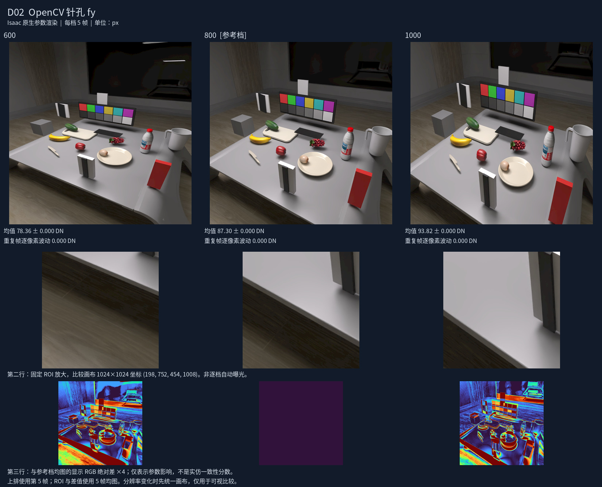

显示 RGB 均值范围 78.36～93.82 DN；相对参考档最大均图差 29.396 DN，平均重复帧逐像素波动 0.000 DN。

**各档原尺寸图：** [600 · 1024×1024](renders/native/D02/level_0/frame_04.png) · [800 · 1024×1024](renders/native/D02/level_1/frame_04.png) · [1000 · 1024×1024](renders/native/D02/level_2/frame_04.png)

[查看全部 5 次重复](comparisons/D02_repeats.jpg)

#### D03　Brown/rational k1

**它是什么：**Brown/rational 镜头模型的 k1 畸变项。高阶项通常在更偏离中心的区域影响更明显。

**主要影响与变化方向：**正负变化会改变边缘径向放大与弯曲；k4 在 rational 中位于分母，不能沿用 fisheye 的方向解释。系数含义依模型，不能在 Brown 与 fisheye 之间直接互抄。

**看图提示：**比较色卡直边、盘沿及画面边缘；中心变化可能很小，要注意有效区域。

**实验设置：**Isaac 原生参数扫描；扫描值 `[-0.15, 0, 0.15]` 1；固定上下文 `{"lens": "opencvPinhole"}`。

**实现边界：**其余条件固定；本实验不是 AVS 实测参数。

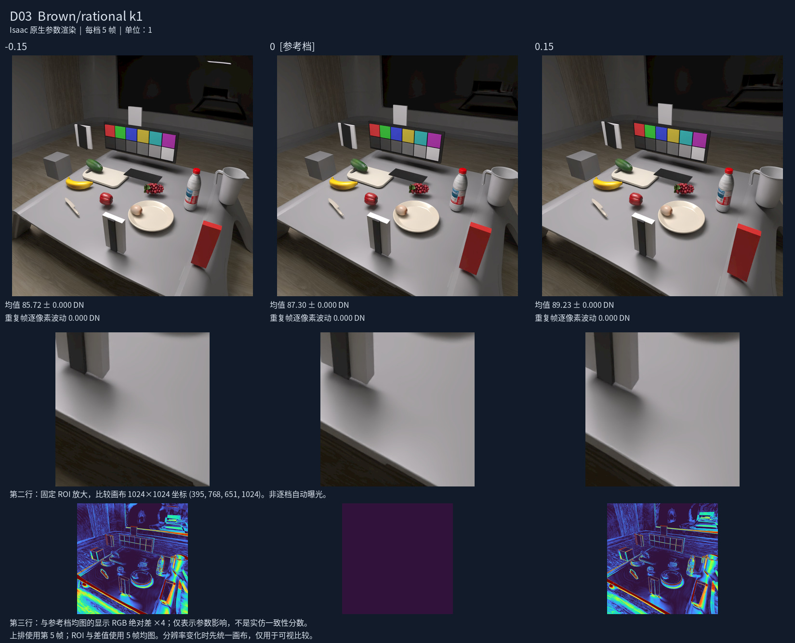

显示 RGB 均值范围 85.72～89.23 DN；相对参考档最大均图差 9.578 DN，平均重复帧逐像素波动 0.000 DN。

**各档原尺寸图：** [-0.15 · 1024×1024](renders/native/D03/level_0/frame_04.png) · [0 · 1024×1024](renders/native/D03/level_1/frame_04.png) · [0.15 · 1024×1024](renders/native/D03/level_2/frame_04.png)

[查看全部 5 次重复](comparisons/D03_repeats.jpg)

#### D04　Brown/rational k2

**它是什么：**Brown/rational 镜头模型的 k2 畸变项。高阶项通常在更偏离中心的区域影响更明显。

**主要影响与变化方向：**正负变化会改变边缘径向放大与弯曲；k4 在 rational 中位于分母，不能沿用 fisheye 的方向解释。系数含义依模型，不能在 Brown 与 fisheye 之间直接互抄。

**看图提示：**比较色卡直边、盘沿及画面边缘；中心变化可能很小，要注意有效区域。

**实验设置：**Isaac 原生参数扫描；扫描值 `[-0.15, 0, 0.15]` 1；固定上下文 `{"lens": "opencvPinhole"}`。

**实现边界：**其余条件固定；本实验不是 AVS 实测参数。

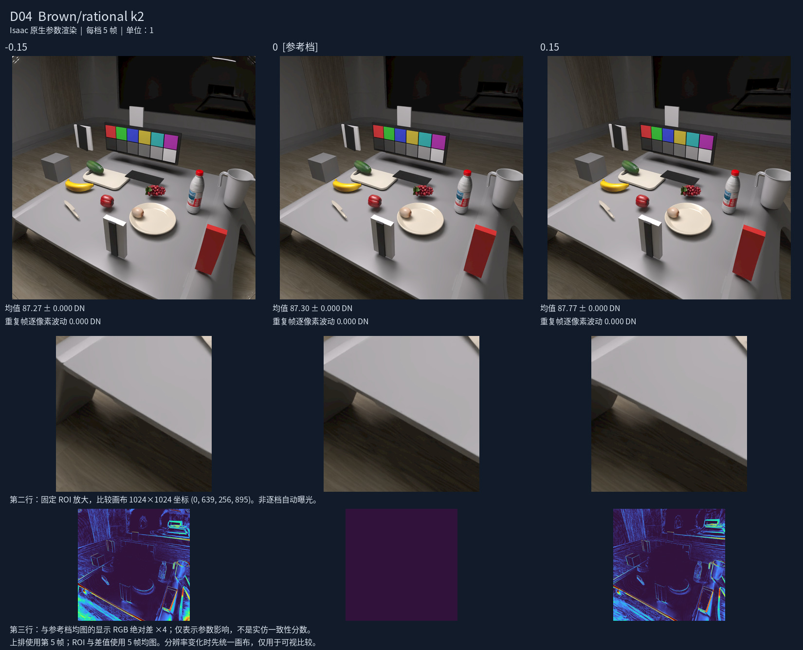

显示 RGB 均值范围 87.27～87.77 DN；相对参考档最大均图差 3.944 DN，平均重复帧逐像素波动 0.000 DN。

**各档原尺寸图：** [-0.15 · 1024×1024](renders/native/D04/level_0/frame_04.png) · [0 · 1024×1024](renders/native/D04/level_1/frame_04.png) · [0.15 · 1024×1024](renders/native/D04/level_2/frame_04.png)

[查看全部 5 次重复](comparisons/D04_repeats.jpg)

#### D05　Brown/rational k3

**它是什么：**Brown/rational 镜头模型的 k3 畸变项。高阶项通常在更偏离中心的区域影响更明显。

**主要影响与变化方向：**正负变化会改变边缘径向放大与弯曲；k4 在 rational 中位于分母，不能沿用 fisheye 的方向解释。系数含义依模型，不能在 Brown 与 fisheye 之间直接互抄。

**看图提示：**比较色卡直边、盘沿及画面边缘；中心变化可能很小，要注意有效区域。

**实验设置：**Isaac 原生参数扫描；扫描值 `[-0.15, 0, 0.15]` 1；固定上下文 `{"lens": "opencvPinhole"}`。

**实现边界：**其余条件固定；本实验不是 AVS 实测参数。

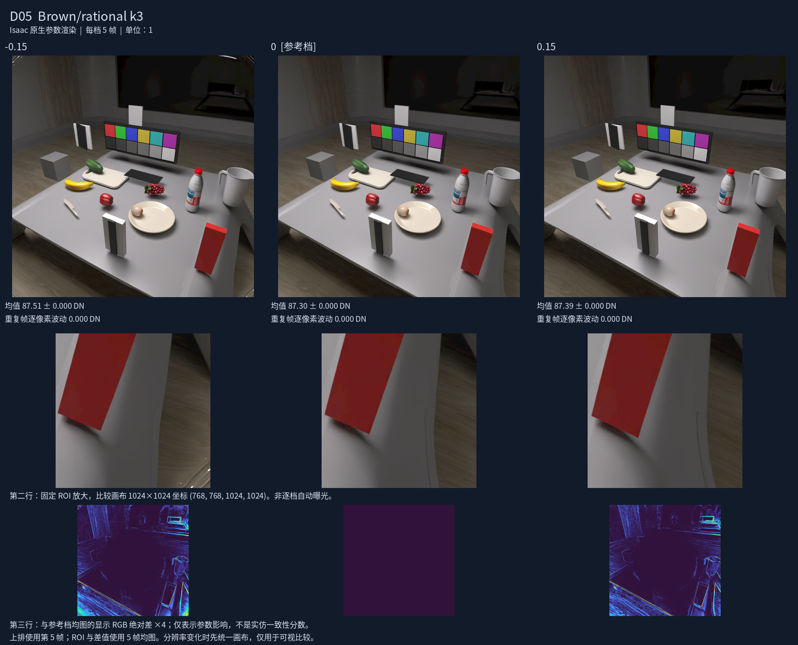

显示 RGB 均值范围 87.30～87.51 DN；相对参考档最大均图差 1.950 DN，平均重复帧逐像素波动 0.000 DN。

**各档原尺寸图：** [-0.15 · 1024×1024](renders/native/D05/level_0/frame_04.png) · [0 · 1024×1024](renders/native/D05/level_1/frame_04.png) · [0.15 · 1024×1024](renders/native/D05/level_2/frame_04.png)

[查看全部 5 次重复](comparisons/D05_repeats.jpg)

#### D06　Brown/rational k4

**它是什么：**Brown/rational 镜头模型的 k4 畸变项。高阶项通常在更偏离中心的区域影响更明显。

**主要影响与变化方向：**正负变化会改变边缘径向放大与弯曲；k4 在 rational 中位于分母，不能沿用 fisheye 的方向解释。系数含义依模型，不能在 Brown 与 fisheye 之间直接互抄。

**看图提示：**比较色卡直边、盘沿及画面边缘；中心变化可能很小，要注意有效区域。

**实验设置：**Isaac 原生参数扫描；扫描值 `[-0.15, 0, 0.15]` 1；固定上下文 `{"lens": "opencvPinhole"}`。

**实现边界：**k4 为 rational 分母项；与 fisheye 的 k4 定义不同。

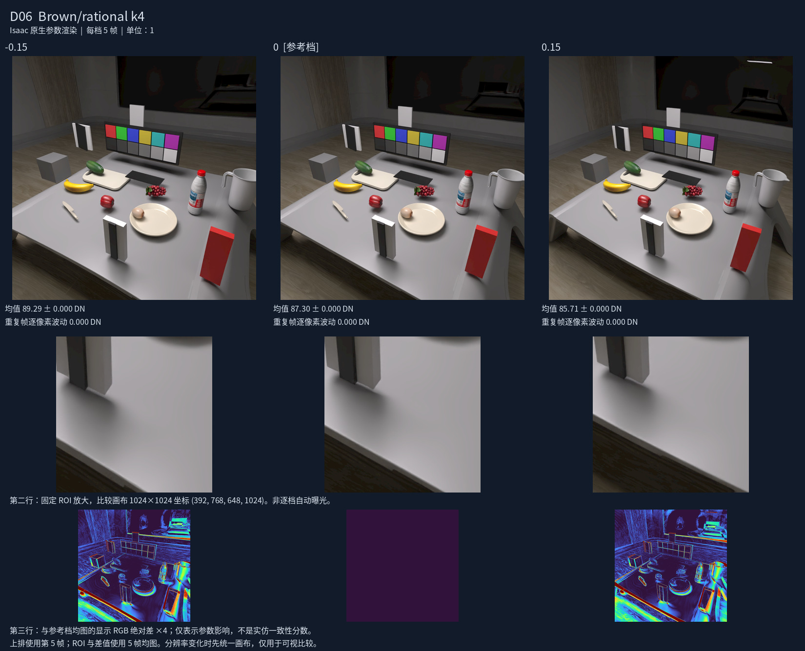

显示 RGB 均值范围 85.71～89.29 DN；相对参考档最大均图差 9.141 DN，平均重复帧逐像素波动 0.000 DN。

**各档原尺寸图：** [-0.15 · 1024×1024](renders/native/D06/level_0/frame_04.png) · [0 · 1024×1024](renders/native/D06/level_1/frame_04.png) · [0.15 · 1024×1024](renders/native/D06/level_2/frame_04.png)

[查看全部 5 次重复](comparisons/D06_repeats.jpg)

#### D07　切向畸变 p1

**它是什么：**Brown/rational 镜头模型的 p1 畸变项。切向项描述非径向对称偏移。

**主要影响与变化方向：**正负值产生不同方向的不对称拉扯/偏移。系数含义依模型，不能在 Brown 与 fisheye 之间直接互抄。

**看图提示：**比较色卡直边、盘沿及画面边缘；中心变化可能很小，要注意有效区域。

**实验设置：**Isaac 原生参数扫描；扫描值 `[-0.04, 0, 0.04]` 1；固定上下文 `{"lens": "opencvPinhole"}`。

**实现边界：**其余条件固定；本实验不是 AVS 实测参数。

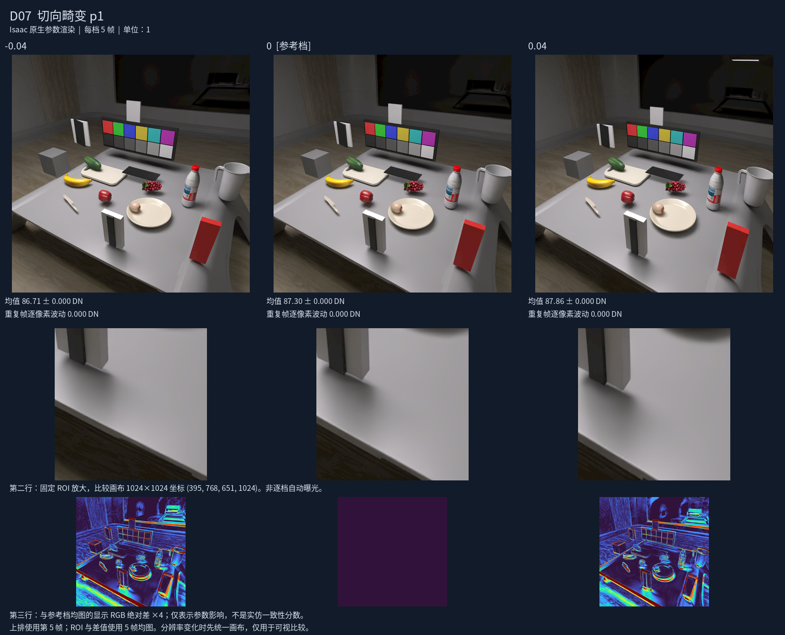

显示 RGB 均值范围 86.71～87.86 DN；相对参考档最大均图差 10.339 DN，平均重复帧逐像素波动 0.000 DN。

**各档原尺寸图：** [-0.04 · 1024×1024](renders/native/D07/level_0/frame_04.png) · [0 · 1024×1024](renders/native/D07/level_1/frame_04.png) · [0.04 · 1024×1024](renders/native/D07/level_2/frame_04.png)

[查看全部 5 次重复](comparisons/D07_repeats.jpg)

#### D08　切向畸变 p2

**它是什么：**Brown/rational 镜头模型的 p2 畸变项。切向项描述非径向对称偏移。

**主要影响与变化方向：**正负值产生不同方向的不对称拉扯/偏移。系数含义依模型，不能在 Brown 与 fisheye 之间直接互抄。

**看图提示：**比较色卡直边、盘沿及画面边缘；中心变化可能很小，要注意有效区域。

**实验设置：**Isaac 原生参数扫描；扫描值 `[-0.04, 0, 0.04]` 1；固定上下文 `{"lens": "opencvPinhole"}`。

**实现边界：**其余条件固定；本实验不是 AVS 实测参数。

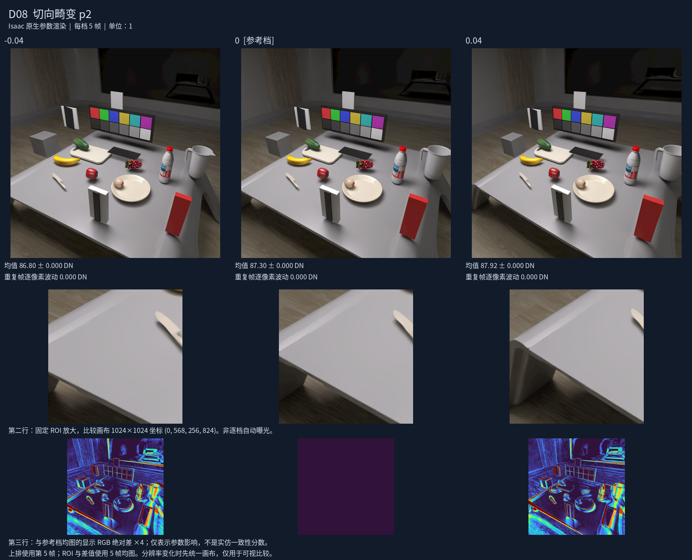

显示 RGB 均值范围 86.80～87.92 DN；相对参考档最大均图差 9.516 DN，平均重复帧逐像素波动 0.000 DN。

**各档原尺寸图：** [-0.04 · 1024×1024](renders/native/D08/level_0/frame_04.png) · [0 · 1024×1024](renders/native/D08/level_1/frame_04.png) · [0.04 · 1024×1024](renders/native/D08/level_2/frame_04.png)

[查看全部 5 次重复](comparisons/D08_repeats.jpg)

#### F01　OpenCV fisheye k1

**它是什么：**OpenCV fisheye 的角度多项式 k1 项。高阶项通常在更偏离中心的区域影响更明显。

**主要影响与变化方向：**正负变化会改变边缘径向放大与弯曲；k4 在 rational 中位于分母，不能沿用 fisheye 的方向解释。系数含义依模型，不能在 Brown 与 fisheye 之间直接互抄。

**看图提示：**比较色卡直边、盘沿及画面边缘；中心变化可能很小，要注意有效区域。

**实验设置：**Isaac 原生参数扫描；扫描值 `[-0.1, 0, 0.1]` 1；固定上下文 `{"lens": "opencvFisheye"}`。

**实现边界：**固定 fx=fy=800，与 Brown 模型不共享系数含义。

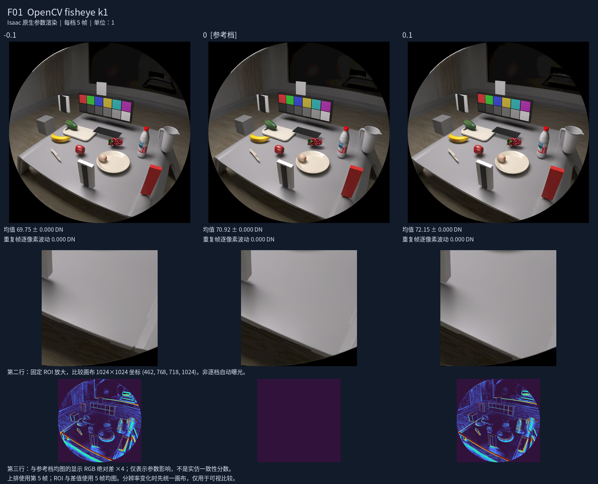

显示 RGB 均值范围 69.75～72.15 DN；相对参考档最大均图差 4.950 DN，平均重复帧逐像素波动 0.000 DN。

**各档原尺寸图：** [-0.1 · 1024×1024](renders/native/F01/level_0/frame_04.png) · [0 · 1024×1024](renders/native/F01/level_1/frame_04.png) · [0.1 · 1024×1024](renders/native/F01/level_2/frame_04.png)

[查看全部 5 次重复](comparisons/F01_repeats.jpg)

#### F02　OpenCV fisheye k2

**它是什么：**OpenCV fisheye 的角度多项式 k2 项。高阶项通常在更偏离中心的区域影响更明显。

**主要影响与变化方向：**正负变化会改变边缘径向放大与弯曲；k4 在 rational 中位于分母，不能沿用 fisheye 的方向解释。系数含义依模型，不能在 Brown 与 fisheye 之间直接互抄。

**看图提示：**比较色卡直边、盘沿及画面边缘；中心变化可能很小，要注意有效区域。

**实验设置：**Isaac 原生参数扫描；扫描值 `[-0.1, 0, 0.1]` 1；固定上下文 `{"lens": "opencvFisheye"}`。

**实现边界：**固定 fx=fy=800，与 Brown 模型不共享系数含义。

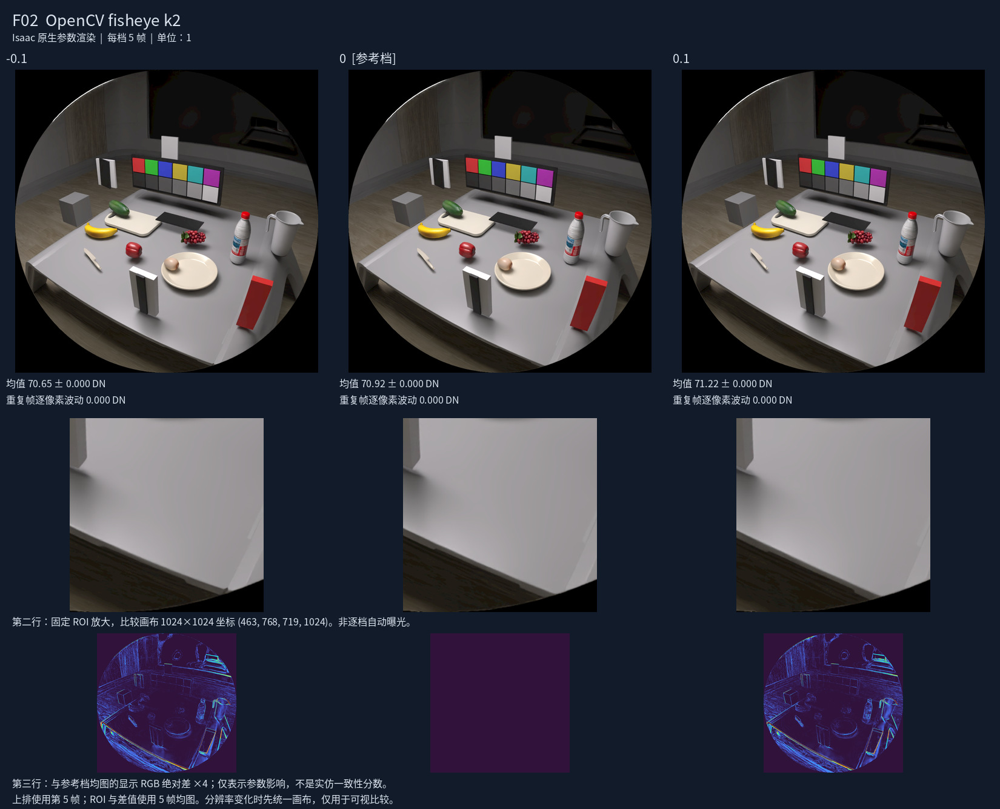

显示 RGB 均值范围 70.65～71.22 DN；相对参考档最大均图差 1.653 DN，平均重复帧逐像素波动 0.000 DN。

**各档原尺寸图：** [-0.1 · 1024×1024](renders/native/F02/level_0/frame_04.png) · [0 · 1024×1024](renders/native/F02/level_1/frame_04.png) · [0.1 · 1024×1024](renders/native/F02/level_2/frame_04.png)

[查看全部 5 次重复](comparisons/F02_repeats.jpg)

#### F03　OpenCV fisheye k3

**它是什么：**OpenCV fisheye 的角度多项式 k3 项。高阶项通常在更偏离中心的区域影响更明显。

**主要影响与变化方向：**正负变化会改变边缘径向放大与弯曲；k4 在 rational 中位于分母，不能沿用 fisheye 的方向解释。系数含义依模型，不能在 Brown 与 fisheye 之间直接互抄。

**看图提示：**比较色卡直边、盘沿及画面边缘；中心变化可能很小，要注意有效区域。

**实验设置：**Isaac 原生参数扫描；扫描值 `[-0.1, 0, 0.1]` 1；固定上下文 `{"lens": "opencvFisheye"}`。

**实现边界：**固定 fx=fy=800，与 Brown 模型不共享系数含义。

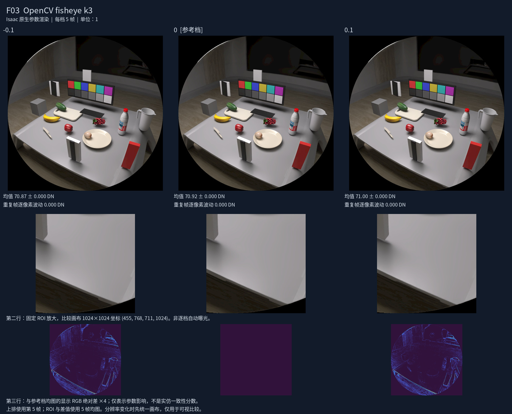

显示 RGB 均值范围 70.87～71.00 DN；相对参考档最大均图差 0.700 DN，平均重复帧逐像素波动 0.000 DN。

**各档原尺寸图：** [-0.1 · 1024×1024](renders/native/F03/level_0/frame_04.png) · [0 · 1024×1024](renders/native/F03/level_1/frame_04.png) · [0.1 · 1024×1024](renders/native/F03/level_2/frame_04.png)

[查看全部 5 次重复](comparisons/F03_repeats.jpg)

#### F04　OpenCV fisheye k4

**它是什么：**OpenCV fisheye 的角度多项式 k4 项。高阶项通常在更偏离中心的区域影响更明显。

**主要影响与变化方向：**正负变化会改变边缘径向放大与弯曲；k4 在 rational 中位于分母，不能沿用 fisheye 的方向解释。系数含义依模型，不能在 Brown 与 fisheye 之间直接互抄。

**看图提示：**比较色卡直边、盘沿及画面边缘；中心变化可能很小，要注意有效区域。

**实验设置：**Isaac 原生参数扫描；扫描值 `[-0.1, 0, 0.1]` 1；固定上下文 `{"lens": "opencvFisheye"}`。

**实现边界：**固定 fx=fy=800，与 Brown 模型不共享系数含义。

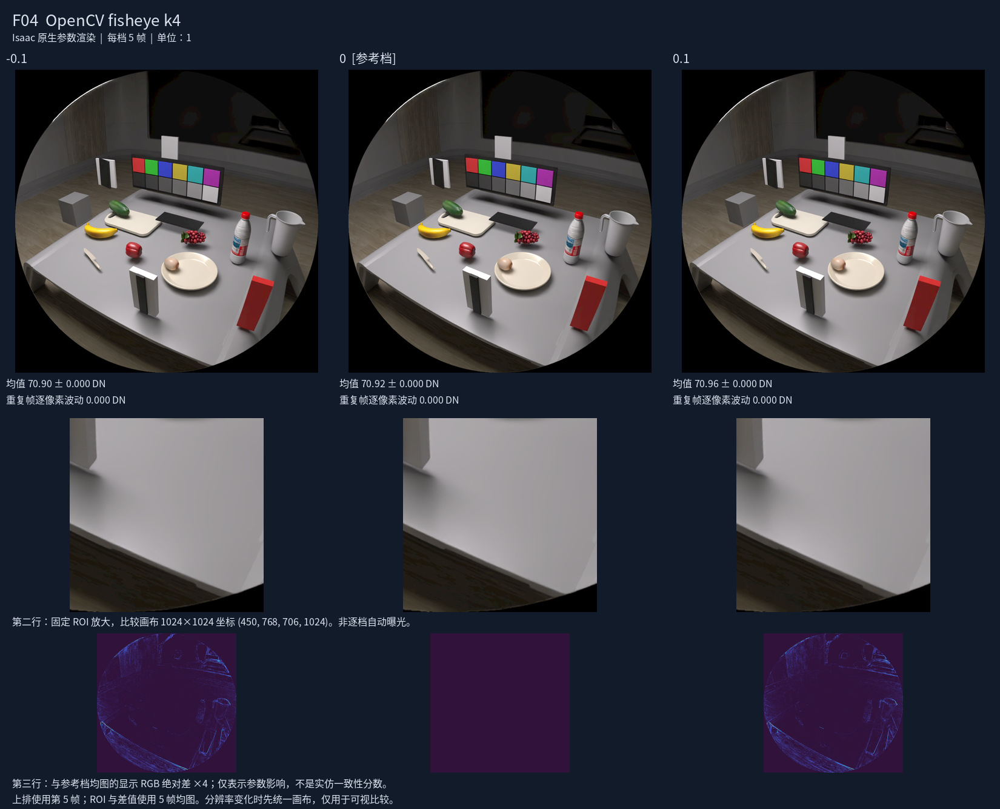

显示 RGB 均值范围 70.90～70.96 DN；相对参考档最大均图差 0.348 DN，平均重复帧逐像素波动 0.000 DN。

**各档原尺寸图：** [-0.1 · 1024×1024](renders/native/F04/level_0/frame_04.png) · [0 · 1024×1024](renders/native/F04/level_1/frame_04.png) · [0.1 · 1024×1024](renders/native/F04/level_2/frame_04.png)

[查看全部 5 次重复](comparisons/F04_repeats.jpg)

#### G01　物理焦距

**它是什么：**镜头物理焦距，表示光线会聚的尺度。

**主要影响与变化方向：**固定感光面和机位时，焦距增大使视场变窄、物体变大，边缘物品可能出画；这不是相机向物体移动。

**看图提示：**比较盘子和色卡占画面的比例、左右边缘剩余内容。

**实验设置：**Isaac 原生参数扫描；扫描值 `[25, 35, 50]` mm；固定上下文 `{}`。

**实现边界：**其余条件固定；本实验不是 AVS 实测参数。

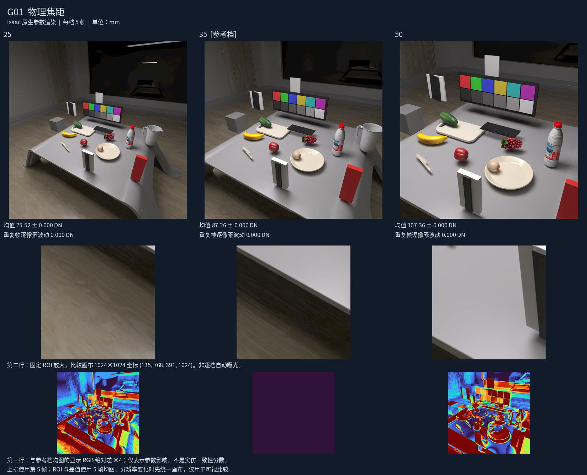

显示 RGB 均值范围 75.52～107.36 DN；相对参考档最大均图差 45.094 DN，平均重复帧逐像素波动 0.000 DN。

**各档原尺寸图：** [25 · 1024×1024](renders/native/G01/level_0/frame_04.png) · [35 · 1024×1024](renders/native/G01/level_1/frame_04.png) · [50 · 1024×1024](renders/native/G01/level_2/frame_04.png)

[查看全部 5 次重复](comparisons/G01_repeats.jpg)

#### G02　水平 filmback aperture

**它是什么：**虚拟感光面的水平宽度，与焦距共同决定水平视场。

**主要影响与变化方向：**宽度变大通常让视场变宽、物体变小；它不是镜头通光光圈，不能用来解释曝光或景深。

**看图提示：**看左右能容纳多少桌面，以及物品的像素大小。

**实验设置：**Isaac 原生参数扫描；扫描值 `[0.3, 0.44799999999999995, 0.65]` USD 光学单位；固定上下文 `{}`。

**实现边界：**其余条件固定；本实验不是 AVS 实测参数。

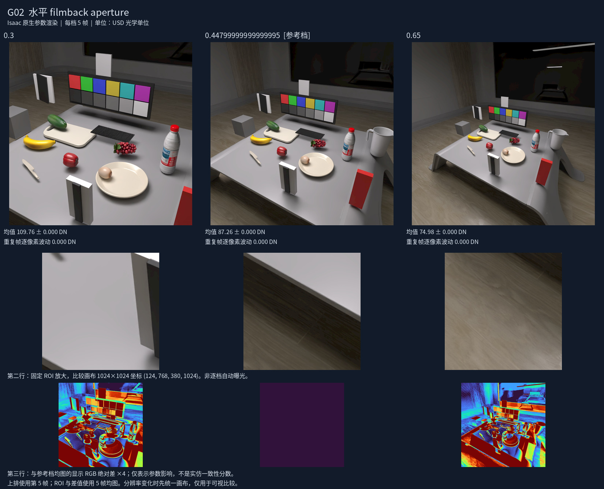

显示 RGB 均值范围 74.98～109.76 DN；相对参考档最大均图差 47.446 DN，平均重复帧逐像素波动 0.000 DN。

**各档原尺寸图：** [0.3 · 1024×1024](renders/native/G02/level_0/frame_04.png) · [0.44799999999999995 · 1024×1024](renders/native/G02/level_1/frame_04.png) · [0.65 · 1024×1024](renders/native/G02/level_2/frame_04.png)

[查看全部 5 次重复](comparisons/G02_repeats.jpg)

#### G03　垂直 filmback aperture

**它是什么：**虚拟感光面的垂直高度。

**主要影响与变化方向：**理论上影响垂直视场；当前 RTX 路径可能按输出比例约束方形像素，声明变化不保证实际 fy 改变。

**看图提示：**对比色卡上下位置，并核对运行时 fy，细小差别可能仅为渲染波动。

**实验设置：**Isaac 原生参数扫描；扫描值 `[0.3, 0.44799999999999995, 0.6]` USD 光学单位；固定上下文 `{}`。

**实现边界：**本机可能强制方形像素；观察不到变化也是需要保留的结论。

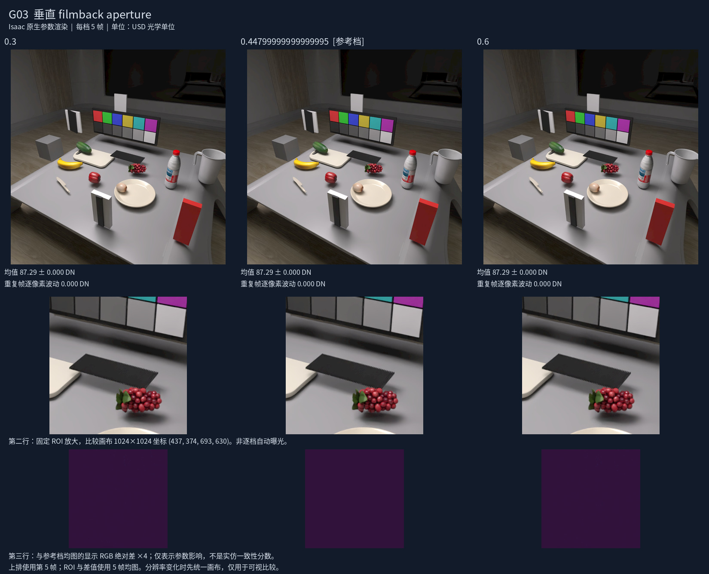

显示 RGB 均值范围 87.29～87.29 DN；相对参考档最大均图差 0.014 DN，平均重复帧逐像素波动 0.000 DN。

**各档原尺寸图：** [0.3 · 1024×1024](renders/native/G03/level_0/frame_04.png) · [0.44799999999999995 · 1024×1024](renders/native/G03/level_1/frame_04.png) · [0.6 · 1024×1024](renders/native/G03/level_2/frame_04.png)

[查看全部 5 次重复](comparisons/G03_repeats.jpg)

#### G04　主点 cx

**它是什么：**光轴与图像相交点的水平像素坐标。

**主要影响与变化方向：**改变 cx 主要让整幅投影左右平移；正常情况下不会单独让物体变大或改变景深。

**看图提示：**用色卡中心或瓶子位置作参照，比较左右空白。

**实验设置：**Isaac 原生参数扫描；扫描值 `[432, 511.5, 592]` px；固定上下文 `{}`。

**实现边界：**其余条件固定；本实验不是 AVS 实测参数。

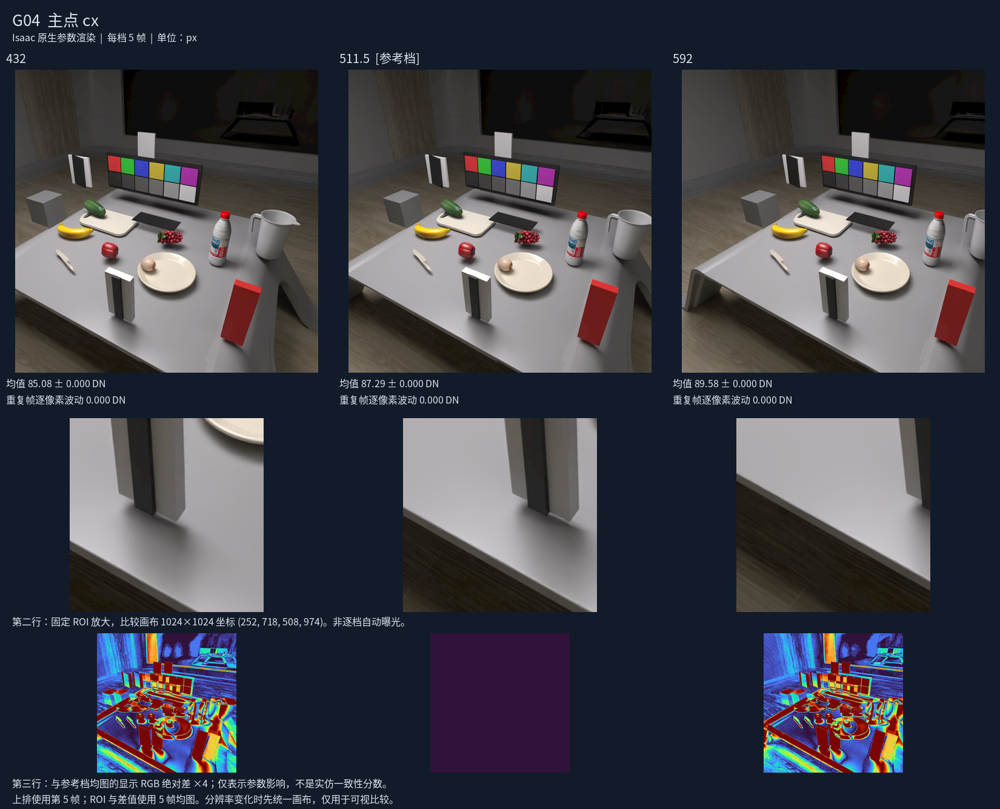

显示 RGB 均值范围 85.08～89.58 DN；相对参考档最大均图差 31.405 DN，平均重复帧逐像素波动 0.000 DN。

**各档原尺寸图：** [432 · 1024×1024](renders/native/G04/level_0/frame_04.png) · [511.5 · 1024×1024](renders/native/G04/level_1/frame_04.png) · [592 · 1024×1024](renders/native/G04/level_2/frame_04.png)

[查看全部 5 次重复](comparisons/G04_repeats.jpg)

#### G05　主点 cy

**它是什么：**光轴与图像相交点的垂直像素坐标。

**主要影响与变化方向：**改变 cy 主要让整幅投影上下平移；别把它与相机俯仰旋转混淆。

**看图提示：**比较色卡到上边框的距离和盘子到下边框的距离。

**实验设置：**Isaac 原生参数扫描；扫描值 `[432, 511.5, 592]` px；固定上下文 `{}`。

**实现边界：**其余条件固定；本实验不是 AVS 实测参数。

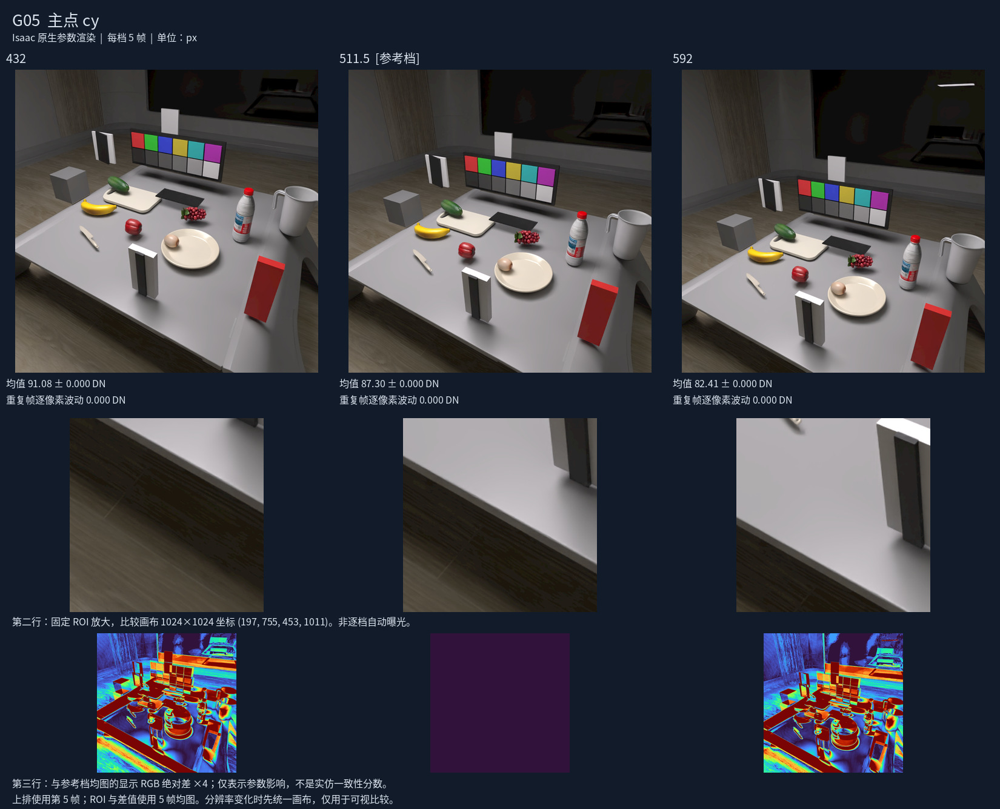

显示 RGB 均值范围 82.41～91.08 DN；相对参考档最大均图差 35.655 DN，平均重复帧逐像素波动 0.000 DN。

**各档原尺寸图：** [432 · 1024×1024](renders/native/G05/level_0/frame_04.png) · [511.5 · 1024×1024](renders/native/G05/level_1/frame_04.png) · [592 · 1024×1024](renders/native/G05/level_2/frame_04.png)

[查看全部 5 次重复](comparisons/G05_repeats.jpg)

#### G06　位置 X

**它是什么：**相机光心在世界 X 方向的位置。

**主要影响与变化方向：**平移改变视点和遮挡，近物比远物移动更明显，会出现视差；本组保持朝向不变。

**看图提示：**比较前景黑白靶与后方色卡的相对移动。

**实验设置：**Isaac 原生参数扫描；扫描值 `[0.55, 0.75, 0.95]` m；固定上下文 `{}`。

**实现边界：**仅平移，保持原方向，不重新 look-at。

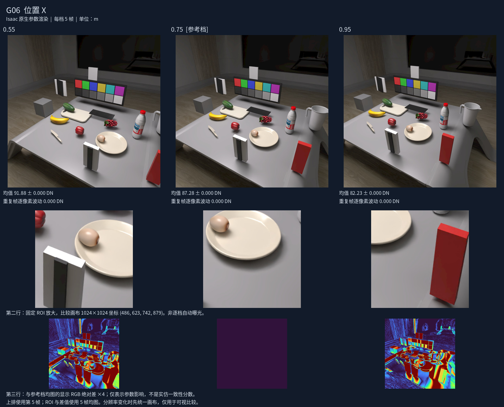

显示 RGB 均值范围 82.23～91.88 DN；相对参考档最大均图差 26.827 DN，平均重复帧逐像素波动 0.000 DN。

**各档原尺寸图：** [0.55 · 1024×1024](renders/native/G06/level_0/frame_04.png) · [0.75 · 1024×1024](renders/native/G06/level_1/frame_04.png) · [0.95 · 1024×1024](renders/native/G06/level_2/frame_04.png)

[查看全部 5 次重复](comparisons/G06_repeats.jpg)

#### G07　位置 Y

**它是什么：**相机光心在世界 Y 方向的位置。

**主要影响与变化方向：**平移改变物体距离、透视比例和遮挡；它和缩放图像得到的效果通常不同。

**看图提示：**比较前景盘子与后方色卡的尺寸比例。

**实验设置：**Isaac 原生参数扫描；扫描值 `[-1.55, -1.35, -1.15]` m；固定上下文 `{}`。

**实现边界：**仅平移，保持原方向，不重新 look-at。

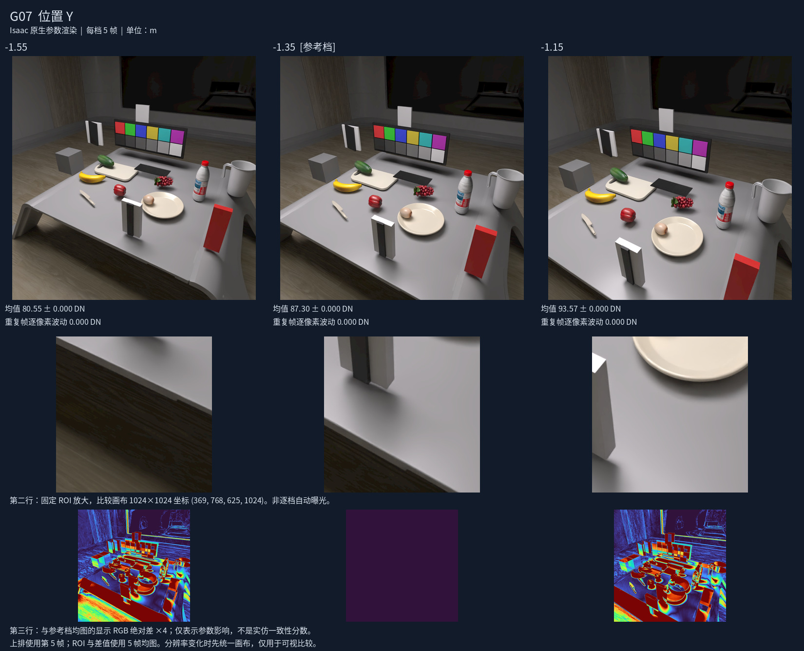

显示 RGB 均值范围 80.55～93.57 DN；相对参考档最大均图差 33.457 DN，平均重复帧逐像素波动 0.000 DN。

**各档原尺寸图：** [-1.55 · 1024×1024](renders/native/G07/level_0/frame_04.png) · [-1.35 · 1024×1024](renders/native/G07/level_1/frame_04.png) · [-1.15 · 1024×1024](renders/native/G07/level_2/frame_04.png)

[查看全部 5 次重复](comparisons/G07_repeats.jpg)

#### G08　位置 Z

**它是什么：**相机光心的高度。

**主要影响与变化方向：**升降改变俯视时的可见面和遮挡，也改变物距；本组不重新对准目标。

**看图提示：**观察盘内可见面积、瓶顶与桌面透视。

**实验设置：**Isaac 原生参数扫描；扫描值 `[1.65, 1.85, 2.05]` m；固定上下文 `{}`。

**实现边界：**仅平移，保持原方向，不重新 look-at。

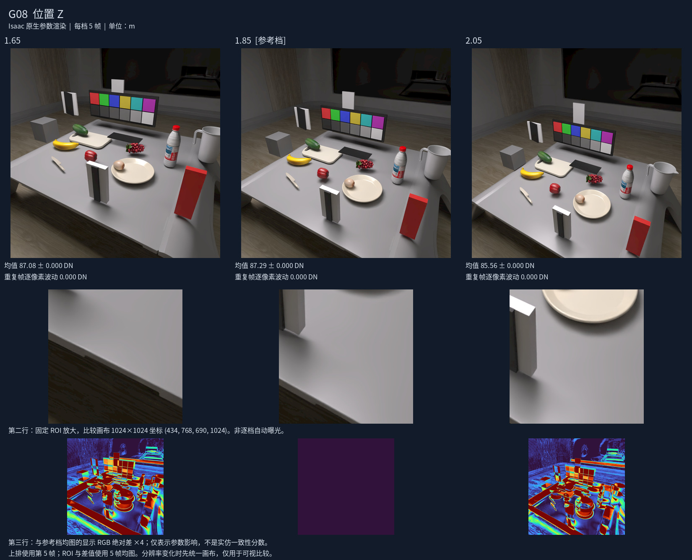

显示 RGB 均值范围 85.56～87.29 DN；相对参考档最大均图差 32.733 DN，平均重复帧逐像素波动 0.000 DN。

**各档原尺寸图：** [1.65 · 1024×1024](renders/native/G08/level_0/frame_04.png) · [1.85 · 1024×1024](renders/native/G08/level_1/frame_04.png) · [2.05 · 1024×1024](renders/native/G08/level_2/frame_04.png)

[查看全部 5 次重复](comparisons/G08_repeats.jpg)

#### G09　局部 Y 轴转角

**它是什么：**相机绕局部 Y 轴旋转的角度。

**主要影响与变化方向：**改变观察方向，使场景横向扫动并改变透视；这里的轴命名以 USD 相机局部轴为准。

**看图提示：**看色卡和左右边缘物品如何进入或离开画面。

**实验设置：**Isaac 原生参数扫描；扫描值 `[-10, 0, 10]` degree；固定上下文 `{}`。

**实现边界：**其余条件固定；本实验不是 AVS 实测参数。

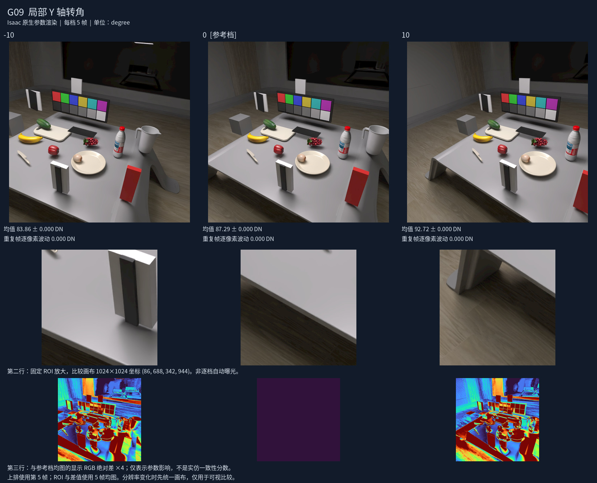

显示 RGB 均值范围 83.86～92.72 DN；相对参考档最大均图差 42.390 DN，平均重复帧逐像素波动 0.000 DN。

**各档原尺寸图：** [-10 · 1024×1024](renders/native/G09/level_0/frame_04.png) · [0 · 1024×1024](renders/native/G09/level_1/frame_04.png) · [10 · 1024×1024](renders/native/G09/level_2/frame_04.png)

[查看全部 5 次重复](comparisons/G09_repeats.jpg)

#### G10　局部 X 轴转角

**它是什么：**相机绕局部 X 轴旋转的角度。

**主要影响与变化方向：**改变俯仰，决定更多看见桌面还是后墙，也会改变物体投影位置。

**看图提示：**比较桌面与后墙的比例，注意近处靶与远处靶的位移。

**实验设置：**Isaac 原生参数扫描；扫描值 `[-10, 0, 10]` degree；固定上下文 `{}`。

**实现边界：**其余条件固定；本实验不是 AVS 实测参数。

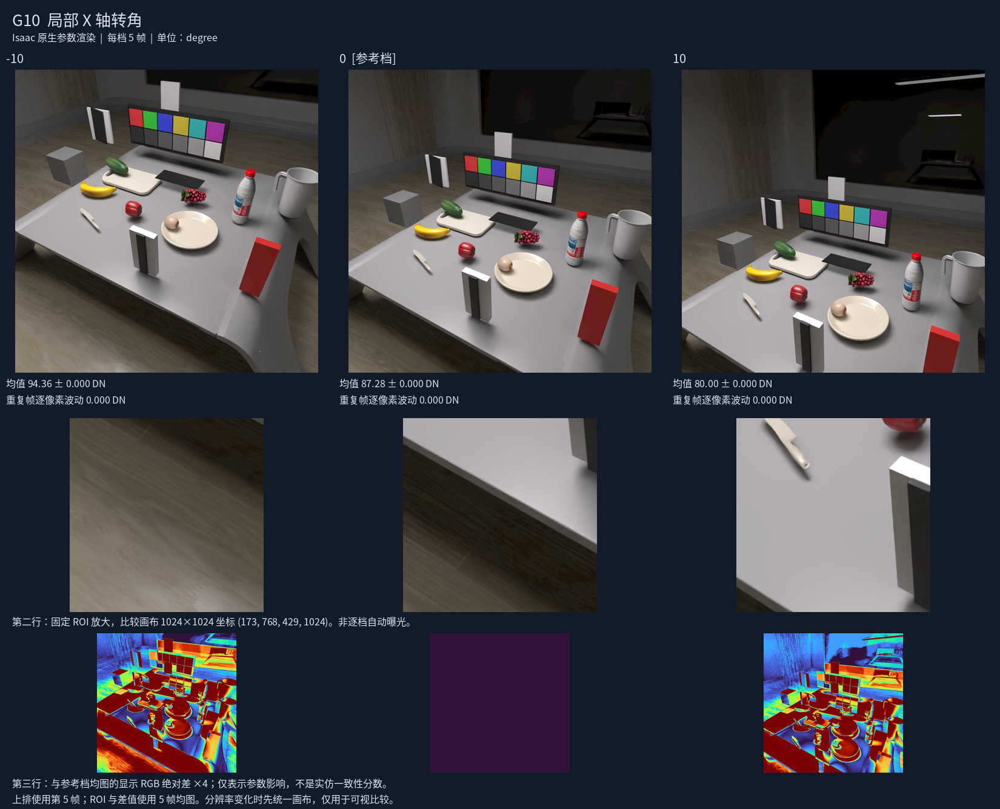

显示 RGB 均值范围 80.00～94.36 DN；相对参考档最大均图差 52.604 DN，平均重复帧逐像素波动 0.000 DN。

**各档原尺寸图：** [-10 · 1024×1024](renders/native/G10/level_0/frame_04.png) · [0 · 1024×1024](renders/native/G10/level_1/frame_04.png) · [10 · 1024×1024](renders/native/G10/level_2/frame_04.png)

[查看全部 5 次重复](comparisons/G10_repeats.jpg)

#### G11　局部 Z 轴转角

**它是什么：**相机绕局部 Z 轴旋转的角度。

**主要影响与变化方向：**主要让画面旋转，原本水平的色卡和桌沿倾斜；不应把它解释成畸变。

**看图提示：**看色卡横边和瓶子的竖边是否倾斜。

**实验设置：**Isaac 原生参数扫描；扫描值 `[-10, 0, 10]` degree；固定上下文 `{}`。

**实现边界：**其余条件固定；本实验不是 AVS 实测参数。

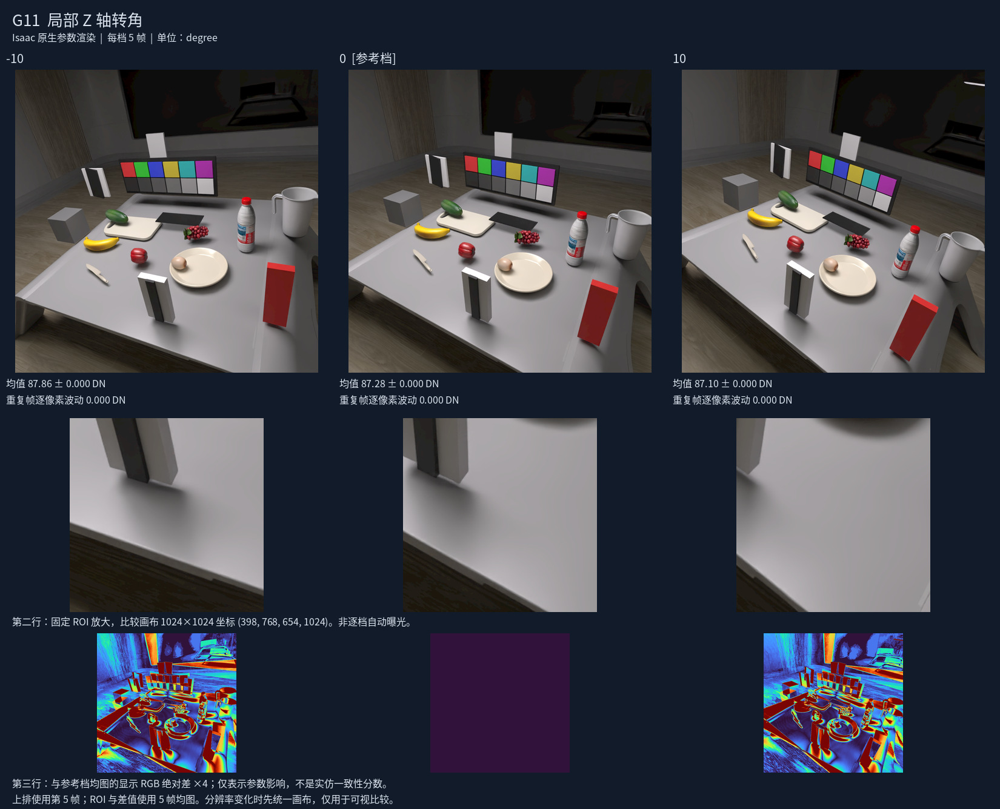

显示 RGB 均值范围 87.10～87.86 DN；相对参考档最大均图差 28.019 DN，平均重复帧逐像素波动 0.000 DN。

**各档原尺寸图：** [-10 · 1024×1024](renders/native/G11/level_0/frame_04.png) · [0 · 1024×1024](renders/native/G11/level_1/frame_04.png) · [10 · 1024×1024](renders/native/G11/level_2/frame_04.png)

[查看全部 5 次重复](comparisons/G11_repeats.jpg)

#### G12　near clipping

**它是什么：**可见深度范围的最近边界。

**主要影响与变化方向：**边界增大后，离相机过近的几何会被切掉；这是几何裁切，不是失焦变糊。

**看图提示：**看前景黑白靶、盘子是否直接缺失或出现切面。

**实验设置：**Isaac 原生参数扫描；扫描值 `[0.01, 1.6, 2.0]` m；固定上下文 `{}`。

**实现边界：**其余条件固定；本实验不是 AVS 实测参数。

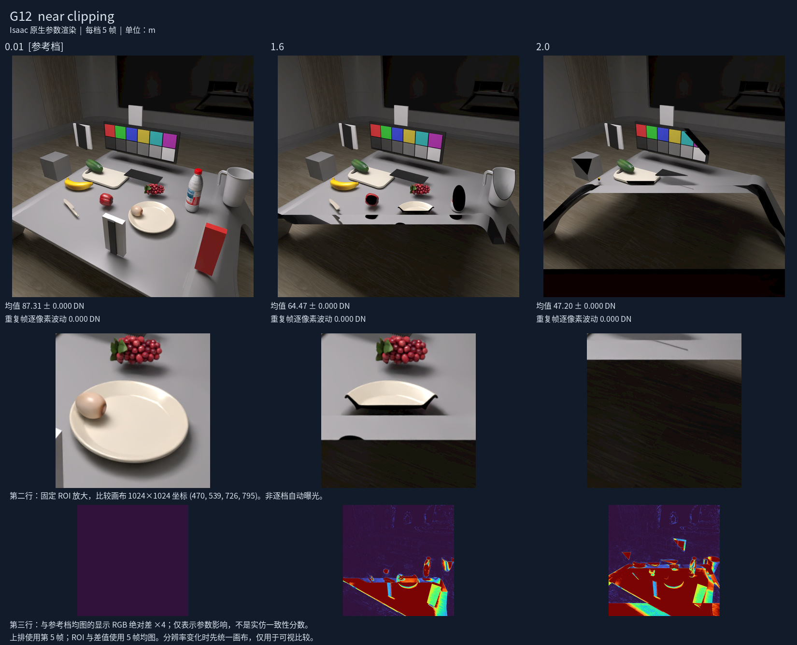

显示 RGB 均值范围 47.20～87.31 DN；相对参考档最大均图差 42.760 DN，平均重复帧逐像素波动 0.000 DN。

**各档原尺寸图：** [0.01 · 1024×1024](renders/native/G12/level_0/frame_04.png) · [1.6 · 1024×1024](renders/native/G12/level_1/frame_04.png) · [2.0 · 1024×1024](renders/native/G12/level_2/frame_04.png)

[查看全部 5 次重复](comparisons/G12_repeats.jpg)

#### G13　far clipping

**它是什么：**可见深度范围的最远边界。

**主要影响与变化方向：**边界减小后，较远物体和背景可能消失；它不是镜头最远对焦距离。

**看图提示：**先看后墙、后方白靶和色卡是否还存在。

**实验设置：**Isaac 原生参数扫描；扫描值 `[1.6, 2.2, 100]` m；固定上下文 `{}`。

**实现边界：**其余条件固定；本实验不是 AVS 实测参数。

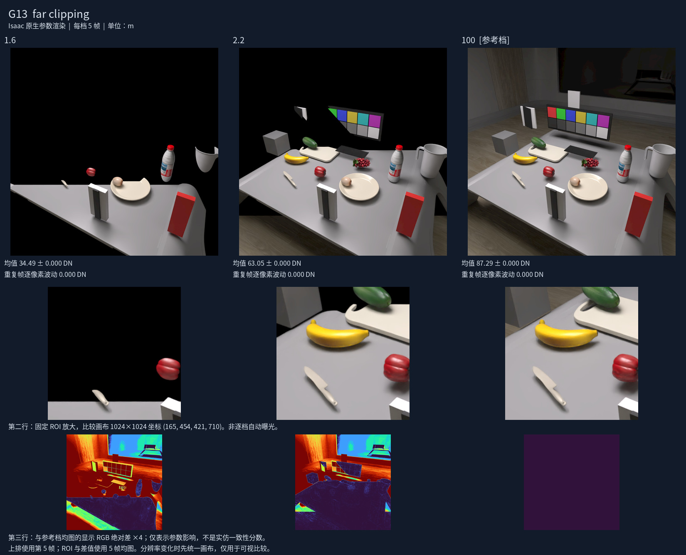

显示 RGB 均值范围 34.49～87.29 DN；相对参考档最大均图差 52.898 DN，平均重复帧逐像素波动 0.000 DN。

**各档原尺寸图：** [1.6 · 1024×1024](renders/native/G13/level_0/frame_04.png) · [2.2 · 1024×1024](renders/native/G13/level_1/frame_04.png) · [100 · 1024×1024](renders/native/G13/level_2/frame_04.png)

[查看全部 5 次重复](comparisons/G13_repeats.jpg)

#### G14　双目基线（右相机沿局部 X）

**它是什么：**两相机光心之间的距离，本组只移动右相机。

**主要影响与变化方向：**基线增大通常加大近物的左右视差和遮挡差；不会自动改善单目色彩。

**看图提示：**比较前景靶相对后方色卡的位置，先固定左目参照。

**实验设置：**Isaac 原生参数扫描；扫描值 `[0, 0.065, 0.13]` m；固定上下文 `{}`。

**实现边界：**左相机光心固定为实验基准；本组仅移动右相机，不是机器人实测基线。

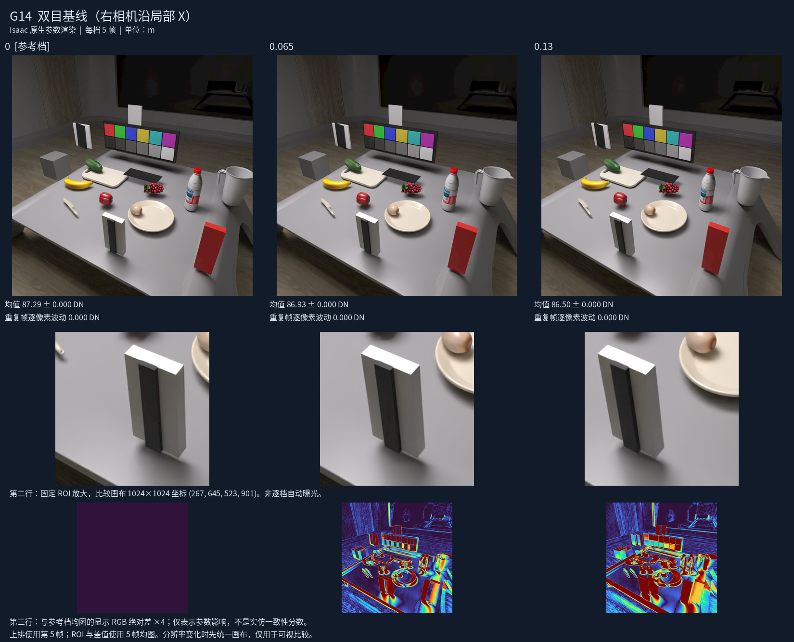

显示 RGB 均值范围 86.50～87.29 DN；相对参考档最大均图差 27.329 DN，平均重复帧逐像素波动 0.000 DN。

**各档原尺寸图：** [0 · 1024×1024](renders/native/G14/level_0/frame_04.png) · [0.065 · 1024×1024](renders/native/G14/level_1/frame_04.png) · [0.13 · 1024×1024](renders/native/G14/level_2/frame_04.png)

[查看全部 5 次重复](comparisons/G14_repeats.jpg)

#### G15　metersPerUnit 单位声明

**它是什么：**一个 USD 场景单位代表多少米。

**主要影响与变化方向：**本组只改单位声明而不换算坐标，用来展示尺度合同错误；视觉可能变化不大，但物理长度解释已改变。

**看图提示：**同时看图和 metadata；不能只凭图像相似认定单位正确。

**实验设置：**Isaac 原生参数扫描；扫描值 `[0.01, 0.1, 1.0]` m/scene unit；固定上下文 `{}`。

**实现边界：**只改单一元数据，数值几何不变；这是单位合同错配诊断，不是保持物理场景不变的单位换算。

显示 RGB 均值范围 87.30～87.30 DN；相对参考档最大均图差 0.015 DN，平均重复帧逐像素波动 0.000 DN。

**各档原尺寸图：** [0.01 · 1024×1024](renders/native/G15/level_0/frame_04.png) · [0.1 · 1024×1024](renders/native/G15/level_1/frame_04.png) · [1.0 · 1024×1024](renders/native/G15/level_2/frame_04.png)

[查看全部 5 次重复](comparisons/G15_repeats.jpg)

### 镜头：清晰度与光学外观

这一组决定细节如何被摊开、边缘是否分色、四角是否变暗，以及强光是否产生雾幕或光斑。

#### O01　对焦距离

**它是什么：**相机设定的对焦距离，即最清晰的目标距离。

**主要影响与变化方向：**焦点移近会优先让近物清楚、远物变糊，移远时相反；只有开启景深后才应明显。

**看图提示：**比较前景黑白靶、盘沿与后方斜边，不只看整图均值。

**实验设置：**Isaac 原生参数扫描；扫描值 `[0.65, 1.8, 5.0]` m；固定上下文 `{"fstop": 1.0}`。

**实现边界：**其余条件固定；本实验不是 AVS 实测参数。

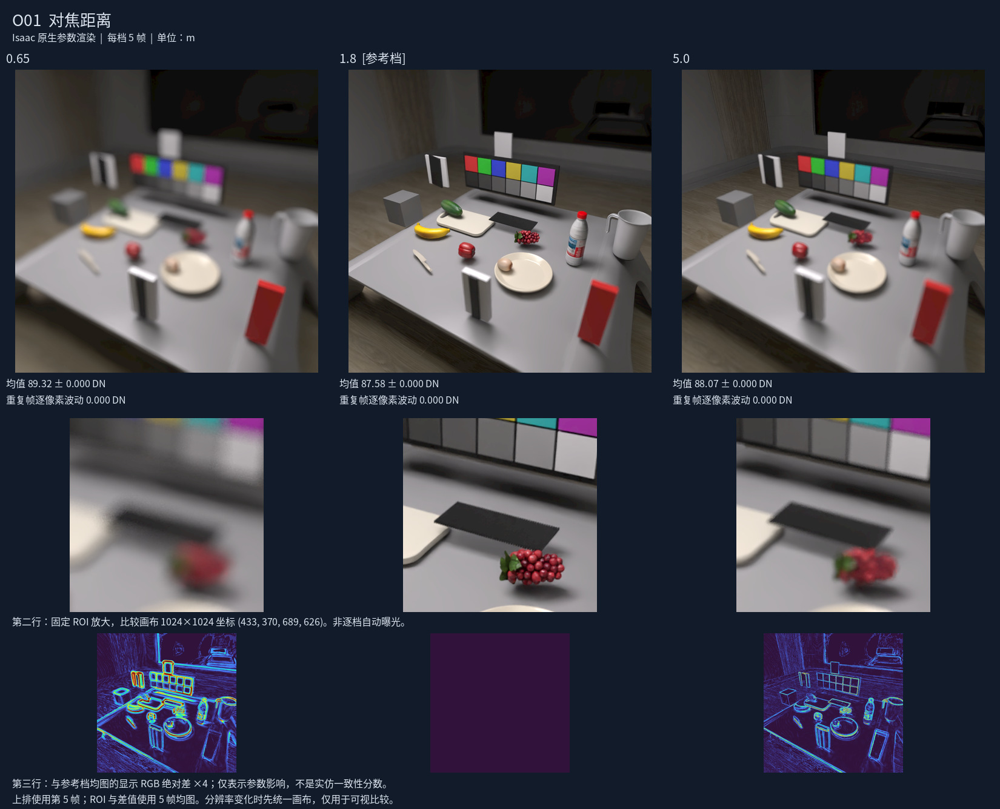

显示 RGB 均值范围 87.58～89.32 DN；相对参考档最大均图差 5.425 DN，平均重复帧逐像素波动 0.000 DN。

**各档原尺寸图：** [0.65 · 1024×1024](renders/native/O01/level_0/frame_04.png) · [1.8 · 1024×1024](renders/native/O01/level_1/frame_04.png) · [5.0 · 1024×1024](renders/native/O01/level_2/frame_04.png)

[查看全部 5 次重复](comparisons/O01_repeats.jpg)

#### O02　景深光圈 fStop

**它是什么：**控制景深的几何 f-number，数值越小孔径越大。

**主要影响与变化方向：**小 f-number 通常景深浅、焦外模糊强；大值通常更多距离清楚。本组曝光光圈固定，亮度不应被连带调节。

**看图提示：**同时比较前景靶和远处色卡边缘的清晰度。

**实验设置：**Isaac 原生参数扫描；扫描值 `[0.5, 2, 16]` f-number；固定上下文 `{"focus": 1.5}`。

**实现边界：**曝光光圈保持 5；本实验只验证独立的景深控制。

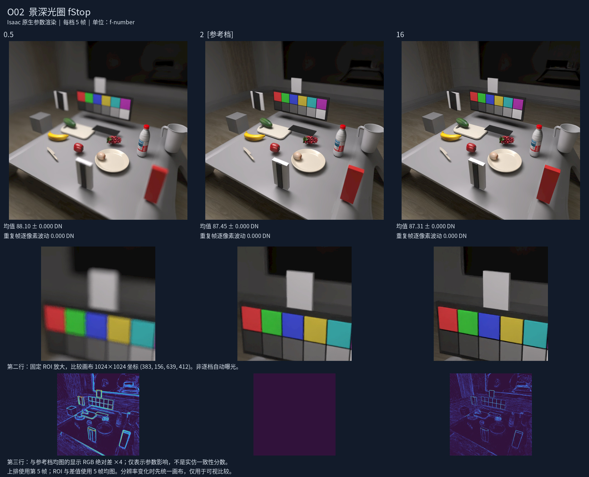

显示 RGB 均值范围 87.31～88.10 DN；相对参考档最大均图差 2.381 DN，平均重复帧逐像素波动 0.000 DN。

**各档原尺寸图：** [0.5 · 1024×1024](renders/native/O02/level_0/frame_04.png) · [2 · 1024×1024](renders/native/O02/level_1/frame_04.png) · [16 · 1024×1024](renders/native/O02/level_2/frame_04.png)

[查看全部 5 次重复](comparisons/O02_repeats.jpg)

#### Q01　光学 PSF 宽度

**它是什么：**点扩散函数的高斯宽度近似，表示一个点被摊开多少像素。

**主要影响与变化方向：**sigma 增大会让细线和边缘更糊、局部细节反差下降；与运动模糊的方向性不同。

**看图提示：**放大刀刃、瓶身文字、斜边和条纹。

**实验设置：**离线假设模型，输入来自 1K Path Tracing；扫描值 `[0, 0.8, 2.5]` px sigma；固定上下文 `{}`。

**实现边界：**基于 RGB 辐射图的空间近似；不能验证真实镜片、光谱响应或真正采样前 OLPF。

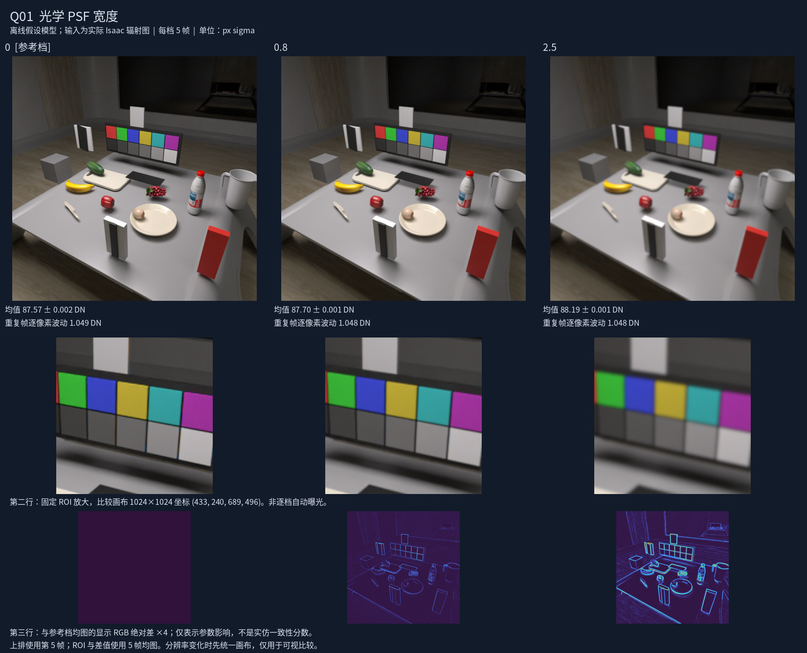

显示 RGB 均值范围 87.57～88.19 DN；相对参考档最大均图差 2.236 DN，平均重复帧逐像素波动 1.049 DN。

**各档原尺寸图：** [0 · 1024×1024](renders/models/Q01/level_0/frame_04.png) · [0.8 · 1024×1024](renders/models/Q01/level_1/frame_04.png) · [2.5 · 1024×1024](renders/models/Q01/level_2/frame_04.png)

[查看全部 5 次重复](comparisons/Q01_repeats.jpg)

#### Q02　暗角强度

**它是什么：**镜头暗角的中心到边缘衰减强度。

**主要影响与变化方向：**增大使边缘相对中心变暗；它不是整图同时调暗。

**看图提示：**比较靠角落的桌面与中心灰块，注意空间分布。

**实验设置：**离线假设模型，输入来自 1K Path Tracing；扫描值 `[0, 0.4, 0.8]` corner attenuation；固定上下文 `{}`。

**实现边界：**基于 RGB 辐射图的空间近似；不能验证真实镜片、光谱响应或真正采样前 OLPF。

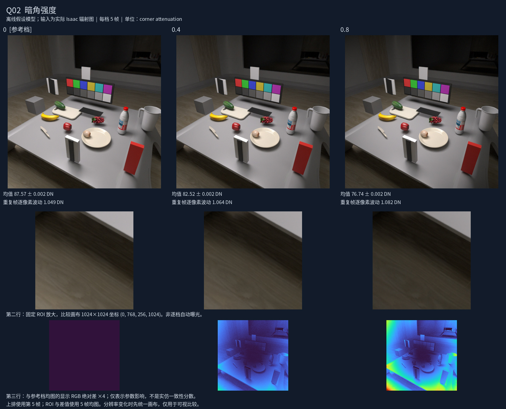

显示 RGB 均值范围 76.74～87.57 DN；相对参考档最大均图差 10.837 DN，平均重复帧逐像素波动 1.065 DN。

**各档原尺寸图：** [0 · 1024×1024](renders/models/Q02/level_0/frame_04.png) · [0.4 · 1024×1024](renders/models/Q02/level_1/frame_04.png) · [0.8 · 1024×1024](renders/models/Q02/level_2/frame_04.png)

[查看全部 5 次重复](comparisons/Q02_repeats.jpg)

#### Q03　红通道颜色阴影

**它是什么：**只对红通道施加的空间阴影。

**主要影响与变化方向：**增大会让边角相对缺红、出现空间色偏，全局 WB 通常不能同时修好中心和四角。

**看图提示：**比较白盘、灰桌面从中心到边缘的颜色。

**实验设置：**离线假设模型，输入来自 1K Path Tracing；扫描值 `[0, 0.4, 0.8]` corner R attenuation；固定上下文 `{}`。

**实现边界：**基于 RGB 辐射图的空间近似；不能验证真实镜片、光谱响应或真正采样前 OLPF。

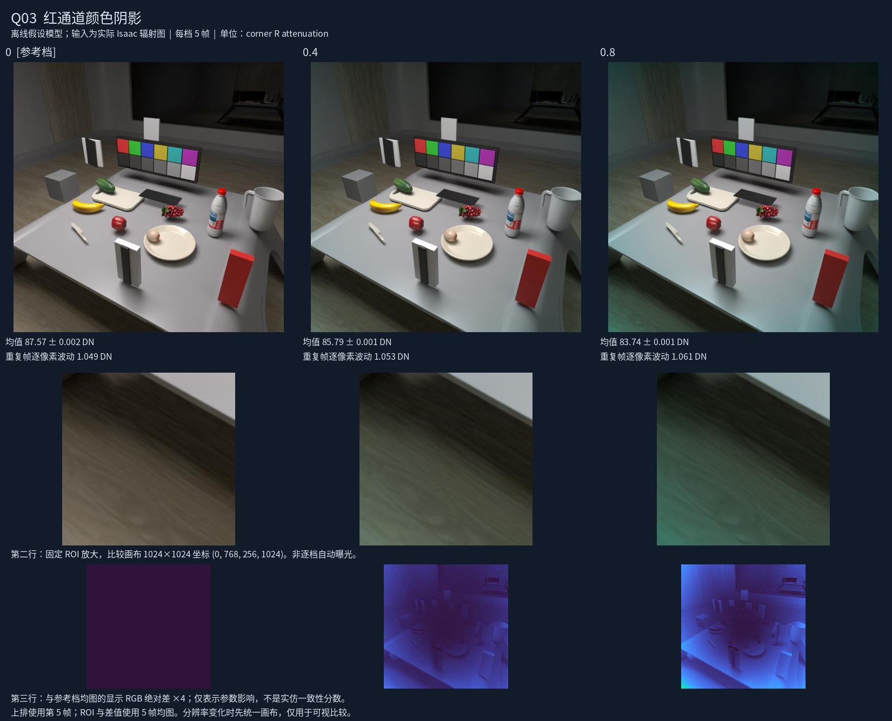

显示 RGB 均值范围 83.74～87.57 DN；相对参考档最大均图差 4.187 DN，平均重复帧逐像素波动 1.055 DN。

**各档原尺寸图：** [0 · 1024×1024](renders/models/Q03/level_0/frame_04.png) · [0.4 · 1024×1024](renders/models/Q03/level_1/frame_04.png) · [0.8 · 1024×1024](renders/models/Q03/level_2/frame_04.png)

[查看全部 5 次重复](comparisons/Q03_repeats.jpg)

#### Q04　红通道径向色差

**它是什么：**红通道的径向空间偏移近似。

**主要影响与变化方向：**增大后不同颜色边缘不能完全重合，尤其画面边缘容易出现红/青彩边。

**看图提示：**看斜边、盘沿和黑白靶的边缘，不只看均匀色块。

**实验设置：**离线假设模型，输入来自 1K Path Tracing；扫描值 `[0, 1.5, 4.0]` px at edge；固定上下文 `{}`。

**实现边界：**基于 RGB 辐射图的空间近似；不能验证真实镜片、光谱响应或真正采样前 OLPF。

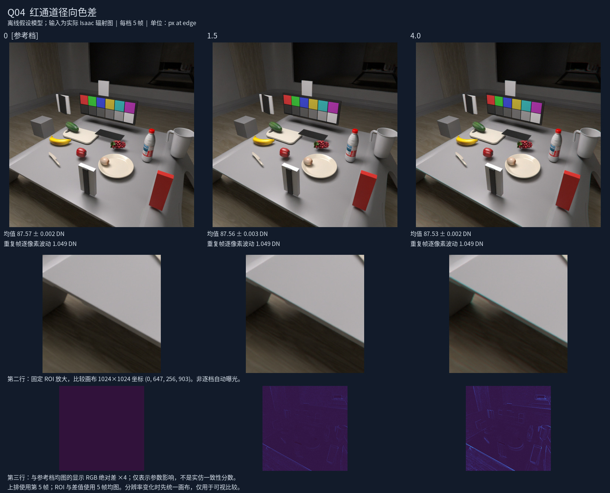

显示 RGB 均值范围 87.53～87.57 DN；相对参考档最大均图差 0.761 DN，平均重复帧逐像素波动 1.049 DN。

**各档原尺寸图：** [0 · 1024×1024](renders/models/Q04/level_0/frame_04.png) · [1.5 · 1024×1024](renders/models/Q04/level_1/frame_04.png) · [4.0 · 1024×1024](renders/models/Q04/level_2/frame_04.png)

[查看全部 5 次重复](comparisons/Q04_repeats.jpg)

#### Q05　衍射 f-number

**它是什么：**用于衍射近似的 f-number，固定假设波长与像元尺寸。

**主要影响与变化方向：**数值变大时衍射斑通常变宽，细节反差下降；这是衍射单独模型，与景深增大的收益分开。

**看图提示：**看细条纹和斜边，阅读该组的波长/pixel-pitch 假设。

**实验设置：**离线假设模型，输入来自 1K Path Tracing；扫描值 `[2, 8, 22]` f-number；固定上下文 `{}`。

**实现边界：**假设 λ=550nm、pixel pitch=4µm，Airy 宽度用高斯近似；非真实镜头 PSF。

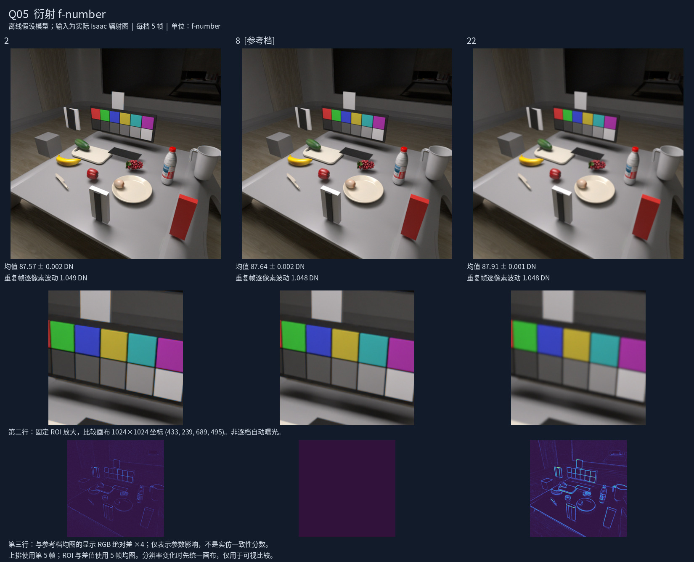

显示 RGB 均值范围 87.57～87.91 DN；相对参考档最大均图差 1.259 DN，平均重复帧逐像素波动 1.048 DN。

**各档原尺寸图：** [2 · 1024×1024](renders/models/Q05/level_0/frame_04.png) · [8 · 1024×1024](renders/models/Q05/level_1/frame_04.png) · [22 · 1024×1024](renders/models/Q05/level_2/frame_04.png)

[查看全部 5 次重复](comparisons/Q05_repeats.jpg)

#### Q06　PSF 横向像散近似

**它是什么：**横向比纵向更宽的 PSF 简化。

**主要影响与变化方向：**增大使横向细节更糊，水平/垂直结构受影响不一样；不是全视场实测像散。

**看图提示：**对比细竖条和水平边缘的清晰度。

**实验设置：**离线假设模型，输入来自 1K Path Tracing；扫描值 `[0, 1, 3]` px sigma；固定上下文 `{}`。

**实现边界：**基于 RGB 辐射图的空间近似；不能验证真实镜片、光谱响应或真正采样前 OLPF。

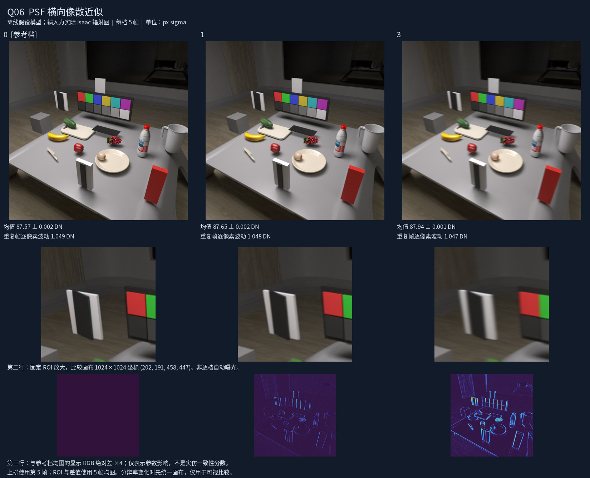

显示 RGB 均值范围 87.57～87.94 DN；相对参考档最大均图差 1.586 DN，平均重复帧逐像素波动 1.048 DN。

**各档原尺寸图：** [0 · 1024×1024](renders/models/Q06/level_0/frame_04.png) · [1 · 1024×1024](renders/models/Q06/level_1/frame_04.png) · [3 · 1024×1024](renders/models/Q06/level_2/frame_04.png)

[查看全部 5 次重复](comparisons/Q06_repeats.jpg)

#### Q07　杂散光雾幕

**它是什么：**给图像加入的线性雾幕光近似。

**主要影响与变化方向：**增大会抬高暗部、降低对比，让黑色发灰、颜色变淡；不同于简单提高曝光。

**看图提示：**看黑白靶黑面与阴影，白处可能也更容易截断。

**实验设置：**离线假设模型，输入来自 1K Path Tracing；扫描值 `[0, 0.05, 0.2]` linear veil；固定上下文 `{}`。

**实现边界：**基于 RGB 辐射图的空间近似；不能验证真实镜片、光谱响应或真正采样前 OLPF。

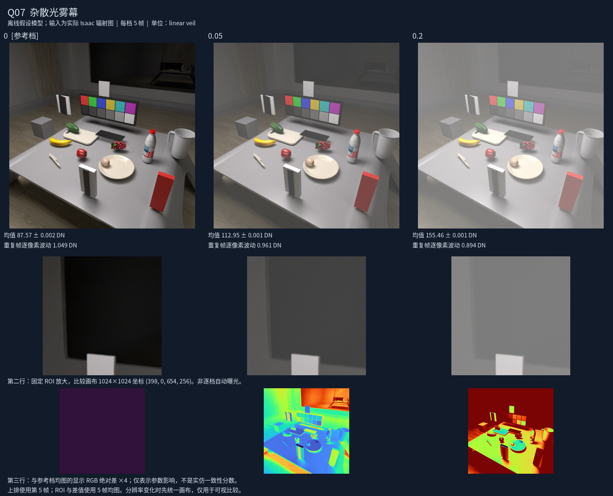

显示 RGB 均值范围 87.57～155.46 DN；相对参考档最大均图差 67.893 DN，平均重复帧逐像素波动 0.968 DN。

**各档原尺寸图：** [0 · 1024×1024](renders/models/Q07/level_0/frame_04.png) · [0.05 · 1024×1024](renders/models/Q07/level_1/frame_04.png) · [0.2 · 1024×1024](renders/models/Q07/level_2/frame_04.png)

[查看全部 5 次重复](comparisons/Q07_repeats.jpg)

#### Q08　鬼影强度

**它是什么：**离散鬼影光斑的强度近似。

**主要影响与变化方向：**增大会出现更明显的额外有色光斑；这里没有追踪真实镜片多次反射路径。

**看图提示：**看画面固定位置的半透明光斑，勿把它认成场景中的物体。

**实验设置：**离线假设模型，输入来自 1K Path Tracing；扫描值 `[0, 0.1, 0.4]` relative；固定上下文 `{}`。

**实现边界：**基于 RGB 辐射图的空间近似；不能验证真实镜片、光谱响应或真正采样前 OLPF。

显示 RGB 均值范围 87.57～93.68 DN；相对参考档最大均图差 6.491 DN，平均重复帧逐像素波动 1.037 DN。

**各档原尺寸图：** [0 · 1024×1024](renders/models/Q08/level_0/frame_04.png) · [0.1 · 1024×1024](renders/models/Q08/level_1/frame_04.png) · [0.4 · 1024×1024](renders/models/Q08/level_2/frame_04.png)

[查看全部 5 次重复](comparisons/Q08_repeats.jpg)

#### Q09　数字 bloom 强度

**它是什么：**高亮区域经模糊扩散后叠加的数字效果。

**主要影响与变化方向：**增大会让亮部向周围扩散、形成光晕；这种后处理不等于传感器溢出或真实镜头杂散光。

**看图提示：**看白盘、高光附近是否侵入邻近暗区域。

**实验设置：**离线假设模型，输入来自 1K Path Tracing；扫描值 `[0, 0.5, 2.0]` relative；固定上下文 `{}`。

**实现边界：**基于 RGB 辐射图的空间近似；不能验证真实镜片、光谱响应或真正采样前 OLPF。

显示 RGB 均值范围 87.57～102.12 DN；相对参考档最大均图差 14.807 DN，平均重复帧逐像素波动 1.029 DN。

**各档原尺寸图：** [0 · 1024×1024](renders/models/Q09/level_0/frame_04.png) · [0.5 · 1024×1024](renders/models/Q09/level_1/frame_04.png) · [2.0 · 1024×1024](renders/models/Q09/level_2/frame_04.png)

[查看全部 5 次重复](comparisons/Q09_repeats.jpg)

#### Q10　降采样前低通

**它是什么：**在进一步采样前施加的低通滤波宽度。

**主要影响与变化方向：**增大可以减少后续采样的高频混叠，也会损失真实细节；无法消除输入里早已折叠的混叠。

**看图提示：**看条纹、刀刃和细纹，不把模糊直接当作完整光学 OLPF 校准。

**实验设置：**离线假设模型，输入来自 1K Path Tracing；扫描值 `[0, 0.8, 1.6]` px sigma；固定上下文 `{}`。

**实现边界：**基于 RGB 辐射图的空间近似；不能验证真实镜片、光谱响应或真正采样前 OLPF。

显示 RGB 均值范围 87.57～87.92 DN；相对参考档最大均图差 1.497 DN，平均重复帧逐像素波动 1.049 DN。

**各档原尺寸图：** [0 · 1024×1024](renders/models/Q10/level_0/frame_04.png) · [0.8 · 1024×1024](renders/models/Q10/level_1/frame_04.png) · [1.6 · 1024×1024](renders/models/Q10/level_2/frame_04.png)

[查看全部 5 次重复](comparisons/Q10_repeats.jpg)

#### S21　镜头透过率

**它是什么：**镜头对入射光的标量透过比例。

**主要影响与变化方向：**减小会减少到达传感器的光子，信号变弱、相对噪声更突出；不是对已经生成的 RGB 单纯压暗。

**看图提示：**比较灰阶与暗部颗粒，和曝光/增益组交叉理解。

**实验设置：**离线假设模型，输入来自 1K Path Tracing；扫描值 `[0.3, 0.7, 1.0]` 1；固定上下文 `{}`。

**实现边界：**固定光子/电子/ADC 模型；不是 RGB 上直接加颗粒。

显示 RGB 均值范围 47.70～87.57 DN；相对参考档最大均图差 39.867 DN，平均重复帧逐像素波动 1.090 DN。

**各档原尺寸图：** [0.3 · 1024×1024](renders/models/S21/level_0/frame_04.png) · [0.7 · 1024×1024](renders/models/S21/level_1/frame_04.png) · [1.0 · 1024×1024](renders/models/S21/level_2/frame_04.png)

[查看全部 5 次重复](comparisons/S21_repeats.jpg)

### 传感器：曝光与电子响应

这一组描述光子变成电子和数字码值的过程。更多光、模拟放大、数字放大和曲线提亮可能看起来相似，但物理含义不同。

#### E01　曝光积分亮度控制

**它是什么：**RTX exposure:time，静态曝光亮度缩放参数，单位秒。

**主要影响与变化方向：**增大通常更亮、较易高光截断；本原生静态组不能证明同时实现了运动积分。

**看图提示：**看灰阶块与白盘细节；真实运动拖影另看 T01。

**实验设置：**Isaac 原生参数扫描；扫描值 `[0.005, 0.02, 0.08]` s；固定上下文 `{}`。

**实现边界：**原生 exposure:time 只在此验证静态辐射缩放；物理运动积分另见时间实验。

显示 RGB 均值范围 61.34～134.49 DN；相对参考档最大均图差 47.195 DN，平均重复帧逐像素波动 0.000 DN。

**各档原尺寸图：** [0.005 · 1024×1024](renders/native/E01/level_0/frame_04.png) · [0.02 · 1024×1024](renders/native/E01/level_1/frame_04.png) · [0.08 · 1024×1024](renders/native/E01/level_2/frame_04.png)

[查看全部 5 次重复](comparisons/E01_repeats.jpg)

#### E02　ISO 亮度控制

**它是什么：**RTX 的 ISO 曝光灵敏度标尺。

**主要影响与变化方向：**增大通常提高输出亮度；这个渲染控制没有自动变成 AVS 的模拟增益与读噪变化。

**看图提示：**看灰阶亮度和高光是否丢层次，不据此判断真实相机噪声。

**实验设置：**Isaac 原生参数扫描；扫描值 `[25, 100, 400]` ISO；固定上下文 `{}`。

**实现边界：**RTX ISO 未建模实机增益相关读噪。

显示 RGB 均值范围 61.28～133.62 DN；相对参考档最大均图差 45.958 DN，平均重复帧逐像素波动 0.000 DN。

**各档原尺寸图：** [25 · 1024×1024](renders/native/E02/level_0/frame_04.png) · [100 · 1024×1024](renders/native/E02/level_1/frame_04.png) · [400 · 1024×1024](renders/native/E02/level_2/frame_04.png)

[查看全部 5 次重复](comparisons/E02_repeats.jpg)

#### E03　曝光专用 f-number

**它是什么：**单独用于曝光计算的 f-number。

**主要影响与变化方向：**在其他曝光参数固定时，数值增大通常更暗，辐射缩放近似与平方倒数相关；它与几何景深光圈分开。

**看图提示：**比较白盘/灰块亮度，同时核对焦外模糊没有被当作自变量。

**实验设置：**Isaac 原生参数扫描；扫描值 `[2.5, 5, 10]` f-number；固定上下文 `{}`。

**实现边界：**保持几何 fStop=0；与景深光圈分开验证。

显示 RGB 均值范围 61.28～133.91 DN；相对参考档最大均图差 46.248 DN，平均重复帧逐像素波动 0.000 DN。

**各档原尺寸图：** [2.5 · 1024×1024](renders/native/E03/level_0/frame_04.png) · [5 · 1024×1024](renders/native/E03/level_1/frame_04.png) · [10 · 1024×1024](renders/native/E03/level_2/frame_04.png)

[查看全部 5 次重复](comparisons/E03_repeats.jpg)

#### E04　responsivity

**它是什么：**渲染曝光模型的整体响应倍率。

**主要影响与变化方向：**增大通常提亮整体，并可能造成亮部截断；它是演示标尺，不是已测设备灵敏度。

**看图提示：**看灰阶与水果亮部，检查最亮几级是否不再可区分。

**实验设置：**Isaac 原生参数扫描；扫描值 `[4, 16, 64]` 1；固定上下文 `{}`。

**实现边界：**其余条件固定；本实验不是 AVS 实测参数。

显示 RGB 均值范围 61.34～134.50 DN；相对参考档最大均图差 47.329 DN，平均重复帧逐像素波动 0.000 DN。

**各档原尺寸图：** [4 · 1024×1024](renders/native/E04/level_0/frame_04.png) · [16 · 1024×1024](renders/native/E04/level_1/frame_04.png) · [64 · 1024×1024](renders/native/E04/level_2/frame_04.png)

[查看全部 5 次重复](comparisons/E04_repeats.jpg)

#### E05　曝光补偿

**它是什么：**相机 exposure 补偿，理论上以 stop 表示倍率。

**主要影响与变化方向：**理想实现中每增大 1 stop 会乘 2；本机该属性是否被管线采用必须按原图和读回核对。

**看图提示：**对比灰块实际亮度，不要只看写入了哪个数字。

**实验设置：**Isaac 原生参数扫描；扫描值 `[1, 3, 5]` stop；固定上下文 `{}`。

**实现边界：**其余条件固定；本实验不是 AVS 实测参数。

显示 RGB 均值范围 87.29～87.30 DN；相对参考档最大均图差 0.018 DN，平均重复帧逐像素波动 0.000 DN。

**各档原尺寸图：** [1 · 1024×1024](renders/native/E05/level_0/frame_04.png) · [3 · 1024×1024](renders/native/E05/level_1/frame_04.png) · [5 · 1024×1024](renders/native/E05/level_2/frame_04.png)

[查看全部 5 次重复](comparisons/E05_repeats.jpg)

#### I22　CFA 相位

**它是什么：**感光面上 R/G/B 滤色采样的排列相位。

**主要影响与变化方向：**正确配套解码时，纯色响应应相近；不同排列仍可能改变细纹的采样/伪色。

**看图提示：**先看灰块是否颜色正确，再看高频条纹和彩边。

**实验设置：**离线假设模型，输入来自 1K Path Tracing；扫描值 `["RGGB", "BGGR", "GRBG"]` ；固定上下文 `{}`。

**实现边界：**完整参数和执行域见 sensor_pipeline.py；不代表 AVS 内部顺序。

显示 RGB 均值范围 87.57～87.57 DN；相对参考档最大均图差 0.925 DN，平均重复帧逐像素波动 1.049 DN。

**各档原尺寸图：** ["RGGB" · 1024×1024](renders/models/I22/level_0/frame_04.png) · ["BGGR" · 1024×1024](renders/models/I22/level_1/frame_04.png) · ["GRBG" · 1024×1024](renders/models/I22/level_2/frame_04.png)

[查看全部 5 次重复](comparisons/I22_repeats.jpg)

#### S01　量子效率 QE

**它是什么：**量子效率：到达的光子转成有效电子的比例。

**主要影响与变化方向：**固定光子输入时，增大通常增加信号，降低相对散粒噪声，过大可能更早饱和；这里只是无光谱的标量。

**看图提示：**同时看暗部颗粒、灰块亮度和白盘截断。

**实验设置：**离线假设模型，输入来自 1K Path Tracing；扫描值 `[0.2, 0.5, 0.9]` electron/photon；固定上下文 `{}`。

**实现边界：**固定光子/电子/ADC 模型；不是 RGB 上直接加颗粒。

显示 RGB 均值范围 55.46～114.66 DN；相对参考档最大均图差 32.109 DN，平均重复帧逐像素波动 1.049 DN。

**各档原尺寸图：** [0.2 · 1024×1024](renders/models/S01/level_0/frame_04.png) · [0.5 · 1024×1024](renders/models/S01/level_1/frame_04.png) · [0.9 · 1024×1024](renders/models/S01/level_2/frame_04.png)

[查看全部 5 次重复](comparisons/S01_repeats.jpg)

#### S02　入射光子数量标尺

**它是什么：**把 renderer RGB 辐射值映射为入射光子数的标尺。

**主要影响与变化方向：**增大意味着模型收到更多光，信号上升且相对 Poisson 起伏减小；不是显示 RGB 后乘增益。

**看图提示：**比较阴影颗粒与亮部余量，留意不是实测绝对光子数。

**实验设置：**离线假设模型，输入来自 1K Path Tracing；扫描值 `[2000, 16000, 128000]` photon / unit radiance；固定上下文 `{}`。

**实现边界：**固定光子/电子/ADC 模型；不是 RGB 上直接加颗粒。

显示 RGB 均值范围 29.31～176.64 DN；相对参考档最大均图差 89.074 DN，平均重复帧逐像素波动 0.950 DN。

**各档原尺寸图：** [2000 · 1024×1024](renders/models/S02/level_0/frame_04.png) · [16000 · 1024×1024](renders/models/S02/level_1/frame_04.png) · [128000 · 1024×1024](renders/models/S02/level_2/frame_04.png)

[查看全部 5 次重复](comparisons/S02_repeats.jpg)

#### S03　满阱容量

**它是什么：**像素在曝光积累阶段能容纳的最大电子数。

**主要影响与变化方向：**增大可保留更多电荷信号；若 ADC 先达到上限，继续增大不一定还能增加高光细节，也不必变亮。

**看图提示：**看高光/白盘的层次，不只比较整图均值。

**实验设置：**离线假设模型，输入来自 1K Path Tracing；扫描值 `[1000, 8000, 32000]` electron；固定上下文 `{}`。

**实现边界：**固定光子/电子/ADC 模型；不是 RGB 上直接加颗粒。

显示 RGB 均值范围 66.42～87.57 DN；相对参考档最大均图差 21.143 DN，平均重复帧逐像素波动 0.948 DN。

**各档原尺寸图：** [1000 · 1024×1024](renders/models/S03/level_0/frame_04.png) · [8000 · 1024×1024](renders/models/S03/level_1/frame_04.png) · [32000 · 1024×1024](renders/models/S03/level_2/frame_04.png)

[查看全部 5 次重复](comparisons/S03_repeats.jpg)

#### S07　模拟增益

**它是什么：**ADC 前的信号放大倍率。

**主要影响与变化方向：**增大会放大信号及此前噪声，也可能使 ADC 更早截断；不会增加已经收集到的光子。

**看图提示：**看暗部颗粒是否跟着变大、白盘是否更早饱和。

**实验设置：**离线假设模型，输入来自 1K Path Tracing；扫描值 `[1, 4, 16]` 1；固定上下文 `{}`。

**实现边界：**固定光子/电子/ADC 模型；不是 RGB 上直接加颗粒。

显示 RGB 均值范围 87.57～205.21 DN；相对参考档最大均图差 117.647 DN，平均重复帧逐像素波动 1.472 DN。

**各档原尺寸图：** [1 · 1024×1024](renders/models/S07/level_0/frame_04.png) · [4 · 1024×1024](renders/models/S07/level_1/frame_04.png) · [16 · 1024×1024](renders/models/S07/level_2/frame_04.png)

[查看全部 5 次重复](comparisons/S07_repeats.jpg)

#### S08　数字增益

**它是什么：**ADC 后的数字信号倍率。

**主要影响与变化方向：**增大让已有信号和噪声一起变大，不能找回 ADC 之前已经截断的细节。

**看图提示：**同时比较灰阶、暗部颗粒和高光细节。

**实验设置：**离线假设模型，输入来自 1K Path Tracing；扫描值 `[1, 4, 16]` 1；固定上下文 `{}`。

**实现边界：**固定光子/电子/ADC 模型；不是 RGB 上直接加颗粒。

显示 RGB 均值范围 87.57～206.41 DN；相对参考档最大均图差 118.843 DN，平均重复帧逐像素波动 1.478 DN。

**各档原尺寸图：** [1 · 1024×1024](renders/models/S08/level_0/frame_04.png) · [4 · 1024×1024](renders/models/S08/level_1/frame_04.png) · [16 · 1024×1024](renders/models/S08/level_2/frame_04.png)

[查看全部 5 次重复](comparisons/S08_repeats.jpg)

#### S09　ADC 位深

**它是什么：**ADC 量化位深，决定模拟范围内有多少码级。

**主要影响与变化方向：**位数增加通常减小量化步长，暗灰渐变更连续；不意味着一定变亮或提高传感器本来的信噪比。

**看图提示：**看灰阶、平滑桌面渐变与暗部色带，码值附件保留实际精度。

**实验设置：**离线假设模型，输入来自 1K Path Tracing；扫描值 `[4, 8, 12]` bit；固定上下文 `{}`。

**实现边界：**固定光子/电子/ADC 模型；不是 RGB 上直接加颗粒。

显示 RGB 均值范围 85.45～87.57 DN；相对参考档最大均图差 8.438 DN，平均重复帧逐像素波动 1.102 DN。

**各档原尺寸图：** [4 · 1024×1024](renders/models/S09/level_0/frame_04.png) · [8 · 1024×1024](renders/models/S09/level_1/frame_04.png) · [12 · 1024×1024](renders/models/S09/level_2/frame_04.png)

[查看全部 5 次重复](comparisons/S09_repeats.jpg)

#### S10　传感器黑位偏置

**它是什么：**传感器/ADC 给数字信号加上的黑位偏置。

**主要影响与变化方向：**固定 BLC 扣除量时，增大偏置会抬高暗部；它不是增加有效光子。

**看图提示：**看黑白靶的黑面是否发灰以及暗级灰块的间距。

**实验设置：**离线假设模型，输入来自 1K Path Tracing；扫描值 `[0, 64, 256]` 12-bit DN；固定上下文 `{}`。

**实现边界：**固定光子/电子/ADC 模型；不是 RGB 上直接加颗粒。

显示 RGB 均值范围 76.83～111.74 DN；相对参考档最大均图差 24.177 DN，平均重复帧逐像素波动 0.914 DN。

**各档原尺寸图：** [0 · 1024×1024](renders/models/S10/level_0/frame_04.png) · [64 · 1024×1024](renders/models/S10/level_1/frame_04.png) · [256 · 1024×1024](renders/models/S10/level_2/frame_04.png)

[查看全部 5 次重复](comparisons/S10_repeats.jpg)

#### S12　白电平归一化参考

**它是什么：**电子信号归一化为满码值时使用的白电平参考。

**主要影响与变化方向：**增大参考值会让同一电子数对应较低输出、更大的表示余量；这不等于满阱容量真的变大。

**看图提示：**看亮度变化与高光截断，把白电平映射和物理饱和分开。

**实验设置：**离线假设模型，输入来自 1K Path Tracing；扫描值 `[4000, 8000, 16000]` electron；固定上下文 `{}`。

**实现边界：**固定光子/电子/ADC 模型；不是 RGB 上直接加颗粒。

显示 RGB 均值范围 62.15～120.01 DN；相对参考档最大均图差 32.445 DN，平均重复帧逐像素波动 1.064 DN。

**各档原尺寸图：** [4000 · 1024×1024](renders/models/S12/level_0/frame_04.png) · [8000 · 1024×1024](renders/models/S12/level_1/frame_04.png) · [16000 · 1024×1024](renders/models/S12/level_2/frame_04.png)

[查看全部 5 次重复](comparisons/S12_repeats.jpg)

#### S20　电子域曝光时间

**它是什么：**在电子模型中真正用于累积光子和暗电流的曝光时间。

**主要影响与变化方向：**延长使信号/暗电流增加，未饱和时相对散粒噪声通常下降；本静态组不产生几何运动积分。

**看图提示：**看阴影颗粒、灰阶与高光，运动效果另见 T01。

**实验设置：**离线假设模型，输入来自 1K Path Tracing；扫描值 `[0.005, 0.02, 0.08]` s；固定上下文 `{}`。

**实现边界：**固定光子/电子/ADC 模型；不是 RGB 上直接加颗粒。

显示 RGB 均值范围 43.27～149.62 DN；相对参考档最大均图差 62.054 DN，平均重复帧逐像素波动 0.969 DN。

**各档原尺寸图：** [0.005 · 1024×1024](renders/models/S20/level_0/frame_04.png) · [0.02 · 1024×1024](renders/models/S20/level_1/frame_04.png) · [0.08 · 1024×1024](renders/models/S20/level_2/frame_04.png)

[查看全部 5 次重复](comparisons/S20_repeats.jpg)

### 传感器：噪声、温度与缺陷

随机颗粒、固定斑点和行列条带应分开观察。这里使用明确的电子模型，参数仍是教学假设。

#### S04　读出噪声

**它是什么：**读出时加入的随机电子误差，单位 e− RMS。

**主要影响与变化方向：**增大会使低信号区颗粒更明显；和随光子数变化的散粒噪声不同。

**看图提示：**放大灰靶暗级、阴影和黑靶，结合重复帧波动。

**实验设置：**离线假设模型，输入来自 1K Path Tracing；扫描值 `[0, 6, 30]` electron RMS；固定上下文 `{}`。

**实现边界：**固定光子/电子/ADC 模型；不是 RGB 上直接加颗粒。

显示 RGB 均值范围 87.49～87.57 DN；相对参考档最大均图差 0.613 DN，平均重复帧逐像素波动 1.464 DN。

**各档原尺寸图：** [0 · 1024×1024](renders/models/S04/level_0/frame_04.png) · [6 · 1024×1024](renders/models/S04/level_1/frame_04.png) · [30 · 1024×1024](renders/models/S04/level_2/frame_04.png)

[查看全部 5 次重复](comparisons/S04_repeats.jpg)

#### S05　暗电流

**它是什么：**没有光也随曝光时间积累的电子速率。

**主要影响与变化方向：**增大通常抬高暗信号并增加随机涨落，长曝光或高温下更明显；未扣暗时会影响黑位。

**看图提示：**看黑靶、背光面与阴影，不能用自然黑物体代替真正暗场测量。

**实验设置：**离线假设模型，输入来自 1K Path Tracing；扫描值 `[0, 100, 1000]` electron/s；固定上下文 `{}`。

**实现边界：**固定光子/电子/ADC 模型；不是 RGB 上直接加颗粒。

显示 RGB 均值范围 87.57～89.53 DN；相对参考档最大均图差 1.819 DN，平均重复帧逐像素波动 1.046 DN。

**各档原尺寸图：** [0 · 1024×1024](renders/models/S05/level_0/frame_04.png) · [100 · 1024×1024](renders/models/S05/level_1/frame_04.png) · [1000 · 1024×1024](renders/models/S05/level_2/frame_04.png)

[查看全部 5 次重复](comparisons/S05_repeats.jpg)

#### S06　温度

**它是什么：**传感器温度，使用本实验指定的暗电流温度关系。

**主要影响与变化方向：**模型温度升高会增加暗电流和相应噪声；翻倍温差是演示假设，不是 AVS 实测规律。

**看图提示：**比较暗部与坏点样式，先读固定暗电流上下文。

**实验设置：**离线假设模型，输入来自 1K Path Tracing；扫描值 `[273, 298, 323]` K；固定上下文 `{"dark_current": 50.0}`。

**实现边界：**温度模型假设每升高 8 K 暗电流翻倍，非实机实测。

显示 RGB 均值范围 87.58～88.45 DN；相对参考档最大均图差 0.955 DN，平均重复帧逐像素波动 1.048 DN。

**各档原尺寸图：** [273 · 1024×1024](renders/models/S06/level_0/frame_04.png) · [298 · 1024×1024](renders/models/S06/level_1/frame_04.png) · [323 · 1024×1024](renders/models/S06/level_2/frame_04.png)

[查看全部 5 次重复](comparisons/S06_repeats.jpg)

#### S13　PRNU 幅度

**它是什么：**像素间固定的相对响应增益差。

**主要影响与变化方向：**增大后亮区更容易显出固定斑点/纹理，跨帧位置保持一致；它不是每帧都换位置的随机噪声。

**看图提示：**看均匀桌面与灰块，并对照全部重复帧。

**实验设置：**离线假设模型，输入来自 1K Path Tracing；扫描值 `[0, 0.03, 0.12]` relative RMS；固定上下文 `{}`。

**实现边界：**固定光子/电子/ADC 模型；不是 RGB 上直接加颗粒。

显示 RGB 均值范围 87.48～87.57 DN；相对参考档最大均图差 2.135 DN，平均重复帧逐像素波动 1.049 DN。

**各档原尺寸图：** [0 · 1024×1024](renders/models/S13/level_0/frame_04.png) · [0.03 · 1024×1024](renders/models/S13/level_1/frame_04.png) · [0.12 · 1024×1024](renders/models/S13/level_2/frame_04.png)

[查看全部 5 次重复](comparisons/S13_repeats.jpg)

#### S14　DSNU 幅度

**它是什么：**暗信号速率的像素间固定差异。

**主要影响与变化方向：**增大产生固定的暗信号斑驳，随模型曝光时间累积；不同于受光后才出现的 PRNU。

**看图提示：**看暗部固定位置的斑点，正式量化应使用暗场序列。

**实验设置：**离线假设模型，输入来自 1K Path Tracing；扫描值 `[0, 10, 50]` electron/s RMS；固定上下文 `{}`。

**实现边界：**固定光子/电子/ADC 模型；不是 RGB 上直接加颗粒。

显示 RGB 均值范围 87.57～87.61 DN；相对参考档最大均图差 0.563 DN，平均重复帧逐像素波动 1.049 DN。

**各档原尺寸图：** [0 · 1024×1024](renders/models/S14/level_0/frame_04.png) · [10 · 1024×1024](renders/models/S14/level_1/frame_04.png) · [50 · 1024×1024](renders/models/S14/level_2/frame_04.png)

[查看全部 5 次重复](comparisons/S14_repeats.jpg)

#### S15　行相关读噪

**它是什么：**同一行像素共享的随机读出偏移。

**主要影响与变化方向：**增大后容易出现横向条带或行间亮度跳动，可能逐帧变化。

**看图提示：**看灰桌面和阴影里的横条，并比较重复帧。

**实验设置：**离线假设模型，输入来自 1K Path Tracing；扫描值 `[0, 4, 20]` electron RMS；固定上下文 `{}`。

**实现边界：**固定光子/电子/ADC 模型；不是 RGB 上直接加颗粒。

显示 RGB 均值范围 87.48～87.57 DN；相对参考档最大均图差 0.620 DN，平均重复帧逐像素波动 1.354 DN。

**各档原尺寸图：** [0 · 1024×1024](renders/models/S15/level_0/frame_04.png) · [4 · 1024×1024](renders/models/S15/level_1/frame_04.png) · [20 · 1024×1024](renders/models/S15/level_2/frame_04.png)

[查看全部 5 次重复](comparisons/S15_repeats.jpg)

#### S16　列相关读噪

**它是什么：**同一列像素共享的随机读出偏移。

**主要影响与变化方向：**增大后容易出现竖向条带，和横向行噪声方向相反。

**看图提示：**看灰桌面和黑靶附近的竖条纹。

**实验设置：**离线假设模型，输入来自 1K Path Tracing；扫描值 `[0, 4, 20]` electron RMS；固定上下文 `{}`。

**实现边界：**固定光子/电子/ADC 模型；不是 RGB 上直接加颗粒。

显示 RGB 均值范围 87.52～87.57 DN；相对参考档最大均图差 0.596 DN，平均重复帧逐像素波动 1.360 DN。

**各档原尺寸图：** [0 · 1024×1024](renders/models/S16/level_0/frame_04.png) · [4 · 1024×1024](renders/models/S16/level_1/frame_04.png) · [20 · 1024×1024](renders/models/S16/level_2/frame_04.png)

[查看全部 5 次重复](comparisons/S16_repeats.jpg)

#### S17　热像素比例

**它是什么：**模型中被固定为高响应的异常像素比例。

**主要影响与变化方向：**比例增大会出现更多亮点，位置随传感器坐标固定；不是灰尘反光。

**看图提示：**放大阴影与纯色区域，再看 DPC 修复组。

**实验设置：**离线假设模型，输入来自 1K Path Tracing；扫描值 `[0, 0.001, 0.01]` fraction；固定上下文 `{}`。

**实现边界：**固定光子/电子/ADC 模型；不是 RGB 上直接加颗粒。

显示 RGB 均值范围 87.57～89.98 DN；相对参考档最大均图差 2.415 DN，平均重复帧逐像素波动 1.043 DN。

**各档原尺寸图：** [0 · 1024×1024](renders/models/S17/level_0/frame_04.png) · [0.001 · 1024×1024](renders/models/S17/level_1/frame_04.png) · [0.01 · 1024×1024](renders/models/S17/level_2/frame_04.png)

[查看全部 5 次重复](comparisons/S17_repeats.jpg)

#### S18　死像素比例

**它是什么：**模型中无正常响应的像素比例。

**主要影响与变化方向：**比例增大会出现更多固定暗点；去马赛克可能把它们扩成小块或带出彩色边。

**看图提示：**放大白盘、亮灰块和桌面。

**实验设置：**离线假设模型，输入来自 1K Path Tracing；扫描值 `[0, 0.001, 0.01]` fraction；固定上下文 `{}`。

**实现边界：**固定光子/电子/ADC 模型；不是 RGB 上直接加颗粒。

显示 RGB 均值范围 87.01～87.57 DN；相对参考档最大均图差 0.561 DN，平均重复帧逐像素波动 1.049 DN。

**各档原尺寸图：** [0 · 1024×1024](renders/models/S18/level_0/frame_04.png) · [0.001 · 1024×1024](renders/models/S18/level_1/frame_04.png) · [0.01 · 1024×1024](renders/models/S18/level_2/frame_04.png)

[查看全部 5 次重复](comparisons/S18_repeats.jpg)

#### S19　Poisson 散粒噪声

**它是什么：**是否启用电子域 Poisson 散粒采样。

**主要影响与变化方向：**开启后同输入会随机起伏；信号越高绝对波动通常越大，但相对颗粒可能更小。

**看图提示：**比较暗灰块和亮灰块的重复波动，不与渲染 Monte Carlo 颗粒混为一谈。

**实验设置：**离线假设模型，输入来自 1K Path Tracing；扫描值 `[false, true]` bool；固定上下文 `{}`。

**实现边界：**固定光子/电子/ADC 模型；不是 RGB 上直接加颗粒。

显示 RGB 均值范围 87.57～87.58 DN；相对参考档最大均图差 0.439 DN，平均重复帧逐像素波动 0.637 DN。

**各档原尺寸图：** [false · 1024×1024](renders/models/S19/level_0/frame_04.png) · [true · 1024×1024](renders/models/S19/level_1/frame_04.png)

[查看全部 5 次重复](comparisons/S19_repeats.jpg)

### ISP：校正、颜色与细节

ISP 将传感器输入校正并重建成颜色图，再调整明暗、纹理与颗粒。每组都写明当前实现方向，避免只记滑块名称。

#### I01　WB 红增益

**它是什么：**白平衡中的红通道倍率。

**主要影响与变化方向：**增大会增强红分量，中性物偏暖/红，红色高光也可能先截断；不会只改变红色物体。

**看图提示：**先看白盘与灰块，再看甜椒和香蕉。

**实验设置：**离线假设模型，输入来自 1K Path Tracing；扫描值 `[0.7, 1, 1.6]` 1；固定上下文 `{}`。

**实现边界：**完整参数和执行域见 sensor_pipeline.py；不代表 AVS 内部顺序。

显示 RGB 均值范围 82.66～94.91 DN；相对参考档最大均图差 7.342 DN，平均重复帧逐像素波动 1.056 DN。

**各档原尺寸图：** [0.7 · 1024×1024](renders/models/I01/level_0/frame_04.png) · [1 · 1024×1024](renders/models/I01/level_1/frame_04.png) · [1.6 · 1024×1024](renders/models/I01/level_2/frame_04.png)

[查看全部 5 次重复](comparisons/I01_repeats.jpg)

#### I02　WB 绿增益

**它是什么：**白平衡中的绿通道倍率。

**主要影响与变化方向：**增大会使中性色偏绿，通道比例与亮度也可能改变。

**看图提示：**看白盘是否泛绿，比较各颜色块的变化。

**实验设置：**离线假设模型，输入来自 1K Path Tracing；扫描值 `[0.7, 1, 1.6]` 1；固定上下文 `{}`。

**实现边界：**完整参数和执行域见 sensor_pipeline.py；不代表 AVS 内部顺序。

显示 RGB 均值范围 82.94～94.63 DN；相对参考档最大均图差 7.065 DN，平均重复帧逐像素波动 1.054 DN。

**各档原尺寸图：** [0.7 · 1024×1024](renders/models/I02/level_0/frame_04.png) · [1 · 1024×1024](renders/models/I02/level_1/frame_04.png) · [1.6 · 1024×1024](renders/models/I02/level_2/frame_04.png)

[查看全部 5 次重复](comparisons/I02_repeats.jpg)

#### I03　WB 蓝增益

**它是什么：**白平衡中的蓝通道倍率。

**主要影响与变化方向：**增大会使中性色偏蓝/冷，蓝通道可能更早截断。

**看图提示：**先看白盘与灰块，避免只用蓝色块判断 WB。

**实验设置：**离线假设模型，输入来自 1K Path Tracing；扫描值 `[0.7, 1, 1.6]` 1；固定上下文 `{}`。

**实现边界：**完整参数和执行域见 sensor_pipeline.py；不代表 AVS 内部顺序。

显示 RGB 均值范围 83.11～94.51 DN；相对参考档最大均图差 6.938 DN，平均重复帧逐像素波动 1.058 DN。

**各档原尺寸图：** [0.7 · 1024×1024](renders/models/I03/level_0/frame_04.png) · [1 · 1024×1024](renders/models/I03/level_1/frame_04.png) · [1.6 · 1024×1024](renders/models/I03/level_2/frame_04.png)

[查看全部 5 次重复](comparisons/I03_repeats.jpg)

#### I04　CCM 非对角混色

**它是什么：**颜色矩阵中一组非对角项的混色幅度。

**主要影响与变化方向：**改变它会把别的通道加入或减出红输出，物体色相/中性响应可能变化；不是单一色温滑块。

**看图提示：**比较色卡的红、绿、蓝块和水果色相。

**实验设置：**离线假设模型，输入来自 1K Path Tracing；扫描值 `[-0.25, 0, 0.25]` 1；固定上下文 `{}`。

**实现边界：**完整参数和执行域见 sensor_pipeline.py；不代表 AVS 内部顺序。

显示 RGB 均值范围 87.33～87.77 DN；相对参考档最大均图差 0.447 DN，平均重复帧逐像素波动 1.060 DN。

**各档原尺寸图：** [-0.25 · 1024×1024](renders/models/I04/level_0/frame_04.png) · [0 · 1024×1024](renders/models/I04/level_1/frame_04.png) · [0.25 · 1024×1024](renders/models/I04/level_2/frame_04.png)

[查看全部 5 次重复](comparisons/I04_repeats.jpg)

#### I05　CCM 红通道系数

**它是什么：**颜色矩阵红输出中红输入项的尺度。

**主要影响与变化方向：**增大增强红输入对输出的贡献，既可能改变中性块，也可能让部分颜色更饱和。

**看图提示：**看红色块、白盘和灰阶是否同时改变。

**实验设置：**离线假设模型，输入来自 1K Path Tracing；扫描值 `[0.7, 1, 1.4]` 1；固定上下文 `{}`。

**实现边界：**完整参数和执行域见 sensor_pipeline.py；不代表 AVS 内部顺序。

显示 RGB 均值范围 82.66～92.73 DN；相对参考档最大均图差 5.166 DN，平均重复帧逐像素波动 1.048 DN。

**各档原尺寸图：** [0.7 · 1024×1024](renders/models/I05/level_0/frame_04.png) · [1 · 1024×1024](renders/models/I05/level_1/frame_04.png) · [1.4 · 1024×1024](renders/models/I05/level_2/frame_04.png)

[查看全部 5 次重复](comparisons/I05_repeats.jpg)

#### I06　饱和度

**它是什么：**把颜色相对亮度轴拉开或收拢的强度。

**主要影响与变化方向：**减到 0 接近灰度，增大让颜色更浓，过强可截断；它不同于电荷饱和。

**看图提示：**比较甜椒、香蕉与色卡，中性块应大致仍中性。

**实验设置：**离线假设模型，输入来自 1K Path Tracing；扫描值 `[0, 1, 2]` 1；固定上下文 `{}`。

**实现边界：**完整参数和执行域见 sensor_pipeline.py；不代表 AVS 内部顺序。

显示 RGB 均值范围 86.19～88.37 DN；相对参考档最大均图差 4.785 DN，平均重复帧逐像素波动 1.195 DN。

**各档原尺寸图：** [0 · 1024×1024](renders/models/I06/level_0/frame_04.png) · [1 · 1024×1024](renders/models/I06/level_1/frame_04.png) · [2 · 1024×1024](renders/models/I06/level_2/frame_04.png)

[查看全部 5 次重复](comparisons/I06_repeats.jpg)

#### I07　色相

**它是什么：**在当前实现的 HSV 表达中旋转色相角。

**主要影响与变化方向：**正负变化会让红/黄/绿等沿色环转动，不应被理解为真实灯光光谱变化。

**看图提示：**看水果从红变橙或偏紫，以及色卡各色的联动。

**实验设置：**离线假设模型，输入来自 1K Path Tracing；扫描值 `[-30, 0, 30]` degree；固定上下文 `{}`。

**实现边界：**完整参数和执行域见 sensor_pipeline.py；不代表 AVS 内部顺序。

显示 RGB 均值范围 87.01～88.45 DN；相对参考档最大均图差 2.081 DN，平均重复帧逐像素波动 1.152 DN。

**各档原尺寸图：** [-30 · 1024×1024](renders/models/I07/level_0/frame_04.png) · [0 · 1024×1024](renders/models/I07/level_1/frame_04.png) · [30 · 1024×1024](renders/models/I07/level_2/frame_04.png)

[查看全部 5 次重复](comparisons/I07_repeats.jpg)

#### I08　对比度

**它是什么：**围绕固定中灰支点拉开/压缩明暗差。

**主要影响与变化方向：**增大通常使亮更亮、暗更暗，可能同时丢高光和暗纹；不等于增加照明。

**看图提示：**看最暗/最亮灰级是否合并，中灰是否相对稳定。

**实验设置：**离线假设模型，输入来自 1K Path Tracing；扫描值 `[0.6, 1, 1.8]` 1；固定上下文 `{}`。

**实现边界：**完整参数和执行域见 sensor_pipeline.py；不代表 AVS 内部顺序。

显示 RGB 均值范围 65.59～106.91 DN；相对参考档最大均图差 37.785 DN，平均重复帧逐像素波动 0.744 DN。

**各档原尺寸图：** [0.6 · 1024×1024](renders/models/I08/level_0/frame_04.png) · [1 · 1024×1024](renders/models/I08/level_1/frame_04.png) · [1.8 · 1024×1024](renders/models/I08/level_2/frame_04.png)

[查看全部 5 次重复](comparisons/I08_repeats.jpg)

#### I09　亮度偏移

**它是什么：**对处理域信号加上固定偏移。

**主要影响与变化方向：**增大通常抬高所有值，黑色也会发灰，和曝光乘倍率的响应不同。

**看图提示：**看黑靶是否被抬起及亮处是否更易截断。

**实验设置：**离线假设模型，输入来自 1K Path Tracing；扫描值 `[-0.1, 0, 0.1]` linear；固定上下文 `{}`。

**实现边界：**完整参数和执行域见 sensor_pipeline.py；不代表 AVS 内部顺序。

显示 RGB 均值范围 47.29～129.79 DN；相对参考档最大均图差 42.218 DN，平均重复帧逐像素波动 0.716 DN。

**各档原尺寸图：** [-0.1 · 1024×1024](renders/models/I09/level_0/frame_04.png) · [0 · 1024×1024](renders/models/I09/level_1/frame_04.png) · [0.1 · 1024×1024](renders/models/I09/level_2/frame_04.png)

[查看全部 5 次重复](comparisons/I09_repeats.jpg)

#### I10　gamma 指数

**它是什么：**本实现用 x^(1/gamma) 处理，必须结合这一方向定义。

**主要影响与变化方向：**gamma 大于 1 通常抬高中暗部，小于 1 压暗；不会增加原本丢失的动态范围。

**看图提示：**看中灰和阴影的变化，不只看白盘。

**实验设置：**离线假设模型，输入来自 1K Path Tracing；扫描值 `[0.7, 1, 1.6]` inverse exponent；固定上下文 `{}`。

**实现边界：**完整参数和执行域见 sensor_pipeline.py；不代表 AVS 内部顺序。

显示 RGB 均值范围 60.32～126.41 DN；相对参考档最大均图差 38.844 DN，平均重复帧逐像素波动 1.007 DN。

**各档原尺寸图：** [0.7 · 1024×1024](renders/models/I10/level_0/frame_04.png) · [1 · 1024×1024](renders/models/I10/level_1/frame_04.png) · [1.6 · 1024×1024](renders/models/I10/level_2/frame_04.png)

[查看全部 5 次重复](comparisons/I10_repeats.jpg)

#### I11　全局 tone map

**它是什么：**把高动态线性输入压到显示范围的全局映射模式。

**主要影响与变化方向：**不同曲线改变暗部、中灰、高光分配，可能改变颜色饱和程度；线性、Reinhard 与 ACES 的响应不同。

**看图提示：**看灰阶间距、高光是否压缩，以及水果颜色是否被洗淡。

**实验设置：**离线假设模型，输入来自 1K Path Tracing；扫描值 `["linear", "reinhard", "aces"]` ；固定上下文 `{}`。

**实现边界：**完整参数和执行域见 sensor_pipeline.py；不代表 AVS 内部顺序。

显示 RGB 均值范围 79.17～91.62 DN；相对参考档最大均图差 13.043 DN，平均重复帧逐像素波动 1.032 DN。

**各档原尺寸图：** ["linear" · 1024×1024](renders/models/I11/level_0/frame_04.png) · ["reinhard" · 1024×1024](renders/models/I11/level_1/frame_04.png) · ["aces" · 1024×1024](renders/models/I11/level_2/frame_04.png)

[查看全部 5 次重复](comparisons/I11_repeats.jpg)

#### I12　高光 shoulder

**它是什么：**高光压缩曲线的膝点尺度。

**主要影响与变化方向：**本实现数值越小通常压缩越早/越强，数值越大更接近保留亮度；显示感觉不等于传感器动态范围变化。

**看图提示：**看白盘与最亮灰块能否保留分级。

**实验设置：**离线假设模型，输入来自 1K Path Tracing；扫描值 `[0.3, 1, 4]` linear knee；固定上下文 `{}`。

**实现边界：**完整参数和执行域见 sensor_pipeline.py；不代表 AVS 内部顺序。

显示 RGB 均值范围 67.99～85.08 DN；相对参考档最大均图差 11.180 DN，平均重复帧逐像素波动 0.899 DN。

**各档原尺寸图：** [0.3 · 1024×1024](renders/models/I12/level_0/frame_04.png) · [1 · 1024×1024](renders/models/I12/level_1/frame_04.png) · [4 · 1024×1024](renders/models/I12/level_2/frame_04.png)

[查看全部 5 次重复](comparisons/I12_repeats.jpg)

#### I13　局部对比度

**它是什么：**增强局部区域相对其模糊背景的明暗差。

**主要影响与变化方向：**增大会加强纹理与立体感，过强可能在边缘周围出现光晕，暗噪声也可能被增强。

**看图提示：**看盘沿、壶边和桌面细纹，不只看整图均值。

**实验设置：**离线假设模型，输入来自 1K Path Tracing；扫描值 `[0, 0.5, 1.5]` amount；固定上下文 `{}`。

**实现边界：**完整参数和执行域见 sensor_pipeline.py；不代表 AVS 内部顺序。

显示 RGB 均值范围 82.94～87.57 DN；相对参考档最大均图差 11.112 DN，平均重复帧逐像素波动 1.624 DN。

**各档原尺寸图：** [0 · 1024×1024](renders/models/I13/level_0/frame_04.png) · [0.5 · 1024×1024](renders/models/I13/level_1/frame_04.png) · [1.5 · 1024×1024](renders/models/I13/level_2/frame_04.png)

[查看全部 5 次重复](comparisons/I13_repeats.jpg)

#### I14　空域降噪

**它是什么：**RGB 空域降噪的空间平滑宽度。

**主要影响与变化方向：**增大通常减少颗粒，但会抹去细纹与低对比边缘；干净不一定更真实。

**看图提示：**同看阴影颗粒、黄瓜表面和瓶身文字。

**实验设置：**离线假设模型，输入来自 1K Path Tracing；扫描值 `[0, 0.7, 2.0]` px sigma；固定上下文 `{"read_noise": 30.0, "photons": 2000.0}`。

**实现边界：**完整参数和执行域见 sensor_pipeline.py；不代表 AVS 内部顺序。

显示 RGB 均值范围 29.47～29.53 DN；相对参考档最大均图差 1.713 DN，平均重复帧逐像素波动 2.984 DN。

**各档原尺寸图：** [0 · 1024×1024](renders/models/I14/level_0/frame_04.png) · [0.7 · 1024×1024](renders/models/I14/level_1/frame_04.png) · [2.0 · 1024×1024](renders/models/I14/level_2/frame_04.png)

[查看全部 5 次重复](comparisons/I14_repeats.jpg)

#### I15　色度降噪

**它是什么：**只对色度差异进行空间平滑的宽度。

**主要影响与变化方向：**增大减少彩色噪点，也可能使彩色细线/边缘变糊，而亮度细节保留相对更多。

**看图提示：**比较彩色块边界与黑白条纹的区别。

**实验设置：**离线假设模型，输入来自 1K Path Tracing；扫描值 `[0, 1, 3]` px sigma；固定上下文 `{"read_noise": 30.0, "photons": 2000.0}`。

**实现边界：**完整参数和执行域见 sensor_pipeline.py；不代表 AVS 内部顺序。

显示 RGB 均值范围 29.45～29.48 DN；相对参考档最大均图差 1.413 DN，平均重复帧逐像素波动 3.373 DN。

**各档原尺寸图：** [0 · 1024×1024](renders/models/I15/level_0/frame_04.png) · [1 · 1024×1024](renders/models/I15/level_1/frame_04.png) · [3 · 1024×1024](renders/models/I15/level_2/frame_04.png)

[查看全部 5 次重复](comparisons/I15_repeats.jpg)

#### I16　RAW 域平滑

**它是什么：**CFA 同相位采样上的平滑宽度。

**主要影响与变化方向：**增大减少 RAW 颗粒，但可能影响后续颜色重建和细纹；它发生在 demosaic 之前。

**看图提示：**看水果细纹、色边和高频条纹，结合其他降噪组比较。

**实验设置：**离线假设模型，输入来自 1K Path Tracing；扫描值 `[0, 0.7, 2.0]` px sigma；固定上下文 `{"read_noise": 30.0, "photons": 2000.0}`。

**实现边界：**完整参数和执行域见 sensor_pipeline.py；不代表 AVS 内部顺序。

显示 RGB 均值范围 29.48～29.72 DN；相对参考档最大均图差 2.460 DN，平均重复帧逐像素波动 2.398 DN。

**各档原尺寸图：** [0 · 1024×1024](renders/models/I16/level_0/frame_04.png) · [0.7 · 1024×1024](renders/models/I16/level_1/frame_04.png) · [2.0 · 1024×1024](renders/models/I16/level_2/frame_04.png)

[查看全部 5 次重复](comparisons/I16_repeats.jpg)

#### I17　锐化强度

**它是什么：**高频残差叠加回图像的倍率。

**主要影响与变化方向：**增大让边缘更硬，也可能出现白边、黑边并放大噪声；不能恢复原来没有的细节。

**看图提示：**看黑白斜边、盘沿和刀刃附近的过冲。

**实验设置：**离线假设模型，输入来自 1K Path Tracing；扫描值 `[0, 1, 3]` amount；固定上下文 `{}`。

**实现边界：**完整参数和执行域见 sensor_pipeline.py；不代表 AVS 内部顺序。

显示 RGB 均值范围 86.36～87.57 DN；相对参考档最大均图差 3.492 DN，平均重复帧逐像素波动 1.937 DN。

**各档原尺寸图：** [0 · 1024×1024](renders/models/I17/level_0/frame_04.png) · [1 · 1024×1024](renders/models/I17/level_1/frame_04.png) · [3 · 1024×1024](renders/models/I17/level_2/frame_04.png)

[查看全部 5 次重复](comparisons/I17_repeats.jpg)

#### I18　锐化半径

**它是什么：**提取锐化高频残差时的模糊尺度。

**主要影响与变化方向：**半径增大通常形成更宽的增强带/光晕，不只是“更清晰”；本组固定锐化强度。

**看图提示：**看盘沿或黑白靶两侧的白边宽度。

**实验设置：**离线假设模型，输入来自 1K Path Tracing；扫描值 `[0.5, 1.5, 4.0]` px sigma；固定上下文 `{"sharpen": 2.0}`。

**实现边界：**完整参数和执行域见 sensor_pipeline.py；不代表 AVS 内部顺序。

显示 RGB 均值范围 85.18～87.43 DN；相对参考档最大均图差 3.985 DN，平均重复帧逐像素波动 2.181 DN。

**各档原尺寸图：** [0.5 · 1024×1024](renders/models/I18/level_0/frame_04.png) · [1.5 · 1024×1024](renders/models/I18/level_1/frame_04.png) · [4.0 · 1024×1024](renders/models/I18/level_2/frame_04.png)

[查看全部 5 次重复](comparisons/I18_repeats.jpg)

#### I19　坏点修复阈值

**它是什么：**把异常像素与同 CFA 相位邻域中值比较的门限。

**主要影响与变化方向：**门限降低会修复更多异常点，也更容易误改真实细节；门限高则可能留下亮点。

**看图提示：**比较故意注入的热像素及细小真实纹理。

**实验设置：**离线假设模型，输入来自 1K Path Tracing；扫描值 `[0, 0.1, 0.5]` normalized residual；固定上下文 `{"hot_fraction": 0.005}`。

**实现边界：**完整参数和执行域见 sensor_pipeline.py；不代表 AVS 内部顺序。

显示 RGB 均值范围 87.55～87.59 DN；相对参考档最大均图差 0.723 DN，平均重复帧逐像素波动 0.911 DN。

**各档原尺寸图：** [0 · 1024×1024](renders/models/I19/level_0/frame_04.png) · [0.1 · 1024×1024](renders/models/I19/level_1/frame_04.png) · [0.5 · 1024×1024](renders/models/I19/level_2/frame_04.png)

[查看全部 5 次重复](comparisons/I19_repeats.jpg)

#### I20　镜头阴影补偿

**它是什么：**镜头阴影补偿所采用的校正强度。

**主要影响与变化方向：**增大能恢复模型暗角，但会把边缘噪声也放大；过度补偿会造成反向亮角。

**看图提示：**比较中心和边缘灰桌面亮度，检查边缘颗粒。

**实验设置：**离线假设模型，输入来自 1K Path Tracing；扫描值 `[0, 0.5, 1]` fraction；固定上下文 `{"vignette": 0.7}`。

**实现边界：**完整参数和执行域见 sensor_pipeline.py；不代表 AVS 内部顺序。

显示 RGB 均值范围 78.28～87.57 DN；相对参考档最大均图差 9.291 DN，平均重复帧逐像素波动 1.150 DN。

**各档原尺寸图：** [0 · 1024×1024](renders/models/I20/level_0/frame_04.png) · [0.5 · 1024×1024](renders/models/I20/level_1/frame_04.png) · [1 · 1024×1024](renders/models/I20/level_2/frame_04.png)

[查看全部 5 次重复](comparisons/I20_repeats.jpg)

#### I21　去马赛克算法

**它是什么：**从每像素一种 CFA 颜色重建完整 RGB 的算法。

**主要影响与变化方向：**最近邻、双线性、保边算法在平滑、锯齿和伪色之间取舍；真实分辨率没有凭空增加。

**看图提示：**放大细条纹、刀刃和彩色/黑白边缘。

**实验设置：**离线假设模型，输入来自 1K Path Tracing；扫描值 `["nearest", "bilinear", "edge_aware"]` ；固定上下文 `{}`。

**实现边界：**完整参数和执行域见 sensor_pipeline.py；不代表 AVS 内部顺序。

显示 RGB 均值范围 87.46～87.57 DN；相对参考档最大均图差 1.171 DN，平均重复帧逐像素波动 1.225 DN。

**各档原尺寸图：** ["nearest" · 1024×1024](renders/models/I21/level_0/frame_04.png) · ["bilinear" · 1024×1024](renders/models/I21/level_1/frame_04.png) · ["edge_aware" · 1024×1024](renders/models/I21/level_2/frame_04.png)

[查看全部 5 次重复](comparisons/I21_repeats.jpg)

#### I23　错误 CFA 解释

**它是什么：**是否故意用不匹配的 CFA 排列解释输入。

**主要影响与变化方向：**错误解释可能造成红蓝颠倒或错误颜色，不应通过调 WB 去掩盖格式错误。

**看图提示：**看红、蓝色块是否被错误互换，先核对数据格式。

**实验设置：**离线假设模型，输入来自 1K Path Tracing；扫描值 `[false, true]` bool；固定上下文 `{}`。

**实现边界：**完整参数和执行域见 sensor_pipeline.py；不代表 AVS 内部顺序。

显示 RGB 均值范围 87.57～87.57 DN；相对参考档最大均图差 7.480 DN，平均重复帧逐像素波动 1.049 DN。

**各档原尺寸图：** [false · 1024×1024](renders/models/I23/level_0/frame_04.png) · [true · 1024×1024](renders/models/I23/level_1/frame_04.png)

[查看全部 5 次重复](comparisons/I23_repeats.jpg)

#### I24　HDR 长短曝光比例

**它是什么：**同一辐射输入生成的长/短曝光比。

**主要影响与变化方向：**比例增大可给短曝光更多高光余量，但归一化后短曝光噪声更重要；融合收益依阈值与输入而定。

**看图提示：**看白盘亮部与暗部噪声，别只看是否整体变暗。

**实验设置：**离线假设模型，输入来自 1K Path Tracing；扫描值 `[1, 4, 16]` ratio；固定上下文 `{}`。

**实现边界：**完整参数和执行域见 sensor_pipeline.py；不代表 AVS 内部顺序。

显示 RGB 均值范围 87.56～87.57 DN；相对参考档最大均图差 0.556 DN，平均重复帧逐像素波动 1.191 DN。

**各档原尺寸图：** [1 · 1024×1024](renders/models/I24/level_0/frame_04.png) · [4 · 1024×1024](renders/models/I24/level_1/frame_04.png) · [16 · 1024×1024](renders/models/I24/level_2/frame_04.png)

[查看全部 5 次重复](comparisons/I24_repeats.jpg)

#### I25　HDR 融合帧错时

**它是什么：**HDR 长短曝光输入的时间间隔。

**主要影响与变化方向：**间隔增大时运动目标位置不一致，融合容易出现重边、鬼影；静止背景相对稳定。

**看图提示：**集中看红色运动靶，不把重影误认为失焦。

**实验设置：**离线假设模型，输入来自 1K Path Tracing；扫描值 `[0, 0.0125, 0.05]` s；固定上下文 `{}`。

**实现边界：**完整参数和执行域见 sensor_pipeline.py；不代表 AVS 内部顺序。

显示 RGB 均值范围 86.42～87.26 DN；相对参考档最大均图差 1.446 DN，平均重复帧逐像素波动 1.050 DN。

**各档原尺寸图：** [0 · 1024×1024](renders/models/I25/level_0/frame_04.png) · [0.0125 · 1024×1024](renders/models/I25/level_1/frame_04.png) · [0.05 · 1024×1024](renders/models/I25/level_2/frame_04.png)

[查看全部 5 次重复](comparisons/I25_repeats.jpg)

#### I26　去摩尔纹低通

**它是什么：**在输出采样前抑制高频的平滑尺度。

**主要影响与变化方向：**增大可减少伪色/摩尔纹，也会减弱真正的细线；只是当前输出链的模型。

**看图提示：**放大细条纹，比较彩色波纹与真实线条一起损失多少。

**实验设置：**离线假设模型，输入来自 1K Path Tracing；扫描值 `[0, 0.7, 1.5]` px sigma；固定上下文 `{}`。

**实现边界：**完整参数和执行域见 sensor_pipeline.py；不代表 AVS 内部顺序。

显示 RGB 均值范围 87.57～87.90 DN；相对参考档最大均图差 1.219 DN，平均重复帧逐像素波动 0.796 DN。

**各档原尺寸图：** [0 · 1024×1024](renders/models/I26/level_0/frame_04.png) · [0.7 · 1024×1024](renders/models/I26/level_1/frame_04.png) · [1.5 · 1024×1024](renders/models/I26/level_2/frame_04.png)

[查看全部 5 次重复](comparisons/I26_repeats.jpg)

#### I27　处理顺序

**它是什么：**相同模块被放置在处理链中的先后顺序。

**主要影响与变化方向：**WB 后压缩、先压缩再 WB、先截断再 WB 通常不同；非线性和截断使顺序不能随意交换。

**看图提示：**同时看白盘高光和色卡，注意截断后调暗也找不回细节。

**实验设置：**离线假设模型，输入来自 1K Path Tracing；扫描值 `["wb_then_tone", "tone_then_wb", "clip_then_wb"]` ；固定上下文 `{"wb_r": 1.6, "wb_b": 0.7}`。

**实现边界：**完整参数和执行域见 sensor_pipeline.py；不代表 AVS 内部顺序。

显示 RGB 均值范围 81.07～121.57 DN；相对参考档最大均图差 40.506 DN，平均重复帧逐像素波动 1.050 DN。

**各档原尺寸图：** ["wb_then_tone" · 1024×1024](renders/models/I27/level_0/frame_04.png) · ["tone_then_wb" · 1024×1024](renders/models/I27/level_1/frame_04.png) · ["clip_then_wb" · 1024×1024](renders/models/I27/level_2/frame_04.png)

[查看全部 5 次重复](comparisons/I27_repeats.jpg)

#### I28　时域降噪历史权重

**它是什么：**时域降噪中历史图像的权重。

**主要影响与变化方向：**增大通常减小随机波动，但移动物体可能残留旧位置而拖影；本组使用已渲染运动历史。

**看图提示：**看红色运动靶身后的残影，不用静态图证明动态效果。

**实验设置：**离线假设模型，输入来自 1K Path Tracing；扫描值 `[0, 0.5, 0.9]` history weight；固定上下文 `{}`。

**实现边界：**完整参数和执行域见 sensor_pipeline.py；不代表 AVS 内部顺序。

显示 RGB 均值范围 87.26～87.55 DN；相对参考档最大均图差 1.889 DN，平均重复帧逐像素波动 1.049 DN。

**各档原尺寸图：** [0 · 1024×1024](renders/models/I28/level_0/frame_04.png) · [0.5 · 1024×1024](renders/models/I28/level_1/frame_04.png) · [0.9 · 1024×1024](renders/models/I28/level_2/frame_04.png)

[查看全部 5 次重复](comparisons/I28_repeats.jpg)

#### I29　CCM[0,0] 单独系数

**它是什么：**3×3 颜色矩阵第 1 行、第 1 列：红 R 输入对 红 R 输出的贡献。

**主要影响与变化方向：**对角项增大主要加强该通道输入对同名输出的贡献。其余八项固定且不重新归一化，因此中性块也可能变色。

**看图提示：**优先看色卡的红 R色块，同时检查白盘/灰块的红 R分量。

**实验设置：**离线假设模型，输入来自 1K Path Tracing；扫描值 `[0.7, 1.0, 1.3]` 1；固定上下文 `{}`。

**实现边界：**固定其余八个矩阵系数，不进行逐行再归一化；因此也可能改变中性块响应。

![I29 CCM[0,0] 单独系数 各档比较](comparisons/I29.jpg)

显示 RGB 均值范围 82.66～91.57 DN；相对参考档最大均图差 4.906 DN，平均重复帧逐像素波动 1.044 DN。

**各档原尺寸图：** [0.7 · 1024×1024](renders/models/I29/level_0/frame_04.png) · [1.0 · 1024×1024](renders/models/I29/level_1/frame_04.png) · [1.3 · 1024×1024](renders/models/I29/level_2/frame_04.png)

[查看全部 5 次重复](comparisons/I29_repeats.jpg)

#### I30　CCM[0,1] 单独系数

**它是什么：**3×3 颜色矩阵第 1 行、第 2 列：绿 G 输入对 红 R 输出的贡献。

**主要影响与变化方向：**非对角项会把另一个输入通道混入该输出，正负值可让色相朝不同方向移动。其余八项固定且不重新归一化，因此中性块也可能变色。

**看图提示：**优先看色卡的绿 G色块，同时检查白盘/灰块的红 R分量。

**实验设置：**离线假设模型，输入来自 1K Path Tracing；扫描值 `[-0.15, 0, 0.15]` 1；固定上下文 `{}`。

**实现边界：**固定其余八个矩阵系数，不进行逐行再归一化；因此也可能改变中性块响应。

![I30 CCM[0,1] 单独系数 各档比较](comparisons/I30.jpg)

显示 RGB 均值范围 85.44～89.49 DN；相对参考档最大均图差 2.130 DN，平均重复帧逐像素波动 1.052 DN。

**各档原尺寸图：** [-0.15 · 1024×1024](renders/models/I30/level_0/frame_04.png) · [0 · 1024×1024](renders/models/I30/level_1/frame_04.png) · [0.15 · 1024×1024](renders/models/I30/level_2/frame_04.png)

[查看全部 5 次重复](comparisons/I30_repeats.jpg)

#### I31　CCM[0,2] 单独系数

**它是什么：**3×3 颜色矩阵第 1 行、第 3 列：蓝 B 输入对 红 R 输出的贡献。

**主要影响与变化方向：**非对角项会把另一个输入通道混入该输出，正负值可让色相朝不同方向移动。其余八项固定且不重新归一化，因此中性块也可能变色。

**看图提示：**优先看色卡的蓝 B色块，同时检查白盘/灰块的红 R分量。

**实验设置：**离线假设模型，输入来自 1K Path Tracing；扫描值 `[-0.15, 0, 0.15]` 1；固定上下文 `{}`。

**实现边界：**固定其余八个矩阵系数，不进行逐行再归一化；因此也可能改变中性块响应。

![I31 CCM[0,2] 单独系数 各档比较](comparisons/I31.jpg)

显示 RGB 均值范围 85.58～89.37 DN；相对参考档最大均图差 1.987 DN，平均重复帧逐像素波动 1.053 DN。

**各档原尺寸图：** [-0.15 · 1024×1024](renders/models/I31/level_0/frame_04.png) · [0 · 1024×1024](renders/models/I31/level_1/frame_04.png) · [0.15 · 1024×1024](renders/models/I31/level_2/frame_04.png)

[查看全部 5 次重复](comparisons/I31_repeats.jpg)

#### I32　CCM[1,0] 单独系数

**它是什么：**3×3 颜色矩阵第 2 行、第 1 列：红 R 输入对 绿 G 输出的贡献。

**主要影响与变化方向：**非对角项会把另一个输入通道混入该输出，正负值可让色相朝不同方向移动。其余八项固定且不重新归一化，因此中性块也可能变色。

**看图提示：**优先看色卡的红 R色块，同时检查白盘/灰块的绿 G分量。

**实验设置：**离线假设模型，输入来自 1K Path Tracing；扫描值 `[-0.15, 0, 0.15]` 1；固定上下文 `{}`。

**实现边界：**固定其余八个矩阵系数，不进行逐行再归一化；因此也可能改变中性块响应。

![I32 CCM[1,0] 单独系数 各档比较](comparisons/I32.jpg)

显示 RGB 均值范围 84.85～89.98 DN；相对参考档最大均图差 2.712 DN，平均重复帧逐像素波动 1.053 DN。

**各档原尺寸图：** [-0.15 · 1024×1024](renders/models/I32/level_0/frame_04.png) · [0 · 1024×1024](renders/models/I32/level_1/frame_04.png) · [0.15 · 1024×1024](renders/models/I32/level_2/frame_04.png)

[查看全部 5 次重复](comparisons/I32_repeats.jpg)

#### I33　CCM[1,1] 单独系数

**它是什么：**3×3 颜色矩阵第 2 行、第 2 列：绿 G 输入对 绿 G 输出的贡献。

**主要影响与变化方向：**对角项增大主要加强该通道输入对同名输出的贡献。其余八项固定且不重新归一化，因此中性块也可能变色。

**看图提示：**优先看色卡的绿 G色块，同时检查白盘/灰块的绿 G分量。

**实验设置：**离线假设模型，输入来自 1K Path Tracing；扫描值 `[0.7, 1.0, 1.3]` 1；固定上下文 `{}`。

**实现边界：**固定其余八个矩阵系数，不进行逐行再归一化；因此也可能改变中性块响应。

![I33 CCM[1,1] 单独系数 各档比较](comparisons/I33.jpg)

显示 RGB 均值范围 82.94～91.42 DN；相对参考档最大均图差 4.631 DN，平均重复帧逐像素波动 1.047 DN。

**各档原尺寸图：** [0.7 · 1024×1024](renders/models/I33/level_0/frame_04.png) · [1.0 · 1024×1024](renders/models/I33/level_1/frame_04.png) · [1.3 · 1024×1024](renders/models/I33/level_2/frame_04.png)

[查看全部 5 次重复](comparisons/I33_repeats.jpg)

#### I34　CCM[1,2] 单独系数

**它是什么：**3×3 颜色矩阵第 2 行、第 3 列：蓝 B 输入对 绿 G 输出的贡献。

**主要影响与变化方向：**非对角项会把另一个输入通道混入该输出，正负值可让色相朝不同方向移动。其余八项固定且不重新归一化，因此中性块也可能变色。

**看图提示：**优先看色卡的蓝 B色块，同时检查白盘/灰块的绿 G分量。

**实验设置：**离线假设模型，输入来自 1K Path Tracing；扫描值 `[-0.15, 0, 0.15]` 1；固定上下文 `{}`。

**实现边界：**固定其余八个矩阵系数，不进行逐行再归一化；因此也可能改变中性块响应。

![I34 CCM[1,2] 单独系数 各档比较](comparisons/I34.jpg)

显示 RGB 均值范围 85.46～89.46 DN；相对参考档最大均图差 2.105 DN，平均重复帧逐像素波动 1.054 DN。

**各档原尺寸图：** [-0.15 · 1024×1024](renders/models/I34/level_0/frame_04.png) · [0 · 1024×1024](renders/models/I34/level_1/frame_04.png) · [0.15 · 1024×1024](renders/models/I34/level_2/frame_04.png)

[查看全部 5 次重复](comparisons/I34_repeats.jpg)

#### I35　CCM[2,0] 单独系数

**它是什么：**3×3 颜色矩阵第 3 行、第 1 列：红 R 输入对 蓝 B 输出的贡献。

**主要影响与变化方向：**非对角项会把另一个输入通道混入该输出，正负值可让色相朝不同方向移动。其余八项固定且不重新归一化，因此中性块也可能变色。

**看图提示：**优先看色卡的红 R色块，同时检查白盘/灰块的蓝 B分量。

**实验设置：**离线假设模型，输入来自 1K Path Tracing；扫描值 `[-0.15, 0, 0.15]` 1；固定上下文 `{}`。

**实现边界：**固定其余八个矩阵系数，不进行逐行再归一化；因此也可能改变中性块响应。

![I35 CCM[2,0] 单独系数 各档比较](comparisons/I35.jpg)

显示 RGB 均值范围 84.70～90.15 DN；相对参考档最大均图差 2.870 DN，平均重复帧逐像素波动 1.053 DN。

**各档原尺寸图：** [-0.15 · 1024×1024](renders/models/I35/level_0/frame_04.png) · [0 · 1024×1024](renders/models/I35/level_1/frame_04.png) · [0.15 · 1024×1024](renders/models/I35/level_2/frame_04.png)

[查看全部 5 次重复](comparisons/I35_repeats.jpg)

#### I36　CCM[2,1] 单独系数

**它是什么：**3×3 颜色矩阵第 3 行、第 2 列：绿 G 输入对 蓝 B 输出的贡献。

**主要影响与变化方向：**非对角项会把另一个输入通道混入该输出，正负值可让色相朝不同方向移动。其余八项固定且不重新归一化，因此中性块也可能变色。

**看图提示：**优先看色卡的绿 G色块，同时检查白盘/灰块的蓝 B分量。

**实验设置：**离线假设模型，输入来自 1K Path Tracing；扫描值 `[-0.15, 0, 0.15]` 1；固定上下文 `{}`。

**实现边界：**固定其余八个矩阵系数，不进行逐行再归一化；因此也可能改变中性块响应。

![I36 CCM[2,1] 单独系数 各档比较](comparisons/I36.jpg)

显示 RGB 均值范围 85.15～89.74 DN；相对参考档最大均图差 2.414 DN，平均重复帧逐像素波动 1.053 DN。

**各档原尺寸图：** [-0.15 · 1024×1024](renders/models/I36/level_0/frame_04.png) · [0 · 1024×1024](renders/models/I36/level_1/frame_04.png) · [0.15 · 1024×1024](renders/models/I36/level_2/frame_04.png)

[查看全部 5 次重复](comparisons/I36_repeats.jpg)

#### I37　CCM[2,2] 单独系数

**它是什么：**3×3 颜色矩阵第 3 行、第 3 列：蓝 B 输入对 蓝 B 输出的贡献。

**主要影响与变化方向：**对角项增大主要加强该通道输入对同名输出的贡献。其余八项固定且不重新归一化，因此中性块也可能变色。

**看图提示：**优先看色卡的蓝 B色块，同时检查白盘/灰块的蓝 B分量。

**实验设置：**离线假设模型，输入来自 1K Path Tracing；扫描值 `[0.7, 1.0, 1.3]` 1；固定上下文 `{}`。

**实现边界：**固定其余八个矩阵系数，不进行逐行再归一化；因此也可能改变中性块响应。

![I37 CCM[2,2] 单独系数 各档比较](comparisons/I37.jpg)

显示 RGB 均值范围 83.11～91.29 DN；相对参考档最大均图差 4.459 DN，平均重复帧逐像素波动 1.046 DN。

**各档原尺寸图：** [0.7 · 1024×1024](renders/models/I37/level_0/frame_04.png) · [1.0 · 1024×1024](renders/models/I37/level_1/frame_04.png) · [1.3 · 1024×1024](renders/models/I37/level_2/frame_04.png)

[查看全部 5 次重复](comparisons/I37_repeats.jpg)

#### I38　锐化门限

**它是什么：**锐化时允许增强的最小高频残差。

**主要影响与变化方向：**提高门限会跳过较弱纹理/噪声，只强化较大边缘；太高会使细节不再被增强。

**看图提示：**比较桌面细纹、噪声与黑白靶的大边缘。

**实验设置：**离线假设模型，输入来自 1K Path Tracing；扫描值 `[0, 0.02, 0.1]` linear residual；固定上下文 `{"sharpen": 2.0}`。

**实现边界：**仅增强超过阈值的高频残差，控制噪声也被增强的程度。

显示 RGB 均值范围 86.66～87.53 DN；相对参考档最大均图差 2.393 DN，平均重复帧逐像素波动 1.524 DN。

**各档原尺寸图：** [0 · 1024×1024](renders/models/I38/level_0/frame_04.png) · [0.02 · 1024×1024](renders/models/I38/level_1/frame_04.png) · [0.1 · 1024×1024](renders/models/I38/level_2/frame_04.png)

[查看全部 5 次重复](comparisons/I38_repeats.jpg)

#### I39　Companding / decompanding μ

**它是什么：**ADC 后压到 8bit 再解压的 μ-law 非线性强度。

**主要影响与变化方向：**增大通常给暗部更密的码级、压缩亮部精度；解压后不能恢复被量化丢掉的信息。

**看图提示：**看暗灰渐变与高光台阶，并核对固定传输位深。

**实验设置：**离线假设模型，输入来自 1K Path Tracing；扫描值 `[0, 15, 255]` mu；固定上下文 `{"compand_enabled": true}`。

**实现边界：**ADC 后、BLC/CFA 重建前，μ-law 压缩到 8bit 再解压；固定传输位深，比较暗部精度。不是 AVS WDR 的实测编码。

显示 RGB 均值范围 87.53～87.57 DN；相对参考档最大均图差 0.370 DN，平均重复帧逐像素波动 1.103 DN。

**各档原尺寸图：** [0 · 1024×1024](renders/models/I39/level_0/frame_04.png) · [15 · 1024×1024](renders/models/I39/level_1/frame_04.png) · [255 · 1024×1024](renders/models/I39/level_2/frame_04.png)

[查看全部 5 次重复](comparisons/I39_repeats.jpg)

#### R01　RTX tone operator

**它是什么：**把高动态线性输入压到显示范围的全局映射模式。

**主要影响与变化方向：**不同曲线改变暗部、中灰、高光分配，可能改变颜色饱和程度；线性、Reinhard 与 ACES 的响应不同。

**看图提示：**看灰阶间距、高光是否压缩，以及水果颜色是否被洗淡。

**实验设置：**Isaac 原生参数扫描；扫描值 `["none", "reinhard", "acesApproximation"]` ；固定上下文 `{}`。

**实现边界：**其余条件固定；本实验不是 AVS 实测参数。

显示 RGB 均值范围 78.98～91.00 DN；相对参考档最大均图差 13.299 DN，平均重复帧逐像素波动 0.000 DN。

**各档原尺寸图：** ["none" · 1024×1024](renders/native/R01/level_0/frame_04.png) · ["reinhard" · 1024×1024](renders/native/R01/level_1/frame_04.png) · ["acesApproximation" · 1024×1024](renders/native/R01/level_2/frame_04.png)

[查看全部 5 次重复](comparisons/R01_repeats.jpg)

#### R11　RTX color correction gamma

**它是什么：**RTX color correction 的逆 gamma 曲线。

**主要影响与变化方向：**改变会重新分配中暗部亮度；它是渲染后处理的响应，不是 AVS gamma 实测值。

**看图提示：**看灰阶中段和阴影，注意与后续固定 sRGB 编码分开。

**实验设置：**Isaac 原生参数扫描；扫描值 `[0.6, 1.0, 1.8]` 1；固定上下文 `{}`。

**实现边界：**其余条件固定；本实验不是 AVS 实测参数。

显示 RGB 均值范围 41.49～154.94 DN；相对参考档最大均图差 67.648 DN，平均重复帧逐像素波动 0.000 DN。

**各档原尺寸图：** [0.6 · 1024×1024](renders/native/R11/level_0/frame_04.png) · [1.0 · 1024×1024](renders/native/R11/level_1/frame_04.png) · [1.8 · 1024×1024](renders/native/R11/level_2/frame_04.png)

[查看全部 5 次重复](comparisons/R11_repeats.jpg)

#### R12　RTX color correction gain

**它是什么：**RTX color correction 对颜色的统一增益。

**主要影响与变化方向：**增加会提高后处理输出，也可能截断；不会改变此前射线积分或恢复饱和信息。

**看图提示：**看灰块亮度、高光和阴影细节。

**实验设置：**Isaac 原生参数扫描；扫描值 `[0.5, 1.0, 2.0]` 1；固定上下文 `{}`。

**实现边界：**其余条件固定；本实验不是 AVS 实测参数。

显示 RGB 均值范围 2.80～249.42 DN；相对参考档最大均图差 162.538 DN，平均重复帧逐像素波动 0.000 DN。

**各档原尺寸图：** [0.5 · 1024×1024](renders/native/R12/level_0/frame_04.png) · [1.0 · 1024×1024](renders/native/R12/level_1/frame_04.png) · [2.0 · 1024×1024](renders/native/R12/level_2/frame_04.png)

[查看全部 5 次重复](comparisons/R12_repeats.jpg)

#### R13　RTX 饱和度

**它是什么：**RTX color correction 的颜色浓淡控制。

**主要影响与变化方向：**减小更灰，增大更浓；真实物体材质与灯光仍不变。

**看图提示：**比较色卡与水果，观察中性块是否大致保持中性。

**实验设置：**Isaac 原生参数扫描；扫描值 `[0.0, 1.0, 2.0]` 1；固定上下文 `{}`。

**实现边界：**其余条件固定；本实验不是 AVS 实测参数。

显示 RGB 均值范围 87.30～87.30 DN；相对参考档最大均图差 0.012 DN，平均重复帧逐像素波动 0.000 DN。

**各档原尺寸图：** [0.0 · 1024×1024](renders/native/R13/level_0/frame_04.png) · [1.0 · 1024×1024](renders/native/R13/level_1/frame_04.png) · [2.0 · 1024×1024](renders/native/R13/level_2/frame_04.png)

[查看全部 5 次重复](comparisons/R13_repeats.jpg)

#### R14　RTX 对比度

**它是什么：**RTX color correction 的明暗反差控制。

**主要影响与变化方向：**增强后亮暗更分离，可能压黑或过曝；具体支点由当前 renderer 实现决定。

**看图提示：**比较灰阶首尾和白盘/黑靶。

**实验设置：**Isaac 原生参数扫描；扫描值 `[0.6, 1.0, 1.6]` 1；固定上下文 `{}`。

**实现边界：**其余条件固定；本实验不是 AVS 实测参数。

显示 RGB 均值范围 47.89～142.54 DN；相对参考档最大均图差 56.695 DN，平均重复帧逐像素波动 0.000 DN。

**各档原尺寸图：** [0.6 · 1024×1024](renders/native/R14/level_0/frame_04.png) · [1.0 · 1024×1024](renders/native/R14/level_1/frame_04.png) · [1.6 · 1024×1024](renders/native/R14/level_2/frame_04.png)

[查看全部 5 次重复](comparisons/R14_repeats.jpg)

#### R15　RTX offset

**它是什么：**RTX 后处理的颜色值偏移。

**主要影响与变化方向：**增加会抬高暗部基准，负值可能压死暗纹；它不同于增加真实照明。

**看图提示：**看黑靶是否发灰、阴影是否失去纹理。

**实验设置：**Isaac 原生参数扫描；扫描值 `[-0.03, 0.0, 0.05]` linear value；固定上下文 `{}`。

**实现边界：**其余条件固定；本实验不是 AVS 实测参数。

显示 RGB 均值范围 73.11～115.45 DN；相对参考档最大均图差 28.156 DN，平均重复帧逐像素波动 0.000 DN。

**各档原尺寸图：** [-0.03 · 1024×1024](renders/native/R15/level_0/frame_04.png) · [0.0 · 1024×1024](renders/native/R15/level_1/frame_04.png) · [0.05 · 1024×1024](renders/native/R15/level_2/frame_04.png)

[查看全部 5 次重复](comparisons/R15_repeats.jpg)

#### R16　RTX R 通道 gain

**它是什么：**RTX 后处理增益中的红通道分量。

**主要影响与变化方向：**增大通常让整体更偏红/暖，也可能让红通道提前截断。

**看图提示：**先看白盘和灰阶，再比较红甜椒与色卡。

**实验设置：**Isaac 原生参数扫描；扫描值 `[0.8, 1.0, 1.2]` 1；固定上下文 `{}`。

**实现边界：**其余条件固定；本实验不是 AVS 实测参数。

显示 RGB 均值范围 58.70～99.52 DN；相对参考档最大均图差 46.909 DN，平均重复帧逐像素波动 0.000 DN。

**各档原尺寸图：** [0.8 · 1024×1024](renders/native/R16/level_0/frame_04.png) · [1.0 · 1024×1024](renders/native/R16/level_1/frame_04.png) · [1.2 · 1024×1024](renders/native/R16/level_2/frame_04.png)

[查看全部 5 次重复](comparisons/R16_repeats.jpg)

#### S11　BLC 扣除量

**它是什么：**ISP 从数字输入中扣除的黑位估计值。

**主要影响与变化方向：**扣得越多，暗部越低，过量会压死暗纹；不足会黑位发灰或残留色偏。

**看图提示：**比较最暗灰块、刀下阴影和黑靶内部细节。

**实验设置：**离线假设模型，输入来自 1K Path Tracing；扫描值 `[0, 64, 256]` 12-bit DN；固定上下文 `{}`。

**实现边界：**固定光子/电子/ADC 模型；不是 RGB 上直接加颗粒。

显示 RGB 均值范围 60.19～97.63 DN；相对参考档最大均图差 27.377 DN，平均重复帧逐像素波动 0.942 DN。

**各档原尺寸图：** [0 · 1024×1024](renders/models/S11/level_0/frame_04.png) · [64 · 1024×1024](renders/models/S11/level_1/frame_04.png) · [256 · 1024×1024](renders/models/S11/level_2/frame_04.png)

[查看全部 5 次重复](comparisons/S11_repeats.jpg)

### ISP：自动曝光与白平衡

AE/AWB 会根据前面帧的统计调整后续帧。必须按 filmstrip 的时间顺序看，同时检查逐步曝光、增益和 WB 轨迹。

#### A01　AE 目标均值

**它是什么：**自动曝光希望测光区域达到的平均信号目标。

**主要影响与变化方向：**目标越高，控制器通常会增加曝光/增益使画面更亮，也更容易牺牲高光余量。

**看图提示：**看阶跃 filmstrip 的最后一格，检查灰阶和白盘。

**实验设置：**离线假设模型，输入来自 1K Path Tracing；扫描值 `[0.08, 0.18, 0.35]` linear；固定上下文 `{}`。

**实现边界：**可复现的演示控制器，输出含阶跃响应 filmstrip；不能冒充 AVS AE/AWB 固件。

显示 RGB 均值范围 59.86～116.41 DN；相对参考档最大均图差 29.497 DN，平均重复帧逐像素波动 0.000 DN。

**各档原尺寸图：** [0.08 · 1024×1024](renders/models/A01/level_0/frame_04.png) · [0.18 · 1024×1024](renders/models/A01/level_1/frame_04.png) · [0.35 · 1024×1024](renders/models/A01/level_2/frame_04.png)

[查看全部 5 次重复](comparisons/A01_repeats.jpg)

#### A02　AE 响应系数

**它是什么：**AE 每帧向目标更新的响应系数。

**主要影响与变化方向：**系数大收敛较快、亮度可能更突变；小值收敛慢，明暗变化后会维持一段过亮或过暗。

**看图提示：**按四格的时间顺序看，并查看逐步曝光/增益轨迹。

**实验设置：**离线假设模型，输入来自 1K Path Tracing；扫描值 `[0.05, 0.25, 1.0]` per frame；固定上下文 `{}`。

**实现边界：**可复现的演示控制器，输出含阶跃响应 filmstrip；不能冒充 AVS AE/AWB 固件。

显示 RGB 均值范围 69.41～94.50 DN；相对参考档最大均图差 17.496 DN，平均重复帧逐像素波动 0.000 DN。

**各档原尺寸图：** [0.05 · 1024×1024](renders/models/A02/level_0/frame_04.png) · [0.25 · 1024×1024](renders/models/A02/level_1/frame_04.png) · [1.0 · 1024×1024](renders/models/A02/level_2/frame_04.png)

[查看全部 5 次重复](comparisons/A02_repeats.jpg)

#### A03　AE 测光区域

**它是什么：**自动曝光测光所看的图像区域。

**主要影响与变化方向：**区域内亮物或暗物会主导曝光，改变 ROI 可使其余部分一起变亮/变暗。

**看图提示：**对照 ROI 内外的白盘、灰块，观察画面内容对控制的影响。

**实验设置：**离线假设模型，输入来自 1K Path Tracing；扫描值 `["full", "center", "left"]` ；固定上下文 `{}`。

**实现边界：**可复现的演示控制器，输出含阶跃响应 filmstrip；不能冒充 AVS AE/AWB 固件。

显示 RGB 均值范围 65.63～89.37 DN；相对参考档最大均图差 23.748 DN，平均重复帧逐像素波动 0.000 DN。

**各档原尺寸图：** ["full" · 1024×1024](renders/models/A03/level_0/frame_04.png) · ["center" · 1024×1024](renders/models/A03/level_1/frame_04.png) · ["left" · 1024×1024](renders/models/A03/level_2/frame_04.png)

[查看全部 5 次重复](comparisons/A03_repeats.jpg)

#### A04　AE 最大曝光

**它是什么：**AE 允许的最长曝光时间。

**主要影响与变化方向：**上限较低时暗场可能无法靠曝光补足，需要增益或保持偏暗；较高上限真实设备还会有运动模糊代价。

**看图提示：**看阶跃后的稳定亮度与记录的曝光/增益，本控制器不模拟固件拖影。

**实验设置：**离线假设模型，输入来自 1K Path Tracing；扫描值 `[0.01, 0.04, 0.16]` s；固定上下文 `{}`。

**实现边界：**可复现的演示控制器，输出含阶跃响应 filmstrip；不能冒充 AVS AE/AWB 固件。

显示 RGB 均值范围 86.91～86.91 DN；相对参考档最大均图差 0.000 DN，平均重复帧逐像素波动 0.000 DN。

**各档原尺寸图：** [0.01 · 1024×1024](renders/models/A04/level_0/frame_04.png) · [0.04 · 1024×1024](renders/models/A04/level_1/frame_04.png) · [0.16 · 1024×1024](renders/models/A04/level_2/frame_04.png)

[查看全部 5 次重复](comparisons/A04_repeats.jpg)

#### A05　AGC 最大增益

**它是什么：**自动增益允许的最大倍率。

**主要影响与变化方向：**上限增大后可补偿暗场亮度，但真实设备噪声通常也受影响；本组主要展示控制分配轨迹。

**看图提示：**看最后一格是否达到目标，并核对增益是否顶到上限。

**实验设置：**离线假设模型，输入来自 1K Path Tracing；扫描值 `[1, 4, 16]` 1；固定上下文 `{}`。

**实现边界：**可复现的演示控制器，输出含阶跃响应 filmstrip；不能冒充 AVS AE/AWB 固件。

显示 RGB 均值范围 86.91～86.91 DN；相对参考档最大均图差 0.000 DN，平均重复帧逐像素波动 0.000 DN。

**各档原尺寸图：** [1 · 1024×1024](renders/models/A05/level_0/frame_04.png) · [4 · 1024×1024](renders/models/A05/level_1/frame_04.png) · [16 · 1024×1024](renders/models/A05/level_2/frame_04.png)

[查看全部 5 次重复](comparisons/A05_repeats.jpg)

#### A06　AWB 响应系数

**它是什么：**AWB 通道比例随帧更新的速度。

**主要影响与变化方向：**大值更快修正光色阶跃，小值会让偏色持续更久；不代表所有材料颜色都能被同时修好。

**看图提示：**按时间比较白盘、灰块是否逐步回中性。

**实验设置：**离线假设模型，输入来自 1K Path Tracing；扫描值 `[0.05, 0.25, 1.0]` per frame；固定上下文 `{}`。

**实现边界：**可复现的演示控制器，输出含阶跃响应 filmstrip；不能冒充 AVS AE/AWB 固件。

显示 RGB 均值范围 86.47～87.36 DN；相对参考档最大均图差 5.159 DN，平均重复帧逐像素波动 0.000 DN。

**各档原尺寸图：** [0.05 · 1024×1024](renders/models/A06/level_0/frame_04.png) · [0.25 · 1024×1024](renders/models/A06/level_1/frame_04.png) · [1.0 · 1024×1024](renders/models/A06/level_2/frame_04.png)

[查看全部 5 次重复](comparisons/A06_repeats.jpg)

#### A07　AWB 测光区域

**它是什么：**AWB 估计中性输入时所使用的区域。

**主要影响与变化方向：**若 ROI 被彩色物体占据，估计会偏；不同区域可能带来不同整图色偏。

**看图提示：**先看 ROI 里是什么，再看白盘与水果是否被一起带偏。

**实验设置：**离线假设模型，输入来自 1K Path Tracing；扫描值 `["full", "center", "neutral"]` ；固定上下文 `{}`。

**实现边界：**可复现的演示控制器，输出含阶跃响应 filmstrip；不能冒充 AVS AE/AWB 固件。

显示 RGB 均值范围 86.70～86.88 DN；相对参考档最大均图差 1.192 DN，平均重复帧逐像素波动 0.000 DN。

**各档原尺寸图：** ["full" · 1024×1024](renders/models/A07/level_0/frame_04.png) · ["center" · 1024×1024](renders/models/A07/level_1/frame_04.png) · ["neutral" · 1024×1024](renders/models/A07/level_2/frame_04.png)

[查看全部 5 次重复](comparisons/A07_repeats.jpg)

#### A08　灯光闪烁频率

**它是什么：**照明强度随时间变化的频率，单位 Hz。

**主要影响与变化方向：**曝光窗和逐行时刻固定时，频率变化会改变条带间距与明暗分布；这里指强度频率而不一定是市电频率。

**看图提示：**看灰桌面和中性块上的横向明暗带。

**实验设置：**离线假设模型，输入来自 1K Path Tracing；扫描值 `[50, 60, 120]` Hz；固定上下文 `{}`。

**实现边界：**可复现的演示控制器，输出含阶跃响应 filmstrip；不能冒充 AVS AE/AWB 固件。

显示 RGB 均值范围 76.50～86.43 DN；相对参考档最大均图差 17.136 DN，平均重复帧逐像素波动 0.000 DN。

**各档原尺寸图：** [50 · 1024×1024](renders/models/A08/level_0/frame_04.png) · [60 · 1024×1024](renders/models/A08/level_1/frame_04.png) · [120 · 1024×1024](renders/models/A08/level_2/frame_04.png)

[查看全部 5 次重复](comparisons/A08_repeats.jpg)

#### A09　抗闪烁曝光选择

**它是什么：**用于周期照明平均的曝光时间选择。

**主要影响与变化方向：**曝光覆盖整数个强度周期时，波动可减弱；不合适的时间可能留下横条和逐帧亮度变化。

**看图提示：**对比灰桌面条带，结合固定 100Hz 强度闪烁理解。

**实验设置：**离线假设模型，输入来自 1K Path Tracing；扫描值 `[0.008333333333333333, 0.01, 0.02]` s；固定上下文 `{}`。

**实现边界：**可复现的演示控制器，输出含阶跃响应 filmstrip；不能冒充 AVS AE/AWB 固件。

显示 RGB 均值范围 87.29～87.47 DN；相对参考档最大均图差 4.115 DN，平均重复帧逐像素波动 0.000 DN。

**各档原尺寸图：** [0.008333333333333333 · 1024×1024](renders/models/A09/level_0/frame_04.png) · [0.01 · 1024×1024](renders/models/A09/level_1/frame_04.png) · [0.02 · 1024×1024](renders/models/A09/level_2/frame_04.png)

[查看全部 5 次重复](comparisons/A09_repeats.jpg)

#### A10　AE 最小曝光

**它是什么：**AE 允许的最短曝光时间。

**主要影响与变化方向：**下限过长时亮场无法再缩短曝光，可能过亮或高光截断；控制器的增益下限也会限制调节。

**看图提示：**看阶跃前的亮场和第一格，核对曝光是否触及下限。

**实验设置：**离线假设模型，输入来自 1K Path Tracing；扫描值 `[0.0001, 0.01, 0.04]` s；固定上下文 `{}`。

**实现边界：**演示控制器的曝光下限。

显示 RGB 均值范围 86.91～95.07 DN；相对参考档最大均图差 8.160 DN，平均重复帧逐像素波动 0.000 DN。

**各档原尺寸图：** [0.0001 · 1024×1024](renders/models/A10/level_0/frame_04.png) · [0.01 · 1024×1024](renders/models/A10/level_1/frame_04.png) · [0.04 · 1024×1024](renders/models/A10/level_2/frame_04.png)

[查看全部 5 次重复](comparisons/A10_repeats.jpg)

#### A11　AGC 最小增益

**它是什么：**AGC 允许的最小倍率。

**主要影响与变化方向：**下限过高会限制暗化能力，亮场可能更容易过曝；它与最大增益不是一个方向的约束。

**看图提示：**比较亮场灰阶与控制轨迹，不只看暗场结果。

**实验设置：**离线假设模型，输入来自 1K Path Tracing；扫描值 `[1, 2, 4]` 1；固定上下文 `{}`。

**实现边界：**演示控制器的增益下限。

显示 RGB 均值范围 86.91～182.68 DN；相对参考档最大均图差 70.851 DN，平均重复帧逐像素波动 0.000 DN。

**各档原尺寸图：** [1 · 1024×1024](renders/models/A11/level_0/frame_04.png) · [2 · 1024×1024](renders/models/A11/level_1/frame_04.png) · [4 · 1024×1024](renders/models/A11/level_2/frame_04.png)

[查看全部 5 次重复](comparisons/A11_repeats.jpg)

#### A12　AE 测光统计量

**它是什么：**把 ROI 像素汇总成测光值的方法。

**主要影响与变化方向：**均值、中位数、80百分位对亮物/暗背景的权重不同，会导致不同的整体曝光。

**看图提示：**看画面中亮区域占比，比较白盘与阴影的取舍。

**实验设置：**离线假设模型，输入来自 1K Path Tracing；扫描值 `["mean", "median", "percentile80"]` ；固定上下文 `{}`。

**实现边界：**只改变测光汇总方式，目标与响应速度固定。

显示 RGB 均值范围 60.80～129.67 DN；相对参考档最大均图差 68.866 DN，平均重复帧逐像素波动 0.000 DN。

**各档原尺寸图：** ["mean" · 1024×1024](renders/models/A12/level_0/frame_04.png) · ["median" · 1024×1024](renders/models/A12/level_1/frame_04.png) · ["percentile80" · 1024×1024](renders/models/A12/level_2/frame_04.png)

[查看全部 5 次重复](comparisons/A12_repeats.jpg)

#### A13　曝光 / 增益分配优先级

**它是什么：**在曝光时间和增益之间分配总响应的策略。

**主要影响与变化方向：**同一静态亮度可由长曝光低增益或短曝光高增益实现；本演示图可能相同，但设置轨迹不同。

**看图提示：**必须打开控制记录；真实模糊/噪声差需进一步做动态和传感器实验。

**实验设置：**离线假设模型，输入来自 1K Path Tracing；扫描值 `["time_first", "gain_first", "balanced"]` ；固定上下文 `{}`。

**实现边界：**相同曝光乘增益可有相同静态亮度；本控制器只展示分配轨迹，不模拟固件噪声。

显示 RGB 均值范围 86.91～86.91 DN；相对参考档最大均图差 0.000 DN，平均重复帧逐像素波动 0.000 DN。

**各档原尺寸图：** ["time_first" · 1024×1024](renders/models/A13/level_0/frame_04.png) · ["gain_first" · 1024×1024](renders/models/A13/level_1/frame_04.png) · ["balanced" · 1024×1024](renders/models/A13/level_2/frame_04.png)

[查看全部 5 次重复](comparisons/A13_repeats.jpg)

### 时间：快门、采样与同步

静态截图无法验证时间行为。以下模型使用实际渲染的 240Hz 运动状态序列，分别控制积分、行间时间和采样/使用时刻。

#### E06　静态场景 shutter:close

**它是什么：**USD shutter:close，相对 shutter:open 的时间码窗口。

**主要影响与变化方向：**静态场景无运动时图像可能不变；仅改这个属性并不保证当前管线开启了原生运动模糊。

**看图提示：**本组看是否近似不变；运动积分和滚动效应要分别看 T01/T02。

**实验设置：**Isaac 原生参数扫描；扫描值 `[0, 0.5, 1.0]` timeCode；固定上下文 `{}`。

**实现边界：**静态输入下预期不改变物体位置；不能据此确认运动模糊实现。

显示 RGB 均值范围 87.30～87.30 DN；相对参考档最大均图差 0.012 DN，平均重复帧逐像素波动 0.000 DN。

**各档原尺寸图：** [0 · 1024×1024](renders/native/E06/level_0/frame_04.png) · [0.5 · 1024×1024](renders/native/E06/level_1/frame_04.png) · [1.0 · 1024×1024](renders/native/E06/level_2/frame_04.png)

[查看全部 5 次重复](comparisons/E06_repeats.jpg)

#### T01　运动曝光积分

**它是什么：**对实际渲染辐射序列进行时间积分的窗口长度。

**主要影响与变化方向：**窗口越长，运动物体拖影越长、轮廓更软；本组归一化为时间平均以单独观察拖影。

**看图提示：**看红色运动靶的横向边缘，静止盘子应基本不动。

**实验设置：**离线假设模型，输入来自 1K Path Tracing；扫描值 `[0.001, 0.016666666666666666, 0.06666666666666667]` s；固定上下文 `{}`。

**实现边界：**输入是实际 Isaac 移动物体辐射序列；时序/积分在离线模型中实现。时间戳标签单独变化时像素应相同；链路损坏是故障注入。

显示 RGB 均值范围 87.16～87.47 DN；相对参考档最大均图差 0.534 DN，平均重复帧逐像素波动 0.000 DN。

**各档原尺寸图：** [0.001 · 1024×1024](renders/models/T01/level_0/frame_04.png) · [0.016666666666666666 · 1024×1024](renders/models/T01/level_1/frame_04.png) · [0.06666666666666667 · 1024×1024](renders/models/T01/level_2/frame_04.png)

[查看全部 5 次重复](comparisons/T01_repeats.jpg)

#### T02　滚动快门读出跨度

**它是什么：**滚动快门首末行曝光中心的时间跨度。

**主要影响与变化方向：**跨度增大会让不同行看到不同物体位置，竖直运动靶可能倾斜/扭曲；不是统一高斯模糊。

**看图提示：**比较运动靶的顶部与底部横向位置；240ms 高档是放大演示。

**实验设置：**离线假设模型，输入来自 1K Path Tracing；扫描值 `[0, 0.06, 0.24]` s；固定上下文 `{}`。

**实现边界：**输入是实际 Isaac 移动物体辐射序列；时序/积分在离线模型中实现。时间戳标签单独变化时像素应相同；链路损坏是故障注入。

显示 RGB 均值范围 87.16～87.57 DN；相对参考档最大均图差 0.943 DN，平均重复帧逐像素波动 0.000 DN。

**各档原尺寸图：** [0 · 1024×1024](renders/models/T02/level_0/frame_04.png) · [0.06 · 1024×1024](renders/models/T02/level_1/frame_04.png) · [0.24 · 1024×1024](renders/models/T02/level_2/frame_04.png)

[查看全部 5 次重复](comparisons/T02_repeats.jpg)

#### T03　滚动扫描方向

**它是什么：**滚动读出的扫描方向。

**主要影响与变化方向：**反向扫描会反转行间时间顺序，运动靶的倾斜方向可能反过来；曝光积分长度固定。

**看图提示：**看红色靶的斜向边缘，不把扫描方向当光源方向。

**实验设置：**离线假设模型，输入来自 1K Path Tracing；扫描值 `["top_down", "bottom_up"]` ；固定上下文 `{}`。

**实现边界：**输入是实际 Isaac 移动物体辐射序列；时序/积分在离线模型中实现。时间戳标签单独变化时像素应相同；链路损坏是故障注入。

显示 RGB 均值范围 87.22～87.57 DN；相对参考档最大均图差 1.578 DN，平均重复帧逐像素波动 0.000 DN。

**各档原尺寸图：** ["top_down" · 1024×1024](renders/models/T03/level_0/frame_04.png) · ["bottom_up" · 1024×1024](renders/models/T03/level_1/frame_04.png)

[查看全部 5 次重复](comparisons/T03_repeats.jpg)

#### T04　触发相位

**它是什么：**全帧曝光中心相对参考时刻的偏移。

**主要影响与变化方向：**偏移使整幅图对应更早或更晚的运动状态；本身不必改变同一时刻的光学清晰度。

**看图提示：**看红色运动靶的整体位置和保存的采样时间。

**实验设置：**离线假设模型，输入来自 1K Path Tracing；扫描值 `[-0.02, 0, 0.02]` s；固定上下文 `{}`。

**实现边界：**输入是实际 Isaac 移动物体辐射序列；时序/积分在离线模型中实现。时间戳标签单独变化时像素应相同；链路损坏是故障注入。

显示 RGB 均值范围 87.12～87.47 DN；相对参考档最大均图差 0.879 DN，平均重复帧逐像素波动 0.000 DN。

**各档原尺寸图：** [-0.02 · 1024×1024](renders/models/T04/level_0/frame_04.png) · [0 · 1024×1024](renders/models/T04/level_1/frame_04.png) · [0.02 · 1024×1024](renders/models/T04/level_2/frame_04.png)

[查看全部 5 次重复](comparisons/T04_repeats.jpg)

#### T05　双目曝光相位差

**它是什么：**左右相机曝光时刻的相位差，这里用同视点隔离时间因素。

**主要影响与变化方向：**相位差越大，运动物体的左右观测位置越不一致，即使几何完全正确也会有错配。

**看图提示：**观察运动靶的位置差；这组没有额外加入几何基线视差。

**实验设置：**离线假设模型，输入来自 1K Path Tracing；扫描值 `[0, 0.01, 0.04]` s；固定上下文 `{}`。

**实现边界：**输入是实际 Isaac 移动物体辐射序列；时序/积分在离线模型中实现。时间戳标签单独变化时像素应相同；链路损坏是故障注入。

显示 RGB 均值范围 87.16～87.80 DN；相对参考档最大均图差 1.080 DN，平均重复帧逐像素波动 0.000 DN。

**各档原尺寸图：** [0 · 1024×1024](renders/models/T05/level_0/frame_04.png) · [0.01 · 1024×1024](renders/models/T05/level_1/frame_04.png) · [0.04 · 1024×1024](renders/models/T05/level_2/frame_04.png)

[查看全部 5 次重复](comparisons/T05_repeats.jpg)

#### T06　采样帧率

**它是什么：**每秒采样多少帧，固定单帧曝光。

**主要影响与变化方向：**低帧率让相邻采样状态跨度更大，视频更跳；提高 FPS 不必使同曝光的单帧更清楚。

**看图提示：**四格按各自帧间隔采样，比较运动位置间距。

**实验设置：**离线假设模型，输入来自 1K Path Tracing；扫描值 `[10, 30, 60]` Hz；固定上下文 `{}`。

**实现边界：**输入是实际 Isaac 移动物体辐射序列；时序/积分在离线模型中实现。时间戳标签单独变化时像素应相同；链路损坏是故障注入。

显示 RGB 均值范围 87.21～87.39 DN；相对参考档最大均图差 1.630 DN，平均重复帧逐像素波动 0.000 DN。

**各档原尺寸图：** [10 · 1024×1024](renders/models/T06/level_0/frame_04.png) · [30 · 1024×1024](renders/models/T06/level_1/frame_04.png) · [60 · 1024×1024](renders/models/T06/level_2/frame_04.png)

[查看全部 5 次重复](comparisons/T06_repeats.jpg)

#### T07　固定使用时刻的帧延迟

**它是什么：**图像到达/被使用的时间滞后。

**主要影响与变化方向：**在固定使用时刻，延迟大意味着用到更旧的位置；已曝光的那张图不会被延迟重新变形。

**看图提示：**看运动靶落后多少，结合“曝光时刻”和“使用时刻”区分。

**实验设置：**离线假设模型，输入来自 1K Path Tracing；扫描值 `[0, 0.03333333333333333, 0.1]` s；固定上下文 `{}`。

**实现边界：**输入是实际 Isaac 移动物体辐射序列；时序/积分在离线模型中实现。时间戳标签单独变化时像素应相同；链路损坏是故障注入。

显示 RGB 均值范围 87.16～87.33 DN；相对参考档最大均图差 2.023 DN，平均重复帧逐像素波动 0.000 DN。

**各档原尺寸图：** [0 · 1024×1024](renders/models/T07/level_0/frame_04.png) · [0.03333333333333333 · 1024×1024](renders/models/T07/level_1/frame_04.png) · [0.1 · 1024×1024](renders/models/T07/level_2/frame_04.png)

[查看全部 5 次重复](comparisons/T07_repeats.jpg)

#### T08　采样时间 jitter

**它是什么：**每次实际采样时刻的随机偏差。

**主要影响与变化方向：**幅度增大时同样计划时刻可能拍到不同运动位置，造成位置不稳。

**看图提示：**比较五次重复的运动靶位置和采样时间记录。

**实验设置：**离线假设模型，输入来自 1K Path Tracing；扫描值 `[0, 0.003, 0.015]` s RMS；固定上下文 `{}`。

**实现边界：**输入是实际 Isaac 移动物体辐射序列；时序/积分在离线模型中实现。时间戳标签单独变化时像素应相同；链路损坏是故障注入。

显示 RGB 均值范围 87.15～87.19 DN；相对参考档最大均图差 0.356 DN，平均重复帧逐像素波动 0.269 DN。

**各档原尺寸图：** [0 · 1024×1024](renders/models/T08/level_0/frame_04.png) · [0.003 · 1024×1024](renders/models/T08/level_1/frame_04.png) · [0.015 · 1024×1024](renders/models/T08/level_2/frame_04.png)

[查看全部 5 次重复](comparisons/T08_repeats.jpg)

#### T09　丢帧概率

**它是什么：**计划采样被丢弃的概率。

**主要影响与变化方向：**增大后部分时刻只能沿用旧帧，四格里更容易看到停住再跳动。

**看图提示：**看相邻格是否重复同一位置，并核对 reused_previous 记录。

**实验设置：**离线假设模型，输入来自 1K Path Tracing；扫描值 `[0, 0.2, 0.6]` probability；固定上下文 `{}`。

**实现边界：**输入是实际 Isaac 移动物体辐射序列；时序/积分在离线模型中实现。时间戳标签单独变化时像素应相同；链路损坏是故障注入。

显示 RGB 均值范围 87.33～87.39 DN；相对参考档最大均图差 0.388 DN，平均重复帧逐像素波动 0.375 DN。

**各档原尺寸图：** [0 · 1024×1024](renders/models/T09/level_0/frame_04.png) · [0.2 · 1024×1024](renders/models/T09/level_1/frame_04.png) · [0.6 · 1024×1024](renders/models/T09/level_2/frame_04.png)

[查看全部 5 次重复](comparisons/T09_repeats.jpg)

#### T10　重帧概率

**它是什么：**交付流出现重复帧的概率。

**主要影响与变化方向：**增大后不同帧号可能对应同一旧图；它不等于更高真实采样率。

**看图提示：**比较四格里重复的物体位置和交付顺序。

**实验设置：**离线假设模型，输入来自 1K Path Tracing；扫描值 `[0, 0.2, 0.6]` probability；固定上下文 `{}`。

**实现边界：**输入是实际 Isaac 移动物体辐射序列；时序/积分在离线模型中实现。时间戳标签单独变化时像素应相同；链路损坏是故障注入。

显示 RGB 均值范围 87.33～87.39 DN；相对参考档最大均图差 0.388 DN，平均重复帧逐像素波动 0.375 DN。

**各档原尺寸图：** [0 · 1024×1024](renders/models/T10/level_0/frame_04.png) · [0.2 · 1024×1024](renders/models/T10/level_1/frame_04.png) · [0.6 · 1024×1024](renders/models/T10/level_2/frame_04.png)

[查看全部 5 次重复](comparisons/T10_repeats.jpg)

#### T11　世界状态采样步长

**它是什么：**用来选择世界运动状态的离散时间步长。

**主要影响与变化方向：**步长变粗会让世界状态呈台阶变化，运动位置/快门近似误差可能增大。

**看图提示：**看运动靶的位置与时间记录，和纯粹降低相机 FPS 分开理解。

**实验设置：**离线假设模型，输入来自 1K Path Tracing；扫描值 `[0.03333333333333333, 0.008333333333333333, 0.004166666666666667]` s；固定上下文 `{}`。

**实现边界：**输入是实际 Isaac 移动物体辐射序列；时序/积分在离线模型中实现。时间戳标签单独变化时像素应相同；链路损坏是故障注入。

显示 RGB 均值范围 87.09～87.14 DN；相对参考档最大均图差 0.370 DN，平均重复帧逐像素波动 0.000 DN。

**各档原尺寸图：** [0.03333333333333333 · 1024×1024](renders/models/T11/level_0/frame_04.png) · [0.008333333333333333 · 1024×1024](renders/models/T11/level_1/frame_04.png) · [0.004166666666666667 · 1024×1024](renders/models/T11/level_2/frame_04.png)

[查看全部 5 次重复](comparisons/T11_repeats.jpg)

#### T12　时间戳标签语义

**它是什么：**给同一曝光图标记 start/center/end 的语义。

**主要影响与变化方向：**本组只改标签，所以像素应相同；真实配对时忽略语义会产生时间误差。

**看图提示：**看图不变并阅读时间 metadata，不能把标签变化当成成像变化。

**实验设置：**离线假设模型，输入来自 1K Path Tracing；扫描值 `["start", "center", "end"]` ；固定上下文 `{}`。

**实现边界：**输入是实际 Isaac 移动物体辐射序列；时序/积分在离线模型中实现。时间戳标签单独变化时像素应相同；链路损坏是故障注入。

显示 RGB 均值范围 87.16～87.16 DN；相对参考档最大均图差 0.000 DN，平均重复帧逐像素波动 0.000 DN。

**各档原尺寸图：** ["start" · 1024×1024](renders/models/T12/level_0/frame_04.png) · ["center" · 1024×1024](renders/models/T12/level_1/frame_04.png) · ["end" · 1024×1024](renders/models/T12/level_2/frame_04.png)

[查看全部 5 次重复](comparisons/T12_repeats.jpg)

#### T13　传输块损坏概率

**它是什么：**传输故障导致的图像块损坏比例。

**主要影响与变化方向：**比例增大会出现更多异常块/颜色，不是正常 GMSL 链路应有的调色行为。

**看图提示：**看不符合场景结构的随机坏块，属于故障注入。

**实验设置：**离线假设模型，输入来自 1K Path Tracing；扫描值 `[0, 0.001, 0.01]` probability；固定上下文 `{}`。

**实现边界：**输入是实际 Isaac 移动物体辐射序列；时序/积分在离线模型中实现。时间戳标签单独变化时像素应相同；链路损坏是故障注入。

显示 RGB 均值范围 87.16～88.06 DN；相对参考档最大均图差 0.899 DN，平均重复帧逐像素波动 0.820 DN。

**各档原尺寸图：** [0 · 1024×1024](renders/models/T13/level_0/frame_04.png) · [0.001 · 1024×1024](renders/models/T13/level_1/frame_04.png) · [0.01 · 1024×1024](renders/models/T13/level_2/frame_04.png)

[查看全部 5 次重复](comparisons/T13_repeats.jpg)

### 输出：重采样、颜色编码与压缩

这些步骤改变算法最终收到的像素和格式，必须同时更新 K、有效区域与颜色/时间合同。处理后尺寸可以与 1K 源图不同。

#### P01　输出 resize

**它是什么：**最终输出图像尺寸的缩放倍率。

**主要影响与变化方向：**缩小会丢失高频细节、改变像素内参；显示器放大回来也不能恢复原信息。

**看图提示：**打开原图查看实际尺寸，比较瓶身文字与条纹。

**实验设置：**离线假设模型，输入来自 1K Path Tracing；扫描值 `[0.5, 0.75, 1.0]` scale；固定上下文 `{}`。

**实现边界：**这是明确的输出处理实验；resize/crop 的 K 和有效 mask 需随变换更新，编码格式不等于相机物理响应。

显示 RGB 均值范围 87.57～87.57 DN；相对参考档最大均图差 1.021 DN，平均重复帧逐像素波动 0.966 DN。

**各档原尺寸图：** [0.5 · 512×512](renders/models/P01/level_0/frame_04.png) · [0.75 · 768×768](renders/models/P01/level_1/frame_04.png) · [1.0 · 1024×1024](renders/models/P01/level_2/frame_04.png)

[查看全部 5 次重复](comparisons/P01_repeats.jpg)

#### P02　裁剪起点 X

**它是什么：**固定宽度 ROI 的水平起点。

**主要影响与变化方向：**起点向右移动会丢掉更多左侧内容；输出主点需减去裁剪起点。

**看图提示：**看左侧灰块和右侧壶如何进出 ROI，不把裁剪误认为相机平移。

**实验设置：**离线假设模型，输入来自 1K Path Tracing；扫描值 `[0, 128, 256]` px；固定上下文 `{}`。

**实现边界：**这是明确的输出处理实验；resize/crop 的 K 和有效 mask 需随变换更新，编码格式不等于相机物理响应。

显示 RGB 均值范围 88.60～95.19 DN；相对参考档最大均图差 41.246 DN，平均重复帧逐像素波动 1.045 DN。

**各档原尺寸图：** [0 · 768×1024](renders/models/P02/level_0/frame_04.png) · [128 · 768×1024](renders/models/P02/level_1/frame_04.png) · [256 · 768×1024](renders/models/P02/level_2/frame_04.png)

[查看全部 5 次重复](comparisons/P02_repeats.jpg)

#### P03　裁剪起点 Y

**它是什么：**固定高度 ROI 的垂直起点。

**主要影响与变化方向：**起点向下移动会裁掉更多上部内容；输出主点需同步变换。

**看图提示：**比较色卡和盘子被保留的范围。

**实验设置：**离线假设模型，输入来自 1K Path Tracing；扫描值 `[0, 128, 256]` px；固定上下文 `{}`。

**实现边界：**这是明确的输出处理实验；resize/crop 的 K 和有效 mask 需随变换更新，编码格式不等于相机物理响应。

显示 RGB 均值范围 84.17～105.06 DN；相对参考档最大均图差 51.539 DN，平均重复帧逐像素波动 1.026 DN。

**各档原尺寸图：** [0 · 1024×768](renders/models/P03/level_0/frame_04.png) · [128 · 1024×768](renders/models/P03/level_1/frame_04.png) · [256 · 1024×768](renders/models/P03/level_2/frame_04.png)

[查看全部 5 次重复](comparisons/P03_repeats.jpg)

#### P04　binning 因子

**它是什么：**把多个输入像素合成/抽取一个输出像素的边长因子。

**主要影响与变化方向：**因子增大通常降低输出细节；本组是已有图像上的平均/采样演示，不是电荷域 binning。

**看图提示：**看输出尺寸、细条纹与小文字。

**实验设置：**离线假设模型，输入来自 1K Path Tracing；扫描值 `[1, 2, 4]` pixels；固定上下文 `{}`。

**实现边界：**这是明确的输出处理实验；resize/crop 的 K 和有效 mask 需随变换更新，编码格式不等于相机物理响应。

显示 RGB 均值范围 87.57～87.57 DN；相对参考档最大均图差 1.926 DN，平均重复帧逐像素波动 0.856 DN。

**各档原尺寸图：** [1 · 1024×1024](renders/models/P04/level_0/frame_04.png) · [2 · 512×512](renders/models/P04/level_1/frame_04.png) · [4 · 256×256](renders/models/P04/level_2/frame_04.png)

[查看全部 5 次重复](comparisons/P04_repeats.jpg)

#### P05　binning / subsampling 模式

**它是什么：**多像素合并采用平均、求和还是间隔抽样。

**主要影响与变化方向：**平均保亮度但损细节，求和在本模型中更亮易截断，抽样更容易混叠；三者不能混称同一种 binning。

**看图提示：**同时看灰阶亮度、条纹与输出尺寸。

**实验设置：**离线假设模型，输入来自 1K Path Tracing；扫描值 `["average", "sum", "subsample"]` ；固定上下文 `{}`。

**实现边界：**这是明确的输出处理实验；resize/crop 的 K 和有效 mask 需随变换更新，编码格式不等于相机物理响应。

显示 RGB 均值范围 87.55～207.64 DN；相对参考档最大均图差 120.070 DN，平均重复帧逐像素波动 1.293 DN。

**各档原尺寸图：** ["average" · 1024×1024](renders/models/P05/level_0/frame_04.png) · ["sum" · 512×512](renders/models/P05/level_1/frame_04.png) · ["subsample" · 512×512](renders/models/P05/level_2/frame_04.png)

[查看全部 5 次重复](comparisons/P05_repeats.jpg)

#### P06　插值方式

**它是什么：**几何重采样时估计非整数坐标像素的算法。

**主要影响与变化方向：**最近邻更块状、双线性更平滑、三次插值可能保细节但有振铃；不会凭空增加真实分辨率。

**看图提示：**放大盘沿、色块边和条纹，看锯齿与过冲。

**实验设置：**离线假设模型，输入来自 1K Path Tracing；扫描值 `["nearest", "linear", "cubic"]` ；固定上下文 `{}`。

**实现边界：**这是明确的输出处理实验；resize/crop 的 K 和有效 mask 需随变换更新，编码格式不等于相机物理响应。

显示 RGB 均值范围 87.54～87.57 DN；相对参考档最大均图差 2.028 DN，平均重复帧逐像素波动 1.054 DN。

**各档原尺寸图：** ["nearest" · 440×440](renders/models/P06/level_0/frame_04.png) · ["linear" · 1024×1024](renders/models/P06/level_1/frame_04.png) · ["cubic" · 440×440](renders/models/P06/level_2/frame_04.png)

[查看全部 5 次重复](comparisons/P06_repeats.jpg)

#### P07　去畸变新 K 视场尺度

**它是什么：**去畸变/虚拟相机新 K 的焦距倍率。

**主要影响与变化方向：**增大通常缩窄最终视场、减少边缘覆盖；减小会请求更宽射线并可能出现无效边界。

**看图提示：**看边缘内容、黑边与物体像素大小。

**实验设置：**离线假设模型，输入来自 1K Path Tracing；扫描值 `[0.75, 1, 1.25]` fx multiplier；固定上下文 `{}`。

**实现边界：**这是明确的输出处理实验；resize/crop 的 K 和有效 mask 需随变换更新，编码格式不等于相机物理响应。

显示 RGB 均值范围 49.26～100.12 DN；相对参考档最大均图差 51.884 DN，平均重复帧逐像素波动 0.840 DN。

**各档原尺寸图：** [0.75 · 1024×1024](renders/models/P07/level_0/frame_04.png) · [1 · 1024×1024](renders/models/P07/level_1/frame_04.png) · [1.25 · 1024×1024](renders/models/P07/level_2/frame_04.png)

[查看全部 5 次重复](comparisons/P07_repeats.jpg)

#### P08　crop / resize 顺序

**它是什么：**固定数字 ROI 与 resize 的执行顺序。

**主要影响与变化方向：**同一 ROI 坐标用于不同尺寸图像时代表不同视场，因此顺序改变可改变画面内容和 K。

**看图提示：**看裁入的物品范围，注意 ROI 坐标属于哪一步输出。

**实验设置：**离线假设模型，输入来自 1K Path Tracing；扫描值 `["crop_then_resize", "resize_then_crop"]` ；固定上下文 `{}`。

**实现边界：**这是明确的输出处理实验；resize/crop 的 K 和有效 mask 需随变换更新，编码格式不等于相机物理响应。

显示 RGB 均值范围 91.94～110.41 DN；相对参考档最大均图差 50.000 DN，平均重复帧逐像素波动 0.846 DN。

**各档原尺寸图：** ["crop_then_resize" · 1024×1024](renders/models/P08/level_0/frame_04.png) · ["resize_then_crop" · 1024×1024](renders/models/P08/level_1/frame_04.png)

[查看全部 5 次重复](comparisons/P08_repeats.jpg)

#### P09　翻转

**它是什么：**最终图像是否水平或垂直翻转。

**主要影响与变化方向：**翻转会改变手性/上下方向，不能靠只拷贝原 K 和外参保持几何合同。

**看图提示：**看瓶子、刀与壶的位置是否左右互换或上下倒置。

**实验设置：**离线假设模型，输入来自 1K Path Tracing；扫描值 `["none", "horizontal", "vertical"]` ；固定上下文 `{}`。

**实现边界：**这是明确的输出处理实验；resize/crop 的 K 和有效 mask 需随变换更新，编码格式不等于相机物理响应。

显示 RGB 均值范围 87.57～87.57 DN；相对参考档最大均图差 71.805 DN，平均重复帧逐像素波动 1.049 DN。

**各档原尺寸图：** ["none" · 1024×1024](renders/models/P09/level_0/frame_04.png) · ["horizontal" · 1024×1024](renders/models/P09/level_1/frame_04.png) · ["vertical" · 1024×1024](renders/models/P09/level_2/frame_04.png)

[查看全部 5 次重复](comparisons/P09_repeats.jpg)

#### P10　旋转

**它是什么：**最终输出图旋转的角度。

**主要影响与变化方向：**旋转会改变坐标轴和宽高关系，必须同步变换内参和像素坐标。

**看图提示：**看色卡方向与物体位置，不把它认作镜头畸变。

**实验设置：**离线假设模型，输入来自 1K Path Tracing；扫描值 `[0, 90, 180]` degree；固定上下文 `{}`。

**实现边界：**这是明确的输出处理实验；resize/crop 的 K 和有效 mask 需随变换更新，编码格式不等于相机物理响应。

显示 RGB 均值范围 87.57～87.57 DN；相对参考档最大均图差 71.928 DN，平均重复帧逐像素波动 1.049 DN。

**各档原尺寸图：** [0 · 1024×1024](renders/models/P10/level_0/frame_04.png) · [90 · 1024×1024](renders/models/P10/level_1/frame_04.png) · [180 · 1024×1024](renders/models/P10/level_2/frame_04.png)

[查看全部 5 次重复](comparisons/P10_repeats.jpg)

#### P11　RGB 通道解释

**它是什么：**接收端把三个颜色通道解释为何种排列。

**主要影响与变化方向：**错误顺序会直接交换颜色，是格式问题；不应先用 WB/CCM 掩盖。

**看图提示：**用红、绿、蓝色块快速检查，再看水果。

**实验设置：**离线假设模型，输入来自 1K Path Tracing；扫描值 `["RGB", "BGR", "GRB"]` ；固定上下文 `{}`。

**实现边界：**这是明确的输出处理实验；resize/crop 的 K 和有效 mask 需随变换更新，编码格式不等于相机物理响应。

显示 RGB 均值范围 87.57～87.57 DN；相对参考档最大均图差 7.480 DN，平均重复帧逐像素波动 1.049 DN。

**各档原尺寸图：** ["RGB" · 1024×1024](renders/models/P11/level_0/frame_04.png) · ["BGR" · 1024×1024](renders/models/P11/level_1/frame_04.png) · ["GRB" · 1024×1024](renders/models/P11/level_2/frame_04.png)

[查看全部 5 次重复](comparisons/P11_repeats.jpg)

#### P12　YUV 量化范围与解码

**它是什么：**YUV full/limited 量化范围及其解码解释。

**主要影响与变化方向：**正确编码并正确反解时应近似一致；把 limited 当 full 会抬黑/压白、看起来发灰。

**看图提示：**看最暗/最亮灰级和整体反差。

**实验设置：**离线假设模型，输入来自 1K Path Tracing；扫描值 `["full", "limited_correct", "limited_as_full"]` ；固定上下文 `{}`。

**实现边界：**这是明确的输出处理实验；resize/crop 的 K 和有效 mask 需随变换更新，编码格式不等于相机物理响应。

显示 RGB 均值范围 87.57～91.21 DN；相对参考档最大均图差 8.218 DN，平均重复帧逐像素波动 1.008 DN。

**各档原尺寸图：** ["full" · 1024×1024](renders/models/P12/level_0/frame_04.png) · ["limited_correct" · 1024×1024](renders/models/P12/level_1/frame_04.png) · ["limited_as_full" · 1024×1024](renders/models/P12/level_2/frame_04.png)

[查看全部 5 次重复](comparisons/P12_repeats.jpg)

#### P13　YUV 编码矩阵

**它是什么：**RGB/YUV 变换采用的亮度/色差系数。

**主要影响与变化方向：**正确配套编码与反解应近似保持 RGB；只改变系数而两端仍匹配，不应被误解为真实色偏。

**看图提示：**观察正确往返是否近似不变，再看 P14 的故意错配。

**实验设置：**离线假设模型，输入来自 1K Path Tracing；扫描值 `["BT601", "BT709", "BT2020"]` ；固定上下文 `{}`。

**实现边界：**这是明确的输出处理实验；resize/crop 的 K 和有效 mask 需随变换更新，编码格式不等于相机物理响应。

显示 RGB 均值范围 87.57～87.57 DN；相对参考档最大均图差 0.000 DN，平均重复帧逐像素波动 1.049 DN。

**各档原尺寸图：** ["BT601" · 1024×1024](renders/models/P13/level_0/frame_04.png) · ["BT709" · 1024×1024](renders/models/P13/level_1/frame_04.png) · ["BT2020" · 1024×1024](renders/models/P13/level_2/frame_04.png)

[查看全部 5 次重复](comparisons/P13_repeats.jpg)

#### P14　YUV 错用矩阵

**它是什么：**编码与解码使用不匹配的 YUV 矩阵。

**主要影响与变化方向：**错配会使特定颜色和亮度产生系统偏差，不是灯光或相机白平衡变化。

**看图提示：**看红蓝色块、肤色类颜色和中性灰，和通道完全交换区分。

**实验设置：**离线假设模型，输入来自 1K Path Tracing；扫描值 `["correct", "601_as_709", "709_as_601"]` ；固定上下文 `{}`。

**实现边界：**这是明确的输出处理实验；resize/crop 的 K 和有效 mask 需随变换更新，编码格式不等于相机物理响应。

显示 RGB 均值范围 87.33～87.80 DN；相对参考档最大均图差 0.558 DN，平均重复帧逐像素波动 1.054 DN。

**各档原尺寸图：** ["correct" · 1024×1024](renders/models/P14/level_0/frame_04.png) · ["601_as_709" · 1024×1024](renders/models/P14/level_1/frame_04.png) · ["709_as_601" · 1024×1024](renders/models/P14/level_2/frame_04.png)

[查看全部 5 次重复](comparisons/P14_repeats.jpg)

#### P15　色度子采样

**它是什么：**色度采用 4:4:4、4:2:2 或 4:2:0 的采样密度。

**主要影响与变化方向：**色度采样更稀会模糊彩色细边，黑白亮度细节可能相对保留；不同于整图降分辨率。

**看图提示：**比较彩色块边缘与黑白条纹的清晰度。

**实验设置：**离线假设模型，输入来自 1K Path Tracing；扫描值 `["444", "422", "420"]` ；固定上下文 `{}`。

**实现边界：**这是明确的输出处理实验；resize/crop 的 K 和有效 mask 需随变换更新，编码格式不等于相机物理响应。

显示 RGB 均值范围 87.57～87.57 DN；相对参考档最大均图差 0.481 DN，平均重复帧逐像素波动 0.935 DN。

**各档原尺寸图：** ["444" · 1024×1024](renders/models/P15/level_0/frame_04.png) · ["422" · 1024×1024](renders/models/P15/level_1/frame_04.png) · ["420" · 1024×1024](renders/models/P15/level_2/frame_04.png)

[查看全部 5 次重复](comparisons/P15_repeats.jpg)

#### P16　最终量化位深

**它是什么：**输出信号最终量化成多少个码级。

**主要影响与变化方向：**位深变低容易有色带和台阶；最终浏览 PNG8 不一定能展示 12bit 全部优势，码值数组另存。

**看图提示：**看灰阶/桌面渐变，并查 codes 附件。

**实验设置：**离线假设模型，输入来自 1K Path Tracing；扫描值 `[4, 8, 12]` bit；固定上下文 `{}`。

**实现边界：**这是明确的输出处理实验；resize/crop 的 K 和有效 mask 需随变换更新，编码格式不等于相机物理响应。

显示 RGB 均值范围 87.23～87.57 DN；相对参考档最大均图差 3.431 DN，平均重复帧逐像素波动 1.071 DN。

**各档原尺寸图：** [4 · 1024×1024](renders/models/P16/level_0/frame_04.png) · [8 · 1024×1024](renders/models/P16/level_1/frame_04.png) · [12 · 1024×1024](renders/models/P16/level_2/frame_04.png)

[查看全部 5 次重复](comparisons/P16_repeats.jpg)

#### P17　JPEG 质量

**它是什么：**JPEG 有损压缩的质量设置。

**主要影响与变化方向：**质量越低通常块状、振铃、蚊噪和细节丢失越多，文件通常更小。

**看图提示：**放大刀刃、瓶身文字、色卡边和阴影。

**实验设置：**离线假设模型，输入来自 1K Path Tracing；扫描值 `[15, 50, 95]` quality；固定上下文 `{}`。

**实现边界：**这是明确的输出处理实验；resize/crop 的 K 和有效 mask 需随变换更新，编码格式不等于相机物理响应。

显示 RGB 均值范围 87.45～87.62 DN；相对参考档最大均图差 3.069 DN，平均重复帧逐像素波动 0.764 DN。

**各档原尺寸图：** [15 · 1024×1024](renders/models/P17/level_0/frame_04.png) · [50 · 1024×1024](renders/models/P17/level_1/frame_04.png) · [95 · 1024×1024](renders/models/P17/level_2/frame_04.png)

[查看全部 5 次重复](comparisons/P17_repeats.jpg)

#### P18　编码器

**它是什么：**保存/传输采用的编码器。

**主要影响与变化方向：**PNG 为无损；此处 JPEG/WebP 使用固定演示质量但码率不同，不能仅凭同一质量数字宣称等价。

**看图提示：**看细纹、边缘和暗部伪影；原始输入相同。

**实验设置：**离线假设模型，输入来自 1K Path Tracing；扫描值 `["PNG", "JPEG", "WEBP"]` quality=40；固定上下文 `{}`。

**实现边界：**这是明确的输出处理实验；resize/crop 的 K 和有效 mask 需随变换更新，编码格式不等于相机物理响应。

显示 RGB 均值范围 87.57～87.70 DN；相对参考档最大均图差 1.699 DN，平均重复帧逐像素波动 0.964 DN。

**各档原尺寸图：** ["PNG" · 1024×1024](renders/models/P18/level_0/frame_04.png) · ["JPEG" · 1024×1024](renders/models/P18/level_1/frame_04.png) · ["WEBP" · 1024×1024](renders/models/P18/level_2/frame_04.png)

[查看全部 5 次重复](comparisons/P18_repeats.jpg)

#### P19　K 的 skew

**它是什么：**内参中把垂直坐标混入水平坐标的项。

**主要影响与变化方向：**正负值使图像产生相反的水平剪切，原本正交的结构变斜；不是物体运动造成的滚动快门。

**看图提示：**看色卡矩形边和竖直靶是否整体剪切。

**实验设置：**离线假设模型，输入来自 1K Path Tracing；扫描值 `[-80, 0, 80]` px；固定上下文 `{}`。

**实现边界：**明确的射线/编码变换演示；参考白使用 RGB 通道近似，不冒充 CIE 光谱色度标定。

显示 RGB 均值范围 86.02～87.57 DN；相对参考档最大均图差 13.842 DN，平均重复帧逐像素波动 0.998 DN。

**各档原尺寸图：** [-80 · 1024×1024](renders/models/P19/level_0/frame_04.png) · [0 · 1024×1024](renders/models/P19/level_1/frame_04.png) · [80 · 1024×1024](renders/models/P19/level_2/frame_04.png)

[查看全部 5 次重复](comparisons/P19_repeats.jpg)

#### P20　rectification 旋转 R

**它是什么：**立体矫正虚拟相机的射线旋转角。

**主要影响与变化方向：**改变虚拟光轴和最终视场，可能导致边缘缺失；不能只改焦距来替代这个旋转。

**看图提示：**看整体视向、边界空缺和物体位置。

**实验设置：**离线假设模型，输入来自 1K Path Tracing；扫描值 `[-5, 0, 5]` degree；固定上下文 `{}`。

**实现边界：**明确的射线/编码变换演示；参考白使用 RGB 通道近似，不冒充 CIE 光谱色度标定。

显示 RGB 均值范围 80.28～87.57 DN；相对参考档最大均图差 37.669 DN，平均重复帧逐像素波动 0.918 DN。

**各档原尺寸图：** [-5 · 1024×1024](renders/models/P20/level_0/frame_04.png) · [0 · 1024×1024](renders/models/P20/level_1/frame_04.png) · [5 · 1024×1024](renders/models/P20/level_2/frame_04.png)

[查看全部 5 次重复](comparisons/P20_repeats.jpg)

#### P21　像素中心约定偏移

**它是什么：**两种像素中心约定之间的亚像素平移。

**主要影响与变化方向：**只差半个像素也会改变插值结果、边缘和细纹；普通缩略图中可能很不明显。

**看图提示：**打开原尺寸放大黑白斜边与条纹，配合像素坐标理解。

**实验设置：**离线假设模型，输入来自 1K Path Tracing；扫描值 `[-0.5, 0, 0.5]` px；固定上下文 `{}`。

**实现边界：**明确的射线/编码变换演示；参考白使用 RGB 通道近似，不冒充 CIE 光谱色度标定。

显示 RGB 均值范围 87.50～87.57 DN；相对参考档最大均图差 1.002 DN，平均重复帧逐像素波动 0.951 DN。

**各档原尺寸图：** [-0.5 · 1024×1024](renders/models/P21/level_0/frame_04.png) · [0 · 1024×1024](renders/models/P21/level_1/frame_04.png) · [0.5 · 1024×1024](renders/models/P21/level_2/frame_04.png)

[查看全部 5 次重复](comparisons/P21_repeats.jpg)

#### P22　overscan 输入覆盖

**它是什么：**源图是否覆盖目标需要的额外视场边缘。

**主要影响与变化方向：**缺失光线只能成为无效区，不能靠拉伸编造内容；本组用显式边框展示覆盖不足。

**看图提示：**看新增边缘是否黑/无效，统计时应有 mask。

**实验设置：**离线假设模型，输入来自 1K Path Tracing；扫描值 `[0, 40, 80]` px margin；固定上下文 `{}`。

**实现边界：**明确的射线/编码变换演示；参考白使用 RGB 通道近似，不冒充 CIE 光谱色度标定。

显示 RGB 均值范围 65.50～87.57 DN；相对参考档最大均图差 36.178 DN，平均重复帧逐像素波动 0.912 DN。

**各档原尺寸图：** [0 · 1024×1024](renders/models/P22/level_0/frame_04.png) · [40 · 1104×1104](renders/models/P22/level_1/frame_04.png) · [80 · 1184×1184](renders/models/P22/level_2/frame_04.png)

[查看全部 5 次重复](comparisons/P22_repeats.jpg)

#### P23　显示编码 transfer

**它是什么：**把线性光信号变成显示码值的编码曲线。

**主要影响与变化方向：**直接把 linear 当显示图通常偏暗；sRGB 与简单 gamma2.2 在暗部不同，必须配套解释。

**看图提示：**看中灰/暗灰及阴影，别把编码错误当成曝光错误。

**实验设置：**离线假设模型，输入来自 1K Path Tracing；扫描值 `["linear", "sRGB", "gamma22"]` ；固定上下文 `{}`。

**实现边界：**明确的射线/编码变换演示；参考白使用 RGB 通道近似，不冒充 CIE 光谱色度标定。

显示 RGB 均值范围 38.91～89.55 DN；相对参考档最大均图差 48.660 DN，平均重复帧逐像素波动 0.888 DN。

**各档原尺寸图：** ["linear" · 1024×1024](renders/models/P23/level_0/frame_04.png) · ["sRGB" · 1024×1024](renders/models/P23/level_1/frame_04.png) · ["gamma22" · 1024×1024](renders/models/P23/level_2/frame_04.png)

[查看全部 5 次重复](comparisons/P23_repeats.jpg)

#### P24　输出参考白变换近似

**它是什么：**输出参考白调整的 RGB 近似模式。

**主要影响与变化方向：**warm/cool 改变通道比例，整体偏暖/偏冷；不等同于完整 CIE 色适应或相机光谱校准。

**看图提示：**先看白盘和灰块，再比较水果色相。

**实验设置：**离线假设模型，输入来自 1K Path Tracing；扫描值 `["D65", "warm", "cool"]` RGB adaptation；固定上下文 `{}`。

**实现边界：**明确的射线/编码变换演示；参考白使用 RGB 通道近似，不冒充 CIE 光谱色度标定。

显示 RGB 均值范围 87.07～87.89 DN；相对参考档最大均图差 8.773 DN，平均重复帧逐像素波动 1.047 DN。

**各档原尺寸图：** ["D65" · 1024×1024](renders/models/P24/level_0/frame_04.png) · ["warm" · 1024×1024](renders/models/P24/level_1/frame_04.png) · ["cool" · 1024×1024](renders/models/P24/level_2/frame_04.png)

[查看全部 5 次重复](comparisons/P24_repeats.jpg)

### 光线追踪：采样与后处理

主批次使用 RTX Path Tracing，默认 32SPP、6 次反弹、去噪开启；基准/模型辐射输入为 64SPP。实时 RTX 对照也使用光线追踪。

#### R02　抗锯齿 / 重建模式

**它是什么：**渲染器抑制锯齿/重建图像的模式。

**主要影响与变化方向：**TAA/DLSS 可能平滑边缘、改变高频和时域历史；它们不是实机 ISP 模块的等价替身。

**看图提示：**看斜边与条纹，模式实际支持/回退以日志为准。

**实验设置：**Isaac 原生参数扫描；扫描值 `["none", "taa", "dlss"]` ；固定上下文 `{"renderer": "RayTracedLighting"}`。

**实现边界：**本批次驱动 570.172.18；DLSS-RR Responsive Denoising 要求 R580+，日志记录回退到 preset D。图示代表本机实际回退路径，不认定为实机 ISP。

显示 RGB 均值范围 84.28～84.56 DN；相对参考档最大均图差 1.001 DN，平均重复帧逐像素波动 0.453 DN。

**各档原尺寸图：** ["none" · 1024×1024](renders/native/R02/level_0/frame_04.png) · ["taa" · 1024×1024](renders/native/R02/level_1/frame_04.png) · ["dlss" · 1024×1024](renders/native/R02/level_2/frame_04.png)

[查看全部 5 次重复](comparisons/R02_repeats.jpg)

#### R03　Path tracing samples

**它是什么：**路径追踪每次图像积分使用的采样预算。

**主要影响与变化方向：**样本增加通常降低 Monte Carlo 颗粒、改善反射/阴影稳定性，但计算更慢；不会增加物理传感器光子。

**看图提示：**先看阴影、光滑灰面与高光，不把低采样渲染噪声拟合成读噪。

**实验设置：**Isaac 原生参数扫描；扫描值 `[8, 32, 128]` samples；固定上下文 `{"renderer": "PathTracing"}`。

**实现边界：**改变最大累积样本数；渲染颗粒不是传感器噪声。

显示 RGB 均值范围 87.28～87.35 DN；相对参考档最大均图差 1.539 DN，平均重复帧逐像素波动 0.000 DN。

**各档原尺寸图：** [8 · 1024×1024](renders/native/R03/level_0/frame_04.png) · [32 · 1024×1024](renders/native/R03/level_1/frame_04.png) · [128 · 1024×1024](renders/native/R03/level_2/frame_04.png)

[查看全部 5 次重复](comparisons/R03_repeats.jpg)

#### R04　Path tracing 最大反弹

**它是什么：**路径追踪允许的最大反弹次数。

**主要影响与变化方向：**次数过少可能丢间接光、反射或透射路径，甚至变黑；增加后应检查是否趋于收敛。

**看图提示：**看背光面、地面反射和壶/瓶附近的间接光。

**实验设置：**Isaac 原生参数扫描；扫描值 `[1, 3, 8]` bounce；固定上下文 `{"renderer": "PathTracing"}`。

**实现边界：**其余条件固定；本实验不是 AVS 实测参数。

显示 RGB 均值范围 0.00～87.58 DN；相对参考档最大均图差 79.290 DN，平均重复帧逐像素波动 0.000 DN。

**各档原尺寸图：** [1 · 1024×1024](renders/native/R04/level_0/frame_04.png) · [3 · 1024×1024](renders/native/R04/level_1/frame_04.png) · [8 · 1024×1024](renders/native/R04/level_2/frame_04.png)

[查看全部 5 次重复](comparisons/R04_repeats.jpg)

#### R05　Path tracing 去噪开关

**它是什么：**是否启用路径追踪采样噪声去噪。

**主要影响与变化方向：**开启通常更干净，但可能抹去细纹或改变高光细节；关闭后出现的是渲染采样噪声。

**看图提示：**比较阴影颗粒、黄瓜表面和刀刃，不能称为 AVS sensor 降噪。

**实验设置：**Isaac 原生参数扫描；扫描值 `[false, true]` bool；固定上下文 `{"renderer": "PathTracing"}`。

**实现边界：**其余条件固定；本实验不是 AVS 实测参数。

显示 RGB 均值范围 82.16～87.29 DN；相对参考档最大均图差 19.113 DN，平均重复帧逐像素波动 0.000 DN。

**各档原尺寸图：** [false · 1024×1024](renders/native/R05/level_0/frame_04.png) · [true · 1024×1024](renders/native/R05/level_1/frame_04.png)

[查看全部 5 次重复](comparisons/R05_repeats.jpg)

#### R06　参数更新后 warm-up

**它是什么：**修改参数后额外执行的应用预热次数。

**主要影响与变化方向：**预热可能让材质、历史和控制状态更稳定；当前采集还包含正式追踪步骤，不能把它简单当曝光时长。

**看图提示：**看前几次重复是否漂移，并阅读逐帧设置。

**实验设置：**Isaac 原生参数扫描；扫描值 `[0, 4, 20]` updates；固定上下文 `{}`。

**实现边界：**含历史状态影响；是瞬态实验，不将重复帧当独立光子采样。

显示 RGB 均值范围 87.30～87.30 DN；相对参考档最大均图差 0.013 DN，平均重复帧逐像素波动 0.002 DN。

**各档原尺寸图：** [0 · 1024×1024](renders/native/R06/level_0/frame_04.png) · [4 · 1024×1024](renders/native/R06/level_1/frame_04.png) · [20 · 1024×1024](renders/native/R06/level_2/frame_04.png)

[查看全部 5 次重复](comparisons/R06_repeats.jpg)

#### R07　每次采集 render subframes

**它是什么：**每次输出前请求的渲染子帧数。

**主要影响与变化方向：**可影响加载/时域累计和计算成本；Path Tracing 仍有独立 SPP 预算，子帧不等于真实快门积分。

**看图提示：**看阴影与细边稳定性，结合总 SPP 与每子帧 SPP。

**实验设置：**Isaac 原生参数扫描；扫描值 `[1, 4, 12]` subframes；固定上下文 `{}`。

**实现边界：**其余条件固定；本实验不是 AVS 实测参数。

显示 RGB 均值范围 87.30～87.30 DN；相对参考档最大均图差 0.012 DN，平均重复帧逐像素波动 0.000 DN。

**各档原尺寸图：** [1 · 1024×1024](renders/native/R07/level_0/frame_04.png) · [4 · 1024×1024](renders/native/R07/level_1/frame_04.png) · [12 · 1024×1024](renders/native/R07/level_2/frame_04.png)

[查看全部 5 次重复](comparisons/R07_repeats.jpg)

#### R08　RenderProduct 分辨率

**它是什么：**真正的 RenderProduct 输出尺寸，本组为分辨率变量例外。

**主要影响与变化方向：**同视场下提高像素数会让小细节有更多采样，也改变以 px 表示的 K；并不改变真实镜头焦距。

**看图提示：**打开各档原图检查 512/1024/1536 尺寸，不只看统一缩略板。

**实验设置：**Isaac 原生参数扫描；扫描值 `[[512, 512], [1024, 1024], [1536, 1536]]` pixel；固定上下文 `{}`。

**实现边界：**光学视场固定，K 随分辨率缩放；比较板统一缩略显示。

显示 RGB 均值范围 87.24～87.29 DN；相对参考档最大均图差 2.274 DN，平均重复帧逐像素波动 0.000 DN。

**各档原尺寸图：** [[512, 512] · 512×512](renders/native/R08/level_0/frame_04.png) · [[1024, 1024] · 1024×1024](renders/native/R08/level_1/frame_04.png) · [[1536, 1536] · 1536×1536](renders/native/R08/level_2/frame_04.png)

[查看全部 5 次重复](comparisons/R08_repeats.jpg)

#### R09　渲染器

**它是什么：**使用 RTX 实时光线追踪或 RTX Path Tracing。

**主要影响与变化方向：**两者都追踪光线，但间接光、反射近似、采样与去噪不同；主批次默认 Path Tracing。

**看图提示：**看反射、高光、阴影与计算时间，不能将渲染器名字当作相机已标定。

**实验设置：**Isaac 原生参数扫描；扫描值 `["RayTracedLighting", "PathTracing"]` ；固定上下文 `{}`。

**实现边界：**其余条件固定；本实验不是 AVS 实测参数。

显示 RGB 均值范围 84.48～87.38 DN；相对参考档最大均图差 4.912 DN，平均重复帧逐像素波动 0.373 DN。

**各档原尺寸图：** ["RayTracedLighting" · 1024×1024](renders/native/R09/level_0/frame_04.png) · ["PathTracing" · 1024×1024](renders/native/R09/level_1/frame_04.png)

[查看全部 5 次重复](comparisons/R09_repeats.jpg)

#### R10　实时模式漫反射反弹

**它是什么：**实时 RTX 漫反射间接光的反弹上限。

**主要影响与变化方向：**增加可能补足间接照明和颜色反弹；本组固定为实时光追路径，避免在 PT 中测试无关属性。

**看图提示：**比较物体背光面和桌面附近反射光。

**实验设置：**Isaac 原生参数扫描；扫描值 `[0, 1, 3]` bounce；固定上下文 `{"renderer": "RayTracedLighting"}`。

**实现边界：**本机请求 RayTracedLighting 后实际读回 RealTimePathTracing（RTX Real-Time 2.0）。旧的 indirectDiffuse/maxBounces 在该后端是否生效未获证明；本组只能展示该设置请求的实际输出响应。

显示 RGB 均值范围 84.18～84.65 DN；相对参考档最大均图差 1.059 DN，平均重复帧逐像素波动 0.468 DN。

**各档原尺寸图：** [0 · 1024×1024](renders/native/R10/level_0/frame_04.png) · [1 · 1024×1024](renders/native/R10/level_1/frame_04.png) · [3 · 1024×1024](renders/native/R10/level_2/frame_04.png)

[查看全部 5 次重复](comparisons/R10_repeats.jpg)

### 响应曲线汇总

曲线解释原生或模型响应，不作真实相机物理验收。

## 4. 论文指标与本批次 SEDD 诊断

SEDD 用于非配对风格差诊断，IPD 用于对应实例的任务性能差，CPD 用于相似上下文的性能分布比较。它们不单独认证完整相机物理一致性。论文与适用条件见[检索文档](docs/01_论文与一致性指标.md)。本批次重新计算 SEDD，避免把旧远景分数贴到新图上。

| 相机 | 真实/仿真帧数 | SEDD1 | SEDD2 作者代码 γ=10 | SEDD2 论文 σ=10 |
|---|---|---|---|---|
| head_left | 10 / 5 | 0.25327 | 0.946711 | 0.000642 |
| head_right | 10 / 5 | 0.25135 | 0.936386 | 0.000632 |
| left_wrist_left | 10 / 5 | 0.15319 | 0.418195 | 0.000235 |
| left_wrist_right | 10 / 5 | 0.19509 | 0.632827 | 0.000381 |
| right_wrist_left | 10 / 5 | 0.17236 | 0.513775 | 0.000297 |
| right_wrist_right | 10 / 5 | 0.26024 | 0.983684 | 0.000677 |

该网络来自道路数据；本项目真实/仿真内容、有效域和位置不同，帧又少且强相关，以上只作 DIAGNOSTIC_ONLY，不设置物理合格线。具体版本、权重和预处理见 [SEDD 记录](analysis/sedd_pilot.json)。

六路原始标定 K/D 与安装合同单独保留，当前图为实验室位置。腕部原生幅面不是正方形，1K 方形输出是演示输出模式；x/y 缩放 K 分别记录，不能未经逐点验证便当作原生实机模式等价。

## 5. 验证、限制与复现

检查图像尺寸/哈希、单变量记录、参数解释覆盖、分类导航、图片/文档链接与模型不变性；见 [验证汇总](analysis/validation_summary.json)。[逐档 CSV](analysis/parameter_metrics.csv) 和 [逐项配置合同](configs/alignment_audit.csv) 保留数值证据。

真实相机物理一致性仍为 NOT_EVALUATED。完整光谱/IR-cut、真实镜片和专有 ISP 固件没有因为模型演示而成为已验证。时间模型的五次确定性输出也不是五次独立动态采集。

复现入口：[reproduce.py](scripts/reproduce.py)。运行条件和数据域见 [README](README.md)、[实验协议](docs/02_实验协议.md)。旧远景批次作为独立历史证据保存在 [archive](archive/wide_before_close_1k/real_sim_camera.md)。
